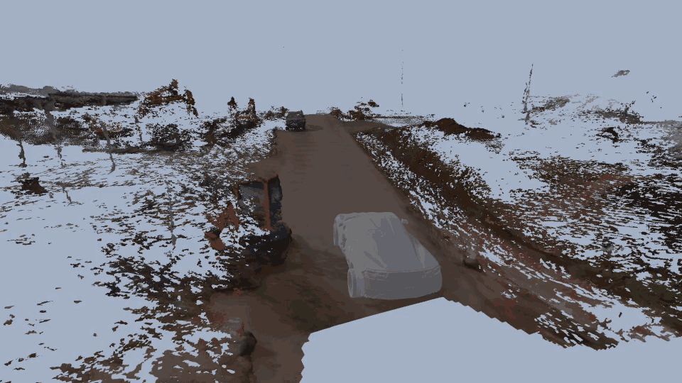
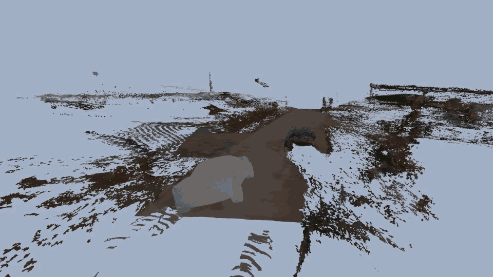
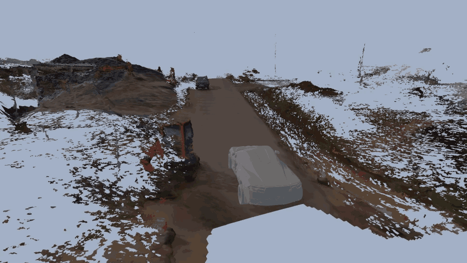
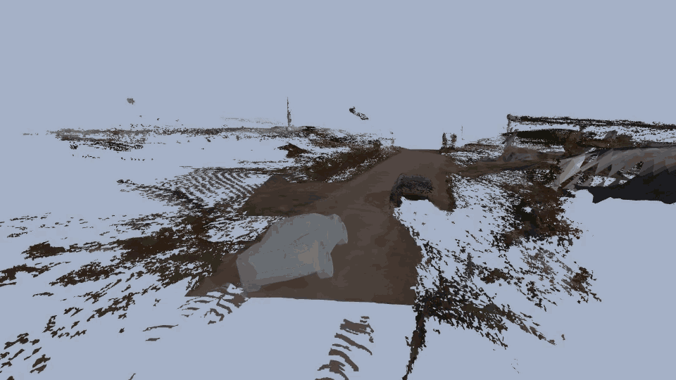
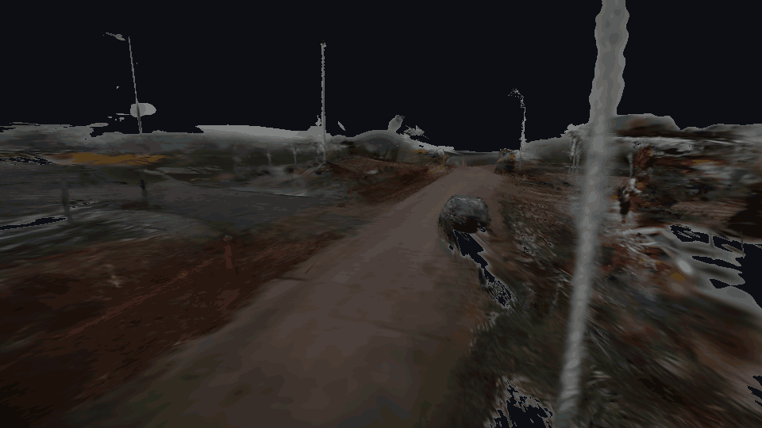
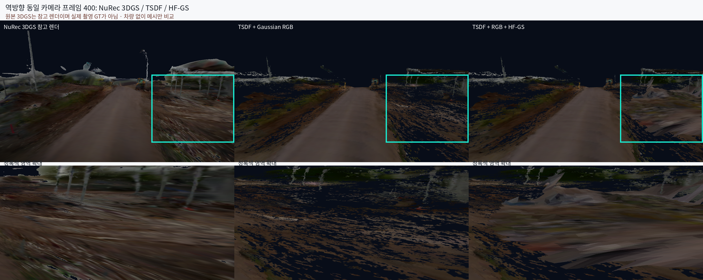

# Filling in empty areas with Generative Model

### Genesis 주행 결과

| 메시 구성 | 기존 방향 | 역방향 |
|---|---|---|
| TSDF + Gaussian RGB (기존) |  |  |
| 기존 + HF-GS (생성) |  |  |

동일한 NuRec Gaussian 렌더 깊이·RGB 기반 TSDF 메시, 35.2m 경로, Genesis 차량·카메라 조건을 사용함. HF-GS 행에는 미관측 측면의 RGB·깊이를 생성한 **시각용 패치**만 추가함. 차량의 물리 접촉은 두 행 모두 기존 도로 메시를 사용하며, 생성 패치의 형상·충돌 정확도는 검증되지 않음. 네 GIF 모두 960×540, 2배속임.

### 역방향 3DGS 원본 시점

위 GIF는 동일한 역방향 Genesis 카메라 경로로 NuRec USDZ를 다시 렌더한 것임. 주행 차량은 합성하지 않음. 저장된 `render_cameras.npz`에 첫 포즈만 반복돼 있어, 실제 주행 telemetry와 추적 카메라 설정으로 프레임별 포즈를 복구함. 원본 3DGS 렌더는 **참고 장면이지 실제 촬영 GT가 아님**.

### 동일 카메라 비교

오른쪽의 청록색 영역에서 기본 TSDF에는 빈 구역이 남고, HF-GS는 생성한 지형으로 일부를 채움. 다만 생성 지형은 원본 3DGS와 형상이 일치한다고 검증되지 않았고, 기존 메시 일부도 가림.

### 정량 확인

동일 역방향 카메라의 프레임 400, 표시한 오른쪽 영역 **95,200픽셀** 기준임. 아래 수치는 시각적 커버리지·접합 차이이며 실제 지형 정확도가 아님.

| 항목 | 값 | 해석 |
|---|---:|---|
| 원본 3DGS opacity ≥ 0.5 | 98.31% | Gaussian이 보인다는 뜻이며 정확한 표면이라는 뜻은 아님 |
| 기본 TSDF 메시가 보이는 픽셀 | 50.06% | 해당 시점에서 메시 광선이 닿는 비율 |
| HF-GS 추가 후 메시가 보이는 픽셀 | 78.49% | 기본 대비 새로 채워진 영역 **28.43%p** |
| 기존 표면과 겹쳐 깊이가 바뀐 픽셀 | 25.56% | 순수한 빈칸 채우기만 한 것은 아님 |
| 겹친 영역의 깊이 차이 | 중앙값 2.85m · 90백분위 4.07m | 두 메시 간 차이이며 GT 대비 오차가 아님 |
| 실제 3D 형상 정확도 | 평가 불가 | 독립적인 후방 RGB·깊이 GT가 없음 |

따라서 이번 HF-GS 결과는 **보이는 면적은 늘었지만, 표면 정확도나 collider 품질이 개선됐다고 결론 내릴 수 없음**.

===============
### 문제
근데 2번에 대해서, 실제 3dgs 에서는 보기에는 잘 보이는데, 이걸 메쉬화 하면 조각 조각만 남는것 같음. 이 부분은 어떻게 해결하지?

