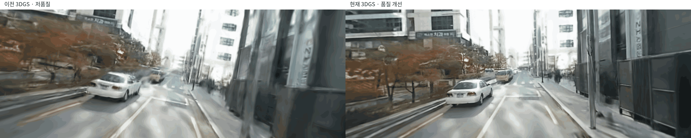
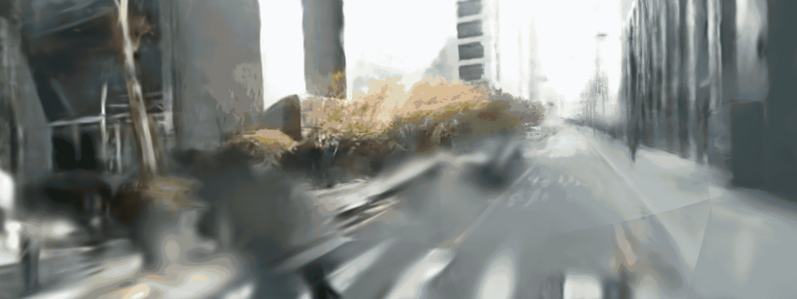
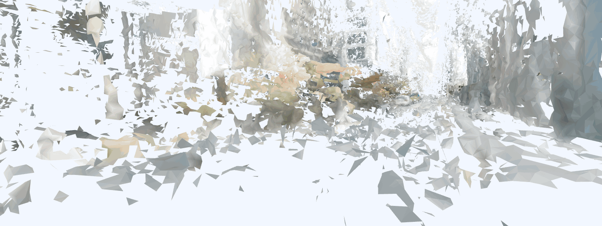
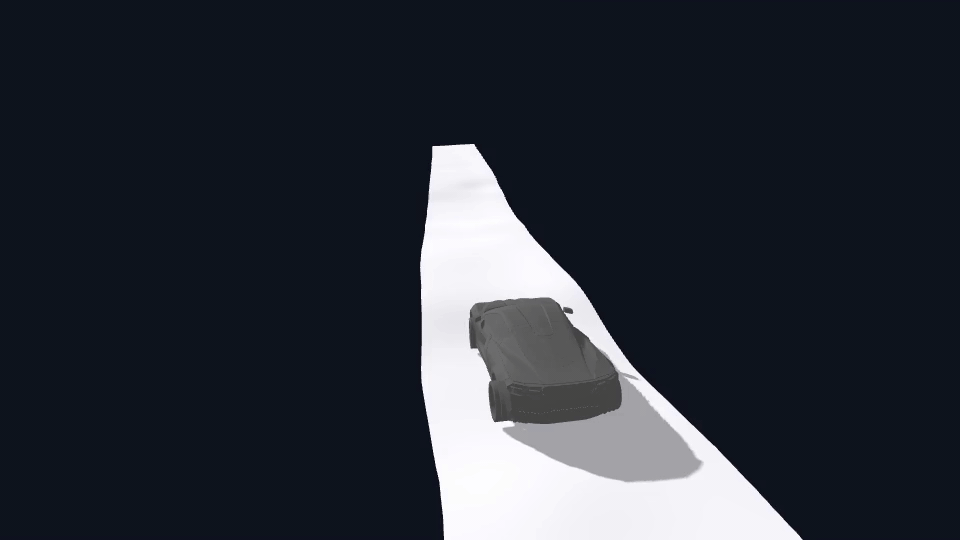

# ADI 실제 데이터 → 3DGS·Mesh·Genesis

> **현재 결과:** 360도 영상으로 4방향 3DGS 씬을 만들고 자유 시점에서 탐색함. 차량은 **별도로 만든 LiDAR 기반 도로 콜라이더** 위에서 39.2m를 완주함. 이 씬의 생성·품질 개선에 **NuRec/Instant NuRec은 사용하지 않았고, 필요하지 않았음.** 3DGS 전체를 정확한 물리 메쉬로 변환한 것은 아직 아님.

## 한눈에 보기

| 단계 | 사용한 정보 | 현재 결과 |
|---|---|---|
| 3DGS 씬 | 360도 영상 → 전·후·좌·우 가상 카메라 영상 → SfM pose → 일반 3DGS 학습 | 40초 구간·4방향·604장으로 학습. 18,000 step, Gaussian 약 189만 개. **NuRec 미사용**. |
| 장면 메쉬 시험 | 3DGS 렌더링 RGB·깊이·가시도 → 51개 시점 TSDF 융합 | 약 110만 triangle 메쉬 생성. 주변 물체와 도로가 조각나 **주행 콜라이더로는 부적합**. |
| 보행 뷰어 | 3DGS 화면 + 별도 도로·장애물 후보 메쉬 | 마우스로 시점을 돌리고 WASD로 도로 위를 이동하는 로컬 뷰어 실행. |
| Genesis 차량 주행 | LiDAR 도로 높이 → 빈틈을 보완한 좁은 연속 도로 메쉬 | 39.2m 경로 완주·정지. 주행 구간 네 바퀴 접촉률 100%. |

## 결과 영상

| ① 이전 저품질 씬 → 현재 품질 개선 씬 | ② 현재 씬의 4방향 탐색 |
|---|---|
|  |  |

| ③ 3DGS 깊이 → TSDF 장면 메쉬 | ④ LiDAR 기반 도로 메쉬 → Genesis 차량 주행 |
|---|---|
|  |  |

③의 조각난 **3DGS 유래 메쉬**와 ④의 매끈한 **LiDAR 유래 주행 도로 메쉬**는 서로 다른 결과물임. ④를 3DGS 전체 메쉬의 주행 성공으로 해석하면 안 됨. GIF는 모두 `res_wjdaksry/1018`에 있으며 해상도를 유지하고 파일당 10MB 아래로 정리함.

①은 **두 모델을 같은 가상 카메라 위치·화면 크기(각 1440×540)**로 렌더링해 비교한 영상임. 따라서 왼쪽이 흐린 것은 GIF의 픽셀 수가 적어서가 아니라 **이전 3DGS가 장면 디테일을 덜 복원한 결과**임. 두 모델의 원래 학습 입력·카메라 pose가 달랐으므로 모델 구조나 학습 step 하나의 효과만 분리한 비교는 아님.

## 왜 화질이 좋아졌나

| 원인 | 이전 | 현재 |
|---|---|---|
| 학습 영상 | 방향별 960×360 영상. 서로 대응하는 방향에 66.7~133.3ms 시차가 남음. | 같은 원본 프레임에서 4방향을 함께 추출해 동기화하고 1440×540으로 학습함. |
| 카메라 기하 | 처음 만든 영상의 K와 이후 다른 방향에 적용한 K가 달라 픽셀 기하가 섞임. Pose도 주로 후방 영상에 의존함. | 가상 카메라 K를 통일하고 4방향의 특징을 함께 이용해 pose를 다시 맞춤. 불량 트랙 제거 후 재투영 RMSE 1.760→0.932px. |
| 장면 최적화 | 12,000 step·약 84만 Gaussian. | 18,000 step·약 189만 Gaussian으로 더 많은 디테일을 표현함. 다만 **step 증가만의 효과는 아님**. |
| 뷰어 표시 | 초기 뷰어는 약 30만 Gaussian을 샘플링하고 SH0 색상만 표시함. | 전체 Gaussian과 SH3를 렌더링해 저장된 색·시점 정보를 더 온전히 보여줌. |

기존 입력에서 학습만 3,000 step 더 했을 때 PSNR은 **19.526→19.606dB**로 거의 변하지 않았음. 이번 개선은 단순히 오래 학습해서가 아니라 **입력 해상도·시간 동기화·카메라 기하·pose·표시 방법을 함께 고친 결과**로 해석해야 함. 미관측 뒷면까지 복원됐다는 뜻은 아님.

## 어떻게 만들었나

1. **입력·시점 정리:** 원본 360도 영상의 중앙은 차량 후방이고, 좌우 경계를 이어야 차량 전방임. 380–420초 구간에서 동일 시각의 전·후·좌·우 영상을 추출함. 이는 실제 카메라 4대가 아니라 **한 360도 영상에서 만든 네 가상 방향**임.
2. **3DGS 품질 개선:** 위 입력·카메라 수정 후 일반 3DGS를 18,000 step 학습함. 인접 홀드아웃 76장의 PSNR은 **22.763dB**, SSIM은 **0.7762**. **NuRec의 모델·추론·학습 기능은 사용하지 않음.**
3. **3DGS 메쉬 시험:** Gaussian 렌더러에서 픽셀별 깊이·RGB를 얻고 51개 시점에서 TSDF로 합침. **968,267 vertex·1,100,986 triangle**이 생성됐지만, 얇은 물체·가림 영역·도로는 끊기거나 떠 있음. TSDF voxel `0.03`은 **SfM 임의 좌표 단위**로, 3cm가 아님.
4. **주행용 콜라이더:** VLP-16 LiDAR의 도로 후보를 15cm 격자로 연결하고, 바퀴가 빠지던 국소 빈틈은 측정된 인근 높이에서 보간해 **연속 도로 strip(3,500 triangle)**으로 만듦. Genesis에서는 이를 바퀴 raycast용 도로로 사용하고 차량 모델을 경로 추종 제어로 주행시킴. 최종 실행은 **완주·정지 성공**, 경로 추종 오차 RMSE 약 **0.014m**, 주행 구간 네 바퀴 접촉률 **100%**였음.

## 해석과 남은 일

- **NuRec은 이 3DGS 제작에 필수 아님.** 현재 결과는 SfM과 일반 3DGS 학습으로 얻었음. NuRec의 사용 여부와 **정확한 물리 메쉬를 만들 수 있는지**는 별개의 문제임.
- 원본 ZIP에는 실제 카메라–LiDAR 외부 calibration과 프레임별 정답 6DoF pose가 없음. 현재 LiDAR↔3DGS 정렬은 **주행 궤적 기반 잠정값**이므로 센티미터급 digital twin 정확도를 주장할 수 없음.
- 3DGS가 화면에서 보이는 것과 정확한 닫힌 메쉬·콜라이더를 제공하는 것은 다름. 가려진 뒷면, 나무·차량 같은 복잡한 물체는 TSDF 메쉬에서 특히 많이 깨짐.
- 현 Genesis GIF는 **도로 메쉬와 차량**을 보여줌. 주변 풍경은 Genesis에 완성된 3DGS 메쉬로 로드한 것이 아니며, 3DGS 풍경은 별도 보행 뷰어에서 확인함.
- 다음 단계는 센서 시간·외부 보정을 검증하고, 도로 높이 오차와 장애물 위치를 대조한 뒤, 배경 물체별 시각 메쉬·충돌 메쉬를 분리해서 정리하는 것임.
