# 3DGS 장면의 Mesh화: 도로 Gaussian 분리·보정과 ADI LiDAR 비교

#### 요약

* **목표·방법:** NuRec에서 분리된 도로 Gaussian의 렌더 depth를 TSDF로 mesh화하고, 높이 격자·구멍 보정을 거쳐 Genesis 주행 가능성 검증. Gaussian RGB는 표면 색상에 활용.
* 검증 : LiDAR 형상 없이 보정한 도로 mesh에서 **24.8m 주행**, 4륜 접촉률 **100%**, 경로 오차 RMSE **4.14cm**. 해당 경로의 접촉성만 확인했으며 실제 노면 형상 정확도는 미검증.
* **NuRec의 필요성:** 
* **ADI 실제 데이터 비교:** RGB 기반 일반 3DGS의 장면 TSDF mesh는 주행용으로 부적합. **별도 LiDAR 도로 collider는 39.2m 완주**, NuRec `export-mesh`의 LiDAR Poisson 표면은 단독 주행 실패, Poisson+Gaussian TSDF 보완 표면은 **6.7m 후 전복**,
* **결론:** TSDF 변환이나 mesh 추출만으로 정밀 주행 바닥을 확보하기 어려움. 도로 분리·높이/연속성 보정이 필요하며, 최종 형상 품질은 3DGS 깊이·센서 정렬 품질에 좌우됨.

## 1. NuRec 데모: 도로 Gaussian 기반 mesh 생성

### 1.1 입력과 방법

| 구분 | 내용 |
|---|---|
| 입력 | NuRec 데모에서 객체별로 분리된 **road Gaussian**; 본 문서에서 재학습 없음 |
| 원본 NCore 데이터 | 다중 카메라 RGB·intrinsics·extrinsics, LiDAR, ego pose |
| 도로 mesh 생성에 사용 | Gaussian 렌더 depth·RGB·가시도, 가상 카메라 pose·intrinsics |
| 도로 mesh 생성에 미사용 | **LiDAR geometry, stereo depth, ego pose의 Z 높이** |

* **관측 배치:** 가상 카메라의 Gaussian RGB·depth·가시도·opacity 추출 → pose·intrinsics로 공통 좌표에 배치
* **깊이 선별:** 낮은 가시도·가려진 도로·시점 간 불일치 제거
* **형상 생성:** 선별한 depth → TSDF 융합 → triangle mesh 추출
* **색상 생성:** Gaussian RGB → mesh 표면에 투영
* **주행용 보정:** 도로 높이 격자·작은 구멍 보완 후 바퀴 접촉 확인; 더 넓은 구간에는 평탄화·연속성 후처리 추가 필요

> **깊이 구분:** Gaussian rendering depth = 3DGS 렌더 깊이 · stereo depth = 두 영상의 시차로 추정한 깊이

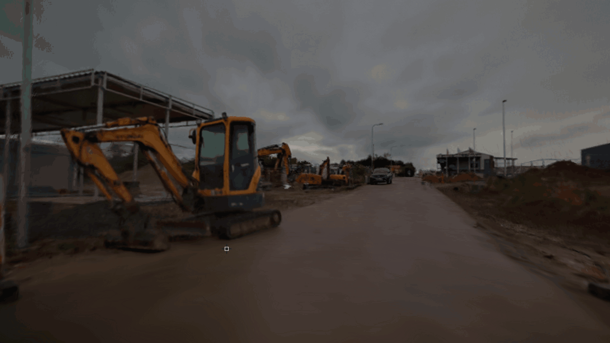

| 원본 Gaussian 도로 | Gaussian depth → TSDF → 색을 입힌 도로 mesh |
|---|---|
| 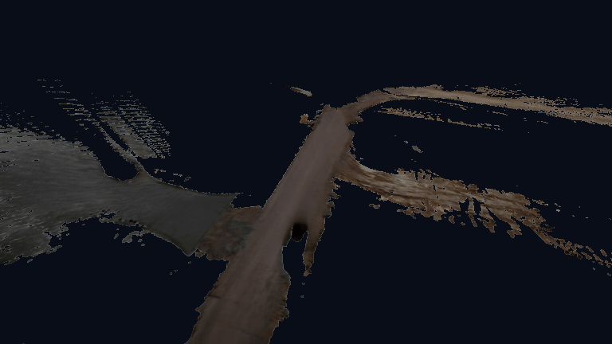 | 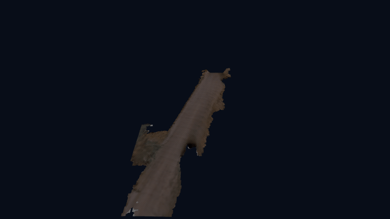 |

### 1.2 도로 집중 복원과 Genesis 시험

* **형상:** road Gaussian depth → **5cm TSDF** → **10cm 도로 높이 격자**; 관측 도로의 **30cm 이내 작은 구멍**만 보완
* **Genesis:** 생성 mesh를 화면 표시·RayWheel 접촉에 적용, 별도 ground plane 없이 **24.8m 주행**
* **지표:** 4륜 접촉률 **100%**, 경로 오차 RMSE **4.14cm**
* **검증 범위:** 도로 Gaussian 선별·TSDF·높이 격자 보정 후 해당 경로의 접촉 가능한 표면 확인; 실제 노면 높이·요철과 넓은 미관측 영역의 형상 정확도는 미검증

| 도로 mesh 형상 | Gaussian RGB를 반영한 도로 mesh | Genesis 도로 주행 |
|---|---|---|
| 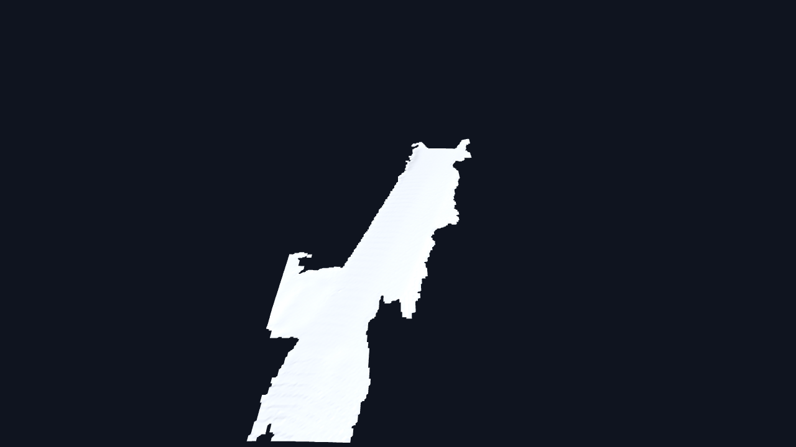 | 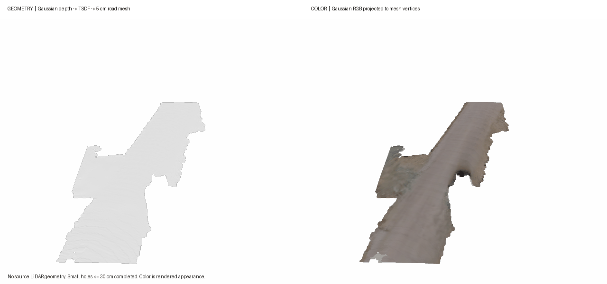 | 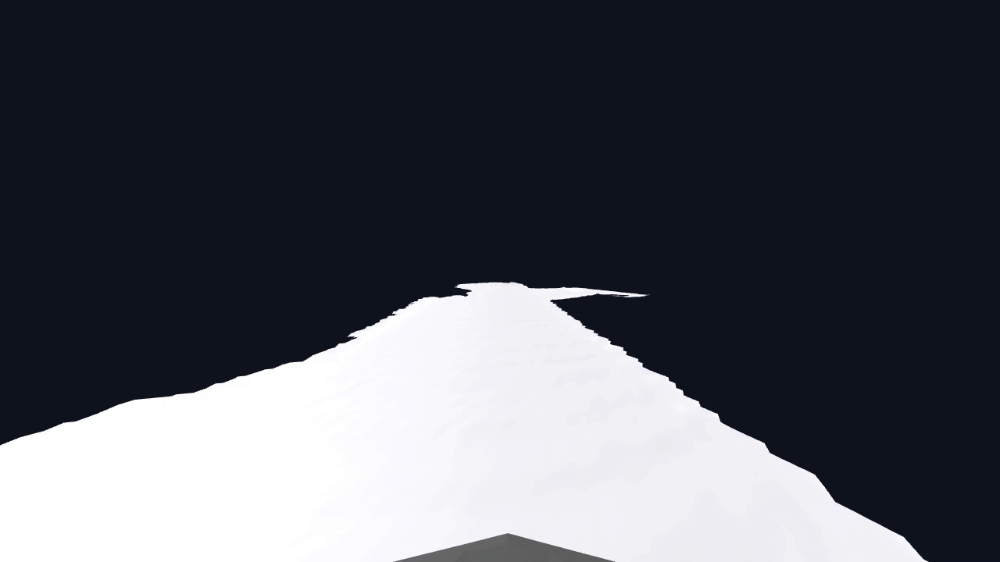 |

### 1.3 배경 확장과 한계

* **확장:** 배경 Gaussian depth로 건물·지형의 관측면 mesh화
* **남은 문제:** 포크레인·나무·가로등의 끊김·부유 조각·빈 영역; 미관측 뒷면 복원 불가
* **영상 범위:** 도로·배경 표시 및 주행; 배경 전체의 물리 충돌 정확도 미검증

| 도로 + 배경 mesh | 도로 + 배경 Genesis 표시·주행 |
|---|---|
| 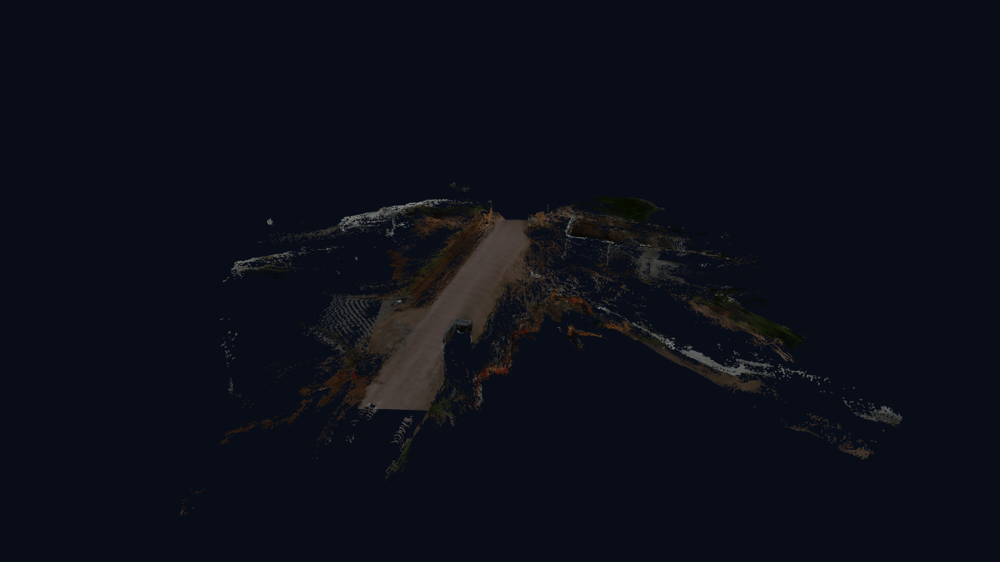 |  |

## 2. ADI 실제 데이터: LiDAR 보유와 활용 범위

* **보유 데이터:** AroundView 360도 RGB, VLP-16 LiDAR, GPS
* **미제공:** 정답 camera–LiDAR extrinsic, 프레임별 6DoF pose
* **해석 기준:** 데이터의 LiDAR 보유 여부와 **각 실험의 LiDAR 사용 여부**를 구분

### 3DGS Scene 검증

3DGS scene 

| GT: ADI 원본 전방 RGB | 3DGS 장면(18,000 step) |
|---|---|
| 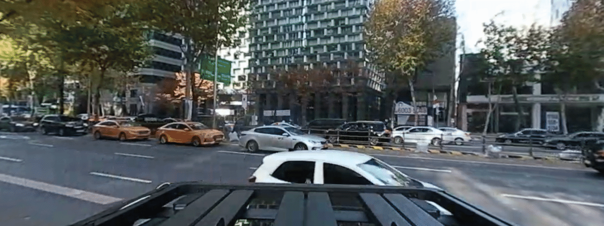 | 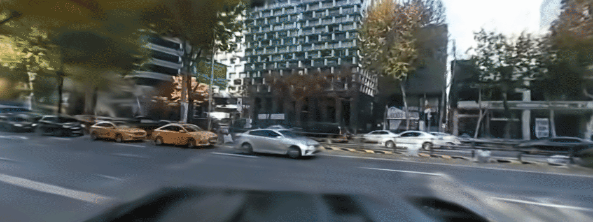 |

**원본 RGB 대비 정량 비교** — 같은 시점의 원본 영상과 일반 3DGS 렌더를 비교. 방향별 19장씩, 총 76장.

| 방향 | PSNR ↑ | SSIM ↑ | 판정 |
|---|---:|---:|---|
| 전방(위 GIF) | 22.09 dB | 0.743 | 큰 도로·건물 구조 재현, 차량·보행자·경계부 흐림 |
| 좌측 | 24.74 dB | 0.800 | 네 방향 중 구조 유사도 최고 |
| 우측 | 24.86 dB | 0.776 | 네 방향 중 PSNR 최고 |
| 후방 | 22.84 dB | 0.777 | 전체 구조 재현, 세부 품질은 별도 확인 필요 |
| **전체 평균(76장)** | **23.63 dB** | **0.774** | **기록된 시점의 외관은 재현; 정밀 형상 검증과는 별개** |

* **평가 범위:** 학습에 사용된 기록 시점의 RGB 기준, 각 프레임 지표의 산술평균. 아래 2.1절의 **미사용 영상 76장** 평가와 별개이며, 새 시점의 일반화 또는 도로 mesh·collider 정확도를 뜻하지 않음.
* **해석:** PSNR·SSIM은 높을수록 원본 RGB에 가까움. 움직이는 물체, 미관측 면, 얇은 구조의 흐림·누락은 평균값만으로 판단 불가.

#### Realworld data 로 mesh 생성 기록

| Real World data 실험 | 사용한 데이터 항목 | 실제 LiDAR 사용 | 결과 |
|---|---|---|---|
| 일반 3DGS + TSDF (2.1) | 360도 RGB, COLMAP 추정 pose, Gaussian depth·RGB·가시도 | 미사용 | 장면 mesh 생성, 주행 collider 부적합 |
| 별도 LiDAR 도로 collider (2.4) | VLP-16 도로 점군 | 사용 | Genesis **39.2m 완주** |
| `export-mesh` Poisson + Gaussian TSDF 보완 (2.4) | VLP-16 점군 + Gaussian depth·RGB | 사용 | Poisson 단독 주행 실패; 융합 후 **6.7m 부분 주행·미완주** |

### 2.1 ADI RGB → 일반 3DGS → 장면 TSDF mesh

| 단계 | 처리·결과 |
|---|---|
| 입력 영상 | 360도 영상 **380–420초** → 동시각 전·후·좌·우 가상 영상 **604장**; 실제 카메라 4대가 아닌 **단일 360도 카메라 재투영** |
| 카메라 경로 | intrinsics 통일, **SfM(영상 특징 기반 카메라 자세 추정)**을 통한 pose 보정; 정답 extrinsic·6DoF pose 부재로 **추정 좌표계** 사용 |
| 3DGS 학습 | 일반 3DGS **18,000 step**, 약 **189만 Gaussian** |
| 렌더 개선 요인 | 입력 해상도·시간 동기화·카메라 기하·pose 수정, 전체 Gaussian/SH3 렌더링 |
| 영상 평가 | 인접 미사용 영상 **76장**: PSNR **22.763 dB**, SSIM **0.7762**; 자유 시점 품질은 미보장 |

* **장면 mesh:** **51개 시점**의 Gaussian RGB·depth·가시도 → TSDF → 약 **97만 vertex·110만 triangle**
* **판정:** 도로·주변 구조의 조각화로 주행 collider 미채택

### 2.2 ADI LiDAR → Nurec 3DGS → export-mesh + 후처리

같은 ADI LiDAR를 사용했지만 **별도 도로 collider**, **NuRec `export-mesh` 출력**, **Gaussian TSDF로 보완한 Poisson 도로**는 서로 다른 물리 표면이다.

| 도로 표면 | 생성·처리 | Genesis 결과 |
|---|---|---|
| **별도 LiDAR 도로 collider** | LiDAR 도로 표면 생성 | 약 **39.2m 완주·정지** |
| **NuRec `export-mesh` Poisson** | LiDAR **151개 스캔·약 346만 점** → 법선 추정·Poisson 표면 | 도로 구멍·돌출로 **단독 연속 주행 실패** |
| **Poisson + Gaussian-depth TSDF·RGB** | Poisson 도로의 일부 빈 셀 보완·RGB 텍스처 적용 | 약 **6.7m** 주행 후 전복, **미완주** |

#### 별도 LiDAR collider: 주행 성공

* **결과 해석:** 아래 39.2m 완주는 별도 LiDAR 도로 collider의 결과. 왼쪽 3DGS 장면 TSDF mesh나 아래 `export-mesh`·융합 도로의 주행 성과와 구분.

| ADI 3DGS 장면 TSDF mesh: 주행용 미채택 | 별도 LiDAR 도로 collider: Genesis 완주 |
|---|---|
|  |  |

#### `export-mesh`: LiDAR Poisson 표면 주행 실패

* **입력·정렬:** VLP-16 스캔 **151개·약 346만 점** → LiDAR odometry·추정 좌표 변환으로 NuRec world에 배치. Gaussian을 직접 삼각형으로 변환한 결과가 아님.
* **추출:** 인접 64점으로 법선 추정 → Poisson mesh → 관측점에서 **22.5cm 초과** 거리의 면 제거. **1,471,359 vertex·2,701,585 triangle** PLY·USD 생성, 약 **33초**.
* **한계:** **6,608개 연결 조각**, 최대 조각 약 **198만 triangle**. 추정 궤적 정렬 RMSE 약 **0.98m**; 정답 extrinsic·스캔 내부 움직임 보정·동적 물체 제거 없음.

| `export-mesh` 전체 표면 회전 | 기존 전방 카메라 경로에서 본 표면 |
|---|---|
| 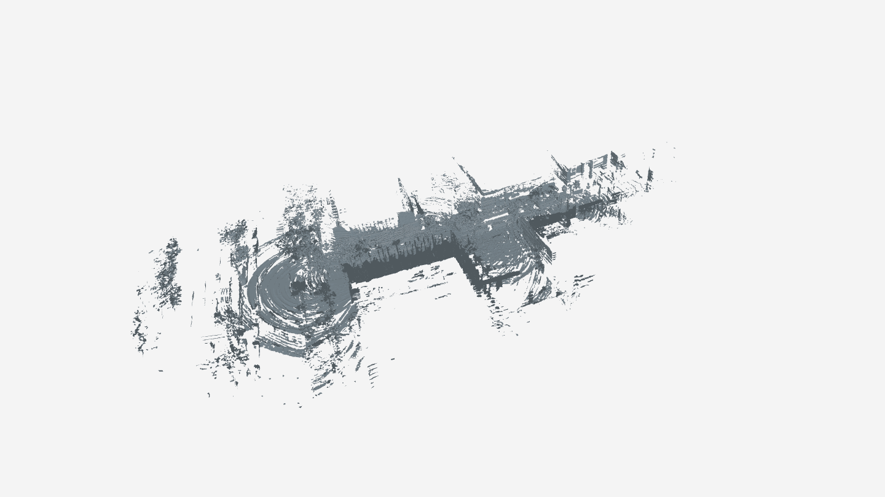 | 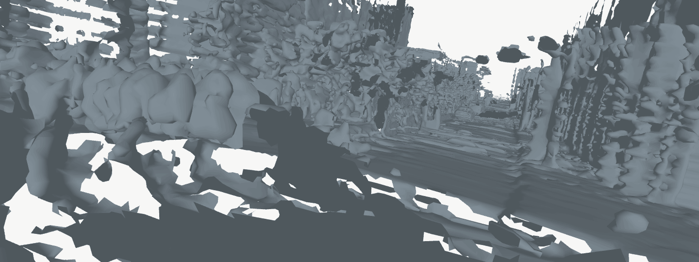 |

* **GIF 해석:** 회색 표시용 재질·카메라 이동 렌더이며 차량 주행 영상은 아님. 원본 약 270만 triangle 유지, GIF 표시용만 80만 triangle으로 축소.

#### export-mesh + Gaussian depth·RGB: 부분 주행 실패

| 항목 | 처리·결과 |
|---|---|
| 바닥 정렬 | LiDAR Poisson 도로 → **10cm 격자**; Gaussian depth TSDF → 동일 Z-up 미터 좌표, 높이 차이 약 **−0.35m 보정** |
| 빈 곳 보완 | 높이가 맞는 **141개 셀** 채움; 30cm 이하 작은 구멍 **766개 셀** 보간·돌출 완화; 큰 미관측 영역 **945개 셀** 잔존 |
| 색·텍스처 | Gaussian RGB 투영: 도로 정점 **17,602개** 색 적용, **5,322개** 회색 유지; UV 텍스처 GLB·주변 Poisson 정점 색 적용 |
| 물리 시험 | 융합 도로 mesh에 RayWheel 접촉, 평면 fallback 없음; 경로 23번에서 **6.7m**, 약 **3.75초** 후 전복 → **미완주** |

* **해석:** TSDF 관측 범위 부족 및 Poisson 높이·센서 정렬 오차 잔존. RGB 적용은 외관 개선이며 빈 형상·물리 표면 생성과 별개. 차체 전체 triangle 충돌은 미검증.

| 융합 mesh·Gaussian RGB 텍스처 | Genesis 부분 주행·실패 구간 |
|---|---|
| 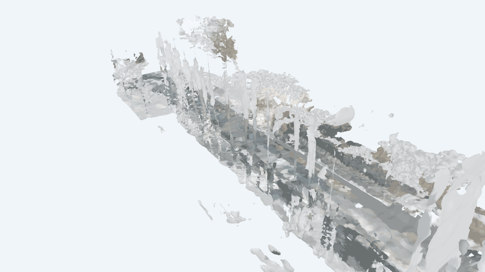 | 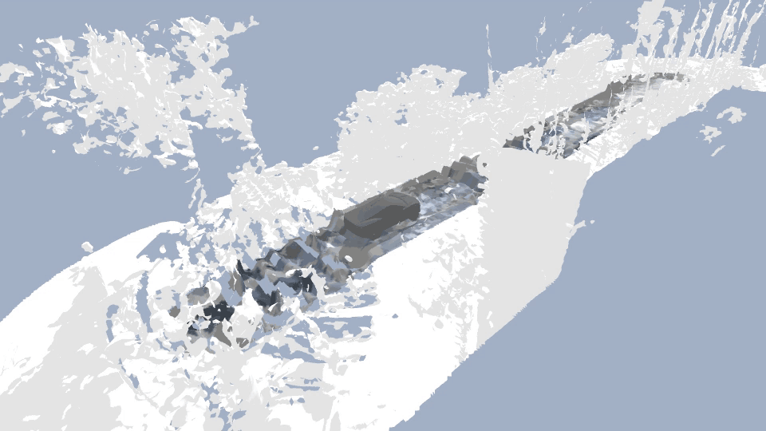 |

#### LiDAR 도로 + 배경(export-mesh·Gaussian depth) + Gaussian RGB

**LiDAR 바닥에서 14m 주행·정지 성공. 배경은 메쉬·텍스처를 고해상도화했지만 단절이 남음.**

| UV 없는 메쉬 회전 — 형상 확인 | UV 포함 Genesis 주행 — 외관·접촉 확인 |
|---|---|
| 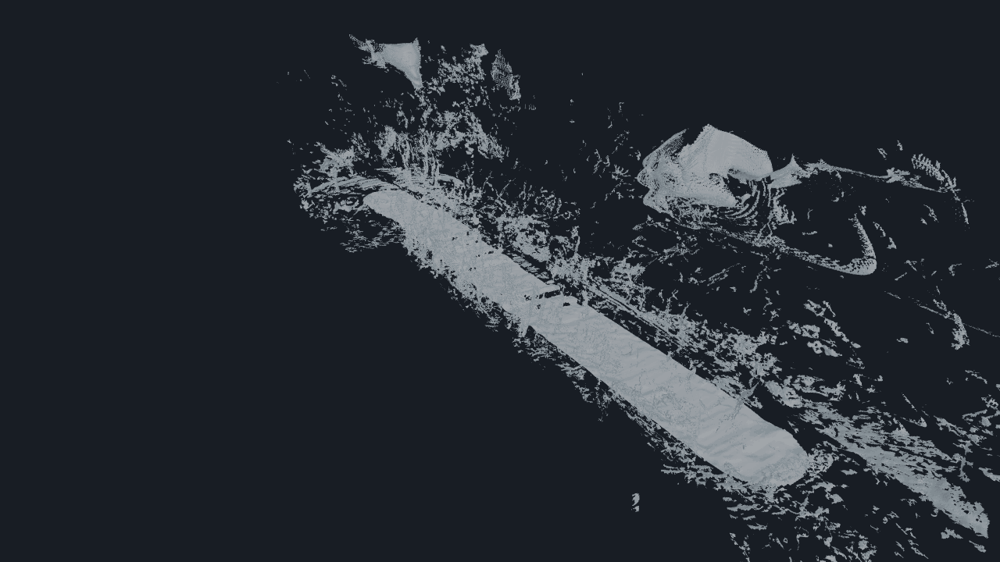 | 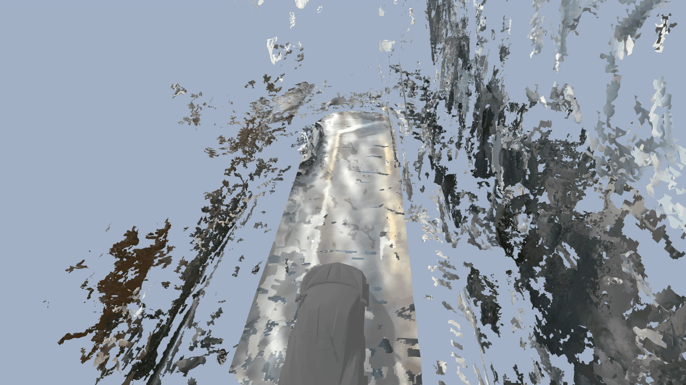 |

| 구분 | 사용 데이터·방법 |
|---|---|
| 바닥 형상 | 기존 **LiDAR 기반 지지면 + 일치하는 원본 LiDAR 잔차**, 5cm 격자. Gaussian depth·ego Z로 높이를 생성하지 않음 |
| 배경 형상 | NuRec **export-mesh의 LiDAR Poisson 깊이 + Gaussian rendering depth → TSDF 융합**. 구조물 3.5cm·얇은 물체 2cm·식생 5cm 복셀 |
| 색·텍스처 | **Gaussian RGB → 텍셀별 UV 투영**. 바닥 8192×1024, 배경 약 13K 텍스처 |
| 주행 결과 | 동일 14m 경로 도착·정지, **네 바퀴 접촉률 100%**. 별도 평면 바닥 없음 |

- **입력:** ADI LiDAR 및 학습된 ADI NuRec 장면의 가상 카메라 RGB·depth **320시점(4방향 × 80)** 사용.
- **해석:** 바닥 시각 메쉬와 바퀴 접촉 메쉬는 동일 형상. 배경은 현재 시각용이며, 차체–배경 충돌은 미검증.
- **남은 한계:** 센서 정렬은 추정값이며 배경 단절·미관측 영역 잔존. **5cm 격자가 5cm 실측 정확도를 의미하지는 않음.**
- **생성 시간:** 약 238만 면의 UV 전개·13K 텍스처 처리로 시간 증가. UV 없는 GIF는 같은 형상의 단색 미리보기이며, UV 제거로 빈 형상이 채워지는 것은 아님.
