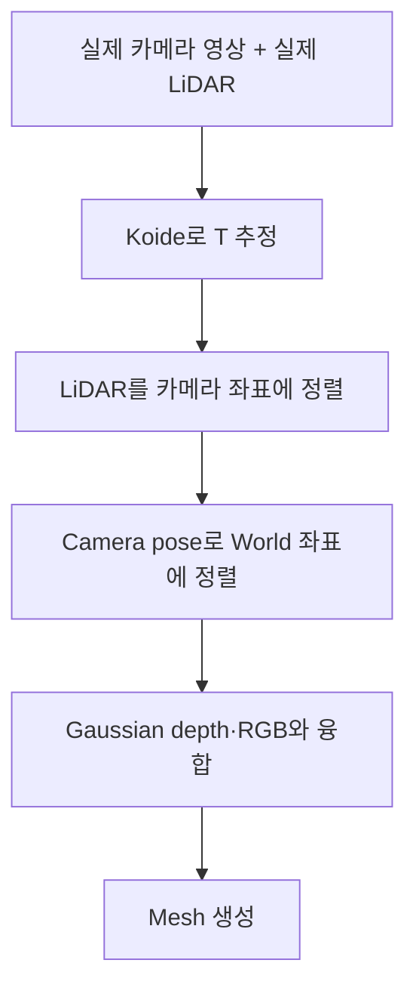
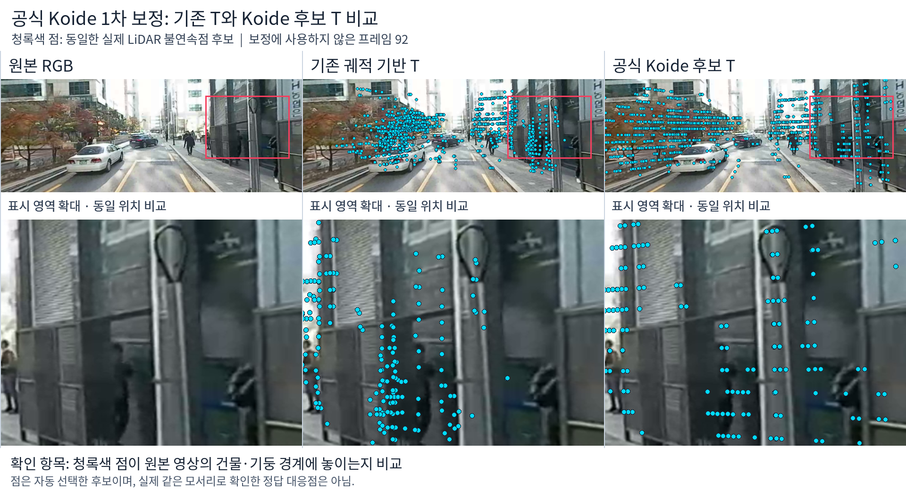
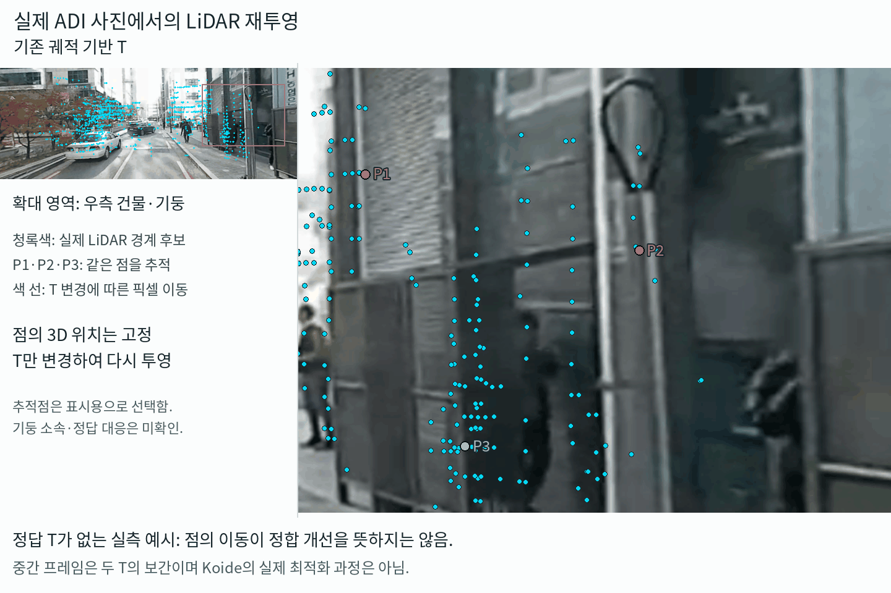
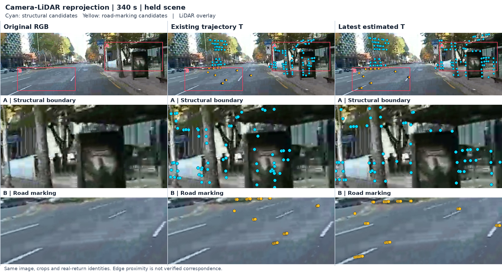
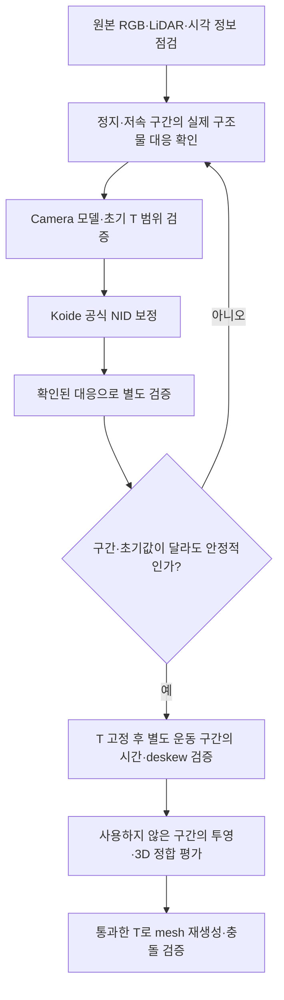

# ADI Camera–LiDAR 외부 보정(T) 추정 결과

**결론: Koide 공식 프로그램과 후속 보강 실험으로 T 후보를 확보함. 별도 장면에서 정합이 일관되게 개선되지 않아, 정밀한 물리 보정값으로 확정하지 않음.**

* 수행: Koide 공식 보정 프로그램을 실행하고, 시간 동기화·LiDAR 움직임 보정(deskew)·다구간 정합을 추가해 \(T\) 후보를 추정.
* 결과: 최신 후보는 기존 \(T\)보다 도로 표식 경계 거리를 40.63→11.34px로 줄였지만, 구조물 경계 거리는 7.17→8.63px로 악화. 사용 구간을 바꾸면 추정 위치도 최대 25.63cm 달라짐.
* 판단: 실제로 같은 물체를 가리키는 영상–LiDAR 대응점과 실측 정답이 없어 물리 정확도는 미검증. 현재 \(T\)는 실험용 후보로만 사용.
* 다음 단계: 정지·저속 구간에서 실제 대응점을 확인하고, 사용하지 않은 구간에서 \(T\)와 시간·deskew를 각각 검증한 뒤 mesh와 collider를 재평가.

## 1. 결론 요약

| 항목 | 실행 결과 |
|---|---|
| 공식 프로그램 적용 | Koide `calibrate` 실행 완료 |
| T 추정 | 후보 행렬 확보 및 자체 보강 실험 수행 |
| 정합 개선 | 도로 표식 개선, 구조물 경계 악화 |
| 추정 안정성 | 동일 입력에서는 반복 수렴. 구간 변경 시 변동 잔존 |
| 물리 정확도 검증 | 미완료. 실측 정답·검증된 동일점 대응 부족 |

**핵심 과제: LiDAR 반환점과 영상 구조물 사이의 실제 대응을 검증하고, 이를 기준으로 추정 T의 정확도를 평가함.**

## 2. 추정 목표와 변환 정의

**목표: LiDAR의 실제 3D 점이 카메라 영상의 같은 물체 위치에 투영되도록 센서 간 회전·이동을 구함.**

```text
p_camera = R · p_lidar + t
T_camera_lidar = [R, t; 0, 1]  ← 4×4 homogeneous transform
```

| 구분 | 의미 |
|---|---|
| T, extrinsic | LiDAR 좌표 → 카메라 좌표 변환. 센서 장착이 고정되면 일정한 값 |
| Camera pose | 시간에 따라 달라지는 카메라의 World 위치·방향 |
| 시간 offset | 영상과 LiDAR가 실제 같은 시각을 관측하도록 맞추는 시간 차이 |
| 필요한 이유 | LiDAR geometry와 카메라/Gaussian RGB·depth를 같은 공간에 합치기 위함 |

ADI에서 확인한 자료에는 **검증된 Camera–LiDAR extrinsic이 없음**. 우리가 만든 NCore에는 추정한 T를 반영했으며, NCore 변환이나 NuRec 실행이 보정 정답을 새로 제공한 것은 아님.

## 3. Koide 적용 방법

**Koide는 카메라와 LiDAR 사이의 extrinsic T를 추정하는 오픈소스 도구**인 `direct_visual_lidar_calibration`을 뜻함. 여기서는 개발자 이름을 따서 Koide로 부름.

### 3.1. 입력과 추정 대상

LiDAR 점은 LiDAR 좌표계에 있고, 영상은 카메라 좌표계에 있음. 두 데이터를 겹치려면 센서 간 **회전 R과 이동 t**가 필요함.

```text
p_camera = R · p_lidar + t
```

Koide는 이 관계를 찾아 **LiDAR 점이 영상의 적절한 위치에 투영되도록 보정**함.

| 입력 | 사용하는 정보 |
|---|---|
| 실제 카메라 영상 | 영상의 픽셀 밝기 |
| 실제 LiDAR | 3D 점 위치·반사강도 |
| 카메라 모델 | 3D 점을 영상 픽셀로 투영하는 방법 |
| 초기 T | 최적화를 시작할 때 넣는 대략적인 회전·이동 |

### 3.2. NID 기반 최적화

> Normalized Information Distance

우리가 실행한 정합 방식은 다음과 같음.

1. **초기 T로 LiDAR 점을 영상에 투영**함.
2. **투영 위치의 영상 밝기와 LiDAR 반사강도의 통계적 관계를 평가**함.
3. **NID 비용이 작아지는 방향으로 T의 회전·이동을 조정**함.
4. 위 과정을 반복하여 T 후보를 출력함.

**NID(Normalized Information Distance)**는 두 센서 관측 사이의 정보 관계를 평가하는 비용임. 카메라 밝기와 LiDAR 반사강도는 서로 다른 물리량이므로, 두 값이 동일해야 하는 것은 아님.

**BFGS·Nelder–Mead는 T를 수정하는 최적화 방법**임. 입력 센서나 출력 T의 의미가 달라지는 것은 아님.

초기 T는 수동 대응이나 자동 대응으로 설정할 수 있음. [공식 프로그램 설명](https://koide3.github.io/direct_visual_lidar_calibration/programs/)

### 3.3. 메시 생성 Pipeline에서의 역할



**Koide는 메시 생성 이전의 센서 정렬을 담당함.** World 좌표 변환에는 시간별 camera pose가 추가로 필요함.

### 3.4. 실제 실행한 실험

우리 ADI 실험에서는 공식 프로그램으로 T 후보를 얻었지만, 초기값·사용 구간에 따라 결과가 달라졌음. 이후 시간 정렬·deskew·윤곽선 정합 등을 추가함.

| 단계 | 우리가 실제 실행한 내용 | 구분 |
|---|---|---|
| 입력 구성 | 원본 360 영상에서 가상 정면 영상 추출, VLP-16(LiDAR) 실제 점·반사강도 사용 | 자체 데이터 변환 |
| 공식 1차 보정 | 학습 8프레임·검증 5프레임. 시간 후보 3종 × 위치 초기값 2종 × BFGS/Nelder–Mead, 총 12회 | **Koide 공식 `calibrate`** |
| 원본 360 보정 | `equirectangular` 모델로 전체 영상 사용, 초기값 3종 비교 | **Koide 공식 `calibrate`** |
| 시계·움직임 보강 | GPS/NMEA·PCAP 시계 관계, 영상 PTS, 발사 시각별 deskew 반영 후 공식 NID 재실행 | 자체 전처리 + **Koide 공식 보정** |
| 윤곽선 보강 | 정적 semantic 영역에서 LiDAR 불연속점과 영상 경계 간 거리 정제 | **자체 구현**, Koide 공식 기능과 구분 |
| 다구간 추정 | 구조물 경계·도로 표식 결합, 여러 초기값·구간 제외 검증 | **자체 구현**, 최신 후보 T를 만든 단계 |

**현재 최신 T는 자체 다구간 구조물 경계·도로 표식 정합에서 나온 후보임.** 공식 Koide 출력 그대로는 아니며, 물리적으로 정확한 T인지에 대한 검증은 아직 남아 있음.

전체 흐름은 **공식 Koide 실행 → 결과의 불안정성 확인 → 자체 전처리·정합·검증 보강**임.

실행 범위:

- 공식 Docker `koide3/direct_visual_lidar_calibration:humble` 사용.
- 1차 입력은 PNG·intensity PLY로 직접 구성. ROSbag 전처리·SuperGlue 자동 초기화는 미사용.
- 이후 SuperPoint/SuperGlue 자동 대응도 별도 시험했으나, PnP RANSAC이 실패해 채택하지 않음.

**보정 입력은 실제 영상과 실제 LiDAR임. Gaussian 렌더링 depth를 보정의 정답으로 사용하지 않음.** 기존 궤적 기반 T도 비교 후보이며 정답이 아님.

## 4. 실행 결과

### A. 공식 Koide 1차 보정 결과

**결론: Koide 적용 후 LiDAR 점의 투영 위치는 바뀌었지만, 기존 T보다 정확하게 정렬됐다는 근거는 확보하지 못함.**

#### A.1. 정합 목표와 기존 결과

**목표: 카메라가 이동해도 같은 T를 사용하여, LiDAR가 관측한 물체와 영상 속 같은 물체의 정합을 유지함.**

> 정합(registration)은 서로 다른 센서가 관측한 같은 물체를, 같은 위치에 맞추는 것임.

예를 들어 기둥을 지나가면 화면 속 기둥의 위치·크기는 달라지고, LiDAR도 매 scan에서 다른 표면 지점을 측정할 수 있음. 그래도 **기둥에서 측정된 점은 각 시각의 영상에서도 해당 기둥 표면에 투영**되어야 함. 모든 점을 기둥 테두리에 모으거나 화면의 점 배열을 고정하는 것이 목표는 아님.

정적인 물체의 3D geometry를 여러 시각에 걸쳐 같은 World 위치에 복원하려면, 고정된 센서 간 T(transformation)와 함께 **시간별 pose·센서 동기화·deskew**도 정확해야 함. T만으로 누적 geometry의 일관성이 보장되는 것은 아님.

| 구분 | 기대하는 상태 | 기존 결과 |
|---|---|---|
| 한 시각의 영상–LiDAR 정합 | 실제 같은 물체·표면에 점이 투영됨 | 궤적으로 추정한 T 사용. 정확한 물체 대응은 미검증 |
| 이동 중 정합 | 같은 T로 여러 시각·거리에서도 정렬 유지 | 검증된 동일 구조물 대응에 기반한 일관성 확인 부족 |

기존에는 궤적으로 추정한 T를 사용함. 아래 A.2의 정지 이미지에서 **가운데 열이 기존 T의 결과**임. 청록색은 **거리·반사강도가 급격히 변하는 실제 LiDAR 불연속점 후보**이며, 기둥 segmentation 결과가 아님. 건물·나무·차량 등의 점이 섞일 수 있어 기존 투영도 정답으로 취급하지 않음.

#### A.2. Koide 이후 결과

Koide로 영상 밝기·LiDAR 반사강도의 NID 비용을 줄이도록 T를 조정한 뒤, **기존 T와 공식 Koide 후보 T를 각각 고정 적용하여 같은 scan을 재투영**함. 이후 자체 보강으로 추정한 최신 T와는 별개의 결과임.

**실제 결과 비교 — 정지 이미지**



> **좌측은 원본 RGB, 가운데는 기존 T, 우측은 공식 Koide 후보 T**임. 같은 사진·확대 영역·실제 LiDAR 불연속점 후보 1,129개를 사용함. 최적화에 사용하지 않은 프레임 92의 예시이며, 화면에서 점이 이동한 것과 실제 정합 개선은 구분해야 함.

**투영 원리 설명 — T 보간 GIF**



> 점의 3D 위치를 고정하고 **기존 T → Koide 후보 T → 기존 T**로 전환함. P1·P2·P3는 같은 실제 점을 추적한 표시이며, 색 선은 픽셀 이동을 뜻함. **중간 화면은 두 T의 보간으로, 실제 최적화 과정·카메라 이동·정답 위치까지의 오차를 나타내지 않음.**

두 자료 모두 점을 수동으로 경계에 배치하지 않음. 다만 점의 실제 물체 소속·정답 대응이 미확인 상태이므로 **이 사진과 GIF만으로 T의 정확도를 판정할 수 없음.** 이동 중 일관성은 T를 고정하고 서로 다른 실제 시각의 영상·LiDAR 쌍으로 별도 검증해야 함.

#### A.3. 정합 개선 평가

두 T에서 모두 보이는 **동일 scan·동일 LiDAR 점**으로 비교함. 아래 값은 최적화에 쓰지 않은 검증 5프레임의 지표 평균이며, 모두 작을수록 좋음.

**이 표는 단일 GIF에서 계산한 값이 아니라, 별도 5프레임의 정합 진단 결과임.** 실제 동일 구조물의 정답 대응에 기반한 연속 주행 검증은 아님.

| 지표 ↓ | 기존 궤적 기반 T | Koide 선택 후보 | 판단 |
|---|---:|---:|---|
| NID | 0.98043 | 0.98062 | 소폭 악화 |
| 영상 경계 거리 median 평균 | 3.14px | 3.61px | 악화 |
| 영상 경계 거리 P90 평균 | 17.48px | 21.38px | 악화 |

경계 거리는 **투영한 LiDAR 경계 후보에서 가장 가까운 영상 경계까지의 거리**임. 실제 같은 모서리로 확인된 대응의 재투영 오차는 아님. 이번 비교에서는 이 보조 지표조차 median **3.14→3.61px**, P90 **17.48→21.38px**로 악화함.

또한 동일 시간·최적화 방식에서 초기 위치를 달리하면 최종 translation이 **3.73m**, 회전이 **2.91°** 달라졌음. 초기값은 최적화를 시작할 때 넣는 대략적인 T이며, 이 차이는 **시작점에 따라 서로 다른 해에 수렴했다는 의미**임. 실측 정답 대비 오차가 3.73m라는 뜻은 아님.

| 평가 항목 | 판단 |
|---|---|
| 공식 프로그램 실행·T 후보 출력 | 완료 |
| 기존 T 대비 별도 프레임 정합 개선 | 확인하지 못함. 위 세 보조 지표는 악화 |
| 초기값 변경에 대한 안정성 | 부족 |
| 실제 동일점 기준의 물리 정확도 | 대응 정답 미확보로 평가 불가 |
| 현재 적용 판단 | 정밀 보정값으로 미채택. 후속 보강·검증 필요 |

이 결과를 바탕으로 B에서는 시간 동기화·deskew를 보강하고, C에서는 여러 구간을 사용하여 T를 추가 추정·검증함.

### B. 시간 동기화·Deskew 및 정합 보강 결과

**보강 목적: 센서 간 시각 불일치와 차량 이동에 따른 scan 왜곡을 줄임.**

Deskew는 LiDAR가 한 바퀴 도는 동안 차량이 움직인 영향을 보정하여, 각 점을 같은 기준 시각의 좌표로 옮기는 처리임.

| 보강 | 확인한 결과 | 한계 |
|---|---|---|
| 공통 시각 정렬 | 영상 PTS·메타데이터, PCAP·VLP/NMEA UTC 관계 확인 | 실제 카메라 노출 지연은 미확정 |
| 발사 시각별 deskew | 고정된 검증 대응에서 scan point-to-plane RMSE **8.35→6.97cm** | 정밀 실측 GT가 아닌 scan 간 일관성 지표 |
| Koide + 자체 윤곽선 정제 | 검증 경계 거리 **3.11→3.40px** | 학습 비용은 감소했으나 검증에서는 악화 |
| LiDAR·SfM·GPS 공동 최적화 | 영상 잔차 감소, LiDAR 잔차 악화 | 모든 센서가 함께 개선되지 않아 미채택 |

**시각을 맞추는 것과 정확한 T를 찾는 것은 별도 문제임.** 시계 변환 잔차가 작아도 노출 지연·스캔 운동·360 stitching 오차가 남을 수 있음.

### C. 다구간 T 추정 및 별도 장면 검증 — 2026-10-24

**보강 목적: 여러 구간의 관측을 함께 사용하여 추정값의 장면 의존성을 평가함.**

| 항목 | 적용 |
|---|---|
| T 추정에 사용 | 원본 영상 30·180·300·450초 |
| 별도 검증 | 240·340·360·500초 |
| 영상 방향 | 각 시점의 전후좌우 가상 카메라 |
| 시간 가설 | 카메라 UTC `t` ↔ LiDAR `t−0.37초` |
| 움직임 보정 | 발사 시각별 deskew |

**−0.37초는 실험에서 사용한 시간 가설이며, 실측한 카메라 노출 지연은 아님.**

| 별도 장면 지표 ↓ | 기존 궤적 기반 T | 이전 Koide T | 최신 다구간 T |
|---|---:|---:|---:|
| 구조물 경계 거리 | **7.17px** | 8.26px | 8.63px |
| 도로 표식 경계 거리 | 40.63px | 11.42px | **11.34px** |

평가 조건:

- 후보마다 **동일한 원본 반환점** 사용.
- 구조물: 시점·방향별 평가 기록 16개, 2,059점. 도로 표식: 기록 9개, 208점.
- 기록별 median을 평균하고 1440×540 영상의 픽셀 단위로 환산함.
- A·B와 평가 장면·점 집합이 다르므로 **각 표 안에서만 전후 비교**함.

**도로 표식은 기존 T 대비 약 72% 개선됐지만, 구조물 경계는 악화함. 최신 자체 후보가 이전 Koide보다 전반적으로 우수하다는 증거는 없음.**



> **비교 목적:** 같은 실제 LiDAR 점이 T 변경 후 영상의 구조물 경계·도로 표식에 더 가깝게 투영되는지 확인함. 좌측은 원본 RGB, 가운데는 기존 T, 우측은 최신 T이며, A는 구조물·B는 도로 표식 확대 영역임. 청록색은 구조물 경계 후보, 노란색은 도로 표식 후보임.

340초 별도 검증 장면의 예시임. 양쪽 T에서 같은 원본 반환점을 사용하고 동일 영역을 확대함. **점을 실제 경계와 비교하는 자료이며, 최신 T가 모든 영역에서 개선됐다는 의미는 아님.**

[확대 비교 정지 이미지](../res_wjdaksry/1024/koide_calibration_closeup.png)

### D. 추정 안정성과 정확도 검증 한계

| 검사 | 결과 | 의미 |
|---|---:|---|
| 세 초기값의 camera center 최대 차이 | 4.64cm | 같은 입력에서는 비슷한 해로 수렴 |
| 학습 장면 하나를 제외한 최대 위치 변화 | 25.63cm | 사용한 장면에 따라 추정값이 달라짐 |
| 같은 구간 제외 검사의 최대 회전 변화 | 1.42° | 현재 제안한 0.5° 안정성 목표 미달 |
| 실측 장착값·검증된 동일점 대응 | 미확보 | 정답 T 대비 cm·degree 오차 산출 불가 |

**25.63cm·1.42°는 실제 오차 범위나 통계적 신뢰구간이 아니라, 입력 구간을 바꾼 민감도임.** 최신 T는 실험용으로 사용했으며 정밀 collider 평가의 보정 정답으로 채택하지 않음.

평가 지표 정의:

| 용어 | 의미 |
|---|---|
| 경계 거리 | 투영한 LiDAR 경계점에서 가장 가까운 영상 경계까지의 거리 |
| Median | 오차들을 정렬했을 때 가운데 값 |
| P90 | 오차의 90%가 이 값 이하라는 의미 |
| RMSE | 큰 오차의 영향을 더 크게 반영하는 오차 지표 |
| 구간 제외 검증 | 사용한 장면 하나를 빼고 다시 T를 구해, 얼마나 달라지는지 확인 |

**가까운 영상 경계가 실제 같은 물체의 경계라는 보장은 없음.** 따라서 경계 거리가 작아도, 확인된 동일점의 재투영 정확도가 좋다고 단정할 수 없음.

## 5. 문제 정의와 해결 구조

**현재 병목: 비용이 줄어드는 T와 실제 센서 장착 관계에 맞는 T를 구별할 근거가 부족함.**

### 5.1. 3D–2D 대응의 불확실성

나무·울타리는 비슷한 경계가 반복되고 VLP-16 점은 희소함. 다른 경계에 붙어도 점수가 좋아질 수 있음.

**해결 방향:** 여러 거리·화면 위치에서 실제 같은 모서리·기둥·표식을 확인하고, 일부는 추정에 쓰지 않고 검증용으로 남김.

### 5.2. 360 카메라 투영 모델과 Stitching 오차

현재 panorama를 하나의 중심에서 촬영한 영상으로 가정함. 원본 stitching(여러 렌즈 영상의 접합) 오차가 남으면, 하나의 T로 모든 영역을 맞추기 어려울 수 있음.

**해결 방향:** 원본 렌즈별 영상·intrinsics·stitching 정보를 확인하고, 접합부와 근거리 영역을 따로 평가함.

### 5.3. 시간 Offset 및 운동 추정 오차

회전 구간의 앞뒤에서 최적 시간 offset이 다르고, deskew에 쓰는 LiDAR 운동도 추정값임.

**해결 방향:** 정지 구간에서 공간 T를 먼저 좁힌 뒤, T를 고정하고 회전·가감속 구간에서 시간과 deskew를 검증함. 정적 구조물의 국소 지도(submap) 정합도 별도로 확인함.

### 5.4. 간접 정합 지표의 한계와 검증 기준

도로 표식은 좋아졌지만 구조물은 나빠짐. 하나의 점수만 낮추면 다른 영역이 희생될 수 있음.

**해결 방향:** 확인된 대응의 오차, 장면·거리별 결과, 초기값·구간 제외 안정성을 함께 평가함.

### 5.5. 후속 검증 Pipeline

다음은 추가 실행할 검증 순서임.



해결 계획은 **공간 T → 시간·운동 → mesh** 순으로 검증함. 시간과 T가 서로의 오차를 대신 흡수하도록 한꺼번에 반복 조정하는 것을 피함.

회전 안정성 **0.5°**는 우리가 제안한 연구용 기준임. 정확도 표준이나 실제 오차 보장은 아님. 최종적으로는 **사용할 거리에서 몇 cm의 어긋남을 허용할지**를 먼저 정해야 함.

## 6. 메시 생성 Pipeline에서의 적용 범위

- T는 **LiDAR 점·깊이를 카메라 및 World 좌표에 정렬하는 단계**에 사용됨. 메시 알고리즘 자체가 아님.
- 최신 T로 공식 NuRec `export-mesh`, 자체 LiDAR Poisson, Gaussian depth·RGB + LiDAR TSDF 메시를 각각 생성함. 이는 **추정 T를 사용한 후속 실험**이며 T의 정확도를 입증한 결과가 아님.
- T가 개선되면 센서 융합 시 이중 표면·색 번짐·경계 불일치를 줄일 수 있음. 미관측 영역·LiDAR 희소성·Gaussian depth 불일치·Poisson 메움 문제는 별도로 남음.
- 현재 단계는 **T 후보 추정 완료 → 물리 정확도 검증 필요**임. 메시가 생성되었다는 사실로 T가 정확하다고 판단하지 않음.

## 근거·재현 기록

| 자료 | 기록 |
|---|---|
| 공식 라이브러리 | [Koide GitHub](https://github.com/koide3/direct_visual_lidar_calibration), [프로그램·초기값·변환 방향 설명](https://koide3.github.io/direct_visual_lidar_calibration/programs/) |
| 실제 실행 소스 기준 | 공식 소스 commit `02a0dc039f5509708f384be4ff3228e0ae09352d` |
| 공식 실행 로그 | instant_nurec의 `adi_quality_20261018/koide_20261023/` — `runs.json`, `runs_nid_nelder_mead.json`, `evaluation.json` |
| 시계·deskew·공동 최적화 | `adi_quality_20261018/synchronized_joint_20261023/` |
| 최신 후보·검증 | 위 폴더의 `fresh_calibration_20261024/`, `T_estimated_20261024.json` |
| 실제 코드 | `research/adi_koide_calibration.py`, `adi_synchronized_fusion.py`, `adi_multisegment_calibration.py`, `adi_multisegment_deskew.py` |

최신 행렬 규약은 **가상 rear 카메라 ← LiDAR**, 미터 단위임. 기존 파일명 `rear`는 물리 차량의 정면 방향을 뜻함. Koide 반대 방향 출력은 역변환 후 비교했으며, 원본 fisheye 렌즈의 실측 extrinsic으로 해석하지 않음.
