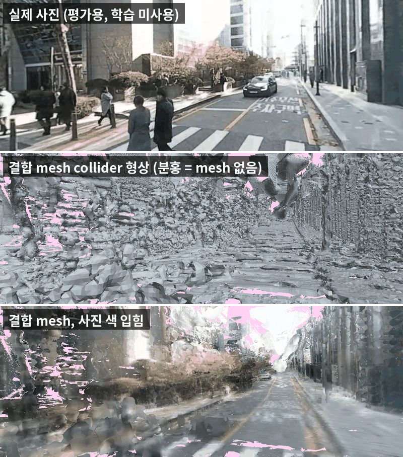
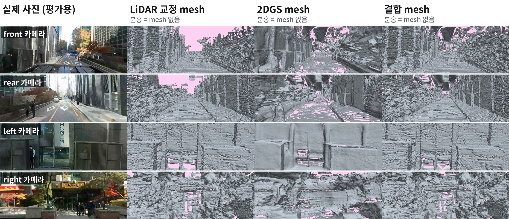
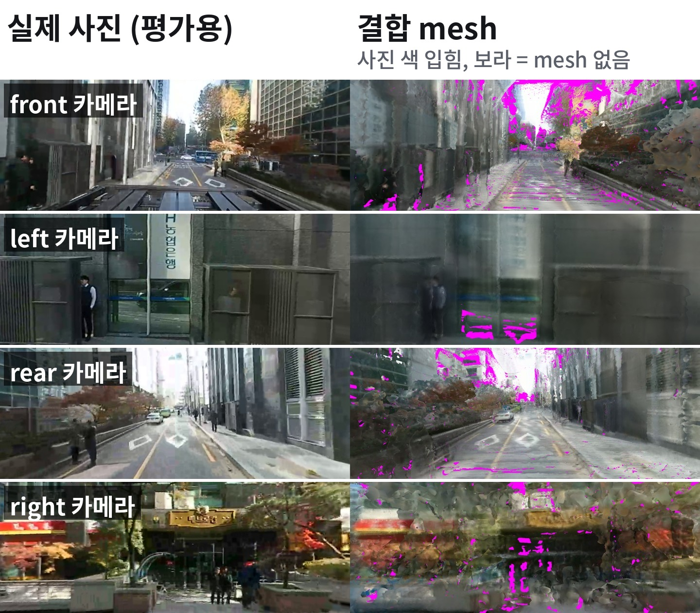
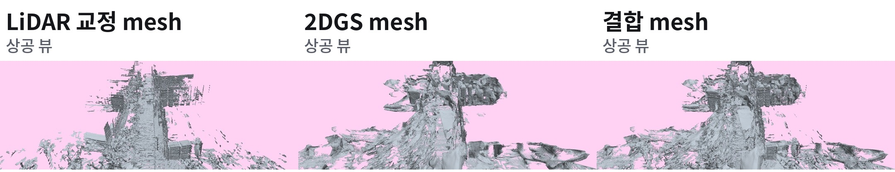

# Camera LiDAR Mesh Reconstruction : 2DGS

> 기존 3DGS에서 mesh 형태 생성에 더 유리한 2DGS 로 진행

## 요약

**결과**
- extrinsic T는 mesh 품질 저하의 원인이 아님. (T:50cm, 회전 2도,&rarr; PSNR 변화 0.1dB 이하)
- 동적 객체 &rarr; LiDAR 오염 &rarr; 제거 후 개선
- 3DGS &rarr; 2DGS mesh와 LiDAR mesh를 결합해 사용
- 최종 mesh는 LiDAR 일치 66.0%, 구멍 1.1%, 바퀴 지지 95%, 사진 덮임 93.9%

* 위는 실제 전방 사진, 가운데는 결합 mesh의 collider 형상, 아래는 사진 색을 입힌 결합 mesh

**미해결**
- 하늘 쪽에 떠 있는 면이 남아 있음
- 2DGS + LiDAR mesh의 경계가 불안정
- 같은 방향으로 함께 움직이는 차량은 동적 물체 판정에서 남을 수 있음.
- GPS 속도가 LiDAR 및 영상과 맞지 않음. 원인을 확인하지 못해 현재 사용하지 않음.

## 용어

| 용어 | 의미 |
|---|---|
| T | 카메라와 LiDAR 사이의 extrinsic 변환 |
| SfM | SfM(Structure from Motion): 여러 사진에서 카메라 pose와 3차원 구조를 추정하는 방법 |
| LiDAR odometry | 연속된 LiDAR scan으로 센서 이동 경로를 추정하는 방법 |
| pose graph | 여러 시점의 정합 관계를 묶어 전체 궤적을 보정하는 방법 |
| ICP | 두 점군이 겹치도록 상대 pose를 맞추는 방법 |
| holdout | 학습과 추정에는 사용하지 않고 평가에만 쓰는 데이터 |
| ray test | LiDAR 빔을 mesh에 쏴 관측 거리와 mesh 교차점을 비교하는 평가 |
| deskew | 한 scan을 취득하는 동안 발생한 센서 움직임을 보정하는 처리 |
| 2DGS | 영상으로 장면을 학습하며 표면 형상 표현에 초점을 둔 Gaussian 방식 |
| TSDF | 여러 depth 관측을 누적해 연속된 표면을 만드는 방법 |
| Poisson | 점군에서 연속된 표면을 복원하는 방법 |
| collider | Genesis에서 주행과 충돌 계산에 사용하는 형상 |
| world | 카메라와 LiDAR의 위치와 방향을 함께 표현하는 공통 좌표계 |
| 기존 Gaussian depth mesh | 3DGS 렌더링 depth로 만든 기존 비교 mesh |
| 기존 LiDAR mesh | LiDAR만으로 만든 기존 비교 mesh |
| LiDAR 교정 mesh | 차 이동 경로를 보정한 뒤 지나간 차와 사람의 잔상을 제거한 LiDAR mesh. 경로 보정과 동적 객체 제거가 함께 적용됨 |
| 2DGS mesh | LiDAR 거리로 교정해 학습한 카메라 2DGS mesh |
| 결합 mesh | LiDAR 교정 mesh에 2DGS mesh의 보완 영역을 더한 mesh |

## Settings

* **목표:** ADI 실데이터(360 카메라 1대·VLP-16 LiDAR)로 Genesis 주행·충돌에 사용할 **시점 독립적인 textured mesh** 생성. 3DGS 표현만으로는 필요한 collider와 빠르게 재사용할 수 있는 단일 mesh를 확보할 수 없어 형상 추출이 필요함.

* **기존 결과의 한계:** 10월 24일까지 Camera–LiDAR 변환 (T) 후보를 얻었으나 정답값은 미확정. Gaussian depth 기반 배경 mesh는 구멍·조각이 많아, 국소 벽면 보간만으로는 장면 전체를 복원하지 못함.

**재설계 방향:** (T)를 추가로 조정하기 전에 공통 평가 기준을 정하고, 카메라·LiDAR를 하나의 기준 world에서 사용하도록 형상 생성 경로를 다시 구성함.

* **데이터 제약:** 렌즈별 원본·stitching calibration·장착 치수·IMU·CAN 미제공. GPS는 1Hz GPRMC/DGPS이며 고도·자세 정보 없음.

* **시간 기준:** 녹화기·GPS UTC·VLP-16 시계 동기화 적용. 카메라–LiDAR 추가 지연은 후속 검증 결과에 따라 **0초로 확정**

## 계획

| 구분 | 하위 문제 | 질문 | 상태 |
|---|---|---|---|
| 1. 평가 기준 고정 | 평가 기준 | 좋은 mesh의 정량평가 | 완료 |
| 2. T 영향 확인 | T 영향 | T가 정확하면 Mesh의 해상도가 더 좋아지는가? | 완료 |
| 3. 카메라와 LiDAR 좌표계 정렬 | 좌표계 정렬 | 두 센서의 pose를 하나의 metric world로 만들 수 있는가 | 완료 |
| 4. LiDAR 교정 2DGS 학습 | 융합 형상 | LiDAR depth + 카메라 사진 을 사용하여 2D Gaussian 의 위치, 방향, 색을 수정 학습 | 1차 완료 |
| 5. 두 mesh 결합 | 연속 표면 | LiDAR mesh + 2DGS mesh : 두 형상의 장점을 유지하며 결합할 수 있는가 | 1차 완료 |
| T 정밀 추정 | 검증 가능한 T | 검증 가능한 T를 얻을 수 있는가 | 2단계 결과에 따라 보류 |
| Genesis 적용 | 주행과 충돌 | Genesis에서 주행과 충돌에 사용할 수 있는가 | 예정 |

## 1. 정량 평가 기준 

#### 문제정의

실험마다 평가 지표 통일

#### 방법

모든 mesh를 같은 조건에서 평가함.

| 조건 | 값 |
|---|---:|
| world | 기울기 보정한 metric Z up |
| holdout | 31프레임 |
| 사진 | 124장 |
| LiDAR scan | 31개 |
| 데이터 분리 | holdout을 모든 학습과 추정에서 제외 |

| 평가 | 확인 대상 |
|---|---|
| LiDAR ray test | 관측 거리와 mesh가 일치하는가 |
| 가짜 면 | LiDAR가 비어 있다고 본 공간에 면이 있는가 |
| 구멍 | LiDAR 관측 위치에 mesh가 없는가 |
| 사진 재렌더 | holdout 사진 시점의 PSNR과 화면 덮임이 어느 정도인가 |
| 위상 | 연결 성분이 얼마나 많은가 |
| corridor | 실제 차량 통과 공간을 mesh가 침범하는가 |
| 바퀴 지지 | 차량 아래 지면과 프레임별 센서 높이가 안정적인가 |

#### 결과

| 지표 | 기존 Gaussian depth mesh | 기존 LiDAR mesh |
|---|---:|---:|
| LiDAR 일치 | 16.6% | 56.8% |
| 가짜 면 | 39.9% | 34.2% |
| 구멍 | 24.9% | 1.4% |
| 연결 성분 | 91,078 | 10,405 |
| 도로 좌우 기울기 | 8.5도 | 음의 0.7도 |

**기존 Gaussian depth mesh는 형상 정확도와 연결성 모두 비교 기준으로 사용하기 어려웠음.**

- 기존 Gaussian depth mesh는 LiDAR 도로와 SfM 배경이 다른 기울기로 조립돼 도로가 8.5도 기울었음.

* 왼쪽은 실제 GT(ADI) 사진, 오른쪽은 기존 Gaussian depth mesh 렌더
* 보라는 mesh가 없는 영역

### 오류 수정

초기 평가 기준에는 두 가지 문제가 있었음.

| 잘못된 기준 | 문제 | 수정 |
|---|---|---|
| ray 10cm 차이 | 비스듬한 지면 ray의 오차를 수십 배 크게 판정 | 관측점 근처의 hit를 일치로 처리함 |
| 지면 판단 | 인도를 차도로 인식 | 프레임마다 센서 높이가 일정한지 평가함 |

 동적 객체의 노이즈 : 시간에 따라 움직이므로 LiDAR 및 camera 에 노이즈

## 2. extrinsic T 영향력 확인

#### 문제정의

T가 실제 mesh 품질의 병목인지 먼저 확인

#### 방법

* 형상은 LiDAR mesh로 고정함. 카메라 pose는 LiDAR pose에 T의 역변환을 곱해 계산함.

> T에 의도적으로 오차를 넣고 holdout 사진 재렌더 결과를 비교함. 같은 pose로 색칠하고 평가하면 일정 오차가 상쇄될 수 있어 두 조건을 사용함.

| 조건 | 방법 |
|---|---|
| 같은 방향 | 같은 방향 카메라로 색칠하고 평가함 |
| 교차 방향 | 전방과 후방 카메라로 색칠하고 좌측과 우측 카메라로 평가함 |
| 대조군 | 이동 1m와 회전 5도를 각각 적용함 |

#### 결과 : T는 낮은 품질의 원인이 아님 

> PSNR : 생성한 이미지가 원본 이미지와 픽셀 단위로 얼마나 비슷한지 나타내는 지표

>물론 Calibration 이 잘되면 더 나은 품질을 보이겠지만, 현재 센서간 extrinsic 이 추정 기반이므로, 현재까지의 best 기준으로 진행

| T 오차 | 같은 방향 PSNR | 교차 방향 PSNR |
|---|---:|---:|
| 없음 | 16.66 | 14.41 |
| 이동 10cm | 16.67 | 14.38 |
| 이동 20cm | 16.66 | 14.39 |
| 이동 50cm | 16.63 | 14.42 |
| 이동 1m 대조군 | 측정값 없음 | 14.29 |
| 회전 0.5도 | 16.65 | 14.39 |
| 회전 1도 | 16.63 | 14.37 |
| 회전 2도 | 16.57 | 14.36 |
| 회전 5도 대조군 | 측정값 없음 | 13.91 |

**T에 이동 50cm와 회전 2도를 각각 적용해도 변화가 0.1dB 이하였음. 현재 품질에서는 T가 원인이 아님.**

#### 결과 : 센서간 지연은 없음

| 검증 | 결과 |
|---|---|
| 회전 속도 정합 | 0.48초 앞선 지점에서 최적 |
| 이동 속도 정합 | 0.00초에서 최적 |
| 첫 번째 구간 이동 거리 | LiDAR 7.0m, SfM 7.1m |
| 두 번째 구간 이동 거리 | LiDAR 48.5m, SfM 46.4m |
| 영상 feature를 사용한 회전 재정합 | LiDAR와의 시간 차이 0.14초 |

* 기존 센서간 시간 offset 0.37초 가 있다고 판단했는데 Local Optima 였음 &rarr; 전체 프레임 기준 측정시 0초가 가장 오차가 적음

## 3. 카메라와 LiDAR를 하나의 world로 통합

#### 문제정의

카메라 SfM과 LiDAR odometry(시간에 따른 궤적)가 서로 다른 world에 있었음 &rarr; 제대로 형상이 나오지 않은 이유 

* 하나의 기준 world로 통합

#### 방법

| 순서 | 처리 |
|---|---|
| 1 | 기존 LiDAR odometry에서 시작함 |
| 2 | 회전은 고정하고 이동만 pose graph로 다시 계산함 |
| 3 | 여러 시간 간격의 ICP edge를 사용하고 이상치를 제거함 |
| 4 | holdout scan을 정합에서 제외함 |
| 5 | 다른 시점의 LiDAR가 점 뒤를 통과해 더 멀리 관측한 경우 해당 점을 동적 물체로 보고 제거함 |
| 6 | 지면은 동적 물체 삭제 대상에서 제외함 |
| 7 | 카메라 위치는 LiDAR pose에 T의 역변환을 곱해 계산하고 지연은 0초로 적용함 |
| 8 | 카메라 회전은 학습 이미지 feature로 다시 맞춤. 위치 수정은 cm 단위만 허용함 |
| 9 | 같은 설정으로 LiDAR 교정 mesh를 다시 생성함 |

LiDAR 궤적을 정제한 뒤 동적 물체를 제거함. 카메라 pose를 다시 맞추고 단일 world mesh를 생성함.

#### 결과 : 단일 world와 궤적 보정으로 LiDAR 일치가 높아짐

| 지표 | 기존 결과 | 교정 결과 |
|---|---:|---:|
| 지도 빈 공간 침범, 3초에서 7.5초 간격 | 18.0% | 8.0% |
| holdout feature 재투영 오차 | 3.35px | 2.17px |
| 영상이 요구한 카메라 위치 수정 | 측정값 없음 | 중앙값 2.6cm |

| mesh 지표 | 기존 LiDAR mesh | **LiDAR 교정 mesh** |
|---|---:|---:|
| LiDAR 일치 | 56.8% | **66.5%** |
| 가짜 면 | 34.2% | **19.8%** |
| 바퀴 지지 | 90% | **92%** |

**단일 world와 궤적 보정으로 LiDAR 일치가 높아져 정확도 증가**

- 지도 빈 공간 침범은 18.0%에서 8.0%로 감소
- 학습에 쓰지 않은 사진에서 특징점 위치 오차는 2.17px임. 사진만으로 카메라 위치를 구한 SfM의 1.62px보다 0.55px 큼

* LiDAR 교정 mesh의 실제 사진, 사진 색을 입힌 mesh, 형상 비교임.

* LiDAR 교정 mesh의 상공 뷰임. 위는 사진 색을 입힌 mesh, 아래는 형상임. 도로와 근거리는 채워지지만 건물 상부가 비어 있음.

## 4. LiDAR 교정 2DGS 학습

### 방법

LiDAR 정보(pose, 점, depth) 와 2DGS(이미지) 기반 mesh를 융합

| 설정 | 값 |
|---|---:|
| 학습 사진 | 480장, holdout 제외 |
| 초기값 | 정적 LiDAR 지도 82만 점 |
| LiDAR supervision | 같은 시각 depth, 이미지당 약 5,400px |
| 사진 loss 제외 영역 | 차체와 동적 물체 |
| 학습 길이 | 30k iteration |
| 장비와 시간 | RTX 4090, 실측 약 20분 |
| mesh 추출 | TSDF, 전체 학습 시점, 30m 이내, 불투명도 0.3 이상 |

LiDAR depth를 사용해 2DGS를 학습함. 조밀한 depth를 만든 뒤 TSDF 표면을 추출함.

### 왜 2DGS인가?

| 항목 | 2DGS | 3DGS |
|---|---|---|
| 기본 조각 | 두께가 없는 2D 원판 | 부피가 있는 3D 타원체 |
| 사진 재현 | 3DGS보다 불리함 | **반사, 유리, 나뭇잎 표현에 유리함** |
| 표면 위치와 normal | **원판 자체가 표면이라 바로 정해짐** | 타원체 부피 안에서 흐림 |
| mesh 추출 | **이어진 면으로 추출됨** | 거친 면과 구멍이 많음 |
| 구현과 도구 | 설정이 까다로움 | **많고 학습 설정이 단순함** |
| 학습 후 Gaussian 수 | **108만 개** | 310만 개, 상한 없으면 GPU 메모리 부족 |
| 학습 시간, RTX 4090 실측 | **약 20분** | 약 1시간 47분 |

같은 조건에서 3DGS로 다시 학습해 mesh를 비교함. 사진, pose, LiDAR depth loss, 30k iteration, TSDF 추출 조건, 평가는 동일함.

| 지표 | 2DGS mesh | 3DGS mesh |
|---|---:|---:|
| LiDAR 일치 | **58.1%** | 50.4% |
| 가짜 면 | 8.1% | **7.8%** |
| 구멍 | **6.9%** | 14.6% |
| 바퀴 지지 | **73%** | 48% |
| 사진 덮임 | **89.7%** | 78.7% |
| PSNR | **17.0dB** | 16.8dB |

**3DGS는 mesh로 바꾸면 사진 재현 장점이 남지 않고 구멍과 바퀴 지지가 크게 나빠짐.**

- 3DGS mesh의 PSNR은 2DGS mesh와 같은 수준임. 렌더링 품질 우위가 mesh에서는 사라짐.
- 구멍이 2배 이상이고 바퀴 지지는 48%에 그침. 도로면이 듬성듬성하게 추출됨.
- 3DGS에는 normal loss를 걸 수 없고 Gaussian 수 상한 300만 개를 둠. 이 두 가지 외 조건은 같음.

#### 결과

| 지표 | LiDAR 교정 mesh | 2DGS mesh |
|---|---:|---:|
| LiDAR 일치 | **66.5%** | 58.1% |
| 가짜 면 | 19.8% | **8.1%** |
| 구멍 | **1.7%** | 6.9% |
| 연결 성분 | 10,070 | 1,001 |
| 바퀴 지지 | **92%** | 73% |

**2DGS mesh는 건물 상부와 벽면을 매끈하게 채우고 가짜 면을 줄였지만 도로와 20m 이상 거리에서 구멍이 생김.**

- 가짜 면은 8.1%로 감소함.
- 구멍은 6.9%, 바퀴 지지는 73%로 악화됨.
- LiDAR 교정 mesh를 단독으로 대체할 수 없어 두 mesh의 결합이 필요함.

## 5. LiDAR + 2DGS fusion

#### 문제정의

두 mesh는 서로 다른 영역에서 강했음.

| mesh | 강한 영역 |
|---|---|
| LiDAR 교정 mesh | 도로와 근거리 |
| 2DGS mesh | 건물 상부와 벽면 |

한쪽을 선택하지 않고 각 형상의 장점을 유지하며 결합해야 했음.

#### 방법

LiDAR 교정 mesh는 그대로 유지함. 2DGS mesh의 면은 다음 조건으로 추가함.

| 순서 | 처리 |
|---|---|
| 1 | LiDAR 교정 mesh에서 15cm 이상 떨어진 면만 추가함 |
| 2 | LiDAR 빔이 뚫고 지나간 위치의 면은 제거함 |
| 3 | LiDAR 교정 mesh와 겹치는 면 43%를 제외함 |
| 4 | 빈 공간에 있는 면 2.8%를 제외함 |
| 5 | 남은 면 5,115㎡를 추가함 |

#### 결과

수치는 아래 mesh 별 결과 비교 표에 정리함.

**두 형상을 결합하자 LiDAR 교정 mesh의 LiDAR 지표를 유지하면서 바퀴 지지와 사진 덮임이 함께 높아짐.**

- LiDAR 일치는 66.5%에서 66.0%로 유지됨.
- 구멍은 1.1%, 바퀴 지지는 95%임.
- 사진 덮임은 93.9%임.

## mesh 별 결과 비교

| mesh | LiDAR 일치 | 가짜 면 | 구멍 | 바퀴 지지(collider) | 사진 덮임(visual) |
|---|---:|---:|---:|---:|---:|
| 기존 Gaussian depth mesh | 16.6% | 39.9% | 24.9% | 74% | 68.4% |
| 기존 LiDAR mesh | 56.8% | 34.2% | 1.4% | 90% | 82.5% |
| LiDAR 교정 mesh | 66.5% | 19.8% | 1.7% | 92% | 84.2% |
| 2DGS mesh | 58.1% | 8.1% | 6.9% | 73% | 89.7% |
| LiDAR + 2DGS 결합 mesh | 66.0% | 20.9% | **1.1%** | **95%** | **93.9%** |

* 실제 사진, LiDAR 교정 mesh, 2DGS mesh, 결합 mesh의 형상 비교임. 분홍은 mesh가 없는 영역임.

* 결합 mesh에 학습 사진 색을 입히고 holdout 시점에서 렌더한 결과임.

* LiDAR 교정 mesh, 2DGS mesh, 결합 mesh의 상공 비교임.

| 항목 | 확인된 상태 |
|---|---|
| 평가 기준 | 동일 world와 동일 holdout을 기준으로 고정함 |
| T | 현재 mesh 품질의 병목이 아님을 검증함 |
| 추가 지연 | 0초로 확정함 |
| 단일 world | 카메라와 LiDAR pose를 통합함 |
| LiDAR 형상 | LiDAR 교정 mesh에서 일치 66.5%, 가짜 면 19.8%를 기록함 |
| 카메라 보완 형상 | 2DGS mesh에서 건물 상부와 벽면을 보완하고 가짜 면 8.1%를 기록함 |
| 현재 최선 | 결합 mesh이며 바퀴 지지 95%, 사진 덮임 93.9%를 기록함 |
| Genesis 적용 | 예정임 |

**현재 확보한 결과는 평가 가능한 결합 mesh임. 완성된 collider는 아직 아님.**

- 하늘 쪽 떠 있는 면은 LiDAR가 닿지 않는 높이에 있어 현재 필터로 제거하지 못함.
- 두 mesh의 경계가 붙지 않음. 결합 mesh의 연결 성분은 24,611개임.

구현과 실험 조건의 상세 내용은 [상세 기록](tech/%5BDIGLAB%5D%5B26-10-26%5D%5B%EC%A0%95%EB%A7%8C%EA%B5%90%5D_Mesh_rebuild_pipeline.md)에 남김.

## next step
* 3DGS로 test
* 하늘 쪽에 떠 있는 면 해결