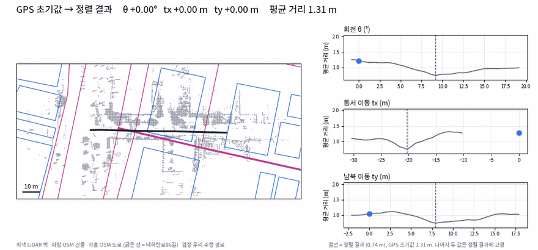
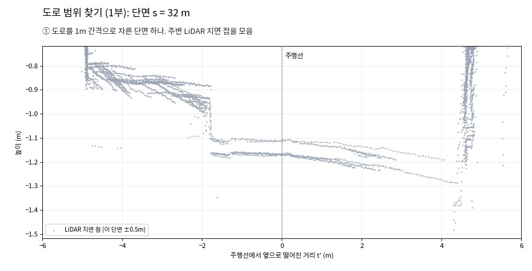
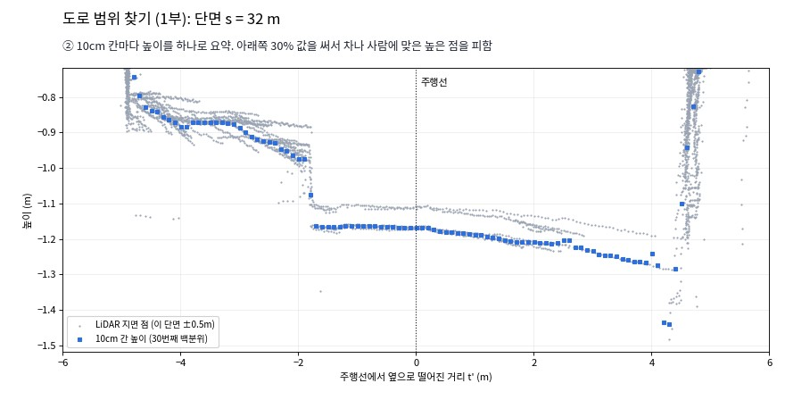
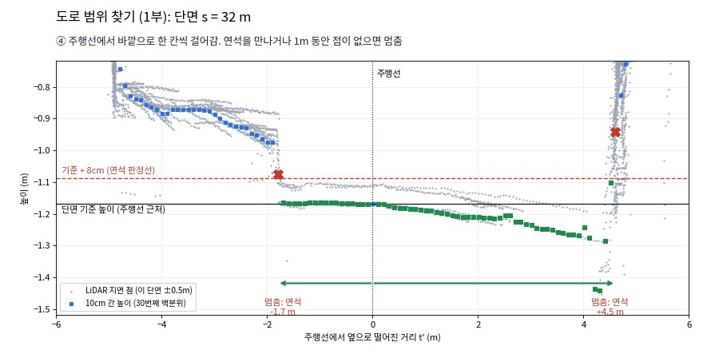
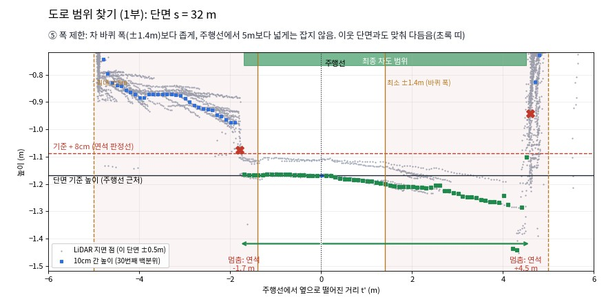
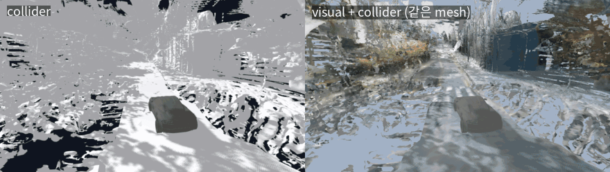
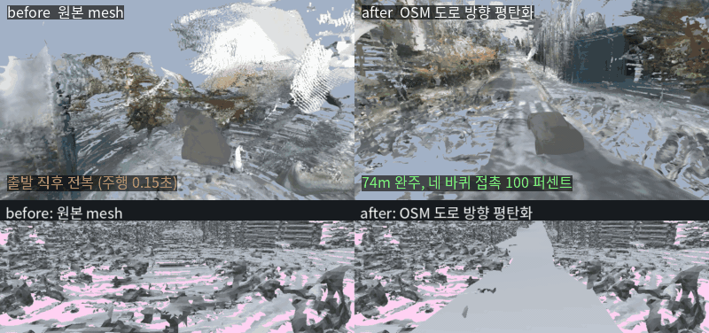

# Using OSM map to Flatten noisy mesh

**목표**:  완성된 mesh 를 osm,osmr 지도와 비교하여 표면을 평활화 하여 genesis 차량이 주행할 수 있는 도로로 만드는 것 

> OSM = 지도 **데이터**, OSRM = 그 데이터 위에서 길을 찾는 **엔진**

| 항목 | OSM | OSRM |
|---|---|---|
| 정식 명칭 | OpenStreetMap | Open Source Routing Machine |
| 정체 | 사용자 참여형 오픈 지도 데이터베이스 | OSM 데이터를 읽어 경로를 계산하는 오픈소스 routing 엔진 |
| 구성 / 기능 | node(위도·경도 점), way(점을 이은 선·다각형 — 도로 중심선, 건물 외곽선), tag(`highway=residential`, `building=yes`, `lanes` 등 속성) | route(출발→도착 경로), match(GPS 궤적 → 도로망에 붙이기, map matching), nearest(가장 가까운 도로) |
| 좌표 | WGS84 위도·경도 | 입출력 모두 위도·경도 (OSM 도로망 기준) |
| 높이(z) | 없음 — 2D | 없음 |
| 이 문서에서의 역할 | 건물 외곽선 → LiDAR 벽 정렬, 도로 방향 벡터 → 단면 방향 | - |

**두 지도 모두 높이가 없다 → 평면 정렬·방향 참조에만 쓰고, 높이는 전부 LiDAR 에서 가져옴**


## 1. 좌표계 정렬
OSM은 종이 지도와 같습니다. 건물과 도로가 위도·경도로 그려져 있습니다.
우리 mesh는 LiDAR로 직접 잰 3D 모형인데, 원점과 방향을 우리가 임의로 정한 미터 좌표입니다. 
같은 거리를 담고 있어도 두 좌표계는 다름

다음을 찾아야함 rotation R, translation t

* 지도를 얼마나 돌릴지(θ) 
* 동서로 얼마나 옮길지(tx)
* 남북으로 얼마나 옮길지(ty)

## 2. 어떻게 Data를 같은 world 에 정렬 할 것인가?

  


1. GPS 값으로 R,T의 쌍(mesh world, OSM world)의 Least Sqaure를 **초기값**으로
  

2. OSM map의 건물 윤곽선을 LiDAR 벽에 맞추기

3. 점수 매기기 :OSM 건물 외곽선을 0.3m 간격 점으로 바꾼 후 LiDAR점과 거리 -> LiDAR 벽 근처(6m 안)에 들어온 점만 평균

4. 데이터 정렬 확인 : 평균거리, OSM 외곽선과 LiDAR벽의 겹침, 주행 경로 궤적, 도로 중심선

5. 도로 방향으로 평탄화 


## 3. 도로 평탄화 과정


### 0. 도로의 영역 지정 후 단면을 몇 cm마다 자를 것인지 설정
* 해당 예시에선 1m 마다 잡음
* 1m 마다 도로의 단면을 잘라서 높이를 설정
* 단면 간 연결은 선형 보간(인도까지 차도로 설정해버리는 것을 방지하기 위해)

### 1.  단면의 LiDAR 점들을 등분(예시에선 10cm마다 30 등분)



* R,T 정렬된 OSM 의 방향 벡터만 참고해서 등분
* LiDAR점을 10cm 마다 30개의 점으로 표면을 표현(Resolution)


### 2. 10cm 마다 하나의 높이 영역 분할


* 차도와 인도의 경계 , 연석을 찾기 위해서 10cm 마다 높이를 지정하여 차이가 나는 지점을 선택

### 3. 표면 생성
* LiDAR 높이로 만든 점들 중 평탄화 하기 위해 높이를 지정해야함

* 영역 속 점들 중 아래쪽 30% 높이를 선택
    * 차, 사람 등의 도로 이외의 객체를 피하기 위해 하위 30% 점을 표면으로 사용

* `z0 + g·t + k·t²` 2차 곡선 식을 통해서 LiDAR점들 fitting

```
z(s, t) = z0(s) + g(s) t + k(s) t²
```

| 항 | 뜻 | 쉽게 말하면 |
|---|---|---|
| z0(s) | 주행선 위 높이 | 오르막과 내리막 |
| g(s) t | 횡단 경사 | 도로가 한쪽으로 기운 정도 |
| k(s) t² | 볼록함 | - |

#### Loss 식

```
loss = Σ w_i (z_i − 모델 높이_i)²  +  Σ λ² (이웃 조절점의 휨)²
```

| 항 | 뜻 |
|---|---|
| 첫째 항 | LiDAR 점(약 11만 개)의 실제 높이와 모델 높이 차이. 작을수록 측정에 가까움 |
| 둘째 항 | 이웃한 조절점 세 개가 일직선에서 벗어날수록 벌점. 도로가 구불구불해지지 않게 함 |
| λ | 매끈함의 세기. 높이 3, 횡단 경사 10, 볼록함 30. 횡단 경사와 볼록함은 도로를 따라 거의 안 변하므로 더 세게 누름 |

### 4. 인도*연석 경계면 필터링



* 주행선에서 왼쪽, 오른쪽으로 한 칸씩 나가며 높이를 봄 (초록 네모)
* 판정선을 넘는 칸을 만나면 연석으로 보고 멈춤 (빨간 X). 1m 동안 점이 없어도 멈춤


### 5. 필터링 constraint

> 높이 차이로 도로의 폭을 정하니 constraint 가 필요함 



* 차 바퀴 폭(좌우 1.4m)보다 좁게 잡지 않음. 연석을 잘못 찾아도 차가 지나갈 폭은 남기기 위함
* 주행선에서 5m보다 넓게 잡지 않음. 교차로처럼 연석이 없는 곳에서 범위가 끝없이 넓어지는 것을 막기 위함
* 이웃 단면 5개와 비교해 튀는 값을 다듬음

* 범위 안의 LiDAR 점에 2차 곡선을 fitting 시킴 


### 결과






**주행 결과 정량평가** (경로 74.2m, Genesis Ray-Wheel 차량)

| 지표 | 원본 | 단순 평활화 | OSM 평탄화 |
|---|---|---|---|
| 완주 | 실패 (출발 직후 전복) | 완주 | 완주 |
| 진행률 | 4.8% | 99.3% | 99.4% |
| 주행 시간 | 0.15초 | 30.0초 | 30.0초 |
| 경로 이탈 (CTE) RMSE | 측정 의미 없음 | 0.5cm | 0.4cm |
| 경로 이탈 95% / 최대 | - | 1.0cm / 1.7cm | 0.8cm / 1.5cm |
| 방향 오차 RMSE | - | 0.21° | 0.19° |
| 속도 오차 RMSE | - | 0.35m/s | 0.34m/s |
| 네 바퀴 모두 접촉 (주행 구간) | 0% | 98.9% | 100% |
| 네 바퀴 모두 접촉 (가속 포함 전체) | 0% | 99.0% | 96.6% |
| 최대 roll / pitch | 48.3° / 19.8° | 4.0° / 8.0° | 3.2° / 6.4° |

**승차감** (주행 기록에서 계산)

| 지표 | 단순 평활화 | OSM 평탄화 |
|---|---|---|
| 서스펜션 압축량 흔들림 (표준편차) | 1.11cm | 0.82cm |
| 차체 상하 가속도 (95% 지점) | 0.58m/s² | 0.14m/s² |
| roll 흔들림 (표준편차) | 1.74° | 2.06° |
| pitch 흔들림 (표준편차) | 1.80° | 1.53° |
