# Tesla FSD Scene Reconstruction Reference

> 9월부터 11월까지 우리 실제 주행 3D 씬 재구성 기록을 그림 위주로 짧게 정리하고, 최근 Tesla FSD 가 보여 준 사실적인 씬 구성 방법을 조사한 기록임

## 용어

| 용어 | 설명 |
|---|---|
| 3DGS | 3D Gaussian Splatting. 색과 투명도를 가진 타원체 수백만 개로 장면을 그리는 방식 |
| 2DGS | 2D Gaussian Splatting. 두께 없는 원판 Gaussian. 표면에 붙이기 쉬워 도로에 씀 |
| NuRec, Instant NuRec | NVIDIA 의 주행 로그 재구성 도구. 9월 초에 로컬에서 시험함 |
| ADI | 우리가 받은 실제 주행 데이터. 360 카메라 1대와 VLP-16 LiDAR, 강남 테헤란로 일대 |
| Alpamayo | NVIDIA 공개 주행 데이터. 카메라 여러 대와 LiDAR 가 있는 비교용 데이터 |
| collider | Genesis 에서 바퀴가 닿는 물리 mesh |
| Genesis Nyx | Genesis 의 Gaussian 렌더러. 우리 씬을 시뮬레이터 화면으로 그림 |
| Difix | 렌더의 흐림과 구멍을 고치는 diffusion 모델. 학습 중 가상 시점 렌더를 고쳐 다시 학습에 씀 |
| 정밀도로지도, V-World | 국토지리정보원 차선 지도와 국토부 3D 건물 데이터. 큰 틀과 좌표를 맡음 |
| k0, k4, k5 | ADI seq60 전체 경로 학습 판본. k0 은 기존 파이프라인, k4 는 바닥 2DGS 와 나머지 3DGS, k5 는 k4 에 네이버 거리뷰 사진을 더함 |
| held-out | 학습에 쓰지 않고 평가에만 쓰는 시점 |
| Generative Gaussian Splatting | Tesla 가 부르는 이름. 주행 신경망이 카메라 영상에서 3D Gaussian 을 한 번에 출력하는 방식 |
| feed-forward | 장면마다 최적화하지 않고, 미리 학습된 네트워크가 입력을 한 번 통과시켜 바로 결과를 내는 방식 |
| per-scene optimization | 우리 방식. 장면 하나마다 수천 번 반복 학습해 Gaussian 을 맞춤 |
| world simulator | 현재 상태와 다음 행동을 받아 다음 순간의 카메라 영상을 생성하는 신경망 |
| Reality View | FSD v15 의 새 화면. 차 위 가상 카메라 시점의 사실적인 영상을 실시간 생성함 |
| diffusion, mean flow | 잡음에서 영상을 만들어 내는 생성 모델 계열. mean flow 는 적은 단계로 생성하는 변형 |
| UVE | Tesla Universal Vision Encoder. 주행 모델과 Reality View 가 같이 쓰는 영상 특징 추출기 |
| multi-traversal | 같은 장소를 여러 번 지나간 주행을 합쳐 재구성하는 방식 |

## 요약

**결과**

- NVIDIA 도구 시험에서 시작해, 실제 주행 데이터 한 번으로 Genesis 에서 달릴 수 있는 씬(물리 collider 와 Gaussian 화면)까지 만들었음
- 현재 구성은 바닥 2DGS, 나무와 건물 3DGS, 하늘은 Gaussian 없이 날씨 환경맵이 채움. 372 m 전체 경로를 주행 영상과 날씨 변화 영상으로 렌더함

**미해결**

- 주행 경로에서 벗어난 시점, 길 건너편 건물, 나무 세부가 흐리거나 잡무늬가 생김
- 원인은 사진 해상도 한계와, 한 번 지나간 주행이라 같은 곳을 본 각도가 좁은 것임 (나무는 시선 각도 중앙값 8.7도)

**Tesla 조사 결과**

- Tesla 의 사실적인 화면은 두 가지가 섞여 보이는 것임. 3D 는 Generative Gaussian Splatting(feed-forward, 약 220 ms), 운전자가 보는 FSD v15 Reality View 는 3D 재구성이 아닌 2D 영상 생성(diffusion)임
- Tesla 스스로 "직선 주행에서 장면별 3DGS 는 새 시점에서 깨진다"고 밝힘. 우리 문제와 같은 진단이고, 해법은 장면별 최적화를 더 잘하는 것이 아니라 대규모 주행 데이터로 미리 학습한 prior 임
- Tesla 의 Gaussian 데모에서도 나무와 산울타리는 흐림. 화면의 선명한 나무는 생성 모델이 그린 것임

## 1. 우리 재구성 타임라인

| 시기 | 단계 | 핵심 결과 |
|---|---|---|
| 09월 초 | NVIDIA Instant NuRec, NuRec 로컬 시험 | Gaussian 씬을 Genesis 에 올림. 시점이 바뀌면 품질이 크게 떨어짐 |
| 09월 말 | 3DGS 를 mesh 로 바꾸기 | Gaussian 깊이로 도로 mesh 를 만들어 Genesis 주행 |
| 10월 중순 | ADI 실제 데이터 첫 씬 | 360 영상을 4방향으로 잘라 3DGS 학습, LiDAR 도로 collider 위 39.2 m 완주 |
| 10월 말 | 카메라와 LiDAR 정렬, 2DGS mesh | 외부 보정 추정, LiDAR 깊이로 학습한 2DGS mesh |
| 11월 초 | 지도로 큰 틀 잡기 | OSM, 정밀도로지도, V-World 로 도로와 건물 위치를 잡고 LiDAR 로 세부 보정 |
| 11월 7일 | Genesis Nyx 화면 | collider 위 2DGS 를 Nyx 가 직접 그림 |
| 11월 9일 | Difix | 경로 밖 시점 보강. 효과는 궤적 밖에서만 보임 |
| 11월 중순 | 나무 3DGS, 하늘, 거리뷰 | 바닥 2DGS 와 나무 3DGS 혼합, 네이버 거리뷰로 길 건너편 건물 보강 |
| 11월 19일 | Alpamayo 전체 구간 | 같은 방식을 공개 데이터 전체 구간에 적용 |
| 11월 21일 | ADI 전체 경로 k0, k4, k5 | 경로 8블록 전체 비교 영상 |
| 11월 22일부터 | 날씨 렌더, 흐림 원인 진단 | 같은 Gaussian 파일로 날씨 변화, 나무와 건물 흐림 원인 측정 |

**10월에 실제 데이터로 넘어온 뒤로는 큰 틀은 지도, 세부는 LiDAR, 색은 사진이 맡는 구조로 굳어짐**

### 09월: NVIDIA 도구 시험

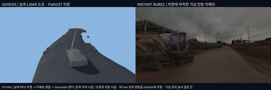

* NuRec Gaussian 씬과 LiDAR mesh, 주행 경로를 Genesis 에 결합한 첫 결과

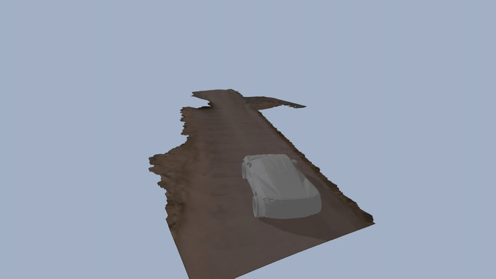

* Gaussian 깊이로 만든 도로 mesh 위 Genesis 주행

### 10월: ADI 실제 데이터

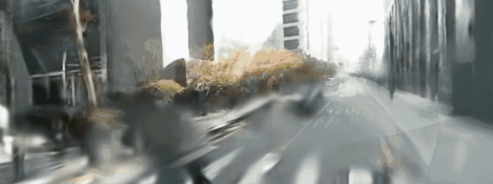

* 360 영상 한 대를 4방향 가상 카메라로 잘라 학습한 3DGS

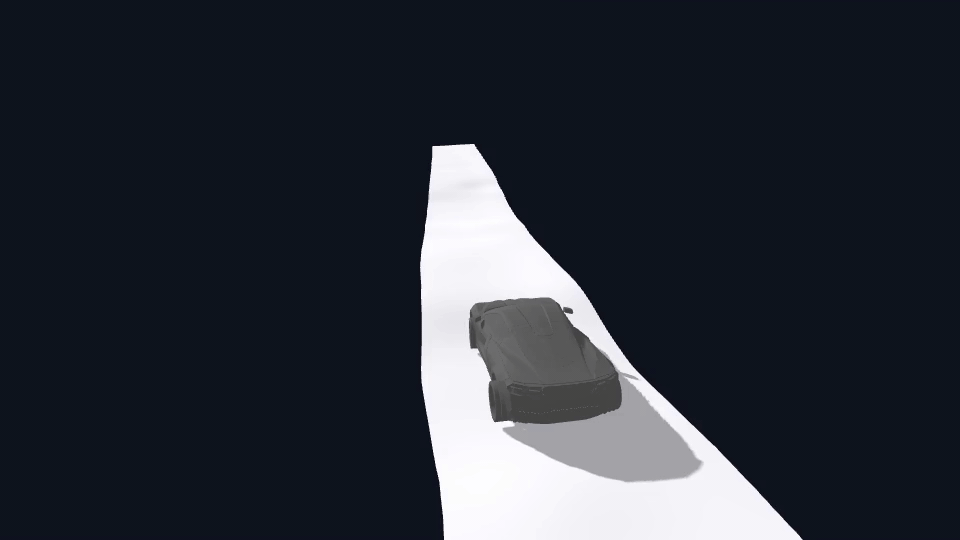

* LiDAR 도로 collider 위 39.2 m 주행

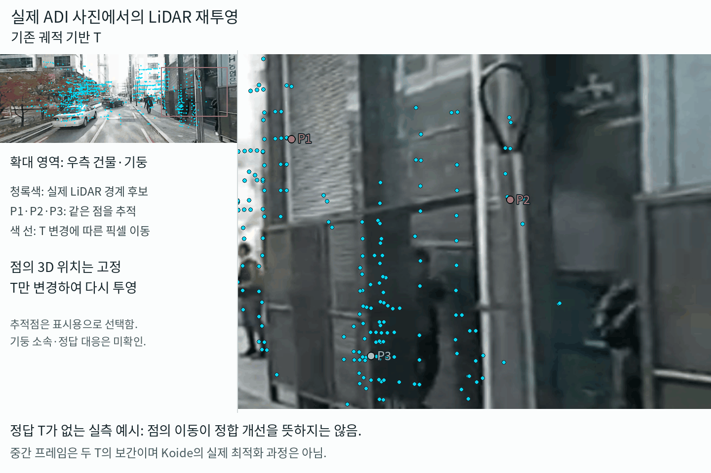

* 카메라와 LiDAR 외부 보정. LiDAR 점을 사진에 투영해 맞춤

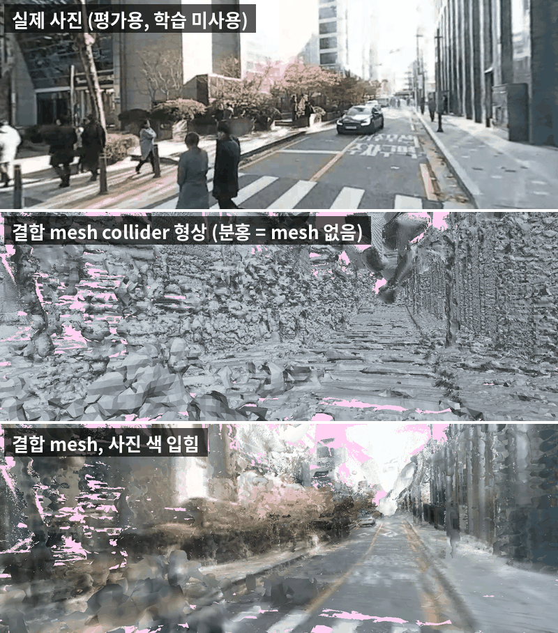

* LiDAR 깊이로 학습한 2DGS mesh 주행

### 11월 초: 지도로 큰 틀, Nyx 로 화면

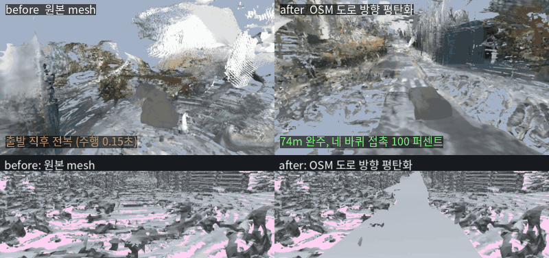

* OSM 도로 영역으로 울퉁불퉁한 LiDAR 노면을 평탄화한 전후

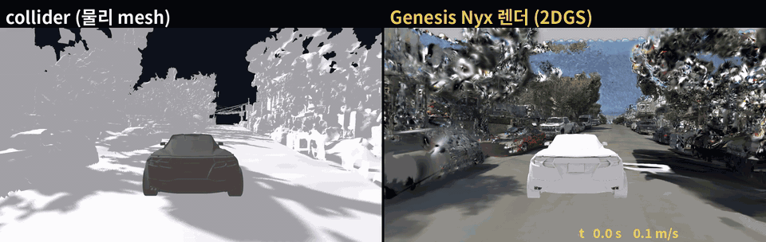

* 왼쪽 collider, 오른쪽 Genesis Nyx 화면. 노면 원판을 바퀴용 노면에 맞춰 바퀴가 도로에 파묻히던 현상이 사라짐

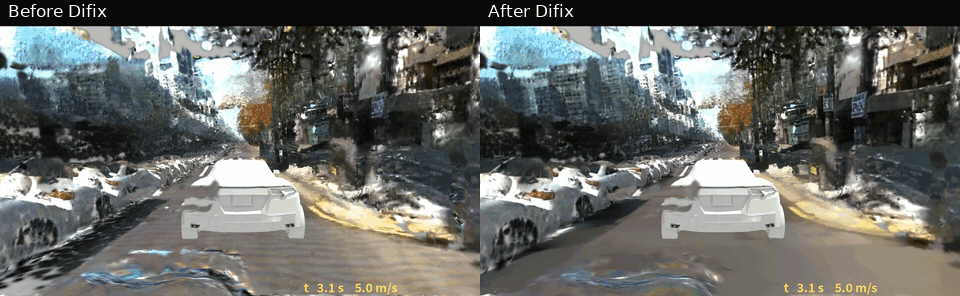

* Difix 적용 전후. 경로 밖 시점의 구멍과 흐림이 줄어듦

### 11월 중순: 나무, 하늘, 거리뷰

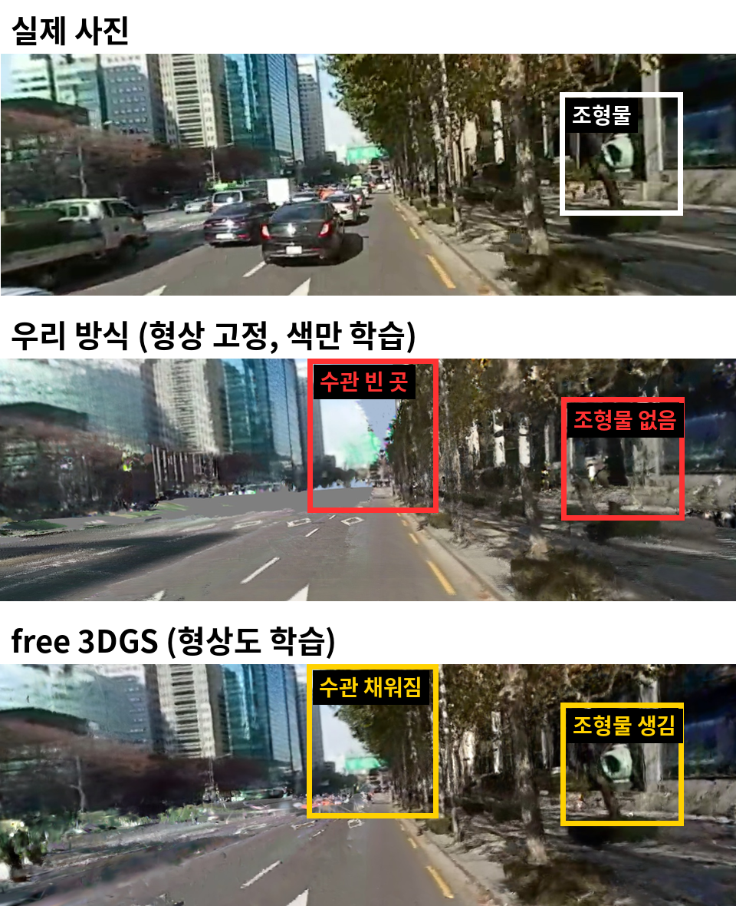

* 모두 2DGS 로 묶은 씬과 바닥 2DGS 에 나무 3DGS 를 더한 씬의 비교

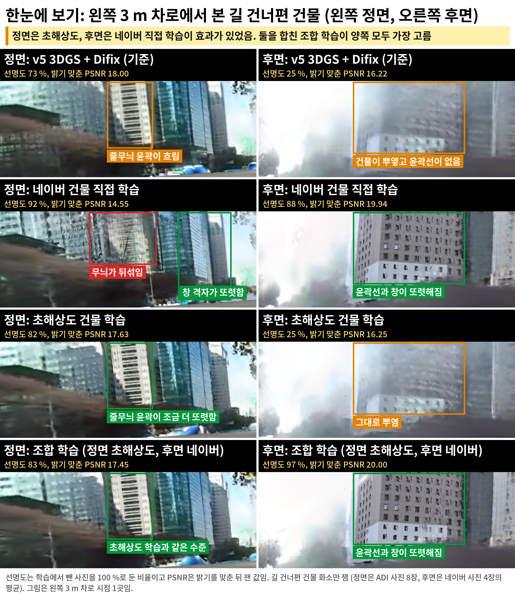

* 네이버 거리뷰 사진으로 길 건너편 건물을 보강한 결과. 후면은 효과가 있었고 정면은 ADI 사진과 무늬가 충돌함

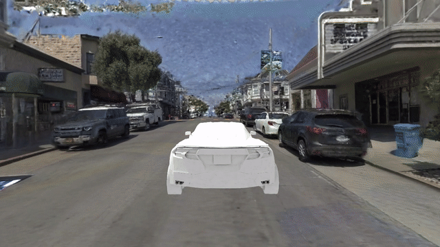

* Alpamayo 전체 구간 주행

### 11월 하순: 전체 경로와 날씨

https://github.com/user-attachments/assets/37457825-71d8-4185-8d00-161d36722ad3

* 위에서부터 실제 사진, k0, k4, k5. ADI seq60 전체 경로 300 프레임

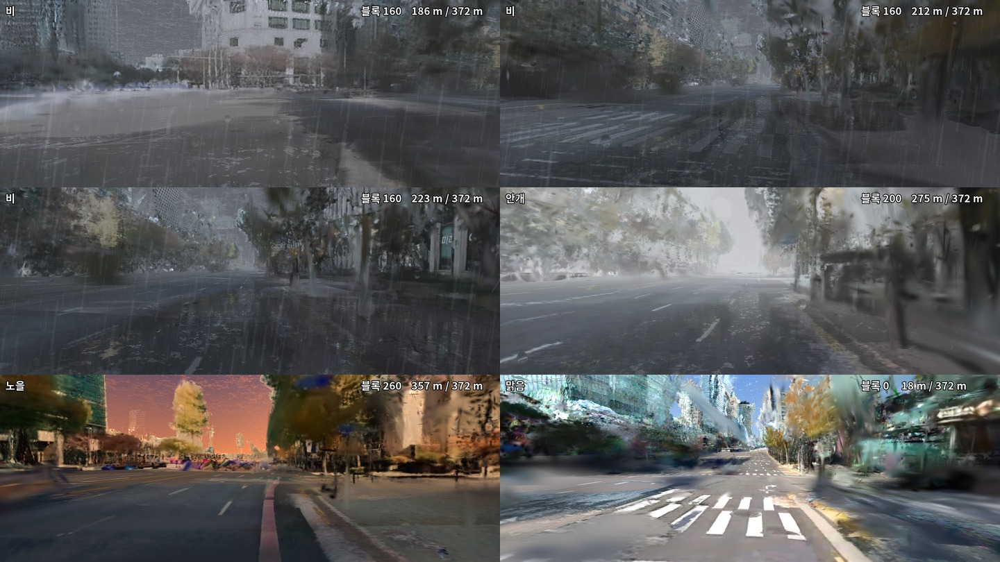

* 같은 k5 Gaussian 파일로 렌더한 날씨 변화. 맑음, 흐림, 비, 안개, 노을. 원본 영상 [mp4](../res_wjdaksry/1123/seq60_route_k5cr_weather_v2.mp4)

### 지금 막힌 곳: 나무와 건물

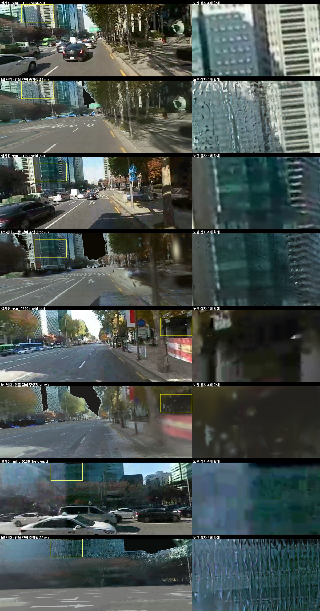

* 각 장면 위가 실제 사진, 아래가 k5 렌더 (held-out). 정면의 먼 건물은 창문 격자가 나오지만 금 간 무늬가 있고, 길 건너편 건물은 세로 줄무늬 바늘로 깨짐

| 진단 | 결과 |
|---|---|
| 사진 자체 해상도 | 사진을 절반으로 줄였다 되돌려도 PSNR 41에서 44 dB. 실제 정보는 명목 해상도의 절반 수준 |
| 건물 렌더 세부 | 세부량은 사진만큼 있으나 위치 일치(NCC)가 0.03에서 0.08. 잡무늬임 |
| 나무 렌더 세부 | 학습 사진의 선명한 영역조차 세부 0.55배, NCC 0.26 |
| 기각한 원인 | LiDAR 로 시작한 것, 번진 사진이 세부를 덮어쓴 것 (k6 시험) |
| 남은 원인 | 한 번 지나간 주행이라 같은 곳을 본 각도가 좁음, 360 카메라 보정 부재로 시점끼리 기하가 안 맞음 |

**한 번의 주행과 한 대의 360 카메라만으로는 정보가 모자란 것이 핵심임. Tesla 조사도 이 관점에서 정리함**

## 2. Tesla FSD 씬 구성 방법

> 출처 표기: Tesla 는 Tesla 공식 계정, Ashok Elluswamy(Tesla AI 총괄), Elon Musk 의 발표와 글, 릴리스 노트. 언론과 사용자 글은 따로 표시함. 2026년 11월 24일 기준

| 구성 | 무엇 | 입력 | 속도 | 용도 | 근거 |
|---|---|---|---|---|---|
| Generative Gaussian Splatting | 주행 신경망의 보조 출력으로 3D Gaussian 을 한 번에 생성 | 양산차 카메라 영상만 | 약 220 ms, 초기화나 COLMAP 불필요 | 디버깅, 해석, 주차 형상 | Tesla, ICCV 2025, CVPR 2026 |
| world simulator | 행동을 받아 8개 카메라 영상을 생성 | 현재 상태와 다음 행동 | 8개 카메라 24 fps 실시간, 6분 이상 | closed loop 평가, 끼어들기 같은 위험 상황 주입, 강화학습 | Tesla, ICCV 2025 |
| Reality View (FSD v15) | 차 위 가상 카메라 시점의 사실적인 영상 | 주행 모델의 영상 특징(UVE) | 18 Hz, AI4 칩 가속기 절반 | 운전자 화면. 기존 상자와 선 표시를 대체 | Tesla, 2026년 11월 21일 배포 |

**셋 중 3D 재구성은 Generative Gaussian Splatting 하나뿐이고, 사람들이 놀란 사실적인 화면은 Reality View(2D 생성)임**

* 셋 다 같은 대규모 주행 데이터로 학습됨. 장면 하나만 보고 맞추는 방식은 없음
* Generative Gaussian Splatting 의 구조와 학습에 여러 번 지나간 데이터를 쓰는지는 공개되지 않음

### 2.1 Tesla 의 진단: 직선 주행에서는 장면별 3DGS 가 깨짐

> "3D Gaussian Splatting 은 기준선이 넓은 카메라 시점이 필요하다. 차량 움직임은 거의 직선이라 일반 Gaussian Splatting 은 특히 새 시점에서 품질이 나쁘다. 다른 파이프라인의 초기화가 필요하고 최적화에 수십 분이 걸린다." (Ashok Elluswamy, 2025년 10월 24일, 번역)

* 출처: https://x.com/aelluswamy/status/1981644831790379245 (ICCV 2025 발표 요약 글)
* 발표 영상 12분 14초 부근: 학습 시점 근처는 좋아 보이지만 멀어지면 깨진다고 설명함. https://www.youtube.com/watch?v=IRu-cPkpiFk
* 우리 k6 시험과 시선 각도 측정(중앙값 8.7도)이 가리키는 것과 같은 진단임

### 2.2 Generative Gaussian Splatting

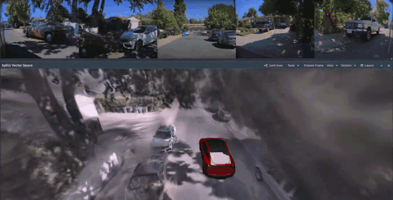

* 위 줄은 차량 카메라 영상, 아래는 그 영상에서 신경망이 바로 만든 Gaussian 을 다른 시점에서 본 것 (Ashok Elluswamy, 2025년 10월 24일). 원본 [mp4](../res_wjdaksry/1124/tesla/tesla_iccv2025_generative_gaussians_from_cameras.mp4)
* 도로, 차, 집 형태는 잘 나오지만 나무와 산울타리는 우리 결과처럼 뭉개져 있음

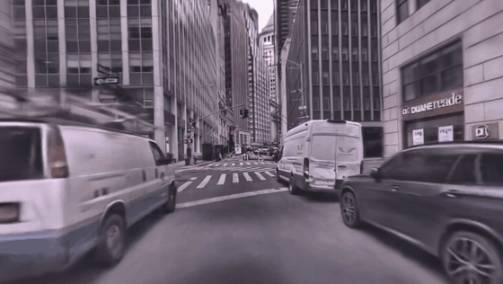

* 같은 Gaussian 을 새 시점으로 돌려 본 렌더. 원본 [mp4](../res_wjdaksry/1124/tesla/tesla_iccv2025_generative_gaussians_novel_view.mp4)

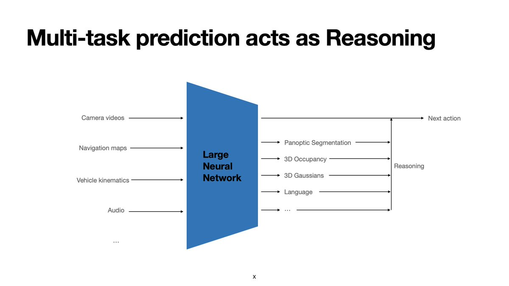

* 하나의 큰 주행 신경망이 행동과 함께 segmentation, occupancy, 3D Gaussian, 언어를 보조 출력으로 냄. Gaussian 은 주행 모델과 같이 학습되는 출력 중 하나임

| 항목 | Tesla 발표 내용 | 우리 |
|---|---|---|
| 방식 | feed-forward, 한 번 통과 | per-scene optimization |
| 시간 | 약 220 ms (하드웨어 비공개) | 블록 하나에 약 40분 |
| 초기화 | 필요 없음, COLMAP 없음 | LiDAR 점과 지도 mesh |
| 동적 객체 | 같이 모델링 | 마스크로 제외 |
| 의미 정보 | Gaussian 마다 semantics 출력 | Mask2Former 라벨을 따로 사용 |
| 정확도 주장 | 센티미터 수준 (CVPR 2026) | 측정 기준 다름 |

**Tesla 의 일반화 능력은 함대 규모 데이터로 미리 학습한 데서 나옴. 같은 장면을 더 오래 최적화해서 얻은 것이 아님**

* CVPR 2026 발표: "장면 전체를 feed-forward 로 생성, 차량 영상만으로, 센티미터 수준 정확도". https://www.youtube.com/watch?v=2V0ddkF1Svo (16분 27초 부근)
* 논문이나 특허로 구조를 공개한 적은 없음

### 2.3 world simulator

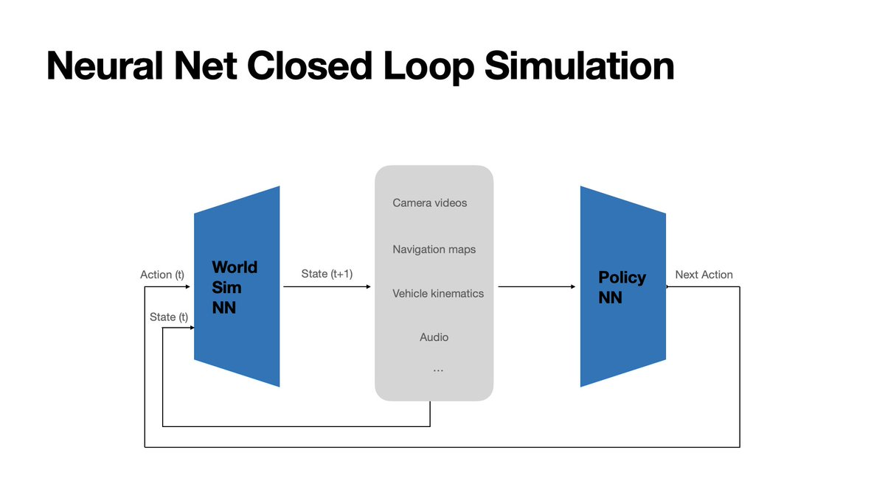

* world simulator 가 현재 상태와 행동을 받아 다음 상태(카메라 영상 등)를 생성하고, 주행 정책이 그 영상을 보고 다음 행동을 냄. 이 고리를 계속 돌림

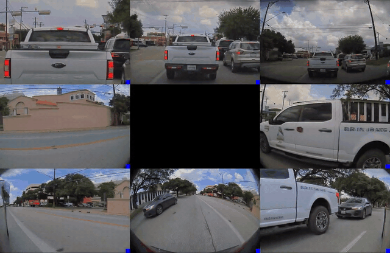

* 생성된 전방, 측방, 후방 카메라 영상. 실제 촬영이 아님. 원본 [mp4](../res_wjdaksry/1124/tesla/tesla_iccv2025_world_sim_generated_8cam.mp4)

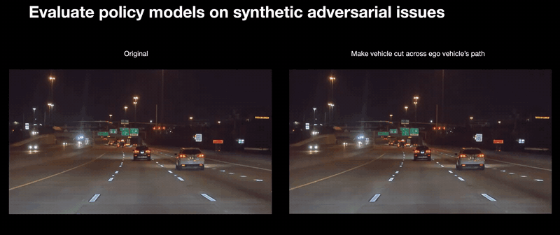

* 시뮬레이터 안에 위험한 끼어들기 차량을 넣은 장면. 원본 [mp4](../res_wjdaksry/1124/tesla/tesla_iccv2025_world_sim_adversarial_cutin.mp4)

**우리 Genesis 의 역할(물리와 화면)을 Tesla 는 신경망 하나로 대신함. 다만 물리 collider 는 없음**

* Musk: "작년부터 거의 화소 단위로 정확한 world model 이 있었고 합성 데이터 생성에 핵심이다" (2026년 11월 22일). https://x.com/elonmusk/status/2124458557525397780
* 실제 사고 장면을 새 정책으로 다시 돌려 보는 데에도 씀

### 2.4 FSD v15 Reality View (2026년 11월 21일 배포)

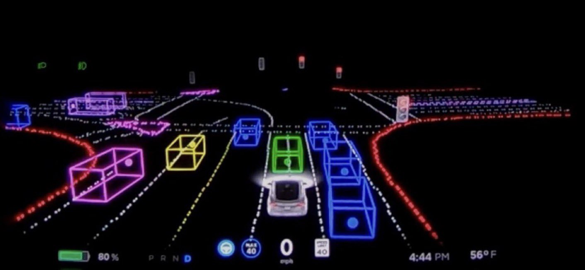

* 기존 화면. 차선과 차량을 선과 상자로 표시함

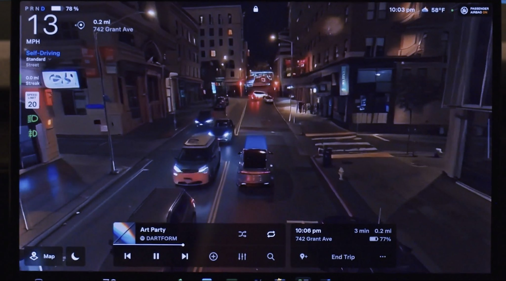

* FSD v15 Reality View. 같은 차량 화면이 건물, 가로등, 횡단보도, 차량 반사까지 사실적인 영상으로 바뀜 (사용자 게시, Ashok Elluswamy 가 인용). https://x.com/wholemars/status/2124228641957798038

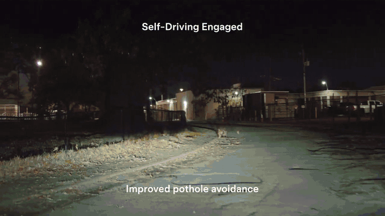

* Tesla 공식 v15 소개 영상 일부. 원본 [mp4](../res_wjdaksry/1124/tesla/tesla_fsd_v15_reality_view_official_teaser.mp4), 출처 https://x.com/Tesla/status/2124222447855743019

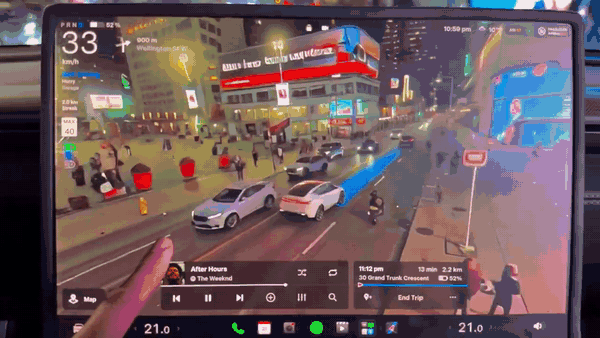

* 사용자 촬영. 야간 번화가에서 간판, 보행자, 건물이 실시간 생성됨. 원본 [mp4](../res_wjdaksry/1124/tesla/tesla_fsd_v15_reality_view_downtown_user.mp4), 출처 https://x.com/niccruzpatane/status/2124354639399370872

| 항목 | 내용 | 근거 |
|---|---|---|
| 모델 | 약 10억 파라미터 diffusion, conditional mean flow | Musk, 11월 22일 |
| 입력 | 주행 모델(30억 파라미터)과 같은 UVE 영상 특징 | Musk, 11월 22일 |
| 시간 연결 | 직전 Reality View 출력에 잡음을 더한 뒤 현재 프레임으로 복원 | Musk, 11월 22일 |
| 출력 | 8장 묶음 영상 조각, 36 fps, 화면 해상도 | Musk, 11월 22일 |
| 연산 | AI4 칩 TRIP 가속기 절반, 18 Hz, 8비트 정수 | Musk, 11월 21일과 22일 |
| 게임 엔진 | 쓰지 않음 ("no gaming engine") | Musk, 11월 21일 |
| 지연 | 약 1초 | 언론 (TechRadar 인용 TNW, 11월 23일) |
| 대상 | AI4 하드웨어 차량, 첫 배포는 신형 Model Y | 언론 (notateslaapp, 11월 22일) |

**Reality View 는 3D 장면을 만들지 않음. 주행 모델이 이미 가진 특징으로 사실적인 2D 영상을 매 순간 생성하는 것임**

* "화소마다 3D 무대에 올린다"는 일부 기사 표현은 Tesla 설명과 맞지 않음. Musk 는 2D 영상 diffusion 으로 설명함
* 2025년 펌웨어 분석에서 나온 Unreal Engine 화면 소문은 별개의 이전 이야기임
* 출처: Musk 기술 설명 https://x.com/elonmusk/status/2124458557525397780 , 릴리스 노트 요약 https://www.teslarati.com/tesla-full-self-driving-v15-rollout-begins-full-release-notes-improvements/

<b>Tesla 원문 영상과 발표 목록</b>, 날짜와 링크 (펼치기)

| 자료 | 날짜 | 링크 |
|---|---|---|
| ICCV 2025 WDFM 기조연설 (Generative Gaussian Splatting 12분 14초) | 2025년 10월 24일 | https://www.youtube.com/watch?v=IRu-cPkpiFk |
| Ashok Elluswamy 글 "Tesla's approach to Autonomy" | 2025년 10월 24일 | https://x.com/aelluswamy/status/1981644831790379245 |
| CVPR 2026 WAD 기조연설 (16분 27초 Gaussian, 18분 35초 world simulator) | 2026년 6월 3일 발표 | https://www.youtube.com/watch?v=2V0ddkF1Svo |
| CVPR 2026 WDFM 기조연설 (18분 18초) | 2026년 6월 발표 | https://www.youtube.com/watch?v=i2hB_8BeueM |
| FSD v15 배포 공지 | 2026년 11월 21일 | https://x.com/Tesla/status/2124222447855743019 |
| Ashok Elluswamy, 같은 주행 모델이 화면도 그림 | 2026년 11월 21일 | https://x.com/aelluswamy/status/2124229978560835880 |
| Musk, Reality View 구조 설명 | 2026년 11월 22일 | https://x.com/elonmusk/status/2124458557525397780 |
| Q3 2025 실적 발표 (world simulator 언급) | 2025년 10월 22일 | https://www.fool.com/earnings/call-transcripts/2025/10/22/tesla-tsla-q3-2025-earnings-call-transcript/ |

## 3. 같은 생각을 공개한 논문

| 방법 | 계열 | 핵심 | 링크 |
|---|---|---|---|
| Instant NuRec (NVIDIA) | feed-forward Gaussian | 여러 카메라를 한 번에 보는 ViT 가 깊이, 의미, 움직임, 하늘, 3DGS 를 출력. 장면당 약 1.5초 (최적화 NuRec 약 75분) | arXiv 2607.14203 |
| STORM | feed-forward Gaussian | Gaussian 마다 속도를 예측해 시간에 따라 이동. 한 번 통과로 동적 장면 | arXiv 2501.00602 |
| EVolSplat | feed-forward Gaussian | 잡음 섞인 깊이 점을 3D CNN 에 넣어 Gaussian 형상 예측, 반구 하늘 모델 | arXiv 2503.20168 |
| VGGT, AnySplat | pose 없는 prior | 카메라 자세와 Gaussian 을 한 네트워크가 같이 냄. "COLMAP 불필요" 주장의 근거가 되는 계열 | arXiv 2503.11651, 2505.23716 |
| Xiaomi JWM | 재구성과 생성 결합 | feed-forward 3DGS 와 4단계 영상 생성을 같이 학습. Tesla 의 Gaussian 과 world simulator 조합에 가장 가까운 공개 사례 | arXiv 2605.18137 |
| StreetCrafter | 생성 prior | 새 시점의 LiDAR 렌더를 조건으로 영상 diffusion, 결과를 3DGS 로 증류 | arXiv 2412.13188 |
| ReconDreamer | 생성 prior | 렌더 복원 모델을 학습 중에 쓰고, 경로에서 벗어나는 폭을 점점 늘림 | arXiv 2411.19548 |
| GEN3C | 생성 prior | 깊이로 만든 3D 점 캐시를 목표 시점에 렌더해 영상 모델 조건으로 씀 | arXiv 2503.03751 |
| MTGS | multi-traversal | 여러 번 지나간 주행을 정적 공통 부분, 회차별 동적 부분, 회차별 색 보정으로 나눔 | arXiv 2503.12552 |
| Wayve GAIA-2, Waymo World Model, NVIDIA Cosmos | world simulator | 행동, 객체 상자, 도로 정보를 조건으로 여러 카메라 영상 생성 | arXiv 2503.20523, waymo.com 블로그 2026년 2월, arXiv 2501.03575 |

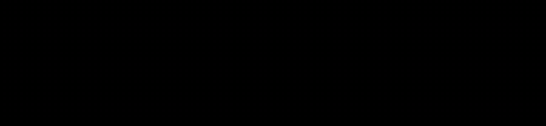

* Instant NuRec 소개 영상. 우리가 9월에 시험한 도구의 feed-forward 판본임 (NVIDIA 프로젝트 페이지). 원본 [mp4](../res_wjdaksry/1124/tesla/instant_nurec_feedforward_teaser.mp4)

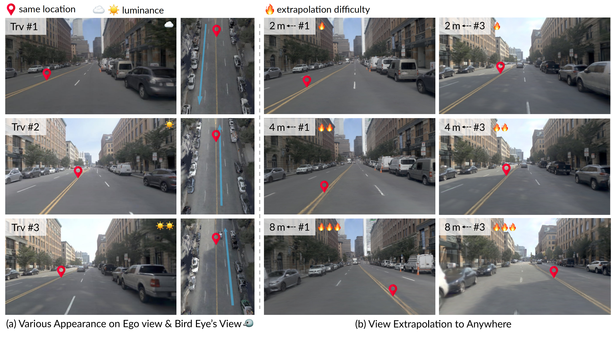

* MTGS. 같은 도로를 여러 번 지나간 주행을 합쳐 한 번 주행보다 넓은 시점을 확보함

**Tesla 와 같은 방향의 공개 방법은 두 갈래임. 미리 학습한 feed-forward 모델로 형상을 잡거나, 생성 모델로 안 본 시점을 채워 3D 로 증류함**

## 4. Tesla 와 우리의 차이

| 항목 | Tesla | 우리 |
|---|---|---|
| 데이터 | 함대 전체, 하루 500년 분량 주행에서 고른 데이터 | 360 카메라 1대, 주행 1회, 372 m |
| 카메라 | 차량 8대, 보정된 양산 구성 | 360 카메라 1대, 렌즈와 stitch 보정 없음 |
| 3D 방식 | feed-forward Gaussian, 미리 학습 | 장면별 최적화, LiDAR 와 지도로 초기화 |
| 사실적인 화면 | 2D 생성 모델(Reality View) | 3D Gaussian 렌더 그대로, Difix 는 학습 중에만 |
| 물리 | 없음 (영상만 생성) | Genesis collider |
| 나무 선명도 | 3D 데모에서도 흐림 | 흐림 (k6 까지 원인 일부 기각) |

**우리에게 없는 것은 데이터 양과 미리 학습한 prior 임. 같은 장면을 더 잘 최적화하는 방향으로는 Tesla 수준에 닿기 어려움**

* 적용 후보 1: 공개 feed-forward 모델(Instant NuRec, EVolSplat, VGGT)을 초기화나 정규화로 쓰고 그 위에서 장면별 학습
* 적용 후보 2: 같은 구간을 다른 차로와 방향으로 한 번 더 주행해 MTGS 식으로 합침. 길 건너편 건물의 시선 각도를 실제로 늘리는 유일한 방법임
* 적용 후보 3: 화면을 사실적으로 보이게 하려면 Reality View 처럼 렌더 뒤 생성 모델을 거치는 길뿐임. 우리 규칙상 Difix 렌더 후처리(Difix3D+)는 요청할 때만 쓰므로 **판단 필요**

## next step
