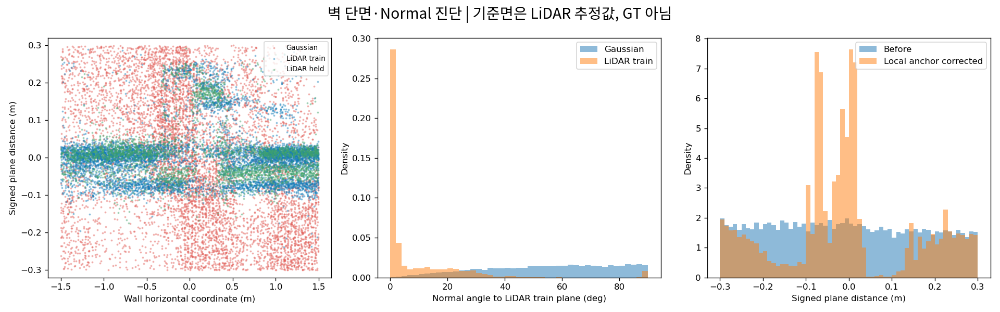
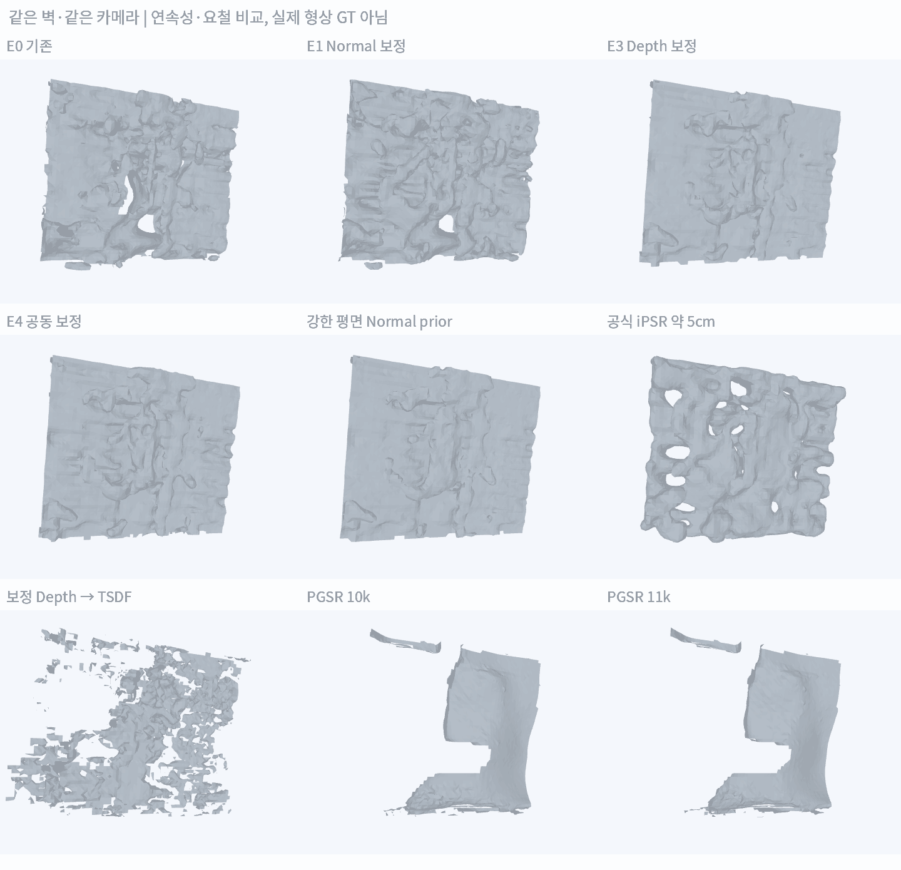
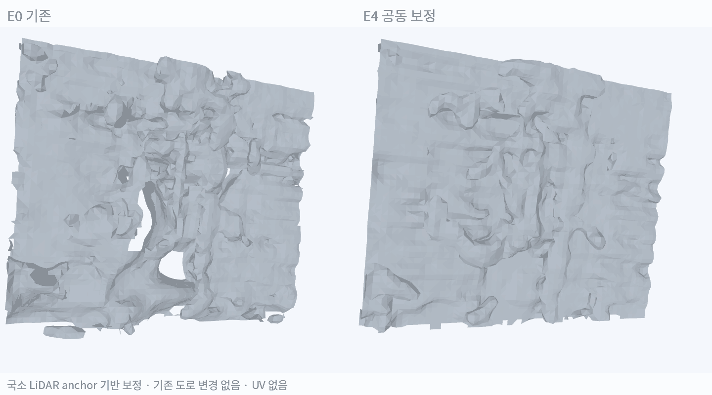
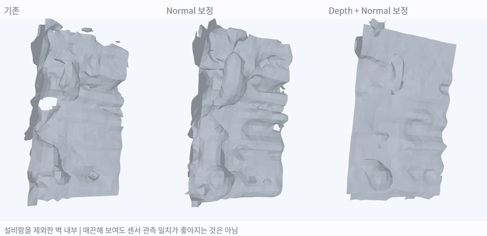
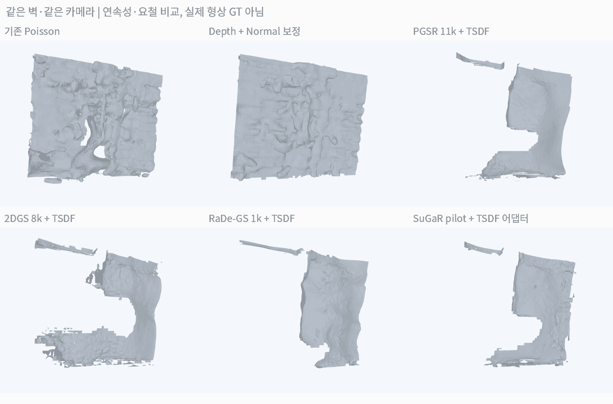

# ADI 배경 Mesh의 Depth·Normal 분리 실험 결과

> **Normal만 바꿔서는 충분하지 않았음. 넓은 patch에서는 depth 보정이 요철을 줄였지만, 설비함을 제외한 벽 내부에서는 공동 보정이 센서 잔차를 오히려 늘렸음. 매끈함과 실제 관측 일치를 구분해야 함.**

실험일: 2026-10-25. [개선 계획](./[DIGLAB][26-10-25][정만교]_Poisson_depth_normal_improvement_plan.md)의 진단·normal-only·depth·공동 보정·TSDF·공식 연구 구현을 소구간에서 비교함. 도로·현재 best T·추가 노출 지연 0초는 유지함. 전체 배경이나 Genesis 주행 결과를 교체한 것은 아님.

## 1. 실제로 어떤 곳을 검사했는가

**녹색 영역은 벽만 있는 곳이 아님. 왼쪽에 벽 앞의 설비함도 포함됨.** 처음의 기하·semantic 후보만으로 같은 평면이라고 묶으면 다른 깊이의 물체까지 섞일 수 있다는 사례임. 이를 발견한 뒤 오른쪽 벽 내부만 따로 검사함.

| 구분 | 넓은 patch | 추가 벽 내부 patch |
|---|---|---|
| 크기 | 약 3×2.5m의 기준면 chart | 약 1×1.6m |
| 실제 LiDAR: 복원용 / 제외 관측 | 6,494 / 3,093점 | 1,596 / 760점 |
| Gaussian depth 표본 | 14,758점 | 3,051점 |
| 선택 | Train LiDAR 평면 주변 ±30cm 표면 가설 | 실제 RGB 확인 후 설비함을 제외한 오른쪽 내부 |
| 평가 한계 | 서로 다른 물체·실제 돌출 형상 포함 가능 | 앞선 결과를 본 뒤 고른 추가 개발 구간. 독립 test 아님 |

Camera label의 modulo 20이 12 미만이면 복원용, 14 이상이면 제외 관측으로 분리함. 기존 Gaussian 학습·pose·LiDAR 운동 추정은 관측 이력이 겹칠 수 있으므로 **복원 단계의 제외 관측 검사이지 독립 GT 정확도 검증은 아님.**

## 2. 첫 진단: Normal뿐 아니라 점 위치도 불안정함

| 넓은 patch의 관측 | Gaussian 표본 | Train LiDAR 표본 |
|---|---:|---:|
| 기준면 법선 방향의 P5~P95 폭 | 53.85cm | 27.09cm |
| 기준면에서 절대거리 P90 | 26.95cm | 12.47cm |
| 기준면과 normal 각도 P50 / P90 | 56.96° / 83.77° | 1.48° / 25.09° |

기준면은 train LiDAR의 RANSAC 추정값임. 위 폭에는 실제 돌출 구조·정합 오차·depth 편향·표면 혼합이 함께 포함될 수 있음. **±30cm로 선택한 점의 통계이므로 Gaussian 전체의 정확도나 고유 두께로 해석하지 않음.**

Gaussian PCA normal의 반경을 8·15·30cm로 바꿔도 각도 중앙값은 약 55.76°·49.83°·48.91°로 남았음. 이 patch에서는 이웃 반경 하나만 바꿔 안정된 벽 normal을 얻지 못함. 설비함을 제외한 내부에서도 Gaussian 표본 폭 약 51.14cm, normal 각도 중앙값 약 50.09°가 남았음.

## 3. 무엇을 바꿔 mesh를 만들었는가

| ID | 실제 적용 | 구분 |
|---|---|---|
| E0 | 기존 점 위치·normal → Poisson | 같은 작은 patch의 기준. 이전 전체 ROI mesh와는 영역이 다름 |
| E1 | XYZ 고정, 국소 PCA normal 반경 15cm·기준면 방향으로 부호 정리 → Poisson | Normal-only 대조. 논문 전체 구현 아님 |
| E2 | 동일 XYZ에 공식 iPSR 실행 | 공식 구현 실행. 입력 normal을 재사용하는 방식이 아니라 반복 추정 |
| E3 | Train LiDAR의 국소 깊이 anchor로 Gaussian depth 보정, Gaussian normal은 기존 반경 20cm로 재계산 | Depth 변경과 그에 필요한 normal 재계산. 엄밀한 XYZ-only 대조는 아님 |
| E4 | 보정 depth + 반경 15cm normal 재추정 → Poisson | Depth·normal 공동 보정 |
| 평면 normal prior | E4 점에 기준면과 동일한 normal 부여 | 강한 평면 가정의 대조군. 실제 세부 형상을 보존한다고 보장하지 않음 |
| E5 | 같은 카메라의 Gaussian depth를 국소 anchor로 보정 → TSDF | Camera Z depth·pose로 실제 fusion. 원시 LiDAR ray의 별도 TSDF 적분은 하지 않음 |

국소 depth anchor는 10cm chart cell에서 3점 이상·2개 이상 scan을 지지하고, cell 내부 거리 분산이 작은 경우만 사용함. Anchor가 없는 곳은 20cm 이내에서만 보완하고, Gaussian depth의 법선 방향 수정은 20cm 이내로 제한함. **실제 원래 카메라 ray 위에서 이동**해 source pixel과의 관계를 유지함. 열린 문·창의 실제 형상을 검증한 보정은 아님.

Poisson 목표 셀은 5cm, 입력점 지지거리 trim은 15cm로 고정함. E0/E1은 XYZ 해시가 같은지 확인함. E3/E4는 같은 보정 XYZ를 사용함. Normal 방향 정리·ray 보존·지원 없는 점 불변의 단위 테스트 3개 통과함.

## 4. 넓은 patch 결과

| 방법 | 제외 LiDAR 거리 P90 ↓ | 기준면 대비 mesh normal 중앙각 ↓ | 분리 조각 수 |
|---|---:|---:|---:|
| E0 기존 | 7.21cm | 22.16° | 35 |
| E1 Normal 보정 | 6.30cm | 27.69° | 19 |
| E3 Depth 보정 | 6.01cm | 11.60° | 21 |
| E4 공동 보정 | 5.97cm | 14.54° | 23 |
| 강한 평면 normal prior | 6.08cm | 10.54° | 22 |
| iPSR 약 5cm | 5.70cm | 26.20° | 2 |
| 보정 Gaussian depth → TSDF | 12.38cm | 26.33° | 306 |

**Normal-only는 일부 센서 잔차·조각 수를 줄였지만, 면의 각도 요철은 줄이지 못함.** 이 patch에서는 depth를 보정한 E3/E4가 더 매끈해졌음. E4의 제외 LiDAR P90은 E0 대비 약 17.2% 감소함.

이 표의 거리는 제외한 LiDAR 점에서 가까운 mesh까지의 거리임. 여러 겹의 면이나 닫힌 껍질을 만들면 점 근처에 면이 생겨 수치가 낮아질 수 있음. 따라서 iPSR를 이 값만으로 최상이라고 채택하지 않음. 기준면 대비 normal 각도 역시 실제 설비함·벽의 모서리를 요철로 셀 수 있는 참고 지표임.

Poisson 원본·density 필터·support trim 결과도 별도 저장함. 이 국소 E0는 trim 전후 조각 수가 33→35, P90이 7.18→7.21cm여서 **이번 patch의 요철을 trim 하나로 설명하기는 어려움.**

## 5. 설비함을 제외하면 같은 결론이 나오는가

| 방법 | 제외 LiDAR 거리 P90 ↓ | 기준면 대비 mesh normal 중앙각 ↓ |
|---|---:|---:|
| E0 기존 | 5.62cm | 21.17° |
| E1 Normal 보정 | **5.04cm** | 27.38° |
| E3 Depth 보정 | 5.76cm | 11.73° |
| E4 공동 보정 | 5.86cm | 14.40° |
| 강한 평면 normal prior | 5.77cm | 11.01° |

**더 매끈해진 E3/E4가 센서 거리에서는 더 좋아지지 않았음.** 이 벽 내부에서는 E1의 P90이 가장 낮았음. 넓은 patch에서 E4가 개선됐다는 이유로 전체 배경에 같은 보정을 적용하지 않음.

이는 단순히 ‘벽을 평평하게 만들면 해결’되는 문제가 아님을 보여줌. 실제 돌출 형상, 추정 기준면, 국소 anchor 편향, 잔여 정합 오차를 구분해야 함. 매끈한 visual과 정확한 collider는 별도 평가 대상임.

## 6. 공식 iPSR 실행 결과

| 조건 | 약 5cm 대조 | 더 촘촘한 대조 |
|---|---:|---:|
| Octree depth / 실제 nominal cell | 6 / 5.20cm | 7 / 2.60cm |
| 반복 | 100회 | 30회 |
| 마지막 normal variation | 0.402 | 0.583 |
| 공식 종료 기준 0.175 미만 | 미충족 | 미충족 |
| 제외 LiDAR P90 | 5.70cm | 4.84cm |

공식 코드를 빌드하고 실제 mesh 생성을 완료함. 두 조건 모두 반복 상한에서 종료했으며 수렴으로 기록하지 않음. 닫힌 껍질 형태가 만들어졌고, 약 5cm 결과 면적은 약 25.54㎡로 E0 약 17.30㎡보다 큼. **연결됐다는 사실과 실제 얇은 벽을 정확히 복원했다는 것은 다름.**

## 7. 재학습 기반 연구의 실제 실행 상태

PGSR·2DGS 등은 기존 NuRec PLY의 단순 mesh 후처리와 다름. 같은 실제 RGB·추정 camera pose를 사용하되 각 방법의 표현·초기화·일정이 다르므로 아래 비교를 동일 학습량의 순위표로 해석하지 않음.

| 연구 | 이번 실행 | 결과·제한 |
|---|---|---|
| PGSR | 기존 공식 10k checkpoint 보존, 별도 위치에서 11k까지 추가 최적화·mesh export | 같은 patch의 TSDF P90 49.86→49.89cm. 이번 1k 추가 실행에서 뚜렷한 개선 없음 |
| 2DGS | 공식 renderer 빌드, 실제 train RGB 37장으로 새 8k 학습·mesh export | TSDF P90 34.06cm. Densification을 끈 제한 pilot이며 normal loss는 마지막 1k step에 활성화. 충분한 최적화의 상한 성능을 나타내지 않음 |
| RaDe-GS | 공식 renderer 빌드, 실제 train RGB로 새 1k 학습·depth→mesh export | TSDF P90 64.74cm. 짧은 실행을 위해 기하 정규화를 첫 step부터 적용하고 densification을 비활성화한 pilot |
| SuGaR | PGSR PLY 초기화로 coarse 학습 1,001회, 보정 초기화에서 실행 성공 | TSDF 어댑터 P90 59.35cm. 공식 density-level mesh 추출·mesh-bound refinement까지 완료한 결과는 아님 |
| VCR-GauS | 공식 CUDA 빌드·PyTorch3D 재사용·실제 GPU entrypoint 실행 | Dataset loading에서 필요한 normal prior `normals/front_0072.npz` 등이 없어 중단. Optimizer 0 step·mesh 없음 |
| DN-Splatter | 기존 환경에서 실제 설정 모듈 import·의존성 검사 | Nerfstudio·관련 의존성 미충족. 전체 학습 실행은 미완료이며 자체 normal 보정 실험과 구별함 |

위 P90은 동일 patch·동일 제외 LiDAR에 대한 값임. PGSR·2DGS는 이 LiDAR를 depth supervision으로 넣지 않았음. 표현 변경만으로 센서와 정확히 일치하는 표면이 자동 생성되지는 않았음.

SuGaR 첫 실행에서는 CUDA/NaN 오류가 발생함. PGSR 초기화의 최소 scale이 약 1.61×10⁻¹⁴m였으며, 별도 복사본의 scale을 최소 1mm로 제한하고 pruning·실행 일정을 조정한 pilot에서 학습을 완료함. 원본 checkpoint는 보존함. 저장 파일명이 `10000.pt`여도 이번 optimizer 실행은 **1,001회**이며, SuGaR 자체를 새로 10k 학습한 것으로 세지 않음.

이 그림의 SuGaR·RaDe-GS·2DGS mesh는 해당 모델의 depth를 어댑터 TSDF에 넣은 결과임. 각 논문의 모든 extraction/refinement 단계를 동일하게 완료한 비교가 아님. 환경 준비·import 성공을 학습 성공으로 세지 않음. VCR-GauS의 실패는 GPU 성능 부족이 아니라 현재 dataset에 필요한 normal prior가 없어서 발생함.

## 8. 현재 판단과 다음 개발

1. **표면 분리가 첫 번째임.** 실제 RGB를 확인하지 않으면 설비함과 벽을 하나의 평면으로 잘못 취급할 수 있음.
2. **Gaussian depth 위치와 normal이 모두 불안정한 후보가 존재함.** Normal 방향만 바꾸는 것으로 전체 문제가 해결되지 않음.
3. **보정이 좋아 보이는 것과 센서 잔차 개선은 다름.** 두 patch에서 결과가 달라 전역 적용은 보류함.
4. **다음은 경계·표면별 confidence를 개발할 단계임.** 실제 벽·설비함을 분리하고, 같은 면 안에서만 LiDAR anchor·depth·normal을 결합함. 카메라·LiDAR 정합의 잔여 오차도 별도 불확실성으로 둠.
5. 도로는 기존 LiDAR-only 유지. 검증되지 않은 배경 mesh를 정확한 collider로 채택하거나 기존 결과 GIF에 덮어쓰지 않음.

## 재현 자료

- 코드: instant_nurec의 `research/adi_depth_normal_campaign.py`, `research/adi_surface_training_campaign.py`
- 입력·실험·mesh: `adi_quality_20261018/depth_normal_campaign_20261025/`
- 진단: `diagnostic.json`, `pure_wall/diagnostic.json`
- 대조: `ablation_results.json`, `pure_wall/ablation_results.json`, `tsdf_result.json`, `external_results.json`
- 공식 실행: `ipsr_run.json`, `ipsr_d6_run.json`, `training/`의 command·execution·checkpoint·export 기록
- [연구별 적용 근거와 단계별 계획](./[DIGLAB][26-10-25][정만교]_Poisson_depth_normal_improvement_plan.md)
