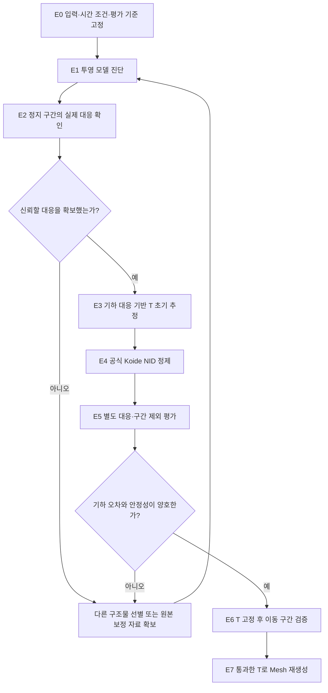

# ADI Camera–LiDAR Extrinsic 검증 계획

**추가 시간 오차는 0초로 고정함. 다음 우선순위는 카메라 투영 모델과 실제 3D–2D 대응을 확인한 뒤, 같은 T가 여러 장면에서도 유지되는지 검증하는 것임.**

현재는 T 후보를 계산했지만, 실제 센서 장착 관계에 맞는지 판별할 근거가 부족함. **1~5절은 전체 검증 계획이며 전체 실행 완료를 뜻하지 않음. 선행 연구를 반영한 1차 실행 범위와 결과는 6절에 구분해 기록함.**

## 1. 문제 정의와 현재 결과

| 현재 확인한 것 | 의미 |
|---|---|
| 추가 지연 0초로 T 추정 완료 | 시간 offset을 최적화하지 않고 회전·이동만 추정함 |
| 구조물 8.00px·도로 표식 4.65px | 가장 가까운 영상 경계까지의 거리 지표. 확인된 동일점의 정답 오차는 아님 |
| 초기값 3종의 위치 차이 0.86cm | 같은 입력에서는 비슷한 해로 수렴함 |
| 구간 제외 시 최대 2.89m·2.39° 변화 | 사용한 장면에 따라 다른 해로 수렴함. 실제 장착값 대비 오차나 신뢰구간은 아님 |

**핵심 문제: 비용이 낮은 T와 물리적으로 올바른 T를 구분할 검증 근거가 부족함.** 시간 지연이 원인이라고 가정하지 않고, 아래 공간 정합 조건을 먼저 확인함.

기존 결과: [Camera–LiDAR T 추정 보고서](./[DIGLAB][26-10-24][정만교]_Camera_LiDAR_extrinsic.md)

## 2. 필요한 정보와 ADI 확보 상태

원본 ZIP의 13개 파일과 기존 실험 자료를 기준으로 정리함.

| 필요한 정보 | 사용하는 목적 | 현재 상태 | 데이터에서 추가 확보 가능한가? |
|---|---|---|---|
| 실제 RGB | 같은 물체의 영상 위치 확인 | AroundView·AVNView 있음 | **가능.** 원본 프레임·확대 영역 추출 |
| LiDAR XYZ·반사강도·ring | 실제 3D 위치·물체 후보 확인 | VLP-16 PCAP 있음 | **가능.** 원본 반환점 ID와 함께 보존 |
| 공통 시각·발사 시각 | 같은 시각의 관측 대응·deskew | 전체 영상 UTC 대응표 생성 완료 | **가능.** 추가 노출 offset 0초로 사용 |
| Camera intrinsics·투영 모델 | 3D 점을 영상 픽셀로 변환 | 가상 카메라 K는 알고 있음. 원본 렌즈·stitching 보정은 미검증 | **부분 가능.** 영상 기반 진단 가능. 원본 물리 보정값은 공유본에서 확인 못함 |
| 실제 3D–2D 대응 | T 초기 추정·독립 평가 | 자동·수동 후보는 있지만 정확한 대응 확정 부족 | **선별·검토 필요.** 원본 정보가 부족한 물체는 사용 불가 |
| 정적이고 다양한 구조물 | 회전·이동의 모호성 감소 | 건물·기둥·표식·정지 구간 존재 | **가능성 있음.** LiDAR와 영상 양쪽에 충분히 보이는 구조물을 골라야 함 |
| 센서 고정 장착·실측 위치 | 일정한 T 가정·비현실적 후보 배제 | 고정 장착 가정. 당시 장착 실측값 미확보 | 원본 영상만으로 정확한 장착 치수는 확인 곤란. 외부 자료 필요 |
| Camera/LiDAR pose | 이동 중 누적·deskew | SfM·ICP 기반 추정값 있음 | **추정 가능.** 정지 단일 관측의 extrinsic 추정에는 필수 입력이 아님 |
| 별도 검증 관측 | 특정 장면 과적합 확인 | 기존 검증 장면을 반복 사용했음 | **추가 선별 가능.** 사용 이력을 확인해 검증 조건을 사전 고정 |

**가상 카메라 K는 우리가 정의한 재투영 수식이지, 원본 카메라의 실측 보정값은 아님.** ZIP의 Lane/ObjectDetection JSON도 카메라–LiDAR 보정 정답으로 취급하지 않음.

GPS 위치는 공간 T를 직접 알려주지 않음. 이번에는 공통 시간축 확인에 사용하며, GPS·SfM 궤적을 extrinsic의 정답으로 고정하지 않음.

## 3. 이상적인 결과의 정의

**고정 장착된 센서에 하나의 T를 적용했을 때, 실제 같은 구조물의 대응이 여러 시각·거리·방향에서 유지되어야 함.**

| 검증 대상 | 기대하는 결과 |
|---|---|
| 한 시각의 대응 | 같은 물체의 확인된 3D 점·선이 영상의 해당 위치에 투영됨 |
| 가까운 곳·먼 곳 | 특정 거리만 맞고 다른 거리에서 체계적으로 벗어나지 않음 |
| 다른 화면 위치·방향 | 한 방향에만 맞고 다른 방향에서 크게 틀어지지 않음 |
| 다른 초기값 | 비슷한 회전·이동으로 수렴함 |
| 구간 제외 | 특정 장면을 빼도 T가 크게 달라지지 않음 |
| 별도 장면 | T를 고정한 상태에서 확인된 대응의 오차가 허용 범위 내임 |

LiDAR 점은 scan마다 관측 위치가 다를 수 있음. 화면의 점 배열을 유지하거나 모든 점을 기둥 테두리에 모으는 것이 목표는 아님. 정적인 World geometry를 누적할 때는 pose·deskew의 정확도도 별도로 필요함.

## 4. 실험 순서와 검증 방법

### E0. 입력과 평가 조건 고정

| 항목 | 실행 방법 | 확인·산출물 |
|---|---|---|
| 시간 조건 | 공통 UTC 사용. 추가 촬영 지연 0초 고정 | 사용 frame PTS·UTC·scan·발사 시각 목록 |
| 좌표 규약 | `p_camera = T_camera_lidar · p_lidar`, 미터 단위로 통일 | 양방향 T·축 방향·가상 카메라 방향 기록 |
| 데이터 분할 | 추정·개발 검증·최종 검증의 장면과 구조물 ID를 사전 구분 | 분할 manifest. 같은 물체의 인접 점만 나누어 독립 검증이라고 하지 않음 |
| 허용 오차 | 목표 사용 거리와 허용 공간 어긋남을 먼저 정함 | 픽셀·각도·센서 위치 안정성의 평가 기준 |

기존 30·180·300·450초는 추정 이력이 있고, 240·340·360·500초는 개발 평가에 사용함. 91·94·99초는 정지 대응 검토 이력이 있음. 이들을 완전히 새로운 최종 test라고 주장하지 않음.

### E1. 카메라 투영 모델 진단 — 첫 번째 우선 검증

**목적: 올바른 T가 있어도 현재 모델로 해당 영상에 정확하게 투영할 수 있는지 확인함.**

1. 원본 렌즈별 영상·intrinsics·stitching 자료의 존재를 확인함. 공유 ZIP에서는 검증된 보정값을 찾지 못했으므로, 별도 원본 자료가 있다면 우선 확보함.
2. 동일 구조물을 화면 위치·거리·접합부 여부로 구분하여 관측함. 가상 카메라 중앙으로 다시 자르는 것은 원본 stitching 오차 보정으로 간주하지 않음.
3. E2·E3에서 확보한 대응으로 T를 추정한 뒤, 잔차가 특정 방향·접합부·근거리에 집중되는지 진단함. 이 패턴만으로 원인을 확정하지 않음.

| 결과 | 다음 조치 |
|---|---|
| 일부 영역만 투영 모델이 일관됨 | 적용 가능한 영역·거리 범위를 명시해 우선 검증 |
| 원본 렌즈별 모델을 확보함 | 렌즈별 보정과 고정 rig 관계를 사용 |
| 단일 중심 모델로 설명하기 어려움 | 하나의 panorama T를 정답으로 강제하지 않고 렌즈 모델·접합 처리 검토 |

AVNView를 대안으로 사용하려면 **AVNView 자체의 intrinsics·왜곡·LiDAR extrinsic을 따로 확인**해야 함. AroundView T를 그대로 재사용하지 않음.

### E2. 정지 구간의 실제 3D–2D 대응 확보 — 두 번째 우선 검증

**목적: 가까운 경계가 아니라 실제 같은 구조물의 같은 기하 특징을 연결함.**

1. 정지 구간에서 차량·보행자 가림이 적은 건물 모서리·기둥·반사 표식을 선별함.
2. RGB와 3D 점군을 각각 검토하고 물체 ID를 부여함. 현재 T로 가까이 투영됐다는 사실만으로 동일 물체라고 확정하지 않음.
3. 3D 점과 영상 픽셀, 또는 확인된 3D 선과 같은 영상 선을 연결함. 점 대응과 선 대응은 서로 다른 residual로 처리함.
4. 사람이 같은 특징을 두 번 표시하여 주석 반복 오차를 기록함. 모서리가 흐리거나 LiDAR가 표면을 충분히 관측하지 못하면 불확실성 표시 또는 제외함.
5. 여러 물체·거리·방향에 대응을 분산함. **평면 교선 등 의미가 확인된 선을 우선 검토**하고, 정확한 점 대응이 보이는 경우에만 점도 사용함. 개별 점 대응 12~20개를 억지로 채우는 것을 목표로 삼지 않으며, 관측이 실제로 T의 여러 성분을 제약하는지 확인함.

**주의:** 영상의 기둥 중심과 LiDAR의 기둥 앞면은 같은 3D 지점이 아님. 영상의 벽 영역과 LiDAR 평면을 대략 연결한 것만으로 정확한 3D–2D 점 대응이 생기지도 않음.

산출물은 `물체 ID·frame PTS·scan ID·원본 반환점 ID·XYZ·픽셀/선 좌표·주석 불확실성·split` 목록과 RGB/3D 대응 검토 이미지임.

정지한 회전식 VLP-16을 오래 누적해도 같은 각도 패턴이 반복되면 관측이 충분히 촘촘해지지 않을 수 있음. 실제 새 반환점만 사용하며 보간 점을 측정값으로 추가하지 않음.

**진행 조건:** 물체 소속뿐 아니라 실제 기하 특징의 대응을 확인할 수 있어야 함. 확인되지 않으면 현재 자동 후보로 다음 단계를 강행하지 않고 다른 구간 또는 추가 자료를 확보함.

### E3. 확인된 대응으로 기하 기반 T 추정

| 항목 | 실험 방법 |
|---|---|
| 초기 추정 | 검증된 중심투영 카메라 K라면 PnP/RANSAC 적용. 구면 영상은 구면 광선 모델 또는 유효한 perspective 영역 사용 |
| 정제 | 확인된 점의 재투영 거리 또는 확인된 같은 선까지의 거리로 robust 최적화 |
| 고정 변수 | 시간 offset 0초, 검증한 카메라 모델. pose·intrinsics·T를 근거 없이 동시에 풀어 서로의 오차를 흡수하지 않도록 함 |
| 안정성 | 서로 다른 초기값과 대응 부분집합으로 반복 추정 |
| 평가 | 추정에 사용하지 않은 확인된 대응에 T 고정 적용 |

특징이 한 평면·한 방향·한 거리에 몰리면 해가 모호하거나 특정 오차에 민감해질 수 있음. 반복 수렴만으로 정답이라고 채택하지 않음.

### E4. 공식 Koide NID 정제

E3에서 구한 T를 초기값으로 공식 Koide `calibrate`를 실행함. **공식 NID를 사용하는 이 단계와 자체 기하 대응 최적화를 구분**함.

| 비교군 | 목적 |
|---|---|
| 기존 0초 다구간 T | 현재 기준 결과 |
| 확인된 대응 기반 T | 실제 기하 제약으로 추정한 결과 |
| 대응 기반 초기값 → Koide NID T | 공식 직접 정합을 추가했을 때의 변화 |

추정용 데이터로 후보를 선택하고, 고정된 검증 데이터로 수용 여부를 판단함. **NID만 줄고 확인된 대응 오차가 커지면 개선으로 채택하지 않음.** 검증 데이터를 반복 튜닝에 쓰기 시작하면 개발 데이터로 재분류함.

### E5. 정확도·안정성 평가

| 평가 | 측정 방법 | 의미·한계 |
|---|---|---|
| 확인된 점 대응 오차 | 투영점과 사전 지정한 동일 특징 픽셀의 거리. median·P90·RMSE 보고 | 가장 가까운 임의 영상 경계 거리와 구분 |
| 확인된 선 대응 오차 | 같은 3D 선의 투영과 지정된 영상 선의 수직 거리 | 선 방향으로의 불확실성은 별도 고려 |
| 거리·방향별 잔차 | 근/중/원거리·화면 위치별로 분리 | 전체 평균으로 특정 영역의 실패를 숨기지 않음 |
| 초기값 안정성 | camera center 차이·상대 회전각 비교 | 같은 입력에서의 반복 수렴. 절대 정확도 보장은 아님 |
| 물체·구간 제외 | 특정 물체 또는 구간을 빼고 재추정 | 특정 관측에 대한 의존성 확인 |
| 주석 불확실성 | 반복 표기의 픽셀 차이 기록 | 관측 자체가 모호한데 작은 오차를 요구하지 않음 |

**동일한 사전 지정 대응을 모든 후보에 적용**함. 후보 T에 따라 더 유리한 대응을 다시 선택하지 않음. 화면 밖으로 나간 점·실패한 기록도 함께 보고하여 평가에서 사라지는 점으로 점수가 좋아지는 현상을 방지함.

허용 기준은 E0에서 정한 사용 목적과 주석·센서 불확실성에 맞춰 설정함. 예를 들어 20m에서 회전만으로 10cm 어긋남을 허용한다면 약 0.29°에 해당하지만, 이는 **회전 오차만 있다고 본 근사 예시**임. 이동 오차와 다른 불확실성까지 각각 10cm씩 허용한다는 뜻은 아님.

실측 T나 독립 geometry GT가 없으면 ‘실제 위치 오차 몇 cm’를 확정하지 않음. 검증된 대응의 오차와 추정 안정성을 근거로 **사용 범위가 명시된 추정값**으로 판단함.

### E6. T 고정 후 실제 이동 구간 검증

1. 채택 후보 T와 시간 offset 0초를 고정함. 시각마다 T를 다시 맞추지 않음.
2. 실제 여러 시각의 영상·LiDAR에 발사 시각 기반 deskew를 적용하고 재투영함.
3. 정지 검증에 사용하지 않은 물체·거리에서도 정합이 유지되는지 확인함.
4. 정지에서는 맞고 이동 중에만 나빠진다면 pose·deskew·가림·카메라 모델 등의 영향을 분리 조사함. 즉시 시간 지연을 추가하지 않음.

산출물은 **동일 시각의 기존 T / 새 T 좌우 비교 영상**, 확인된 구조물 확대 PNG, 시각별 대응 잔차임. 두 T 사이를 보간한 설명 GIF를 이동 중 정합 검증으로 사용하지 않음.

### E7. 통과한 T로 Mesh 재생성

E5·E6을 통과한 뒤 동일 geometry·동일 mesh 조건으로 이전 T와 새 T를 비교함. 도로·벽의 이중 표면, 경계 어긋남, 독립 관측 지지 정도를 확인하고 마지막에 Genesis 충돌을 검증함.

**Mesh가 매끈하거나 주행이 된다는 사실만으로 T가 정확하다고 판단하지 않음.** 보간·Poisson 메움·별도 도로 collider가 정합 문제를 가릴 수 있음.

## 5. 현재 실행 우선순위

| 순서 | 먼저 할 일 | 완료로 판단할 근거 |
|---|---|---|
| **1** | 원본 카메라 모델 자료 확인 + 정지 구간의 겹치는 구조물 선별 | 적용할 투영 모델·유효 영역과 물체 후보 명시 |
| **2** | RGB와 원본 LiDAR에서 실제 점/선 대응 검토 | 대응 목록·주석 불확실성·분리된 검증 대응 확보 |
| **3** | 기하 기반 T → Koide NID 정제 → 고정 검증 | 대응 오차·구간 제외 안정성이 함께 양호 |
| **4** | T 고정 후 실제 이동 구간 검증 | 다른 시각·거리에서도 대응 유지 |
| **5** | Mesh 재생성·Genesis 검증 | 센서 정합 검증과 물리 사용 검증을 각각 통과 |

**첫 실험의 핵심 산출물은 또 하나의 T 행렬이 아니라, 믿을 수 있는 대응 목록과 그 대응을 설명할 수 있는 카메라 모델임.** 원본에서 그 근거를 확보할 수 없다면 장착 자료·원본 렌즈 보정 또는 동일 장착의 추가 calibration 촬영이 필요함. 장착이 바뀐 재촬영 결과를 과거 T의 정답으로 쓰지 않음.

## 6. 선행 연구를 반영한 검증 보강 — 2026-10-25

**개별 거리 불연속점을 곧바로 영상의 정확한 경계점으로 취급하지 않음. 검증 단위를 실제 구조물의 평면·교선으로 확장함.**

| 연구 근거 | 이번 실험에 반영할 것 |
|---|---|
| Koide 2023: 누적 점군·가림 제거·NID 정제, 별도 타깃 기준 평가 | 단일 scan과 짧은 실제 scan 누적을 구분하고, NID 외의 geometry 지지 근거 확보 |
| Yuan 2021: 거리 불연속 경계의 오차, 평면 교선 기반 특징 | LiDAR 자체에서 두 평면의 관측 지지와 교선의 안정성부터 검사 |
| 관측 가능성 연구: 특징 배치에 따라 T 제약 부족 가능 | 방향·거리 분포와 물체/구간 제외 안정성 확인 |

### 6.1. 즉시 실행할 실험

1. **시간 조건:** 추가 offset 0초, 기존 공통 UTC 사용. 시간 지연 탐색은 수행하지 않음.
2. **입력:** 0초 실험의 8개 시점에서 실제 LiDAR를 사용. 카메라 T나 Gaussian geometry 없이 LiDAR-only 운동으로 짧은 구간을 정렬함.
3. **관측 분리:** 주변 실제 scan을 형상 추정용과 형상 검사용으로 구분함. 운동 추정은 공유하므로 완전 독립 geometry GT라고 주장하지 않음.
4. **평면·교선:** 국소 영역에서 평면을 추정하고 실제 점이 교선 주변과 두 면을 충분히 지지하는지 검사함. 무한 평면의 멀리 떨어진 교차나 관측 밖 선 연장은 제외함.
5. **안정성:** 추정 scan·ring을 일부 제외하고 평면과 교선을 다시 계산함. 위치·방향이 크게 흔들리면 불확실한 특징으로 분류함.
6. **영상 확인:** geometry 검사를 통과한 선을 영상과 비교함. 현재 T로 가까워 보인다는 사실만으로 정답 대응으로 승격하지 않음.
7. **T 추정 조건:** 실제 동일 선·물체 대응을 확인할 수 있고 여러 방향·거리에 분포할 때만 기하 T 추정·별도 관측 평가로 진행함.

**검사하는 순서의 이유:** 점 자체가 부정확하면 T를 아무리 최적화해도 영상과 맞지 않을 수 있음. 따라서 먼저 LiDAR에서 믿을 만한 선이 관측됐는지 확인하고, 그다음 같은 영상 선인지 확인함.

실험 결과·gate 통과 여부는 별도 결과 문서에 기록함. 그림용 보간 점이나 임의 경계 배치를 실측 검증으로 사용하지 않음.

### 6.2. 실제 실행 결과

**1차 형상·대응 진단 실행 완료.** 8개 시점·실제 scan 40개에서 국소 교선 후보 349개를 만들고, 형상 검사 통과 후보 72개를 확보함. 한 건물 모서리에서 실제 인접 영상 4프레임의 조건부 선 거리 평균은 현재 0초 T 0.59px, 이전 T 2.66px였음.

이 수치는 전체 extrinsic 정확도나 독립 정답 오차가 아님. 자동 영상 대응 중 다른 종류의 경계에 붙는 의심 사례도 확인했으며, 다양한 확인 대응을 확보하는 조건은 아직 미충족임. **새 T 추정·공식 Koide 재보정·기존 mesh 교체는 수행하지 않음.**

[1차 실험 결과·시각자료·쉬운 설명](./[DIGLAB][26-10-25][정만교]_Geometric_feature_validation.md)

**후속 다방향·다거리 실험 완료:** 8개 선 후보의 인접 영상 32개 중 25개가 추적 품질 검사를 통과함. 네 선 대응 가설로 T를 조건부 재추정했으나, 추정에서 제외한 세 구조물의 잔차가 모두 증가해 미채택함. 현재 T·추가 지연 0초 유지. 공식 Koide 재보정·mesh 교체는 수행하지 않음.

[후속 검증 결과·고정 T 추적 GIF·미채택 사유](./[DIGLAB][26-10-25][정만교]_Multifeature_extrinsic_validation.md)

- [Koide 2023 논문](https://arxiv.org/html/2302.05094)
- [Yuan 2021: 경계 신뢰도·평면 교선·불확실성 분석](https://arxiv.org/html/2103.01627)
- [LiDAR–Camera 관측 가능성 분석](https://arxiv.org/html/1903.06141)

## 근거

- [Koide 데이터 수집 조건](https://koide3.github.io/direct_visual_lidar_calibration/collection/): intrinsics 사전 보정·고정 장착·관측 자료 조건.
- [Koide 초기값·NID 보정·결과 확인](https://koide3.github.io/direct_visual_lidar_calibration/programs/): 공식 수동 대응과 보정 프로그램.
- 기존 0초 실험 기록: instant_nurec의 `docs/adi_zero_delay_extrinsic_20261025.md`, `adi_quality_20261018/zero_delay_extrinsic_20261025/`.
- 원본 시각 정렬: instant_nurec의 `docs/adi_sensor_time_alignment_20261025.md`.
