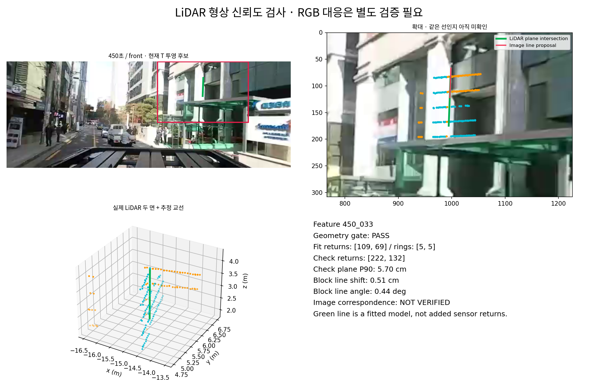
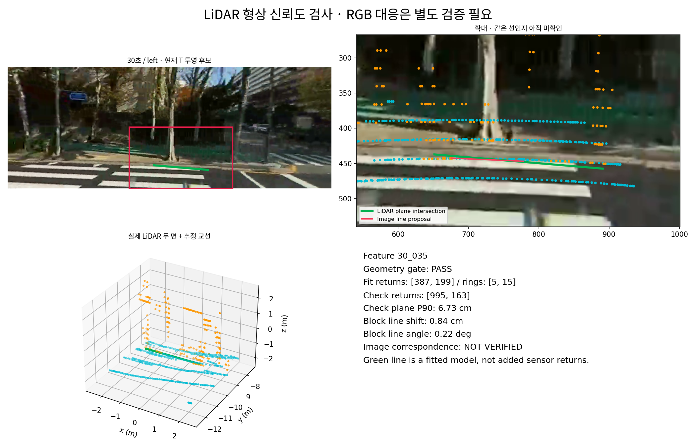
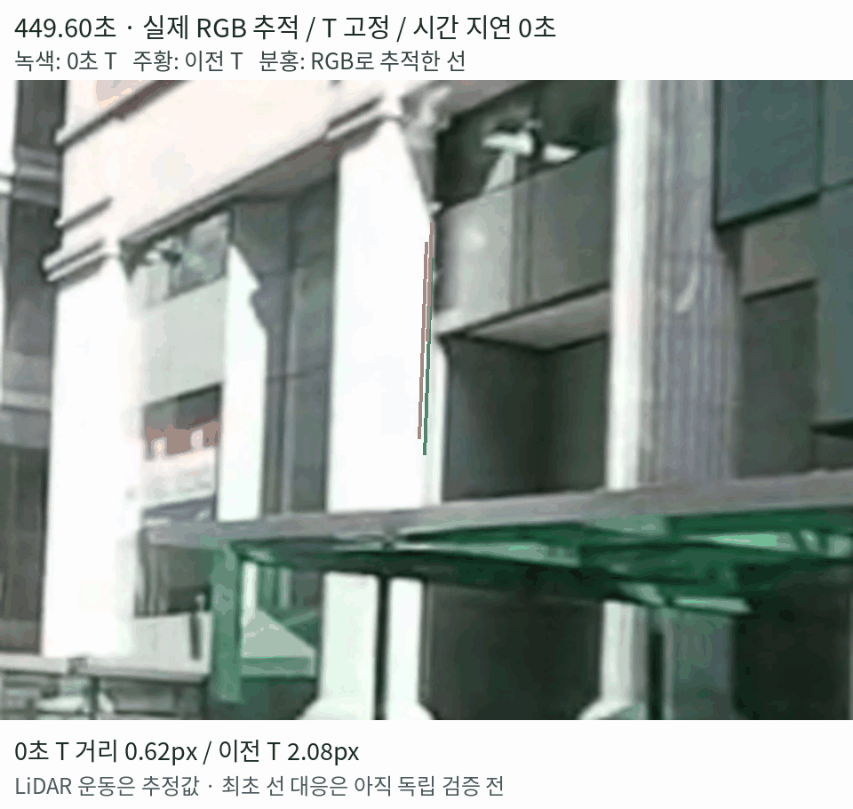

# ADI LiDAR 형상·영상 대응 검증 — 1차 실험 결과

**LiDAR 자체에서 안정적인 선 후보를 확보했고, 건물 모서리 후보 한 곳에서 실제 인접 영상의 정합 일관성을 확인함. 다만 이 결과는 전체 extrinsic의 정확도 검증 완료가 아님. 새 T를 추정하거나 기존 T·mesh를 교체하지 않음.**

실험일: 2026-10-25. [선행 연구 기반 검증 계획](./[DIGLAB][26-10-25][정만교]_Extrinsic_validation_plan.md)의 형상 검증·영상 대응 진단을 실제 실행한 결과임. 추가 시간 offset은 0초로 고정함.

## 검증 결론 요약

**후속 결과:** 다른 방향·거리의 8개 후보를 추가 검사함. 일부는 잘 맞지만 조건부 재추정 T는 제외한 세 구조물에서 모두 악화해 미채택함. [다방향·다거리 검증 결과와 비교 GIF](./[DIGLAB][26-10-25][정만교]_Multifeature_extrinsic_validation.md) 참고. 아래는 1차 실험 당시의 결과임.

| 검증 항목 | 결과 | 현재 판단 |
|---|---|---|
| LiDAR 형상 안정성 | 후보 349개 중 72개 통과 | 사용 가능한 3D 선 후보 확보. 영상 대응 확인과는 별개 |
| 영상 대응의 신뢰성 | 페인트 경계 등 다른 특징에 붙는 의심 사례 확인 | 가까운 영상 경계 거리만으로 판정 불가 |
| 건물 모서리 한 곳의 실제 인접 영상 | 현재 0초 T 0.59px, 이전 T 2.66px | 이 국소 사례에서는 현재 T가 더 일관됨 |
| 전체 센서 정합·extrinsic 정확도 | 다양한 구조물의 독립 검증 미완료 | 확정 불가. T·mesh 교체 안 함 |

**0.59px는 현재 T를 참고해 선택한 모서리 한 곳의 짧은 구간 진단임. 전체 T의 정확도나 독립 GT 오차가 아님.**

시각 자료: [LiDAR 두 면·모서리 후보 PNG](../../res_wjdaksry/1025/geometry_validation_450.png) · [잘못된 대응 의심 사례 PNG](../../res_wjdaksry/1025/geometry_validation_30.png) · [실제 인접 영상 추적 GIF](../../res_wjdaksry/1025/geometry_line_temporal_check.gif)

## 1. 이번 실험의 이유와 순서

| 순서 | 확인하려는 것 | 이 검증이 필요한 이유 |
|---|---|---|
| ① LiDAR의 두 면 확인 | 실제 점들이 평면을 지지하는가? | 거리 급변점만으로는 정확한 물체 경계를 보장하지 못함 |
| ② 두 면의 교선 계산 | 관측된 두 면이 만나는 선이 안정적인가? | 흔들리는 형상으로 T를 구하면 공간 보정도 흔들릴 수 있음 |
| ③ 다른 실제 scan으로 검사 | 일부 점을 제외해도 면·선이 유지되는가? | 특정 scan·ring에만 맞춘 형상을 걸러내기 위함 |
| ④ 같은 영상 선인지 확인 | 물리적으로 같은 모서리인가? | 가까운 그림자·페인트 선에 잘못 붙을 수 있음 |
| ⑤ 실제 인접 영상 추적 | T 고정 상태에서 같은 선이 계속 설명되는가? | 한 사진에만 우연히 맞는지 확인하기 위함 |

**기존 파란 점 전체를 정답으로 사용하는 대신, 먼저 어떤 선을 믿을 수 있는지 검사함.** 그림의 녹색 선은 실제 점에서 계산한 형상 모델이며, 센서가 직접 측정한 새로운 반환점은 아님.

## 2. 실제 사용한 입력

| 항목 | 적용 |
|---|---|
| 영상 시점 | 30·180·240·300·340·360·450·500초 |
| 추가 시간 지연 | 0초 고정. 기록 시계 차이·drift 보정 유지 |
| 실제 LiDAR | 시점별 주변 5scan, 총 640,624개 범위 내 반환점 |
| 형상 추정 scan | 중심 scan 기준 −2·0·+2 |
| 형상 검사 scan | 중심 scan 기준 −1·+1 |
| 움직임 보정 | 기존 국소 LiDAR-only ICP 운동과 실제 발사 시각으로 deskew |
| 사용하지 않은 것 | Gaussian geometry·생성 모델·보간 반환점·카메라 T를 이용한 3D 형상 생성 |

검사 scan은 평면 추정에서 제외했지만 **운동 추정은 공유**함. 따라서 완전히 독립적인 실측 geometry GT 평가는 아님. 정지에 가까운 구간도 포함되지만 전체 8개 구간이 정지 상태인 것은 아님.

## 3. LiDAR 형상 검증 결과

국소 3m·5m 영역에서 평면을 추정하고, 두 면의 교선을 계산함. 양쪽 면의 실제 관측이 교선 주변을 지지하는 유한 구간만 남김. 관측 밖에서 무한 평면이 만나는 선을 그대로 사용하지 않음.

| 시점 | 교선 후보 | 형상 검사 통과 |
|---|---:|---:|
| 30초 | 45 | 1 |
| 180초 | 34 | 1 |
| 240초 | 39 | 4 |
| 300초 | 16 | 1 |
| 340초 | 25 | 8 |
| 360초 | 20 | 6 |
| 450초 | 88 | 30 |
| 500초 | 82 | 21 |
| **합계** | **349** | **72** |

**72개는 신뢰도 검사를 통과한 3D 선 후보의 개수임. 정확한 영상 대응점 72개를 확보했다는 뜻은 아님.** 서로 겹치는 국소 후보도 있을 수 있어 서로 다른 실제 물체 72개로 해석하지 않음.

### 3.1. 적용한 검사와 기준

| 검사 | 적용한 연구용 기준 |
|---|---|
| 평면의 관측 지지 | 충분한 점·2D 분포 확보, 각 면 최소 3개 ring |
| 유한 교선의 관측 지지 | 두 면에서 교선 주변 실제 관측, 지지 구간 중첩 40cm 이상 |
| 검사 scan의 평면 거리 | P90 8cm 이하 |
| scan·주요 ring 제외 후 교선 위치 변화 | 최대 5cm 이하 |
| 같은 제외 검사의 교선 방향 변화 | 최대 2° 이하 |

위 기준은 후보 선별용이며 물리 정확도 보장 기준이 아님. 불확실성 검사에서 일부 plane을 다시 계산할 점이 부족해진 경우도 통과시키지 않음.

통과 후보 72개의 지표 중앙값은 검사 평면 P90 **4.89cm**, 최대 block 제외 교선 위치 변화 **1.04cm**, 방향 변화 **0.53°**였음. 각각 내부 일관성 지표이며 실제 모서리 대비 정답 오차가 아님.

### 3.2. 단일 scan 대조 검사

누적에서 찾은 72개 후보의 같은 면 소속을 유지하고 **중심 scan만으로** 평면을 다시 계산함. 41개에서는 재추정할 점·형상 지지가 있었고, 31개에서는 부족했음.

이는 누적 관측의 활용 가능성을 보여주지만, 같은 후보의 소속을 누적 결과에서 가져왔으므로 **단일 scan과 누적의 완전히 독립적인 특징 검출 성능 비교는 아님.**

## 4. 영상 대응 검토

현재 0초 T는 **후보를 영상에 표시하는 데만** 사용함. 영상 선의 위치·방향과 가까운 자동 후보를 243개 만들었지만 이를 정답 대응으로 승격하지 않음.

### 4.1. 유력한 건물 모서리 후보

> 청록·주황 점은 두 면을 지지하는 실제 LiDAR 점, 녹색은 계산한 교선, 분홍은 자동으로 찾은 영상 선 후보임. 우측 확대에서 건물 기둥 모서리와 일치하는 형태가 보임. 최초 영상 선은 현재 T를 참고해 찾았으므로 독립적인 정답은 아님.

`450_033` 후보의 두 면은 각각 109·69개 실제 대표점과 각 5개 ring으로 지지됨. 검사 평면 거리 P90 **5.70cm**, block 제외 교선 위치 변화 **0.51cm**, 방향 변화 **0.44°**였음.

### 4.2. 좋은 점수여도 보류해야 하는 사례

> LiDAR 형상은 안정적이고 가까운 영상 선까지의 거리도 약 0.72px였음. 그러나 영상 후보가 횡단보도 페인트 경계에 붙어 있어, 실제 두 면의 교선과 같은 특징인지 의심됨. **기하 교선과 평면 위 페인트 경계는 다른 종류의 특징**이므로 신뢰할 대응으로 사용하지 않음.

340초 후보에서도 전경 나무·가림이 의심되는 영역이 포함됨. 자동 semantic 진단은 투영 선 샘플의 약 29%를 식생으로 분류했음. 이는 오분류 가능한 보조 신호이며 가림 정답은 아님.

이 결과는 **형상이 안정적이라는 사실과 RGB 대응이 맞는다는 사실이 별개**임을 보여줌. 가까운 영상 선까지의 거리 하나로 정확한 대응을 판정하지 않음.

## 5. 실제 인접 시각의 T 고정 추적

450초의 건물 모서리 후보를 기준으로 449.6·449.8·450.0·450.2·450.4초의 실제 RGB를 추출함. 최초 영상 선을 RGB optical flow로 추적했으며, 매 시각 T에 가까운 선을 새로 선택하지 않음.

기존 0초 T와 이전 −0.37초 가설에서 구한 공간 T를 **각각 고정 적용**함. 양쪽 모두 0초 시간축·같은 LiDAR 형상과 운동을 사용함.

> **분홍: RGB로 추적한 선 / 녹색: 현재 0초 T / 주황: 이전 T.** 실제 카메라 영상이 바뀌며 T는 고정임. T 보간 GIF가 아님. 설명을 위해 느리게 재생하며 화면에 실제 시각을 표시함.

| 실제 시각 | 현재 0초 T 선 거리 | 이전 T 선 거리 |
|---|---:|---:|
| 449.6초 | 0.62px | 2.08px |
| 449.8초 | 0.50px | 2.66px |
| 450.0초, 기준 선 선택에 사용 | 0.14px | 2.81px |
| 450.2초 | 0.89px | 3.56px |
| 450.4초 | 0.35px | 2.34px |
| **기준 시각을 제외한 4프레임 평균** | **0.59px** | **2.66px** |

지표는 투영한 3D 교선 양 끝점에서 추적한 영상 직선까지의 수직 거리 평균임. 정확한 점 대 점 대응이나 원본 실측 T 대비 오차가 아님.

**해석: 현재 0초 T가 이 건물 모서리의 짧은 구간을 더 일관되게 설명하는 유력 사례를 확보함.** 다만 다음 한계가 있음.

- 최초 영상 선은 현재 T를 참고해 선택했으므로 선택 편향이 있을 수 있음.
- 450초는 기존 T 추정에 사용한 구간임. 주변 프레임도 완전히 독립적인 test가 아님.
- LiDAR 운동과 RGB 추적은 추정값임. 짧은 0.8초 구간·한 구조물의 조건부 검사임.
- 따라서 **전체 T 정확도 0.59px 달성** 또는 **시간 지연 0초가 실측 정답임을 증명**했다고 해석하지 않음.

## 6. 새로운 T를 아직 확정하지 않은 이유

한 직선은 하나의 사진에서 회전·이동 6개 성분을 모두 강하게 결정하기 어려움. 이번 후보의 국소 Jacobian 검사에서도 기준 프레임은 주로 2개 방향을 제약했음. 실제 5프레임을 함께 보면 수치 rank는 6이었지만, 가장 약한 방향과 강한 방향의 singular value 비율은 약 **2.94×10⁻⁵**였음.

회전 1°·이동 10cm로 변수를 정규화한 국소 민감도 검사이며, 절대 covariance나 물리 정답 오차는 아님. **수치적으로 식을 풀 수 있어도, 모든 성분이 충분히 안정적으로 결정되는 것은 아님.**

| 단계 | 이번 실행 상태 |
|---|---|
| 0초 시간 조건의 실제 LiDAR 정렬·관측 분리 | 완료 |
| 국소 평면·교선 추출·scan/ring 제외 검사 | 완료. 후보 349개 → 형상 검사 통과 72개 |
| 단일 scan 대조 | 완료. 누적 후보 중 41개에서 중심 scan 재추정 가능 |
| RGB 대응 후보·가림 보조 진단 | 완료. 자동 후보 243개, 정답 대응으로 미채택 |
| 유력한 건물 모서리의 실제 인접 영상 검사 | 완료. 한 구조물의 조건부 일관성 확인 |
| 다양한 구조물로 새로운 T 추정·공식 Koide 재보정 | **미실행. 신뢰할 다방향·다거리 대응 확보 조건 미충족** |
| Production T·Gaussian·mesh 교체 | 수행하지 않음 |

**다음 우선순위:** 건물 모서리처럼 물리적 의미를 설명할 수 있는 선을 서로 다른 방향·거리에서 추가 확인하고, 일부 구조물은 검증용으로 제외함. 그 후 기하 T 추정 → 공식 Koide 정제 → 제외한 구조물 평가 순으로 진행함.

### 6.1. 다음 실험의 실행 순서

1. **추가 대응 확보:** 형상 검사를 통과한 72개 후보에서 기존 모서리와 방향·거리가 다른 건물 선을 고름. 단순히 후보 수만 늘리지 않고 물체·경계 유형·가림을 검토함.
2. **현재 T 고정 검증:** 추가 시간 offset 0초와 현재 T를 고정한 채 실제 여러 시각에 적용함. 검증 구조물의 선 ID를 고정하고, 매번 가장 가까운 다른 영상 선으로 바꾸지 않음.
3. **추정·평가 분리:** 새 대응으로 T를 다시 구할 경우, 일부 물체·구간은 처음부터 추정에서 제외함. 제외한 대응이 동시에 개선되는지 확인함.
4. **필요한 경우 T 정제:** 확인된 다양한 대응으로 기하 T 추정 후 공식 Koide NID 정제를 비교함. NID 감소만으로 채택하지 않고, 물체·구간 제외 안정성도 평가함.

**진행 판단:** 다른 구조물에서도 현재 T가 유지되면 신뢰도를 높일 수 있음. 특정 방향·거리에서만 어긋나면 대응·카메라 모델·LiDAR 운동 중 원인을 분리함. 현재 단계에서 시간 지연 탐색이나 mesh 재생성을 먼저 수행하지 않음.

## 7. 쉽게 이해하는 이번 결과

1. **점이 정확한 모서리인지 몰랐으므로**, 먼저 LiDAR 점들이 두 벽면을 실제로 지지하는지 검사함.
2. **한 scan에만 우연히 맞았을 수 있으므로**, 다른 scan과 일부 ring을 빼도 선이 유지되는지 확인함. 형상 후보 72개가 이 검사를 통과함.
3. **좋은 3D 선이라도 영상의 다른 선에 붙을 수 있으므로**, RGB 대응을 따로 봄. 횡단보도 페인트에 붙는 의심 사례를 실제로 발견함.
4. **한 사진에만 맞을 수 있으므로**, 건물 모서리 한 곳을 다른 실제 시각의 영상에서 추적함. 이 사례에서는 현재 0초 T가 이전 T보다 잘 맞았음.
5. **한 모서리만으로 전체 센서 관계를 확정할 수 없으므로**, 다음에는 다른 방향·거리의 구조물을 확보해야 함. 현재 성과는 검증 가능한 특징 후보를 찾은 것이며, 정확한 T를 새로 확정한 것은 아님.

## 재현 자료와 방법 근거

작업 폴더: instant_nurec의 `adi_quality_20261018/geometric_feature_validation_20261025/`.

| 기록 | 내용 |
|---|---|
| `inputs.json`, `*_returns.npz` | 실제 scan·split·반환점·LiDAR 좌표 |
| `geometry_report.json` | 전체 후보·검사 수치·통과 여부 |
| `single_scan_control.json` | 중심 scan만 사용한 조건부 대조 |
| `image_proposals.json`, `visibility_diagnostic.json` | 자동 영상 선 후보·가림 보조 진단 |
| `temporal_line_check.json` | 실제 시각·RGB 추적·두 고정 T의 선 거리 |
| `observability_diagnostic.json`, `visual_review.json` | 국소 민감도·육안 검토 기록 |

코드: `research/adi_geometric_feature_validation.py`, `adi_feature_temporal_check.py`. 교선이 두 평면 위에 놓이는지·강체 좌표 변환 불변성·작은 잡음의 평면 추정 테스트 3개 통과. 저장된 349개 선의 양 평면 일치와 fit/check 소속도 확인함.

평면 교선·가림·관측 가능성에 대한 선행 연구를 참고한 **자체 검증 코드**이며, 논문 구현을 그대로 실행했거나 공식 Koide를 이번 단계에서 재실행한 것은 아님.

- [Koide 2023](https://arxiv.org/html/2302.05094)
- [Yuan 2021: 경계·평면 교선·불확실성](https://arxiv.org/html/2103.01627)
- [Fu et al.: 관측 가능성](https://arxiv.org/html/1903.06141)
