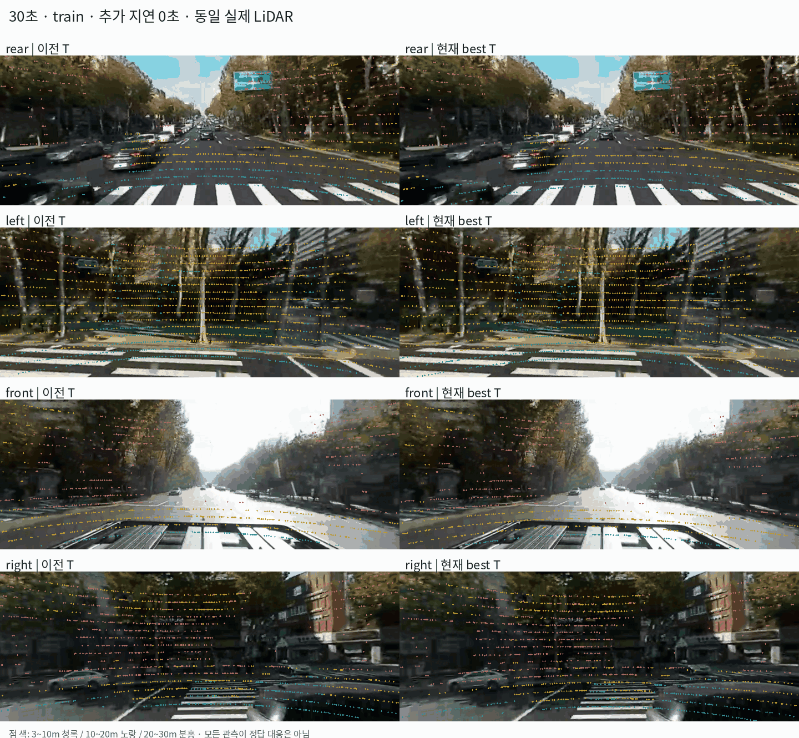

# ADI 고정 T의 전체 화면·다시점 검증

**현재 작업용 best T는 검증 시점의 구조물 경계에서 이전 T보다 평균 8.4% 개선됐지만, 도로 페인트에서는 악화함. 전체 시간·방향에서 정합이 해결됐다고 판단할 수 없음.**

## 1. 검사 범위

- 30·180·240·300·340·360·450·500초의 네 방향, 총 **32개 전체 화면**을 검사함. 특정 모서리만 확대하지 않음.
- 양쪽 모두 추가 지연 0초, 동일 실제 LiDAR·동일 영상·동일 deskew를 사용함. T만 변경함.
- 원본 1440×540 가상 영상을 표시용으로 720×270으로 축소함. 평가값은 원본 픽셀 단위로 환산함.
- 투영 그림은 거리 3~30m의 동일한 실제 LiDAR 반환점을 두 T에 공통 투영함. 표시 과밀을 줄이기 위해 공통점 중 3개마다 1개를 표시함.
- 정량 평가는 기존 구조물 경계·도로 페인트 후보를 사용함. 각 T에서 화면 안에 들어오는 **공통 반환점만** 비교함.

**범위의 한계:** 이번 검사는 넓은 시간대에서 표본을 고른 전체 화면 검사임. 모든 동영상 프레임을 검사하거나, LiDAR를 하나의 world map으로 누적해 전역 궤적 drift까지 검증한 것은 아님. Extrinsic은 센서 사이의 고정 관계이며, world 궤적 정합은 별도 검증 대상임.

## 2. 동일 전체 화면 비교

왼쪽은 이전 T, 오른쪽은 현재 best T임. 한 프레임당 2.2초씩 재생하며, 8개 실제 시점이 바뀜. 연속 주행 영상이 아님. 가상 카메라 이름 rear는 실제 차량 전방, front는 실제 후방에 해당함.

[340초 네 방향 비교 PNG 크게 보기](../../res_wjdaksry/1025/global_T_340.png)

색은 반환점의 거리 구간임. 청록 3~10m·노랑 10~20m·분홍 20~30m. **점 전체가 영상의 윤곽선 위에 있어야 하는 것은 아님.** 벽 내부나 도로 내부를 측정한 점은 해당 면 위에 놓이는 것이 정상임. 가려진 점·움직이는 물체도 있으므로 이 그림만으로 점별 정답 대응을 확정하지 않음.

## 3. 정량 결과

지표: 구조물 후보는 가까운 호환 영상 경계까지 거리, 페인트 후보는 영상의 밝은 도로 페인트 영역까지 거리임. 관측별 중앙값을 구한 뒤 관측에 동일 비중을 주어 평균함. **실제 대응점의 reprojection GT 오차가 아닌 진단용 지표**임.

| 구분 | 평가 관측 수 | 이전 T | 현재 best T | 판단 |
|---|---:|---:|---:|---|
| 추정 시점·구조물 | 16 | 20.22px | 19.31px | 4.5% 개선 |
| 추정 시점·페인트 | 9 | 20.19px | 18.27px | 9.5% 개선 |
| 추정에서 제외한 시점·구조물 | 16 | 8.26px | **7.57px** | **8.4% 개선**, 16관측 중 10개 개선 |
| 추정에서 제외한 시점·페인트 | 8 | **3.16px** | 4.86px | **53.8% 악화**, 8관측 모두 악화 |

추정 시점은 30·180·300·450초, 제외 시점은 240·340·360·500초임. 제외 시점도 과거 개발 과정에서 관찰했으므로 완전한 신규 독립 test는 아님. 후보 선택·semantic mask 역시 T의 영향을 받을 수 있음.

### 제외 시점의 구조물: 방향별

| 가상 방향 | 이전 T | 현재 best T |
|---|---:|---:|
| rear: 실제 차량 전방 | 4.19px | **3.97px** |
| left | **8.80px** | 9.17px |
| front: 실제 차량 후방 | 7.93px | **7.21px** |
| right | 12.13px | **9.92px** |

세 방향 평균은 개선됐지만 left에서는 악화함. 특정 방향·거리·경계 유형에 따라 결과가 달라짐.

## 4. 앞선 47.6% 개선과 다른 이유

앞선 결과는 선택한 선 후보의 **추적 성공 인접 관측 25개**에서 선까지 거리를 측정한 것임. 이번 결과는 **32개 전체 화면의 기존 구조물·페인트 후보**를 사용함. 대상·후보 선택·거리 정의가 다르므로 두 평균을 같은 정확도 지표로 합치지 않음.

과거 0초 실험의 표와도 공통점 집합이 다름. 당시 여러 T 후보 전부에 공통인 점을 사용했지만 이번에는 이전 T·현재 T 두 후보에 공통인 점을 사용함. 같은 지표명이어도 평가점이 달라 수치가 달라질 수 있음.

## 5. 현재 판단

1. **현재 T를 실험 기준으로 유지함.** 구조물 평균은 개선됐지만 ‘전체 지표에서 최적’이라는 주장은 하지 않음.
2. **도로 생성 정확도까지 좋아졌다고 단정하지 않음.** 페인트 잔차가 일관되게 악화하므로 실제 도로 대응을 별도 확인해야 함.
3. **T를 시간·방향마다 따로 맞추지 않음.** 고정 장착이라면 하나의 T로 설명되어야 함. 불일치가 남는 구간은 대응·360 투영 모델·LiDAR 운동 추정·물체 움직임을 분리해 검사해야 함.

이번 단계에서는 T를 재최적화하거나 mesh·Gaussian·차량 주행을 재생성하지 않음.

## 재현 기록

- 코드: instant_nurec의 `research/adi_global_fixed_T_check.py`
- 전체 관측 수치: `adi_quality_20261018/global_fixed_T_check_20261025/report.json`
- 기준 설정: `research/adi_working_best_extrinsic.json`
- 공식 Koide 재실행이 아닌 기존 실제 관측의 고정 T 투영·경계 진단임.
