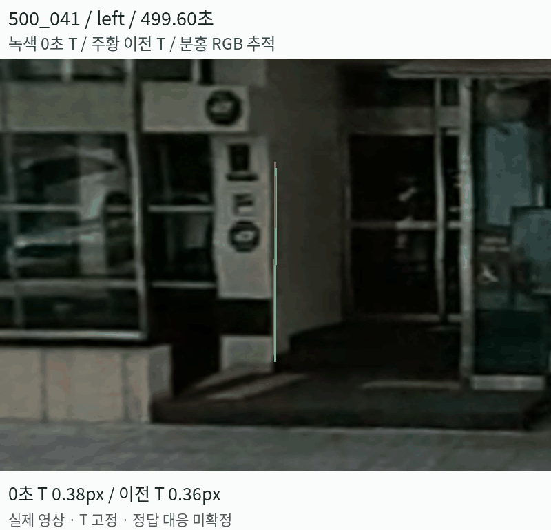
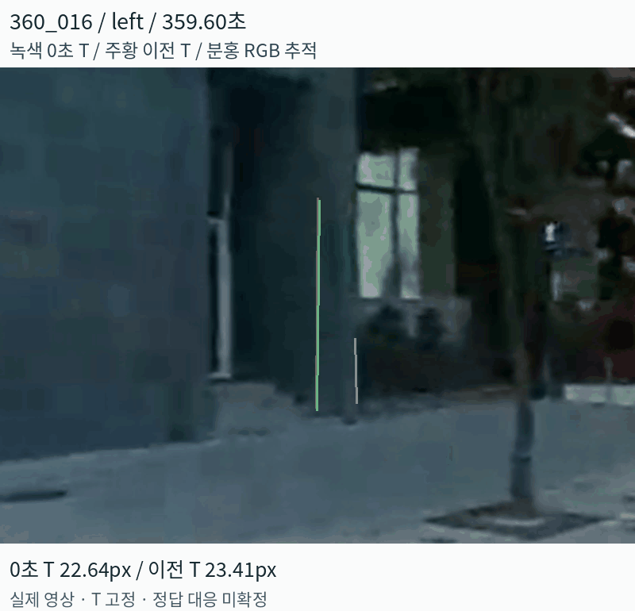
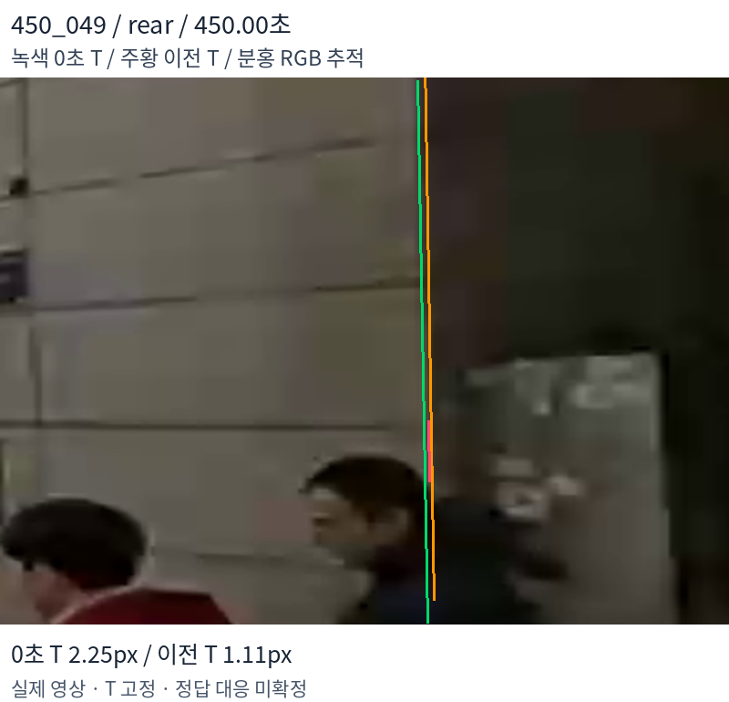
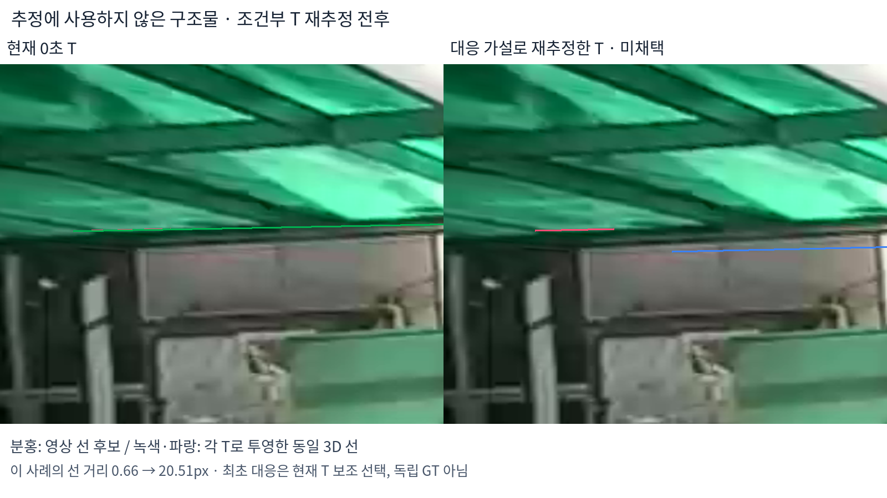

# ADI 다방향·다거리 Extrinsic 검증 결과

**현재 T는 일부 구조물에서 잘 맞지만, 다른 방향·거리까지 일관되게 맞는다고 확정할 수 없음. 선 대응 후보로 T를 다시 추정했으나, 추정에서 제외한 세 구조물의 잔차가 모두 증가해 새 T는 채택하지 않음.**

실험일: 2026-10-25. [1차 형상 검증](./[DIGLAB][26-10-25][정만교]_Geometric_feature_validation.md)에 이어 실제 인접 영상과 추가 구조물을 검사함.

## 후속 실험의 작업용 best 지정

**추가 전체 화면 검사:** 8개 시점×4방향에서 구조물 평균은 개선됐지만 페인트는 악화함. [전체 화면 비교 GIF·정량 결과](./[DIGLAB][26-10-25][정만교]_Global_T_validation.md). 아래의 47.6% 개선은 선택한 선 후보 검사에 한정됨.

사용자 지시에 따라 **현재 0초 T를 이후 ADI 실험의 작업용 best로 지정함.** 과거 비교 기록과 원본 T는 보존함. 아래의 ‘재추정 T 미채택’은 이번 선 대응 가설로 새로 맞춘 후보에 대한 판단이며, 현재 0초 T를 쓰지 않는다는 뜻이 아님.

| 구분 | 이전 비교 후보 | 현재 작업용 best |
|---|---|---|
| T 추정 당시 추가 지연 가정 | −0.37초 | 0초 |
| 이번 비교의 추가 지연 | 0초 | 0초 |
| 동일 유효 관측 25개의 평균 선 거리 | 8.50px | **4.45px: 47.6% 감소** |
| 중앙값 | 7.50px | **2.19px** |
| 구조물별 우세 | 2곳 | **5곳** |

**−0.37초·0초는 추정 조건이지 실측 시간 오차의 정답이 아님.** 기록 시계 보정·deskew는 유지하고 추가 노출 지연만 0초로 둠. 이번 선택은 이전 후보와의 조건부 상대 비교에 근거하며, 모든 구조물에서 우세하거나 물리 정답으로 검증됐다는 뜻은 아님.

후속 실험용 설정: instant_nurec의 `research/adi_working_best_extrinsic.json`. LiDAR → 가상 rear 카메라(차량 전방) 변환·역변환·시간 조건·선택 근거를 함께 저장함. 기존 생성 mesh·영상은 이번 지정만으로 재생성되지 않음.

## 1. 무엇을 고정하고 검사했는가

| 항목 | 적용 |
|---|---|
| 시간 조건 | 추가 노출 지연 0초. 기록 시계·GPS 기준 보정과 LiDAR deskew 유지 |
| 기준 T | 기존 `T_zero_delay.json`. 각 영상에서 다시 맞추지 않고 고정 |
| 시점 | 360·450·500초 주변, 각각 −0.4·−0.2·0·+0.2·+0.4초 |
| 방향·거리 | 가상 rear·left·right, 약 5.7~20.3m |
| 후보 선택 | 10개 검토 → 가림·대응이 불명확한 2개 제외 → 8개 조건부 검사 |
| 영상 추적 | 기준 영상의 선을 RGB optical flow로 추적. 프레임마다 T에 가까운 다른 선으로 교체하지 않음 |

방향 이름은 기존 가상 카메라 명칭임. **rear가 실제 차량 전방**에 해당함. 여러 특징이 같은 시각을 공유하므로 8개×5장을 모두 독립적인 촬영 시점으로 세지 않음.

**최초 영상 선 선택에는 현재 T를 참고했음. 실제 같은 물리적 모서리라는 독립 정답 대응은 아직 아님.** 특히 창문·간판·가림 경계는 다른 선에 붙을 가능성이 남음.

## 2. 현재 T를 고정한 인접 영상 검사

거리 지표는 **투영한 3D 선의 양 끝점에서 추적한 영상 직선까지의 수직 거리 평균**임. 기준 프레임을 제외한 유효 인접 프레임의 평균이며, 원본 1440×540 영상의 픽셀 단위임. 대응점의 실제 정답 오차를 의미하지 않음.

| 후보 ID | 가상 방향 | 거리 | 유효 인접 영상 / 4 | 현재 0초 T | 이전 T |
|---|---|---:|---:|---:|---:|
| 360_003 | rear | 17.9m | 4 | 5.19px | 6.46px |
| 360_016 | left | 17.1m | 4 | 16.24px | 16.98px |
| 450_056 | rear | 20.3m | 1 | 0.77px | 3.56px |
| 450_049 | rear | 6.1m | 0 | — | — |
| 450_053 | right | 15.4m | 4 | 2.76px | 1.87px |
| 450_081 | right | 8.5m | 4 | 2.20px | 11.43px |
| 500_041 | left | 10.6m | 4 | 0.60px | 0.55px |
| 500_038 | rear | 5.7m | 4 | 0.65px | 14.97px |

두 T 모두 **추가 지연 0초인 동일 관측**에 적용함. ‘이전 T’는 과거 −0.37초 가정으로 추정했던 공간 변환이며, 이번 비교에서 시간 지연을 다시 적용한 것은 아님.

| 작은 잔차가 유지되는 사례: 500_041 | 큰 잔차가 남는 후보: 360_016 |
|---|---|
|  |  |
| 현재 T 약 0.60px. 이 후보에서는 선 위치가 유지됨. | 현재 T 약 16.24px. 동일 물리적 경계인지부터 재확인해야 함. |

실제 0.8초 동안 촬영된 5장을 천천히 재생한 GIF임. 카메라 위치를 인위적으로 바꾼 합성 영상이 아님.

### 추적 실패는 T 오차와 분리함

전체 인접 관측 32개 중 **25개가 추적 품질 검사를 통과**함. 사람에게 가려진 450_049에서는 추적선이 수직에서 수평으로 바뀌는 실패가 발생함. 이때의 큰 잔차를 T 오차로 집계하지 않음.

추적점 수·왕복 optical flow·직선 적합 잔차를 확인하고, 기준선 대비 방향 변화 15° 이하·길이 비율 0.5~2·직선 잔차 P90 1.5px 이하 조건을 적용함. **방향·길이·직선 조건은 실패 사례를 본 뒤 추가한 개발 단계 검사**임. 사전 고정한 독립 평가로 해석하지 않음.

## 3. 공통 T를 다시 맞추면 해결되는가

네 구조물의 선 대응 가설로 강체 T를 조건부 재추정하고, 다른 세 구조물은 추정에서 제외함. 이는 **자체 기하 최적화 진단**이며 공식 Koide NID 재실행은 아님.

| 구분 | 사용한 후보 |
|---|---|
| T 추정 | 450_056·450_053·450_081·500_041의 기준 프레임 |
| 추정에서 제외 | 360_003·360_016·500_038의 기준 프레임 |
| 탐색 범위 | 현재 T 주변 회전 각 성분 ±5°, LiDAR 좌표의 카메라 중심 각 성분 ±1m |

세 초기값이 같은 제한 경계 해로 모였지만, 카메라 중심은 약 **1.00m**, 회전은 약 **2.67°** 바뀜. 중심 이동 한 성분이 탐색 경계에 닿았음. 이 범위는 실측 장착 제약이 아니라 진단용 범위임.

| 추정에서 제외한 구조물 | 현재 T | 조건부 재추정 T | 판단 |
|---|---:|---:|---|
| 360_003 | 6.46px | 15.59px | 악화 |
| 360_016 | 13.83px | 34.17px | 악화 |
| 500_038 | 0.66px | 20.51px | 악화 |

이 표는 기준 프레임의 잔차이므로 앞 표의 인접 영상 평균과 값이 다름. 추정에 사용한 네 후보 중 세 후보는 개선됐지만, 제외한 세 후보는 모두 악화함. **따라서 이 T는 채택하지 않음.**

그림에서 분홍색은 영상 선 후보, 녹색·파란색은 각 T로 투영한 동일한 3D 선임. 재추정 T가 다른 구조물의 정합을 깨뜨리는 사례를 보여줌. 최초 대응이 T 보조로 선택됐으므로, 이 비교도 독립 GT 평가는 아님.

## 4. 결론과 다음 검증

- **한 모서리의 작은 잔차만으로 전체 T를 확정할 수 없음.** 다른 방향에서 맞지 않는 후보가 실제로 확인됨.
- **선 대응을 더 넣는 것만으로 해결되지 않음.** 잘못된 물리적 대응이 섞이면 일부 선을 맞추는 동안 다른 선이 틀어질 수 있음.
- **현재 T·추가 지연 0초를 유지함.** 새 T·Gaussian·mesh로 교체하지 않음.

다음에는 360_016·450_053처럼 불일치가 남는 후보에서 **LiDAR의 두 면과 RGB의 실제 모서리가 같은 구조물인지** 먼저 확인해야 함. 같은 구조물임이 확인됐는데도 방향별 오차가 남으면, 360 영상의 stitching·가상 카메라 투영 모델과 LiDAR 운동 추정을 분리해 검사함. 현재 결과만으로 원인을 extrinsic 하나로 단정할 수 없음.

## 재현 기록

instant_nurec의 `adi_quality_20261018/multifeature_validation_20261025/`에 후보 선택, 추적 성공·실패, 조건부 최적화 결과를 저장함.

| 기록 | 내용 |
|---|---|
| `candidate_manifest.json`, `review_decisions.json` | 검토 후보와 사용·제외 사유 |
| `tracking_report_raw_flow.json` | 추가 추적 품질 검사 적용 전 결과 |
| `tracking_report.json` | 유효 프레임·실패 사유·두 고정 T의 잔차 |
| `conditional_rigid_fit.json` | 초기값별 최적화·제외 구조물 평가·미채택 T |

코드: `research/adi_multifeature_validation.py`. 선 추적 품질 검사의 정상 이동·수직/수평 오대응·흩어진 추적점 단위 테스트 3개 통과함. 이 테스트는 코드의 판정 동작을 확인하며 실제 센서 T의 정답을 보장하지 않음.
