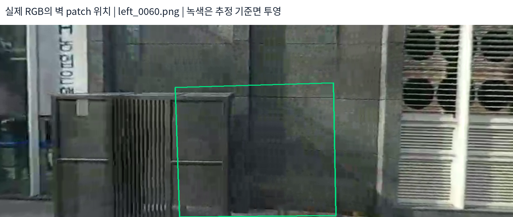
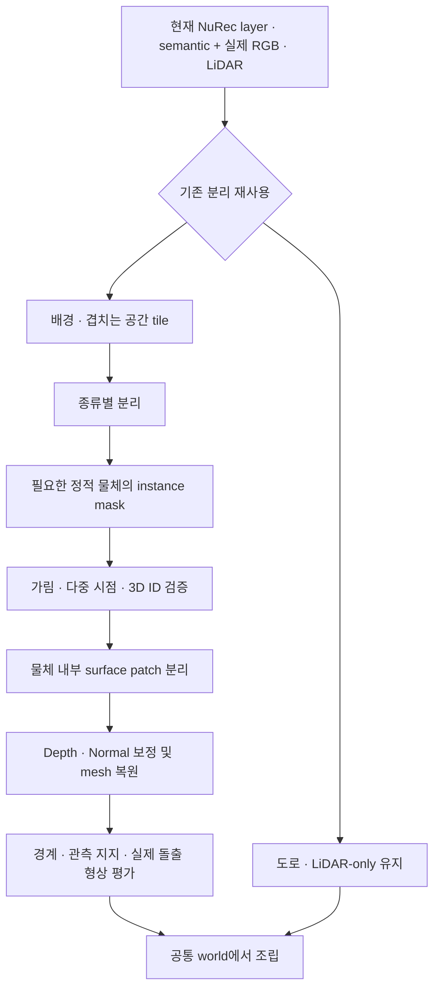

# NuRec 분리 정보를 활용한 전체 배경 Mesh 설계

> **현재 ADI NuRec의 road/background·semantic 정보를 재사용할 수 있음. 다만 벽과 설비함을 개별 물체·표면으로 구분하는 후처리는 추가로 필요함. 전체 씬은 계층적으로 분할해 처리하는 방향을 제안함.**

작성일: 2026-10-25. 공식 문서와 현재 ADI 18k-step 모델의 저장 설정·checkpoint 메타데이터·실제 semantic mask를 확인함. 아래 전체 씬 파이프라인은 설계이며 아직 실행한 결과가 아님.

## 1. NuRec이 제공하는 분리와 우리가 필요한 분리

| 구분 | 의미 | 이번 문제에 충분한가 |
|---|---|---|
| Model layer | Road·background·track 기반 객체 등을 다른 Gaussian 집합으로 관리 | 도로 제외·동적 객체 처리에 유용. 배경 내부의 벽·설비함 분리까지 자동 보장하지 않음 |
| Semantic class | Road·building·wall·vegetation 같은 종류 | 다른 종류를 분리하는 1차 필터. 같은 class의 서로 다른 물체는 구분 못 할 수 있음 |
| Object instance | 설비함 A·벽 B처럼 개별 물체의 지속적인 ID | 벽 앞의 설비함을 독립 처리하는 데 필요 |
| Surface patch | 같은 물체 안에서도 위치·normal·연결성이 일치하는 면 | 벽 모서리·설비함의 앞/옆면을 섞지 않고 복원하는 데 필요 |

공식 NuRec은 track ID·class·시간별 pose·cuboid를 이용해 객체를 layer로 라우팅함. 기본 설정에서 정지한 객체가 background에 남을 수 있으며, preset에 따라 static_rigids 같은 layer도 추가 가능함. **원본 track·label과 실제 설정이 무엇인지 확인해야 하며, NuRec에 넣는 것만으로 모든 정적 물체가 instance로 분리된다고 해석하지 않음.** [공식 track 분류·layer routing](https://docs.nvidia.com/nurec/nurec/dynamic-track-classification.html)

공식 보조 데이터는 camera semantic과 이를 LiDAR로 투영한 label·가시성 등을 지원함. 이는 종류별 관측 분리에 도움이 되지만 완성된 개별 object mesh를 출력한다는 뜻은 아님. [공식 auxiliary data](https://docs.nvidia.com/nurec/nurec/nurec-aux-data.html)

## 2. 현재 ADI 모델에서 실제 확인한 것

| 항목 | 확인 내용 |
|---|---|
| 학습 결과 | ADI full-scene 18,000-step 모델 |
| 실제 model.layers | background·road 두 개. 각 layer는 standalone |
| Road 분리 | road class 사용, background에서 road 제외 |
| Gaussian 수 | 현재 사용 중인 렌더 manifest 기준 background 403,869개·road 5,728개 |
| Semantic | 두 layer에 20차원 semantic_logits 설정. Checkpoint pickle 메타데이터에서도 semantic_logits 항목 존재 확인 |
| 학습 supervision | Semantic cross-entropy와 node semantic loss가 설정됨. 예측 품질은 별도 검증 필요 |
| 입력 semantic 생성 | 실제 ADI RGB에 SegFormer-B0 Cityscapes 19-class 모델 적용한 기존 자료 |
| 개별 벽·설비함 layer | 현재 resolved layer 설정에서 확인되지 않음 |

확인 자료: `adi_nurec_road_retrain_20261021/full_scene_training/adi_full_scene_18000/config/parsed.yaml`, `checkpoints/last.ckpt` 메타데이터, `semantic_manifest.json`, instant_nurec의 `lidar_background_hq_20261021/renders/manifest.json`.

**기존 ADI semantic은 우리가 생성해 넣은 자료임. 공식 기본 auxiliary backend를 이번에 다시 실행한 것으로 기록하지 않음.** 또한 semantic_logits의 저장 존재와 그 예측이 정확하다는 것은 별개임.

### 실제 실패 사례: 설비함과 벽이 같은 label임

실제 `left_0060.png`에 해당하는 기존 semantic mask를 검사함. 기준면 chart의 높이 범위 ±0.8m에서 다음과 같았음.

| 투영 영역 | 검사 pixel 수 | 기존 semantic |
|---|---:|---|
| 넓은 영역 | 104,603 | building 100% |
| 설비함 쪽 후보 영역 | 39,305 | building 100% |
| 벽 내부 쪽 후보 영역 | 36,104 | building 100% |

영역은 3D 기준면을 해당 영상에 투영해 지정한 후보이며 정답 instance mask는 아님. 그래도 **이 프레임의 기존 semantic을 그대로 쓰면 벽과 설비함을 나눌 수 없다는 점**은 확인됨. 현재 Cityscapes class 목록에도 설비함 전용 class는 없음. 다른 시점·NuRec의 학습 semantic 출력까지 모두 같은 결과라고 일반화하지 않음.

## 3. 제안: 재학습 전 배경 관측부터 분리

1. **기존 layer 재사용:** road·background를 구분함. 도로 geometry는 LiDAR-only로 유지하고 배경 처리에서 제외함.
2. **Semantic으로 큰 종류 분리:** building/wall, vegetation, pole 등으로 배경 관측을 나눔. 낮은 confidence는 unknown으로 둠.
3. **실제 RGB에서 필요한 instance 구분:** 벽 앞의 설비함처럼 기존 class가 같은 물체는 별도 mask·추적으로 구분함. 영상별 ID를 그대로 3D 객체 ID로 사용하지 않음.
4. **다중 시점·LiDAR로 3D ID 확인:** 가림·depth·기하 연결성을 확인하면서 같은 물체의 관측만 묶음. 반대편 벽이나 앞뒤 물체를 가까운 거리만으로 합치지 않음.
5. **물체 내부를 surface patch로 분리:** 같은 normal·깊이·연결성을 가진 면끼리 묶음. 같은 건물도 여러 벽면, 같은 설비함도 앞/옆면으로 나눔.
6. **표면별 복원:** 관측이 충분한 벽은 depth/normal 보정 후 Poisson·TSDF 비교. 설비함·기둥에는 별도 경계·두께 제약을 적용함. 물체 경계를 가로질러 smooth하지 않음.
7. **공통 world에 조립:** 같은 물리적 면의 patch 경계만 기하가 일치할 때 연결함. 다른 객체 사이를 무조건 weld하거나 빈 공간을 채우지 않음.

**먼저 depth 역투영 관측에 object/surface ID를 붙이는 방식이 구현 부담이 작음.** 기존 Gaussian을 바로 수정하지 않고도 mesh 입력의 혼합을 줄일 수 있음. Gaussian 자체에 ID를 부여하려면 여러 시점에서의 실제 기여·가시성을 고려하는 adapter가 필요함. 가려진 Gaussian까지 중심점 투영 mask로 한 번에 확정하지 않음.

## 4. 전체 씬에 적용할 수 있는가

**전체 씬 처리를 설계할 수는 있음. 하지만 ‘한 번 segmentation → 하나의 Poisson’보다 공간·종류·표면을 나누는 방식이 적절함.** 이는 현재 결과를 바탕으로 한 적용 판단이며 전체 성공이 검증된 것은 아님.

| 영역 | 처리 제안 |
|---|---|
| 도로 | 기존 LiDAR-only 복원 유지 |
| 가까운 건물·벽 | 겹치는 공간 tile → instance/surface 분리 → 고정 metric 해상도 복원 |
| 설비함·기둥 등 돌출 물체 | 독립 관측 집합·geometry로 복원. 주변 벽과 다른 normal·depth 유지 |
| 나무·복잡한 식생 | 벽과 섞지 않음. 세부 잎의 정확한 collider 복원을 전제로 하지 않음 |
| 먼 배경 | 낮은 해상도·시각용 표현을 별도로 관리 |
| 미관측·모호한 영역 | unknown·불확실성 표시. 검증 없는 보완 면을 정확한 collider로 채택하지 않음 |

Tile마다 임시 ID가 달라질 수 있으므로 overlap의 3D 위치·가시성·표면 방향을 이용해 ID를 통합함. Semantic·instance가 맞아도 depth/normal·pose 오류가 자동으로 사라지는 것은 아니며 기존 진단·평가를 유지함.

## 5. 바로 다음 실험

**벽과 설비함 한 쌍을 분리한 후, 같은 관측에서 ‘분리 전 복원’과 ‘분리 후 개별 복원’을 비교함.** 새 NuRec 전체 재학습부터 시작하지 않음.

평가 항목은 벽 두께·normal 분산·제외 LiDAR 거리·경계 보존·설비함 돌출 깊이임. 구멍이 줄었더라도 실제 설비함을 벽으로 밀어버렸다면 실패로 판단함.

후처리 분리가 여러 실제 시점에서도 안정적일 때만 NuRec에 static object track/layer를 추가해 재학습하는 경로를 검토함. 이 경우 NCore track ID·class·cuboid/pose와 layer routing을 별도 준비해야 하며, 기존 semantic만으로 개별 물체 layer가 자동 생성되는 것은 아님.

공식 layer 구조 참고: [NuRec scene layers](https://docs.nvidia.com/nurec/best-practices/scaling-neural-reconstruction.html). 현재 모델의 실제 설정은 공식 최신 preset과 다를 수 있으므로 위 로컬 점검 결과를 우선함.
