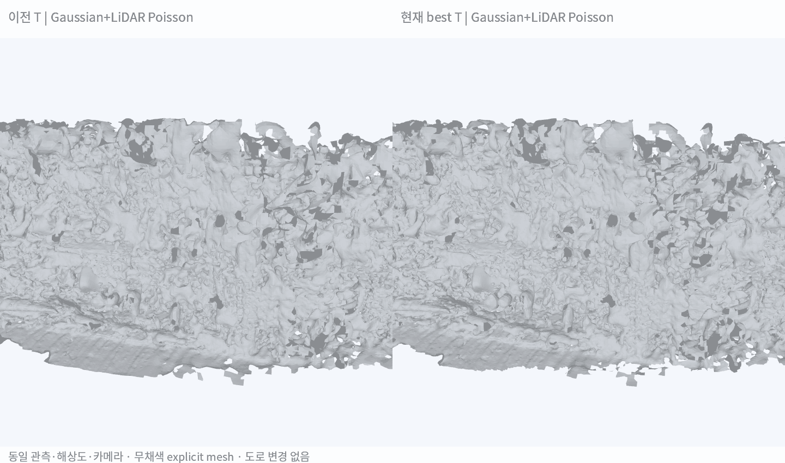
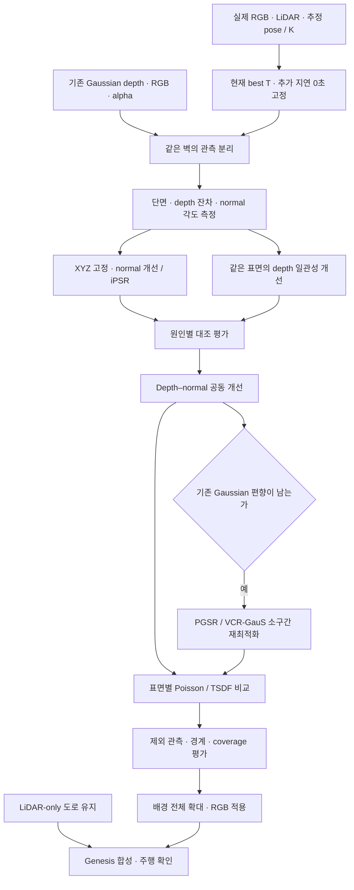

# Depth·Normal 일관성 개선을 통한 배경 Mesh 복원 계획

> **목표: LiDAR-only 도로는 유지하고, 배경의 depth·normal·표면 혼합 문제를 분리해 연속된 mesh를 복원함. 현재는 원인 가설 단계이며 normal이 주원인이라고 확정하지 않음.**

작성일: 2026-10-25. 기존 [벽 Mesh의 T 변경 비교](./[DIGLAB][26-10-25][정만교]_Wall_mesh_best_T_comparison.md)를 바탕으로 한 **후속 실험 설계**임. 아래 신규 보정·재학습 실험은 아직 실행하지 않음.

## 1. 현재 결론과 해결 방향

**현재 입력은 ‘정확한 하나의 표면’으로 정리되지 않은 여러 시점의 점과 추정 normal임. 이 상태에서 Poisson 해상도만 높여도 연속된 실제 벽이 된다는 보장은 없음.**

우선순위는 **① 관측이 같은 표면인지 분리 → ② depth 위치 오차와 normal 방향 오차 측정 → ③ 하나씩 보정해 원인 비교 → ④ 필요할 때 geometry 중심 재최적화**임. 마지막 mesh smoothing은 작은 잔여 요철에만 사용하며, 이중 벽·잘못된 연결을 해결하는 주 방법으로 삼지 않음.

| 유지할 것 | 개선할 것 |
|---|---|
| 도로: 기존 LiDAR-only 방식 | 배경: 벽·건물 단위의 표면 관측 정리 |
| 현재 작업용 best T | Depth·normal 신뢰도와 다중 시점 일관성 |
| 추가 노출 지연 0초 가정, 기록 시계 보정·deskew | 센서별 해상도·밀도 차이를 고려한 결합 |
| 동일 camera pose·metric scale로 대조 | 필요하면 표면 복원을 위한 Gaussian 재최적화 |

현재 T는 비교 실험의 기준이며 물리 정답으로 검증된 값은 아님. 시간·T·camera pose·depth를 한꺼번에 변경하면 원인을 구분하기 어려우므로 초기 대조에서는 고정함.

## 2. 관측된 사실과 아직 모르는 것

| 확인한 사실 | 아직 확인하지 못한 것 |
|---|---|
| T 변경으로 벽 LiDAR 점이 중앙값 약 9.84cm 이동함 | 실제 벽의 정답 위치와 표면 두께 |
| T만 변경해도 조각·열린 경계 수는 개선되지 않음 | Depth와 normal 중 어느 쪽의 영향이 큰지 |
| Gaussian+LiDAR Poisson에 요철·구멍·조각이 남음 | 같은 물체의 앞뒤 면, 서로 다른 물체가 얼마나 섞였는지 |
| Gaussian 약 70만 점과 LiDAR 약 17만 점을 결합함 | 센서별 점 수 차이가 최종 표면에 미치는 영향 |
| Gaussian normal 반경 20cm, LiDAR normal 반경 60cm 사용 | 해당 반경이 실제 벽·창틀 크기에 적절한지 |
| 입력점에서 15cm보다 먼 복원 vertex를 제거함 | Poisson 원본의 단절과 trim으로 생긴 단절의 비중 |

현재 색상은 가까운 Gaussian RGB를 vertex에 옮긴 것임. UV texture·가림 검증은 별도이며, 색이 자연스러운지와 형상이 정확한지는 구분함.

## 3. 문제 정의 — 무엇이 잘못됐을 수 있는가

| ID | 문제 | 예상되는 증상 | 구분 방법 |
|---|---|---|---|
| P0 | 좌표·깊이 정의·법선 변환 오류 | 방향별 일정한 기울기·깊이 비율 오류 | Camera Z와 ray 거리 구분, 역투영 왕복, normal에는 회전만 적용하는지 검사 |
| P1 | 서로 다른 물체·앞뒤 면 혼합 | 벽과 식생·창틀이 연결되거나 두 겹으로 생김 | 같은 실제 벽의 내부·경계·다른 물체를 분리해 단면 비교 |
| P2 | 같은 면의 multi-view depth 불일치 | 벽 점들이 얇은 면 대신 두꺼운 띠로 쌓임 | 시점별 점-기준면 거리, 재투영 depth 잔차 측정 |
| P3 | Normal 부호·각도·이웃 반경 문제 | 작은 면 방향이 흔들리고 표면이 둥글게 굽음 | 부호 뒤집힘과 각도 분산 분리, 반경별·센서별 normal 비교 |
| P4 | Depth가 만드는 면과 normal이 요구하는 면 불일치 | 점 위치는 두꺼운데 normal만 평행하거나 그 반대 | Depth로 계산한 normal과 다른 normal 추정치의 각도 비교 |
| P5 | 관측 부족·복원·trim 문제 | 빈 곳을 임의 연결하거나 연결부가 삭제됨 | Poisson 직후 / density 필터 후 / support trim 후를 각각 저장 |
| P6 | 센서별 표본 밀도 불균형 | 조밀하지만 편향된 Gaussian 관측이 결과를 지배할 수 있음 | 공간·시점별 대표점 수를 맞춘 대조와 신뢰도별 결합 비교 |

**‘Normal 방향 통일’은 ‘normal 정확도 보장’과 다름.** 카메라 쪽으로 부호를 맞춰도, 잘못된 이웃 점에서 추정한 각도 오차는 그대로 남음. 벽의 앞면·뒷면은 먼저 분리하고, 동일한 물리적 면 안에서 방향을 정리해야 함.

## 4. ADI 데이터·센서로 해결 가능한가

**관측된 벽의 일관성을 개선하는 실험은 현재 데이터로 가능함. 미관측 뒷면이나 실제 표면의 정답을 모두 복구하는 것은 현재 데이터만으로 보장할 수 없음.**

| 필요한 정보 | 현재 보유 상태 | 쓸 수 있는 방법 | 한계 |
|---|---|---|---|
| 실제 LiDAR 거리·점군 | VLP-16 원시 PCAP·디코딩 점 보유 | 국소 벽 위치·평면 방향의 물리 관측 anchor | Sparse함. 먼 벽·얇은 기둥에 충분한 반환점이 없을 수 있음 |
| Ring·발사 시각·반사강도 | 디코딩 자료에 존재 | Scan/ring별 안정성, deskew, 일부 페인트·재질 경계 참고 | 반사강도는 RGB 밝기나 정확한 물체 경계의 정답이 아님 |
| LiDAR normal | 센서가 직접 제공한 정답 normal 없음 | 실제 점에서 국소 평면을 robust fitting해 추정 | 모서리·식생·비균일 샘플에서는 불안정. 여러 scan 누적도 운동 오차 영향 |
| 실제 RGB·360 영상 | 보유 | 물체·가림·관측 경계 확인, photometric 일관성·재학습 | 반사·유리·동적 물체·stitching 문제. RGB만으로 metric depth 정답이 되지는 않음 |
| Camera pose·intrinsics | 가상 카메라 설정·추정 SfM pose 보유 | 역투영·시점 간 depth/normal 비교 | 가상 K를 안다고 원본 lens·stitching 오차까지 보정된 것은 아님 |
| Camera–LiDAR T | 현재 working best 추정값 보유 | LiDAR를 Gaussian/camera 좌표로 배치 | 독립적인 실측 extrinsic GT 없음. 센서 간 불일치를 depth 오류로 오인할 수 있음 |
| Gaussian depth·RGB·alpha | 기존 NuRec 최적화의 저장 렌더 보유 | 조밀한 표면 후보·색상·가림 보조 | Alpha가 높다고 기하가 정확한 것은 아님. 시점별 depth 편향 가능 |
| Gaussian geometry의 normal | 원래 Gaussian 회전·scale을 읽을 수 있으면 계산 후보 | Gaussian 최소 축과 depth 유래 normal 비교 | 최소 축이 실제 표면 normal이라는 보장 없음. 현재 캐시의 직접 점군 normal과도 다른 값 |
| Stereo depth | 과거 실험은 있으나 이번 ROI의 동일 관측에 맞는 캐시는 확인 필요 | 실제 RGB 쌍의 stereo를 추가 관측으로 비교 | 가상 Gaussian 렌더 쌍은 같은 원본 geometry를 공유해 독립 검증이 아님 |
| GPS | 시각·저주파 위치 참고 자료 보유 | 시간 기준·큰 궤적 변화 점검 | 벽 normal·cm급 표면 형상의 정답으로 사용 불가 |
| 미관측 후면·가려진 공간 | 추가 실측 근거 없음 | 불확실 영역 표시, 필요하면 별도 자산·모델링 | 생성·평면 연장은 추정 보완이며 실제 digital twin 형상으로 검증된 것이 아님 |

즉 **LiDAR를 벽의 신뢰 가능한 위치·방향 anchor로, Gaussian depth를 조밀한 표면 후보로 사용하는 설계는 가능함.** 다만 현재 T·운동·pose의 잔여 오차를 감안해 anchor의 신뢰도도 평가해야 함. LiDAR라는 이유만으로 누적 world 점을 모두 정답으로 고정하지 않음.

## 5. 단계별 개발

### Stage 0. 좌표와 비교 조건 고정

1. 현재 best T·추가 지연 0초·기존 metric world·camera pose를 고정함.
2. 모든 depth가 camera Z인지 ray 거리인지 확인하고 같은 정의로 환산함. 누적 alpha 정규화 여부와 invalid depth 처리도 확인함.
3. XYZ에는 회전·이동을 적용하고 normal에는 회전만 적용함. Normal을 world 좌표에서 비교하고, 원래 좌표로 왕복되는지 검사함.
4. 정상적인 평면의 합성 depth로 계산식을 검증함. 합성 검사는 구현 확인용이며 센서 정확도 평가가 아님.

**산출물:** 좌표·단위·normal 부호·invalid mask 검사표. 여기서 실패하면 복원 비교보다 구현을 먼저 수정함.

### Stage 1. 벽 한 면의 단면·오차 분리

기존 ROI에서 무늬가 적고 관측이 겹치는 벽 내부 한 곳, 창틀·모서리가 포함된 경계 한 곳을 별도로 선택함. Semantic 분류만으로 같은 평면이라고 간주하지 않음.

| 검사 | 방법 | 보여줄 자료 |
|---|---|---|
| Depth 두께 | 신뢰 가능한 train LiDAR로 기준 평면 추정. 각 시점 점의 signed point-to-plane 거리 측정 | 위·옆 단면, 시점별 색상, 거리 P50/P90 |
| 면 자체의 평탄성 | LiDAR만으로 평면 적합 가능 여부·고유값·ring/scan 제외 안정성 확인 | 실제 센서 점과 기준면 |
| Normal 불일치 | PCA normal / depth 유래 normal / 가능한 Gaussian 축 normal을 분리 계산 | Normal 화살표·각도 분포 |
| Depth–normal 관계 | 역투영 점 X(u,v)의 두 영상 방향 미분 외적으로 normal 계산. 깊이 단절을 가로지르는 이웃 제외 | Depth-derived normal과 기준면 normal 비교 |
| 표면 혼합 | 벽 내부·창틀·식생·반사면·가림을 분리해 같은 통계를 계산 | 영역별 표본·단면 |

Normal의 부호 없는 각도는 `acos(abs(n·n_ref))`로 평가하고, 부호 뒤집힘 비율은 별도로 기록함. 한 평면에 잘 맞는다는 것만으로 창틀·굴곡까지 정확하다고 평가하지 않음.

**진행 조건:** LiDAR 기준면 자체가 scan/ring 제외에 불안정하면 그 구간을 anchor로 사용하지 않음. 관측이 약한 벽은 다른 구간을 고르고, 남는 불확실성은 기록함.

### Stage 2. Depth를 고정하고 Normal만 개선

- 같은 점 ID·XYZ를 유지한 채 이웃 반경·이웃 수를 바꿔 normal을 비교함.
- 거리만 가까운 점 대신 같은 표면·가림 관계를 만족하는 이웃으로 local plane을 robust fitting함.
- 같은 면의 normal 부호를 센서 가시성과 인접 면의 일관성으로 정리함. 실제 접힌 면의 각도는 보존함.
- 같은 XYZ에서 기존 Poisson과 **iPSR**를 비교함. iPSR는 반복 복원 표면으로 normal을 갱신하는 대조군임. [논문](https://arxiv.org/abs/2209.09510) · [공식 코드](https://github.com/houfei0801/ipsr)

**해석:** XYZ가 동일한데 두께·요철이 줄고 제외 관측도 설명하면 normal 처리의 효과임. 같은 벽이 앞뒤로 갈라진 상태가 남으면 normal만으로 해결되지 않은 것임. iPSR도 미관측 영역·얇은 개방 벽의 실제 형상을 보장하지 않음.

### Stage 3. Normal 변경 효과와 분리해 Depth 개선

1. 시점 i의 depth를 world로 역투영하고 시점 j로 재투영함. 같은 면이며 가려지지 않은 곳의 camera Z depth 잔차를 구함.
2. 실제 LiDAR anchor와 여러 시점에서 함께 지지되는 관측을 우선 사용함. 낮은 alpha뿐 아니라 시점 간 불일치·깊이 단절·가림을 신뢰도에 반영함.
3. 평탄한 벽 내부에는 국소 평면/완만한 표면 제약으로 depth를 보정함. 창틀·기둥·깊이 경계를 넘어 보정값을 퍼뜨리지 않음.
4. Depth를 바꾼 조건에서는 normal 추정 알고리즘·반경은 고정함. 좌표 변경에 따른 normal 재계산은 기록함. 이전 XYZ의 normal을 무조건 복사해 불일치를 만들지 않음.

**주의:** 현재 scene은 가상 카메라 수를 늘린다고 새로운 실제 관측이 생기는 것은 아님. 실제 영상·LiDAR 지지가 없는 표면에 다수의 가상 렌더가 동의해도 독립적인 정확도 증거는 아님.

### Stage 4. Depth–Normal 공동 개선과 표면별 결합

Depth-only·normal-only의 효과를 확인한 뒤 결합함. 위치·각도가 함께 일치하는 표본을 같은 표면 patch로 묶고, 공간·시점별 대표점을 정리함. 반복 렌더가 많은 쪽이 점 수만으로 결과를 지배하지 않도록 센서별 표본 수·분포를 맞춘 대조도 둠.

한 벽 전체를 하나의 평면으로 강제하지 않음. 벽 내부에는 약한 평면 제약, 창틀·기둥에는 경계 보존, 식생·유리에는 낮은 신뢰도 또는 별도 표현을 적용함. 열린 문·창·통로와 관측 부족 구멍을 구별하지 못한 곳은 자동 메우지 않음.

정리된 동일 관측을 사용해 **Poisson과 depth→TSDF**를 비교함. 같은 목표 공간 해상도를 사용하되 두 방법의 adaptive 표면 표현 차이는 기록함. Poisson은 oriented points, TSDF는 원래 카메라 depth·가시성·pose를 입력으로 유지함.

### Stage 5. 필요하면 Gaussian을 geometry 중심으로 재최적화

후처리 후에도 같은 면의 depth가 시점마다 달라지면, 원본 Gaussian geometry와 depth 렌더링을 개선하는 실험으로 넘어감.

| 연구 | 논문의 핵심 | 우리 개발에서 참고할 부분 |
|---|---|---|
| [PGSR](https://zju3dv.github.io/pgsr/) | 평면 기반 depth 렌더링, 단일·다중 시점 기하/영상 정규화 | 벽 patch의 surface-oriented 재학습 대조군. 전체 건물을 하나의 평면으로 강제하는 방법은 아님 |
| [VCR-GauS](https://arxiv.org/abs/2406.05774) | Depth–normal 결합, 시점별 normal prior의 신뢰도 반영 | Normal 회전만이 아니라 위치 등 geometry도 함께 개선하는 목적함수 설계 |
| [DN-Splatter](https://maturk.github.io/dn-splatter/) | Depth·normal supervision과 Gaussian geometry 정규화 | 신뢰 가능한 LiDAR depth anchor와 normal을 학습 제약으로 사용하는 구조. 주로 실내 결과이므로 ADI 야외 개선은 별도 검증 |
| [RaDe-GS](https://baowenz.github.io/radegs/) | 3D Gaussian의 depth·surface normal rasterization 개선 | 저장된 depth의 계산 자체가 병목인지 확인하는 렌더러 대조군 |
| [2DGS](https://arxiv.org/abs/2403.17888) | 얇은 disk 표현, depth distortion·normal consistency | 부피 표현을 표면 표현으로 바꾸는 대조군. NuRec PLY의 단순 파일 변환과는 다름 |
| [SuGaR](https://arxiv.org/abs/2311.12775) | Gaussian 표면 정렬 후 Poisson, 선택적 mesh 공동 정제 | Poisson 전 단계의 surface alignment가 중요하다는 근거 |

우선 PGSR 또는 VCR-GauS 중 **한 방법을 작은 동일 벽 구간에서** 검증함. 기존 NuRec checkpoint는 라이브러리마다 파라미터·좌표·렌더러가 달라 그대로 로드된다고 가정하지 않음. 실제 RGB·pose·K·신뢰 관측으로 학습하거나, 검증한 checkpoint adapter를 별도 개발해야 함.

위 연구의 전체 파이프라인 실행과 아이디어 일부를 자체 코드에 적용한 실험은 구분해서 기록함. **최근의 ‘Gaussian 점+PCA normal→Poisson’ 실험은 DN-Splatter 전체 학습 결과가 아님.**

## 6. 최소 대조 실험표

| 실험 | 변경하는 것 | 고정/비교 조건 | 확인할 질문 |
|---|---|---|---|
| E0 | 없음: 현재 파이프라인 재현 | 동일 점·normal·Poisson 설정 | 현재 요철·단절의 기준값은 무엇인가? |
| E1 | Normal 추정·방향 처리만 개선 | XYZ·점 ID 고정 | Normal만 개선해 효과가 있는가? |
| E2 | iPSR로 반복 normal 갱신 | E0와 같은 XYZ | 반복 표면 기반 normal이 안정적인가? |
| E3 | Depth 관측 정리·보정 | E0의 normal 계산 방법 유지 | 점 위치·두께가 주 병목인가? |
| E4 | Depth+normal 개선, 표면별 결합 | E1/E3와 각각 비교 | 두 보정을 함께 해야 개선되는가? |
| E5 | E4 관측의 Poisson vs TSDF | 동일 영역·목표 셀 크기·관측 split | 최종 복원 방법의 영향은 어느 정도인가? |
| E6 | PGSR 또는 VCR-GauS 재학습 | 동일 원본 RGB·pose·평가 영역 | Gaussian geometry 자체를 바꿔야 하는가? |

각 실험에서 Poisson 원본·density 처리 후·support trim 후를 따로 평가함. Normal-only 비교에서는 XYZ 해시, T-only 비교에서는 원본 반환점 ID 해시를 기록함. 셀 크기를 동시에 바꾸지 않음.

## 7. 평가 기준과 채택 조건

| 평가 대상 | 지표 | 해석 주의 |
|---|---|---|
| 평탄한 벽의 표면 두께 | 기준면 signed 거리의 P5~P95 폭·P90 절대거리 | 실제 평탄한 내부에서만 측정. 굴곡·창틀 제외 |
| Normal | 부호 없는 각도 P50/P90, 부호 오류율 | 기준 normal도 LiDAR 기반 추정임. 불안정한 기준면 제외 |
| Multi-view geometry | 가림 제외 depth 재투영 잔차, 통과 관측 비율 | 삭제를 많이 해서 잔차만 낮아지는지 coverage도 함께 확인 |
| 센서 관측 지지 | 제외 scan의 point-to-mesh 거리·지지 비율 | 공유 pose·기존 Gaussian 학습 이력 때문에 완전 독립 GT 아님 |
| 연속성 | 같은 벽의 coverage, 연결 성분, 열린 경계·잘못 연결된 면 | 실제 문·창을 메워 수치만 좋아지지 않는지 확인 |
| 시각·경계 보존 | 동일 카메라 무채색 mesh, RGB, 단면 비교 | 색상으로 기하 오류를 가리지 않음 |

가능하면 시간 블록 단위로 fit/validation을 미리 분리하고, 같은 누적점이 양쪽에 중복되지 않게 함. Threshold·반경은 fit 구간에서 정하고 validation 결과를 본 뒤 반복 선택하지 않음. 이미 원본 Gaussian 학습에 쓰인 관측이면 ‘복원 단계 제외 관측’으로 명시함.

**채택 기준:** 제외 관측에서 두께·depth/normal 잔차가 개선되고, coverage와 실제 경계를 잃지 않으며, 다른 벽에서도 개선 경향이 유지될 것. 허용 cm·각도 기준은 sensor 반복 관측의 변동과 사용 목적을 먼저 측정해 정함. 임의 목표치를 정답 정확도로 선언하지 않음.

## 8. 전체 파이프라인

**바로 수행할 단계는 Stage 0~1임.** 벽 한 면의 옆 단면과 normal 분포를 먼저 만들고, 그 결과에 따라 E1~E4를 수행함. 연구 프레임워크를 한꺼번에 바꾸기보다 어떤 항목이 개선을 만드는지 확인한 뒤 재학습 범위를 결정함.
