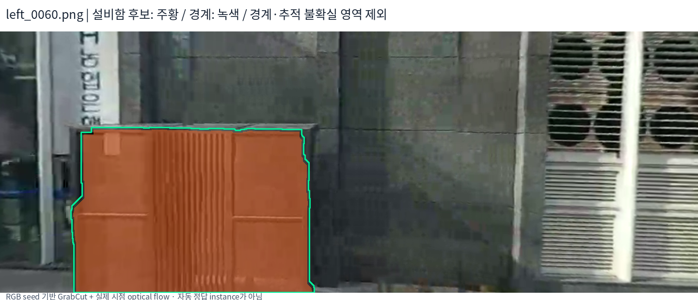
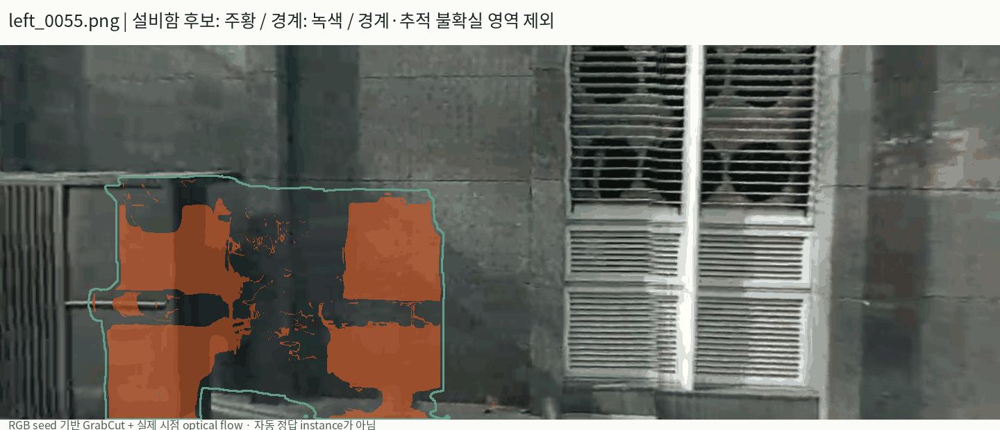
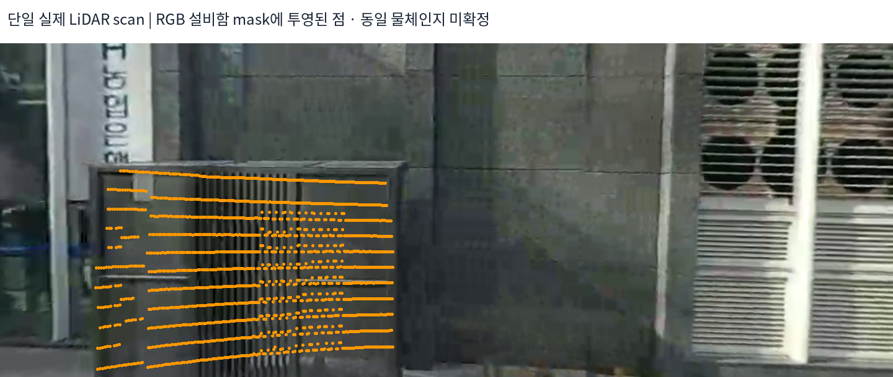
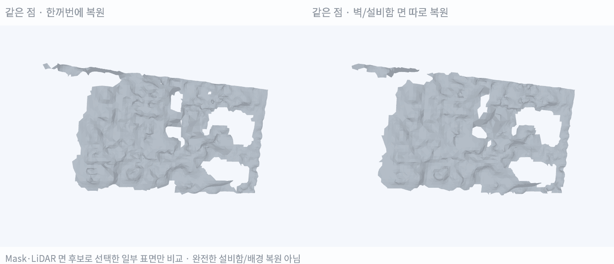

# 벽·설비함 Instance 분리와 개별 Mesh 시험

> **실제 RGB에서 설비함 mask 후보를 만들고 원시 LiDAR를 다시 확인함. 벽 주변 필터가 앞쪽 물체의 점을 제거하던 문제를 발견했으며, 원시 관측을 복원한 뒤 약 1.38m 떨어진 두 면 후보를 따로 mesh화함. 완전한 물체 복원·전체 씬 개선 검증은 아직 아님.**

실험일: 2026-10-25. [NuRec 분리 정보 활용 설계](./[DIGLAB][26-10-25][정만교]_NuRec_background_separation_design.md)의 첫 소구간 시험임. 기존 NuRec 학습·도로·best T·추가 지연 0초는 유지함.

## 1. 실제 수행한 일

| 단계 | 적용 |
|---|---|
| RGB 후보 mask | 실제 `left_0060.png`를 육안 확인하고 ROI·전경 seed를 지정한 GrabCut |
| 다른 시점 확인 | 실제 left_0055·0057·0060·0062·0064 영상에서 양방향 optical flow로 mask 전달 |
| 불확실 영역 | 경계 약 5px·추적 왕복 불일치·다중 시점 label 충돌을 unknown 처리 |
| 3D 후보 ID | 같은 점이 2개 이상 영상에서 같은 label을 받고 반대 label 투표가 없을 때 후보 채택 |
| 실제 표면 지지 | Train LiDAR에서 wall/box 후보별 평면 추정, 해당 면 8cm 이내 점만 사용 |
| 복원 | 같은 5cm Poisson·15cm support trim. 면별 normal을 따로 추정하고 개별 복원 |

**NuRec이 자동 출력한 instance mask나 SAM 실행 결과가 아님.** 기존 semantic에서 둘 다 building으로 나온 부분을 RGB seed 기반의 자체 시험으로 추가 구분함. 마스크의 물리 정답 여부와 모든 면의 완전한 분리는 아직 검증하지 않음.

기준 영상 외 시점에서 후보 mask 내부의 optical-flow 신뢰도 통과율은 약 30~52%였음. 색으로 잘 칠해져 보이는 전체 영역을 모두 신뢰 점으로 사용하지 않음.

## 2. 중요한 발견: 입력 필터가 앞쪽 물체를 잘라냈음

처음에는 기존 벽 기준면 ±30cm 관측으로 시험함. RGB에서 설비함으로 분류된 점도 벽과 거의 같은 면으로 나왔음. 이 결과를 instance 분리 성공으로 채택하지 않음.

원시 단일 scan을 확인하니, 설비함 mask로 투영된 실제 LiDAR 반환점 1,604개 중 법선 방향 거리 중앙값이 벽보다 약 **1.30m 앞**에 있었음. 기존 입력에는 다음 제약이 있었음.

- 벽 기준면 주변 ±30cm만 선택하던 제한.
- 기존 Gaussian 관측에서 50cm 이내인 LiDAR만 선택하던 필터.

따라서 필요한 전경 관측이 제거됐을 가능성을 확인하고, **동일 76개 시각의 저장된 zero-extra-delay deskew scan을 원래 점군부터 다시 읽음.** 실제 반환점의 8cm voxel 대표점을 사용하고, 기준면 앞 2m까지 입력 범위를 확대함. 새로운 depth나 물체 형상을 임의 생성하지 않음.

점이 mask 안에 투영됐다는 사실만으로 동일 물체의 정답 대응이 되는 것은 아님. 가려진 배경이 섞일 수 있으므로 다중 시점 투표와 실제 면 지지를 추가로 검사함.

## 3. 분리 후 확보한 앞면 후보

| 후보 면 | Gaussian 표본 | Train LiDAR | 생성 Triangle |
|---|---:|---:|---:|
| 벽 면 | 1,661 | 1,780 | 5,911 |
| 설비함 앞면 후보 | 2,218 | 1,907 | 4,396 |

설비함 앞면 후보 LiDAR에서 추정 벽면까지의 signed 거리 중앙값은 약 **1.38m**였음. 원시 관측 복원 전과 달리 서로 다른 깊이의 면 후보를 확보함. 다만 설비함 후보 전체에 대한 단일 RANSAC 면의 inlier 비율은 약 37.6%여서, 다른 면·누적 오차·잘못 배정된 점이 여전히 섞일 수 있음.

원시 입력의 Gaussian 79,643점 중 75,764점, 복원용 LiDAR 22,115점 중 18,428점은 최종 앞면 복원에서 제외됨. **남긴 소수의 신뢰 후보만 복원한 것이며 전체 관측·전체 물체를 복원한 결과가 아님.**

## 4. 분리 전후 Mesh 비교

두 결과 모두 **동일한 선택 점 7,566개**를 사용함. 왼쪽은 점을 합쳐 normal·Poisson을 계산하고, 오른쪽은 벽/설비함 면마다 normal·Poisson을 계산한 뒤 common world에 조립함. 도로·UV texture는 추가하지 않음.

| 방법 | Triangle | 조각 수 | 확대 영역 전체 제외 LiDAR 거리 P90 |
|---|---:|---:|---:|
| 같은 점을 합쳐 복원 | 10,486 | 5 | 81.58cm |
| 면별 복원 후 조립 | 10,307 | 4 | 81.62cm |

**현재는 분리로 mesh가 뚜렷하게 좋아졌다고 결론내릴 수 없음.** 평가에 미복원 unknown 영역의 제외 점도 포함돼 거리가 큼. 이 수치는 앞선 좁은 벽 patch의 5~7cm 수치와 평가 범위가 다르므로 직접 비교하지 않음.

이번 성과는 정확한 collider 완성이 아니라 **전경 관측이 입력 필터에서 사라지는 문제를 찾고, 서로 다른 깊이의 앞면 후보를 별도로 복원한 것**임.

## 5. 다음 단계

1. **가시성 검증:** mask 안에 투영된 점 중 실제 전경과 가려진 벽을 first-surface depth·sensor return 관계로 구분함. 현재 mask 투표만으로는 충분하지 않음.
2. **옆면·경계 관측 확보:** 더 많은 실제 시점에서 같은 설비함 ID를 유지하고, 앞면·옆면·윗면을 분리함. 관측 없는 면을 임의로 닫지 않음.
3. **Instance별 입력 필터:** 벽 주변 거리로 모든 물체를 자르지 않음. 물체별 관측 지지·bbox·depth 범위를 사용함.
4. **같은 실제 면으로 평가:** Coverage와 돌출 깊이를 함께 확인하고, 표면별 제외 관측 잔차를 비교함. 개선이 유지될 때 공간 tile로 확대함.

## 재현 자료

- 코드: instant_nurec의 `research/adi_wall_box_instances.py`
- 자료: `adi_quality_20261018/depth_normal_campaign_20261025/wall_box_instances/`
- `masks.json`, `*_mask.npz`: RGB 초기화·추적·불확실 영역.
- `input.json`, `input.npz`: 복원한 원시 관측과 확장 범위.
- `split.json`, `labels.npz`: 다중 시점 투표·train LiDAR 면 가설·unknown.
- `wall.ply`, `box.ply`, `assembled.ply`, `joint_same_points.ply`: 실제 생성 mesh.
- `narrow_wall_band/`: 초기 ±30cm 입력에서의 실패 진단 기록.
