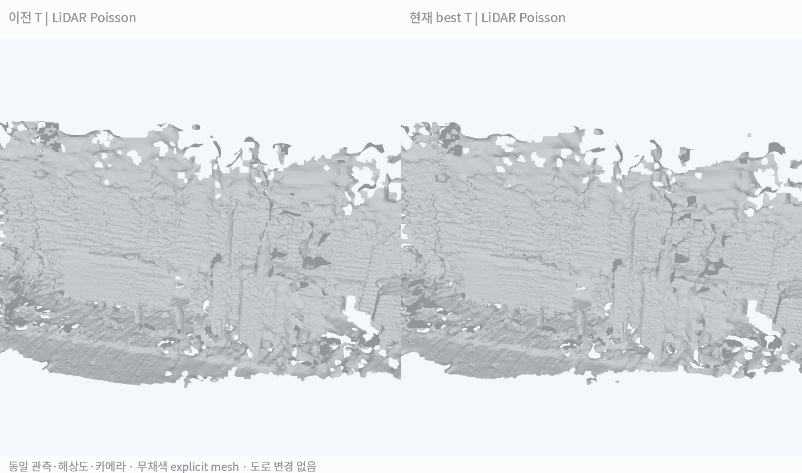
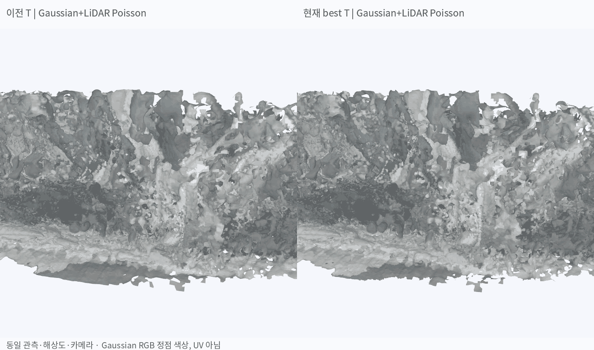

# ADI 배경 Mesh — 이전 T와 현재 best T 비교

**현재 best T로 벽·건물 구간을 다시 mesh화했지만, 이번 조건에서는 표면 단절과 조각 수가 개선되지 않음. T 변경만으로 배경 mesh 품질 문제가 해결되지는 않음. 도로는 변경하지 않음.**

## 1. 실제 수행한 비교

같은 약 40초 카메라 궤적에서 벽·건물 측면 영역을 선택하고, **T만 변경한 4개 explicit triangle mesh**를 생성함. 양쪽 모두 추가 지연 0초이며, 과거 −0.37초 가정으로 추정했던 T도 이번에는 0초 관측에 적용함.

| 항목 | 두 조건에서 공통 사용 |
|---|---|
| 영역 | 기존 미터·Z-up world의 X 27~48m, Y −8~−1m, Z 0.4~8m |
| 실제 LiDAR | 76개 camera keyframe에 대응하는 zero-extra-delay deskew scan, 동일 반환점 174,794개 |
| Gaussian 관측 | 기존 NuRec 렌더의 wall/building depth·RGB 700,763개 표본, 4cm voxel 대표점 |
| LiDAR Normal | 원래 scan 좌표에서 반경 60cm로 추정한 뒤 각 T로 회전 |
| Gaussian Normal | 고정 표본에서 반경 20cm로 추정하고 해당 카메라 쪽으로 방향 정리 |
| Poisson | 목표 최소 셀 5cm, 입력 지지점에서 15cm보다 먼 표면 제거 |
| 고정 조건 | 원본 점 ID·카메라 pose·metric scale·시각·deskew·Gaussian·렌더 카메라 |
| 변경 조건 | LiDAR → camera extrinsic T만 변경 |

LiDAR 선택은 두 T 중 하나라도 고정 ROI에 들어오고 Gaussian 관측에서 50cm 이내인 점의 **합집합**을 사용함. 두 결과에서 서로 다른 점을 고르지 않음. 따라서 LiDAR Poisson도 입력 영역 선택은 Gaussian의 도움을 받았으며, 전체 원시 LiDAR를 무조건 복원한 것은 아님.

## 2. 무채색 Mesh 비교

왼쪽 이전 T / 오른쪽 현재 best T. 양쪽 카메라 위치와 이동은 동일함. 도로·UV·텍스처로 형상을 가리지 않고 explicit mesh만 표시함.

| 복원 입력 | 동일 구도 비교 GIF |
|---|---|
| LiDAR 관측 + Normal → Poisson |  |
| Gaussian depth 표본 + LiDAR 관측 + Normal → Poisson |  |

**이번 융합은 Gaussian depth를 역투영한 점과 LiDAR 점을 함께 넣는 Poisson 경로임. TSDF나 공식 NuRec export-mesh를 호출한 결과가 아님.** 기존 렌더를 재사용했으며 Gaussian 재학습도 하지 않음.

## 3. 생성 결과와 정량 진단

| 입력 | T | Triangle | 분리 조각 수 | 열린 edge 수 | Gaussian 관측과 거리 P50 / P90 |
|---|---|---:|---:|---:|---:|
| LiDAR | 이전 | 360,264 | 517 | 12,404 | 26.23 / 139.70cm |
| LiDAR | 현재 best | 359,283 | 548 | 12,792 | 26.26 / 142.03cm |
| Gaussian + LiDAR | 이전 | 2,656,504 | 1,827 | 28,053 | 1.93 / 6.86cm |
| Gaussian + LiDAR | 현재 best | 2,661,428 | 1,879 | 28,857 | 1.94 / 6.94cm |

**거리의 의미:** 두 T에 공통인 고정 Gaussian 표본에서 mesh 표면까지의 거리임. 실제 정답 형상 오차가 아님. Gaussian+LiDAR 방식은 그 표본을 복원 입력으로도 사용했으므로 거리가 작아지는 것이 자연스러우며, 이 수치로 LiDAR보다 실제로 정확하다고 결론내리지 않음.

조각·열린 edge 수에는 ROI 절단과 관측 경계도 포함됨. 면 수가 많거나 조각 수가 적다는 것만으로 정확도·collider 품질을 보장하지 않음.

### 이번 비교에서 확인한 것

- T 변경에 따른 LiDAR 점 이동은 중앙값 **9.84cm**, P90 **11.61cm**였음.
- LiDAR-only 복원은 이전·현재 모두 관측 부족과 스캔 형태의 표면이 남음.
- Gaussian 점을 추가하면 더 많은 면이 생기지만, 별도 조각·겹치는 표면이 남음. 현재 T에서 조각 수가 감소하지 않음.
- **영상에서의 정합 개선이 이번 배경 mesh의 개선으로 이어졌다는 근거는 없음.** 현재 T를 작업 기준으로 유지하되 mesh 품질 개선은 별도 단계가 필요함.

## 4. Gaussian RGB 색상 적용

색은 mesh vertex에서 가장 가까운 고정 Gaussian RGB 표본을 가져옴. UV texture나 가림을 고려한 multi-view baking은 아님. 색상이 채워져 보여도 구멍·이중 표면이 해결됐다는 뜻은 아님.

## 5. 다음 개선의 우선순위

1. **현재 T를 유지하고 벽의 표면을 분리함.** 한 ROI에 창문·간판·식생·앞뒤 벽 표본을 함께 넣으면 같은 벽으로 이어지거나 여러 겹이 생길 수 있음.
2. **벽마다 depth·normal 일관성을 확인함.** 평면 가설을 무조건 덮어씌우기보다, 같은 면을 지지하는 관측만 묶고 실제 경계·개구부를 보존함.
3. **선택한 같은 벽 입력으로 국소 Poisson과 depth→TSDF를 비교함.** 목표 공간 해상도를 맞추고, 새 관측으로 표면 지지와 겹침을 확인한 후 전체 배경으로 확대함.
4. 형상 확인 이후 가림·시야 방향을 고려한 RGB 투영을 적용하고, 기존 LiDAR-only 도로와 결합함.

이번 단계는 벽 구간의 T 민감도 대조 실험임. **전체 배경·Genesis 주행·물리 collider 검증을 새로 수행한 결과는 아님.**

## 재현 자료

- instant_nurec 코드: `research/adi_wall_best_T_comparison.py`
- 입력·메쉬·결과: `adi_quality_20261018/wall_best_T_comparison_20261025/`
- 실제 mesh: `lidar_previous.ply`, `lidar_current.ply`, `fusion_previous.ply`, `fusion_current.ply`
- 동일 원본 점·Normal·camera pose·점 ID의 SHA256을 `inputs.json`에 기록함.
- 두 T 모두 world → camera → LiDAR 역변환 시 원본 점 복원이 되는지와 Normal 길이 보존을 확인함.
- LiDAR deskew·camera pose·metric scale은 기존 추정값을 유지했으며 독립적인 geometry GT가 없음.
