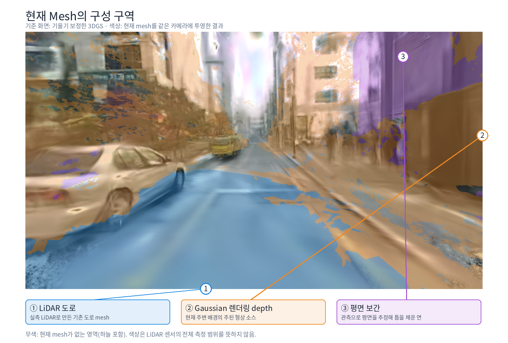
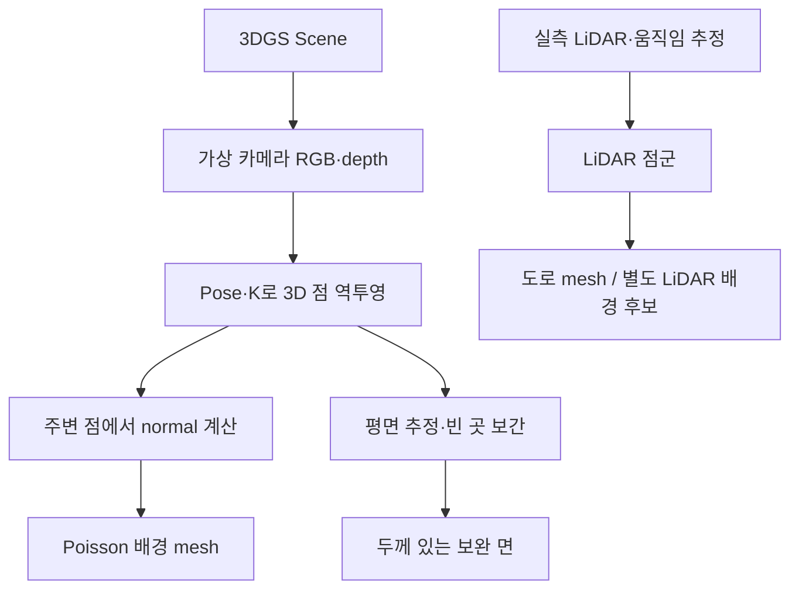

# Gaussian Depth·Normal과 현재 Mesh 구성

> 현재 배경 mesh는 주로 Gaussian 렌더링 depth로 만들며, 도로는 LiDAR 기반이다. Gaussian 축 방향과 depth에서 계산한 normal은 같은 정보가 아니다.

## 1. 구분해야 할 정보

| 정보 | 의미 | 주의점 |
|---|---|---|
| Gaussian 위치·크기·회전 | 학습된 타원체의 위치와 모양 | 가장 얇은 축을 normal 후보로 볼 수 있지만 실제 표면 방향은 보장되지 않음 |
| Gaussian 렌더링 depth | 가상 카메라의 픽셀 방향으로 보이는 거리 | 여러 Gaussian의 기여가 섞인 추정값. LiDAR 실측값이 아님 |
| Depth 기반 normal | 주변 픽셀을 3D로 펼쳐 얻은 국소 면의 방향 | depth가 흔들리면 normal도 흔들림 |
| LiDAR 거리 | 실제 센서가 관측한 반환점까지의 거리 | 거리값과 별개로 pose·deskew·정합 오차가 지도에 영향을 줌 |
| LiDAR 점군 normal | 주변 실측 점을 이용해 추정한 표면 방향 | 센서가 normal을 직접 측정한 것은 아님. 점이 희소하면 추정이 불안정할 수 있음 |

**렌더링 depth가 곧 normal은 아니다.** Depth는 거리이고 normal은 방향이다. 현재 배경 Poisson에는 depth를 역투영한 점과 인접 점의 방향 차이로 계산한 normal을 사용했다.

## 2. 현재 혼합 방식의 구성 구역

기울기를 보정한 원본 3DGS의 한 컷에 기존 mesh를 같은 카메라로 투영했다. 픽셀별 가장 앞에 맞는 삼각형의 출처를 표시했으며, 수동 semantic 구획이나 LiDAR 전체 측정 범위 표시가 아니다. 이 그림은 **새 LiDAR-only 후보로 교체하기 전의 혼합 방식**이다.

| 색 | 실제 구성 |
|---|---|
| 파랑 | 기존 LiDAR 도로 mesh |
| 주황 | Gaussian 렌더링 depth 기반 배경·추가 시점 Poisson |
| 보라 | 관측에서 평면을 추정해 보간한 면 |
| 무색 | 현재 mesh가 없는 영역. 하늘도 포함 |

## 3. 어느 단계에서 무엇을 사용하는가

| 구간 | 형상·normal의 출처 |
|---|---|
| 기존 전체 배경 | Gaussian depth → 점 → depth-gradient normal → Poisson |
| 추가 카메라 보강 | 새 시점 Gaussian depth·normal과 시점 간 일치 검사 |
| 벽·지형의 면 보간 | 점들에 맞춘 평면의 normal 사용 |
| 기존 도로 | LiDAR 기반 geometry |
| 새 LiDAR-only 배경 시험 | LiDAR 점군 + PCA normal → Poisson. Gaussian depth 미사용 |

## 4. 현재 해석

- 나무는 얇은 잎·가지·여러 깊이가 겹쳐 하나의 면으로 복원하기 어렵다. 그러나 벽도 깨지므로 나무만의 문제는 아니다.
- RGB가 잘 보이는 것과 실제 표면 geometry가 정확한 것은 다르다.
- Gaussian 수나 렌더링 해상도를 높이는 것만으로 잘못된 depth·normal이 해결되지는 않는다.
- 두 normal 방식의 정확도 우열을 동일 조건으로 검증한 상태는 아니다. 현재 사용 경로를 더 정확하다고 단정하지 않는다.
- LiDAR를 형상의 기준으로 두고 다른 depth로 보강하는 방향은 가능하지만, 먼저 정합·움직임·관측 밀도를 검증해야 한다.

관련 실험: [기울기 보정](./[DIGLAB][26-10-26][정만교]_Gaussian_scene_leveling.md), [LiDAR-only 배경](./[DIGLAB][26-10-26][정만교]_LiDAR_only_background.md).
