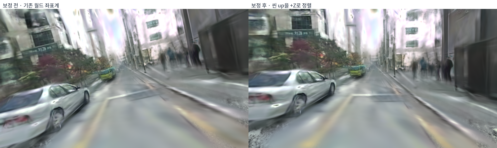
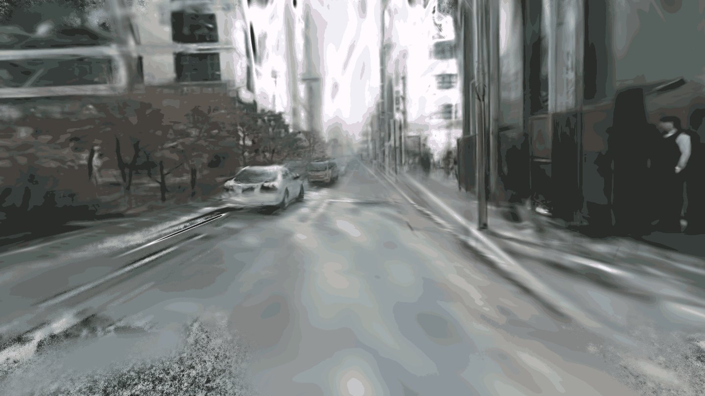

# 3DGS Scene의 기울기 원인 확인 및 보정

> 약 11.81°의 씬 수직 방향 오차를 별도 NuRec artifact의 월드 좌표 변환으로 보정했다. 재학습이나 이미지 회전은 수행하지 않았다.

## 1. 원인 확인

Mesh와 같은 1인칭 카메라로 Gaussian을 직접 렌더링해 보니 Gaussian에도 기울기가 있었다. 따라서 mesh 변환만의 문제는 아니었다.

| 검사 | 결과 |
|---|---:|
| 표시용 카메라 roll | 기존 월드 Z 기준 0° |
| 표시용 카메라 pitch | 약 −2.15° |
| 현재 재구성의 평균 camera-up과 월드 Z 차이 | 11.81° |
| BA 이후 궤적 중심 정렬의 추가 회전 | 11.50° |
| 초기 pose 대비 회전 RMSE: BA 직후 / 정렬 후 | 1.19° / 11.84° |
| 정렬 회전을 역으로 적용한 수치 검사 | camera-up 차이가 1.13°로 감소 |

`align_to_seed`는 카메라 중심만으로 Sim3를 맞췄다. 직선에 가까운 궤적에서는 진행 축 주변 회전이 약하게 구속된다. 이 정렬이 불필요한 회전을 도입한 것이 주요 원인 후보다. Camera deskew나 원본 stitching 오류로 단정하지 않는다.

## 2. 실제 적용한 보정

최소 회전으로 현재 평균 camera-up을 +Z에 맞췄다. BA 이후 Sim3 전체를 역변환한 것이 아니며, scale은 1로 유지했다. 첫 rig 위치를 회전 중심으로 사용했다.

```text
기존 월드 → 보정 월드: G
보정 world_to_nre = 기존 world_to_nre × inverse(G)
보정 rig pose     = G × 기존 rig pose
```

- 내부 Gaussian tensor와 checkpoint는 그대로 보존했다.
- Artifact의 world-to-NRE, rig pose, 프레임별 pose, USD 카메라 궤적을 일관되게 변경했다.
- 별도 `adi_nurec_leveled.usdz`로 저장했다. 원본 artifact는 덮어쓰지 않았다.
- 비교 카메라 위치·진행 방향은 보정 월드로 옮기고, 표시용 up을 새 월드 +Z로 설정해 다시 렌더링했다.

## 3. 전후 비교





## 4. 검증과 한계

| 검증 | 결과 |
|---|---|
| 보정 회전 | 11.810964° |
| 평균 camera-up의 새 +Z 정렬 | 수치 오차 범위에서 일치 |
| 회전 행렬 determinant·거리 scale | 1 / 1 |
| 원본·보정 checkpoint SHA-256 | 동일 |
| 씬과 카메라를 함께 변환한 RGB 보존 검사 | MAE 약 0.006 / 255 |
| 저장된 카메라 궤적 변환 검사 | 최대 행렬 차이 약 5.96×10⁻⁷ |

**Camera-up은 추정된 수직 기준이며 실측 IMU 중력이 아니다.** 이번 보정은 좌표 정렬 문제를 줄인 것이고, lens·stitch calibration이나 물리적 절대 수직을 검증한 것은 아니다.

기존 mesh·경로 파일은 자동으로 모두 재작성하지 않았다. 보정한 3DGS와 함께 사용할 때는 같은 G를 적용해야 한다. Sensor-to-sensor extrinsic T는 월드 축을 바꿨다고 자동으로 다른 값이 되는 것은 아니며, 원래 T의 물리 정확도 검증은 별개다.

이 회전은 국소 형상·거리·Gaussian 학습 상태를 바꾸지 않으므로 mesh의 구멍·요철·depth 불일치를 해결하지 않는다.

## 5. 저장 위치

- 보정 artifact: `/home/diglab/Documents/ChatGPT/3DGS mesh/work/scene_surface_completion_20261026/leveled_scene/adi_nurec_leveled.usdz`
- 변환·검증: 같은 폴더의 `transform.json`, `native/manifest.json`.
- 코드: `research/adi_level_gaussian_scene.py`, `adi_level_gaussian_native.py`, `adi_level_gaussian_preview.py`.
