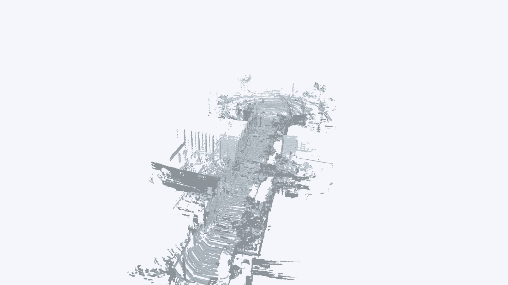
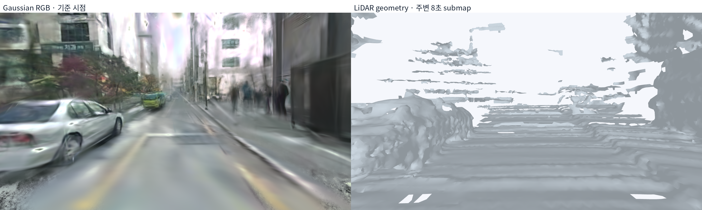
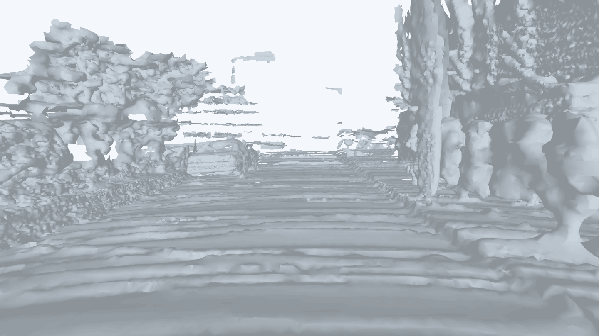

# LiDAR-only 배경 Mesh 비교 실험

> Gaussian depth를 배제하고 실측 LiDAR로 배경까지 mesh를 생성했다. 거리 관측은 확보했지만 띠 모양의 단절과 구멍이 남아, 정확한 거리값만으로 연속 mesh가 보장되지는 않았다.

## 1. 실험 목적

기존 전체 mesh의 실패가 불안정한 Gaussian 렌더링 depth 때문인지 확인하기 위해 geometry 입력을 LiDAR로 바꿨다. Gaussian에 가까운 점만 선택하는 필터도 배제했다.

**LiDAR-only는 형상의 입력이 LiDAR라는 뜻이다.** 전체 위치·움직임·normal까지 정답이라는 뜻은 아니다.

## 2. 실제 입력과 누적 방법

| 항목 | 사용한 정보 |
|---|---|
| 센서 | ADI의 VLP-16 반환점 |
| 범위 | 151 scan·약 38초, 센서 거리 30m 이내 |
| 점 수 | 3,312,340개 |
| Scan 내부 움직임 보정 | 기존 sensor-time·발사 시각 기반 deskew 캐시 |
| Scan 간 pose | 기존 LiDAR ICP odometry. 매 프레임 SfM pose로 대체하지 않음 |
| 씬 배치 | 54번 프레임 한 곳의 camera pose + working-best T로 전체 map을 한 번 rigid 정렬 |
| 월드 방향 | 저장된 3DGS 기울기 보정 G를 합성 |
| Gaussian depth·지지 필터·색상 | geometry 생성에 미사용. 비교 렌더는 회색 |

한 번의 rigid 배치는 지도 내부의 형상을 Gaussian에 맞춰 구부리지 않는다. 다만 camera pose와 T가 추정값이라 절대 위치와 두 씬의 겹침 정확도는 미검증이다. 추가 노출 지연 0초라는 기존 가정도 유지했다.

## 3. 생성 조건

| 조건 | 전체 지도 | 국소 지도 |
|---|---|---|
| 구간 | 10~160번·151 scan | 38~70번·33 scan, 약 8초 |
| Geometry에 쓴 점 | 2,633,712 | 597,766 |
| Fusion에서 제외한 점 | 678,628 | 160,481 |
| Downsample 후 점 | 1,235,375 | 272,400 |
| Poisson 목표 cell | 5cm | 3.5cm |
| Normal 추정 반경 | 45cm | 45cm |
| 관측점 지지 거리 제한 | 18cm | 18cm |
| 최대 triangle edge | 60cm | 60cm |
| 생성 삼각형 | 6,422,245 | 1,704,461 |
| 연결 성분 | 1,566 | 370 |

`label % 5 == 0`인 scan은 geometry fusion에서 제외했다. 기존 odometry가 이 scan을 사용했을 수 있으므로 완전 독립 holdout은 아니다. 작은 조각 제거·거리 필터도 적용했으므로 원시 반환점을 그대로 연결한 mesh는 아니다.

## 4. 결과

### 전체 LiDAR 지도

### 동일 시점 비교와 국소 지도 1인칭

왼쪽 기준 영상은 기울기를 보정한 Gaussian RGB이며 실측 GT 사진이 아니다. LiDAR 영상은 동일한 1인칭 camera pose·K·프레임 타이밍을 사용했다. 국소 submap을 사용해 긴 구간의 누적 오차 영향을 줄여 관찰했지만, 정합 오차가 사라진 것은 아니다. 차량 주행이나 물리 검증은 하지 않았다.

**관찰:** 도로와 주변 구조의 형상은 생성됐으나, LiDAR에서도 수평 띠·끊어진 면·빈 부분이 많이 남았다. 따라서 현재 실패를 Gaussian depth 하나의 문제로만 결론 내릴 수 없다.

## 5. 정량 검사

| Fusion에서 제외한 LiDAR 점 → mesh | 전체 | 국소 |
|---|---:|---:|
| 평가 점 수 | 226,210 | 53,494 |
| 거리 P50 | 2.15cm | 1.92cm |
| 거리 P90 | 8.90cm | 7.85cm |
| 10cm 이내 비율 | 91.58% | 92.92% |

평가 점은 제외 scan의 점을 3개마다 하나씩 사용했다. **동일 odometry에 누적한 점과의 일관성**이며 독립 GT 위치 정확도가 아니다. 전체 지도가 휘거나 이중 표면이 생겨도 이 점수가 좋아질 수 있다. Gaussian 실험의 다른 평가 영역·조건과 직접 우열 비교하지 않는다.

## 6. 비판적으로 볼 점

- LiDAR는 거리를 측정하지만 normal은 주변 점에서 추정한다. 희소한 곳·물체 경계에서 normal이 틀릴 수 있다.
- 16채널의 수직 샘플 간격, 가림, 거리 증가로 표면 근거가 부족한 곳이 생긴다. cell을 작게 해도 관측이 늘지는 않는다.
- 기존 LiDAR odometry와 deskew는 연구용 추정이다. 누적 pose drift가 정확한 거리값을 잘못된 위치에 배치할 수 있다.
- 이동 물체를 완벽하게 분리하지 않아 잔상이나 겹침이 남을 수 있다.
- Poisson과 지지 거리 필터는 빈 곳을 과도하게 메우거나 반대로 띠 모양으로 잘라낼 수 있다. 이번 시험은 그 영향을 제거한 센서 성능 평가가 아니다.
- 전체 LiDAR-only mesh의 Genesis 충돌·차량 주행은 아직 검증하지 않았다. 기존 Gaussian 보완 면의 접촉 성공을 이 결과에 적용하지 않는다.

## 7. 현재 판단과 저장 위치

**관측된 형상의 기준으로 LiDAR를 사용하는 방향은 타당하다. 그러나 정확한 LiDAR 거리 → 정확한 누적 지도 → 연속된 collider는 각각 검증해야 하는 별도 단계다.** 이번 결과만으로 어느 전체 씬이 더 정확하다고 채택하지 않는다.

- 결과·입력·검사: `/home/diglab/Documents/ChatGPT/3DGS mesh/work/scene_surface_completion_20261026/lidar_only/`
- Mesh: `lidar_full_mesh.glb`, `lidar_local_mesh.glb` 및 PLY.
- 기록: `input.json`, `results.json`.
- 코드: `instant_nurec/research/adi_lidar_only_scene.py`.
- 기존 혼합 방식의 구역: [Gaussian depth·normal 설명](./[DIGLAB][26-10-26][정만교]_Gaussian_depth_normal.md).
