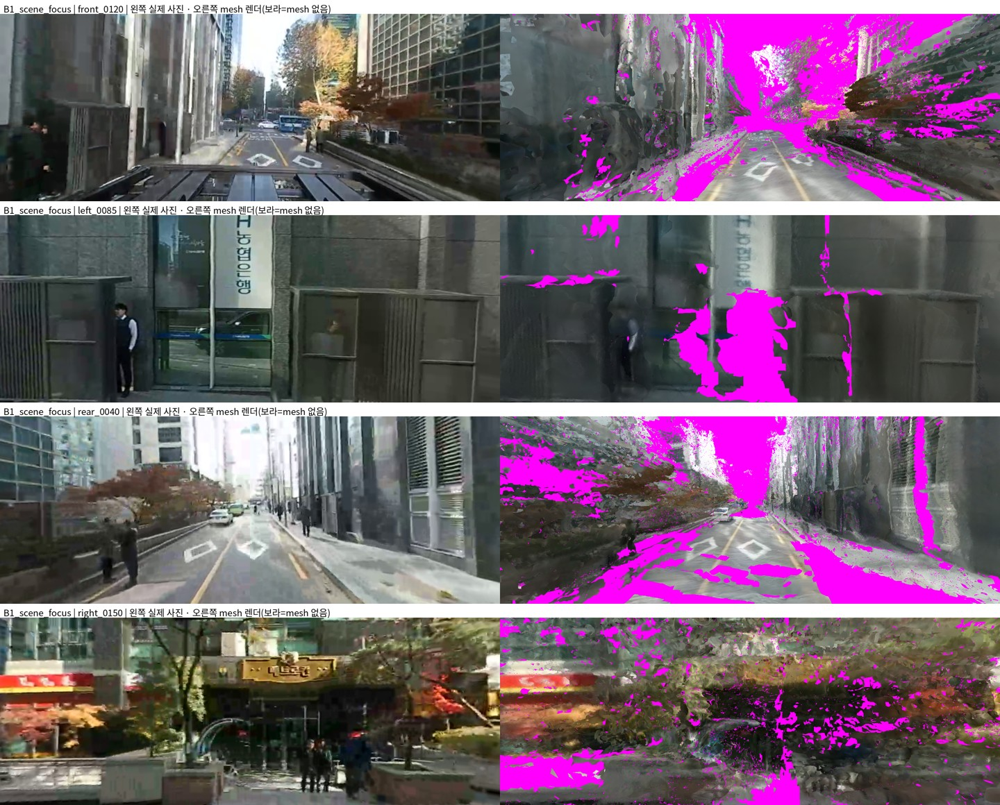
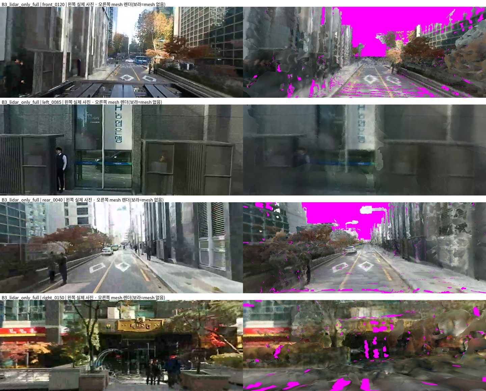
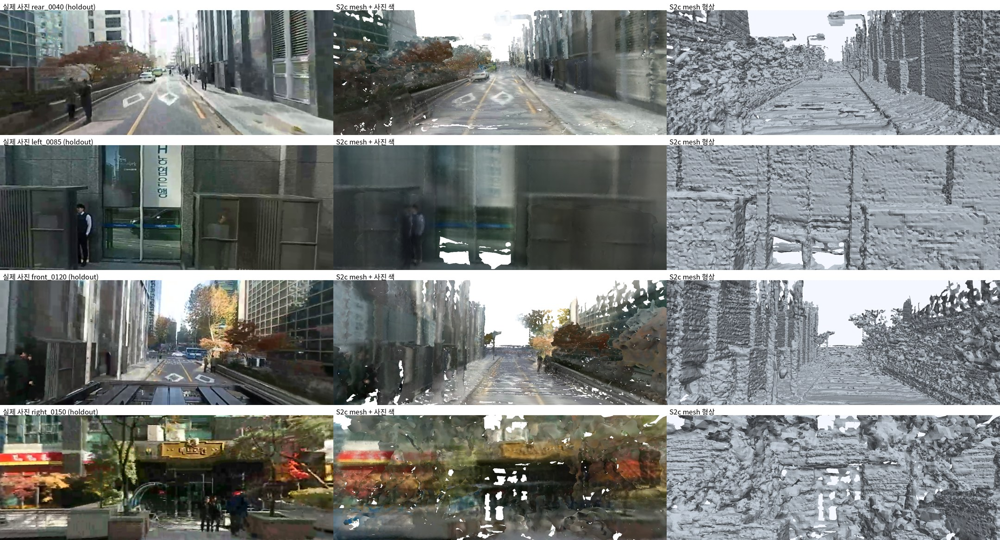
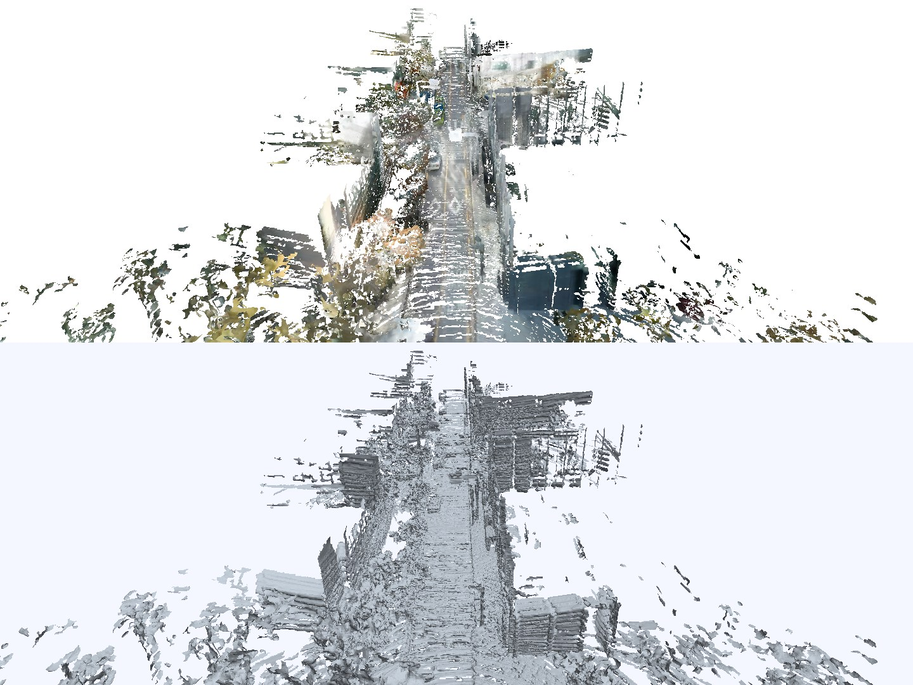
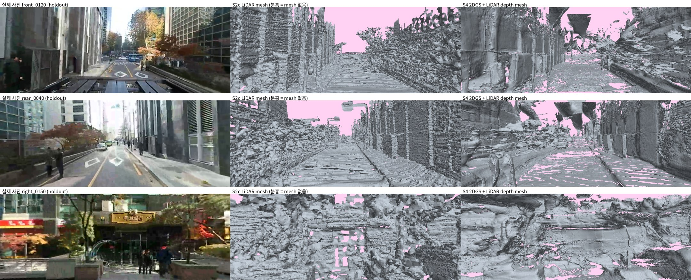
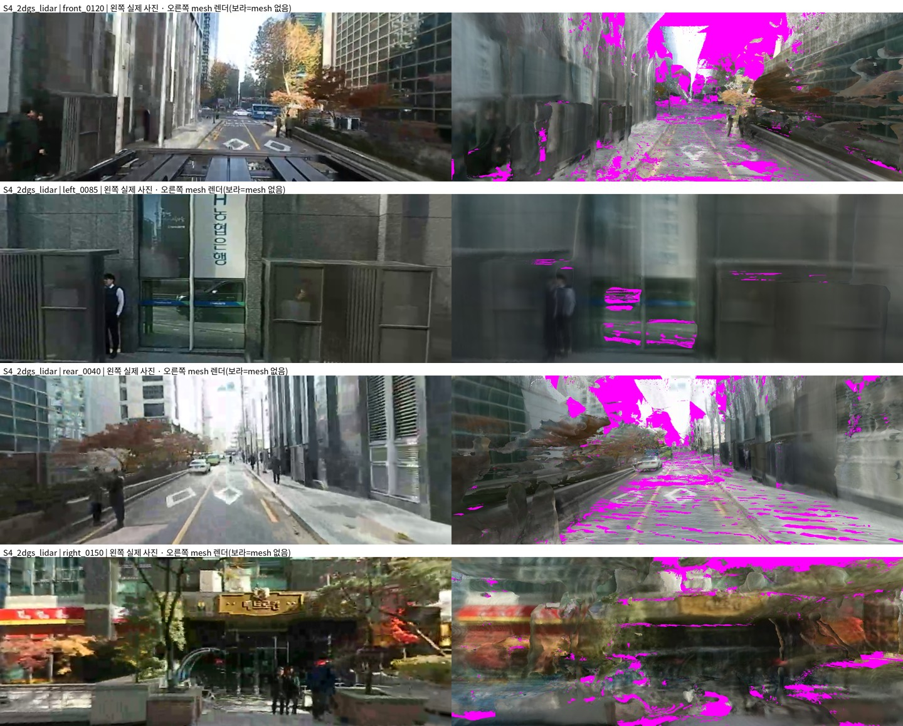

# Single-World Mesh Rebuild Pipeline: Evaluation → T Sensitivity → LiDAR World

> ADI 씬의 mesh 를 처음부터 다시 만들기 위해 평가 기준을 고정하고(Stage 0), T 의 영향을 먼저 재고(Stage 1), 카메라·LiDAR 를 하나의 world 로 묶고(Stage 2), 그 world 에서 LiDAR depth 로 2DGS 를 학습한(Stage 4) 기록. Stage 3(T 정밀 추정)은 Stage 1 결과로 보류.

## 용어

| 표제어 | 정의 |
|---|---|
| T (extrinsic) | LiDAR → 카메라 좌표 변환. 현재 working best = 추가 지연 0초 조건으로 추정한 후보 |
| 추가 지연 | 시계 동기화(녹화기 ↔ GPS UTC ↔ VLP-16, +0.834s, 6.51ppm) 이후 남는 카메라 촬영 지연. **0초로 확정** |
| leveled world | 기울기 보정(11.81°) 후의 metric Z-up world. 모든 평가의 기준 좌표 |
| two-world | SfM 카메라 궤적과 LiDAR odometry 궤적이 서로 다른 world 에 있는 상태 |
| holdout | `label % 5 == 0` 인 31 프레임의 이미지 124장 + LiDAR scan 31개. 형상·색·pose·T 추정에 쓰지 않음 |
| ray test | holdout LiDAR 반환점을 ray 로 쏴 mesh 와 비교 — consistent / early(관측된 빈 공간에 가짜 면) / late / miss(구멍) |
| self-consistency | 누적 LiDAR 지도에서 다른 scan 의 점이 holdout ray 의 빈 공간에 들어간 비율. scan 간 시간 차이(label gap, 1 label = 0.25s)별로 집계 |
| feature reprojection | 학습 이미지의 SfM feature track 을 삼각측량해 holdout 이미지에 다시 투영한 pixel 오차. pose 품질 지표 |
| corridor | 실제 차량이 지나간 공간(차체 4.0×1.6m). 그 안에 mesh 가 있으면 오류 |
| B1 / B2 / B3 | 기준선 mesh — B1 = 집중 시점 Gaussian Poisson, B2 = B1 + 추가 카메라 보완, B3 = LiDAR-only |
| S2a / S2b / S2c | Stage 2 LiDAR mesh — S2a = 개선 궤적 전체 점, S2b = + 동적 점 제거 v1, S2c = + 동적 점 제거 v2(지면 보존) |
| S4 | Stage 4 mesh — Stage 2 world 에서 LiDAR depth 로 학습한 2DGS 의 TSDF mesh |
| rotation BA | 카메라 중심은 LiDAR × T⁻¹ 로 두고 회전(+cm 단위 위치)을 feature track 으로 다시 맞추는 정제 |
| 2DGS | 2D Gaussian Splatting. depth·normal 렌더링과 TSDF mesh 추출이 내장된 surface Gaussian |

## 요약

**결과**

* **평가 기준 고정** — 후보 mesh 를 같은 holdout·같은 world 에서 ray test·사진 재렌더·위상·corridor·바퀴 지지로 채점하는 체계 완성. 기준선 3개 채점 완료.
* **two-world 정량화** — 같은 시각 SfM 카메라와 LiDAR 가 가리키는 센서 위치가 중앙값 **0.69m**, 최대 **3.03m** 차이. B1·B2 는 도로가 leveled world 에서 **좌우 8.5°** 기울어진 채로 조립돼 있었음.
* **T 는 현재 병목이 아님** — T 에 이동 50cm·회전 2°를 넣어도 holdout 사진 재렌더 PSNR 변화 0.1dB 이하. 1m·5°는 검출됨(지표는 정상).
* **단일 world 구축** — 카메라 = LiDAR pose × T⁻¹(추가 지연 0초). 영상이 요구한 위치 수정 중앙값 **2.6cm**. holdout feature reprojection 3.35 → **2.17px**.
* **LiDAR 지도 일관성 개선** — 3~7.5초 떨어진 scan 간 빈 공간 침범 **18.0% → 8.0%**. 동적 물체 제거로 corridor 침범 0.24% → 0.07%.
* **S2c 를 LiDAR 기준 mesh 로 채택** — ray consistent 56.8% → **66.5%**, early 34.2% → 19.8%, 바퀴 지지 92%.
* **2DGS + LiDAR depth(S4)가 건물 상부를 채움** — 가짜 면 early **7.8%**(전 후보 중 최저), 연결 성분 1,003, LiDAR 빔 줄무늬 없는 연속 벽면.

**미해결**

* S4 는 도로·20m 이상 구간이 비어 있음(miss 10.1%, 바퀴 지지 74%) — S2c(도로·근거리)와 S4(상부·벽면)를 결합하는 단계가 필요.
* 카메라 pose 는 공정 비교한 SfM(1.62px)보다 아직 나쁨(2.17px).
* LiDAR 는 위로 +15°까지만 봄 → S2c 단독으로는 건물 상부가 비어 있음.
* 같은 방향으로 함께 움직이는 차량은 동적 판정에 잡히지 않음.
* GPS 속도가 LiDAR·영상과 맞지 않음(r = 0.05) — 원인 미확인, 제약으로 사용하지 않음.
* 작업 파티션 잔여 **86MB** — 대용량 산출물은 루트 파티션에 저장 중.

---

## 문제 정의

| # | 하위 문제 | 질문 | 이 문서에서 |
|---|---|---|---|
| P0 | 평가 기준 | 좋은 mesh 를 어떤 숫자로 판정하나 | Stage 0 |
| P1 | T 의 영향 | T 가 정확해지면 mesh 가 나아지나, 얼마나 정확해야 하나 | Stage 1 |
| P2 | 단일 world | 카메라·LiDAR pose 를 하나의 metric 궤적으로 | Stage 2 |
| P3 | T 추정 | 검증 가능한 T | Stage 1 결과로 후순위 |
| P4 | 융합 형상 | LiDAR 거리 + 카메라 조밀함으로 일관된 depth | Stage 4 |
| P5 | 표면화 | 조각이 아니라 연속된 면 | 예정 |
| P6 | Genesis | 주행·충돌 | 예정 |

**지난 한 달이 "전부 실패"로 보였던 이유는 T 가 형상에 들어가는 경로가 없었기 때문**

* 기존 배경 mesh = Gaussian depth 만 사용, 기존 NuRec 18k 학습 = LiDAR supervision 0(SfM pose)
* LiDAR-only mesh = LiDAR 만 사용 + anchor 1개로 한 번 배치
* &rarr; T 를 바꿔도 mesh 가 그대로였던 것은 T 가 무관해서가 아니라 측정할 수 없는 구조였음

---

## Stage 0 — 평가 체계

| 지표 | 측정 | 잡아내는 것 |
|---|---|---|
| ray test | holdout LiDAR 반환점 → ray cast | 가짜 면(early), 구멍(miss) |
| 사진 재렌더 | 학습 사진으로 vertex 색을 입힌 mesh 를 holdout 사진 시점에서 렌더 → PSNR | 형상 + pose + 텍스처 정합 |
| feature reprojection | holdout 이미지 feature 의 pixel 오차 | pose 품질 (Stage 2 에서 추가) |
| 위상 | 연결 성분, 상위 10개 면적 비율 | 조각화 |
| corridor | 차체 상자를 실제 궤적에 따라 sweep | 차량 통로를 막는 면 |
| 바퀴 지지 | 바퀴 4곳 아래 ray, 센서 높이의 프레임 간 흔들림 | 도로 처짐·구멍·배치 불일치 |

**holdout 은 어떤 단계에서도 형상·색·pose·T 추정에 쓰지 않는 것이 규칙**

* LiDAR 배치는 두 방식(odometry 지도 anchor 1개 / 프레임마다 SfM pose × T)으로 모두 채점 → 차이가 곧 two-world 크기

### 기준선 채점

| 지표 | B1 | B2 | B3 |
|---|---:|---:|---:|
| ray consistent | 16.6% | 18.3% | **56.8%** |
| ray early (가짜 면) | 39.9% | 40.2% | **34.2%** |
| ray miss (구멍) | 24.9% | 22.9% | **1.4%** |
| 사진 재렌더 PSNR / 덮인 비율 | **17.86** / 0.68 | 17.78 / 0.70 | 17.22 / **0.83** |
| 연결 성분 / 상위 10개 면적 | 91,078 / 0.48 | 103,237 / 0.44 | **10,405 / 0.87** |
| 센서 높이 흔들림 P90 | 0.33m | 0.33m | **0.29m** |
| 도로 좌우 기울기 | 8.5° | 8.5° | **−0.7°** |

**형상 기준은 LiDAR(B3)가 모든 형상 지표에서 우세**

* B3 의 사진 점수가 가장 낮은 이유 = 형상은 LiDAR world, 색은 SfM pose — two-world 의 증상
* B1·B2 의 사진 점수는 holdout 이미지로도 학습된 Gaussian 에서 나온 것이라 유리하게 나옴


* B1 — 왼쪽 실제 holdout 사진, 오른쪽 mesh 렌더(보라 = mesh 없음)


* B3 — 같은 시점

### two-world 와 지도 자체 불일치

| 항목 | 값 |
|---|---:|
| 센서 위치 차이 (SfM vs LiDAR, 같은 시각) | p50 **0.69m** · p90 2.42m · max **3.03m** |
| 센서 회전 차이 | p50 1.28° · max 5.22° |
| 83.2m 구간 높이 변화 | SfM 3.9m / LiDAR 5.5m |
| 누적 LiDAR 지도 빈 공간 침범 (label gap 1-3 / 4-10 / 11-30 / 31-60) | 5.9% / 11.1% / **18.0%** / 11.4% |

**LiDAR 누적 지도도 시간이 벌어질수록 서로 어긋남**

* 3~7.5초 차이에서 3배 → drift 와 동적 물체 잔상이 섞인 것으로 보임 (Stage 2 에서 분리)

### 잘못된 이해 — 평가 지표 자체의 결함 2개

| 결함 | 현상 | 수정 |
|---|---|---|
| ray 방향 ±10cm 기준 | 점–mesh 거리 2cm 인 정상 mesh 도 early 57% — 비스듬한 ray 는 면이 몇 cm 만 달라도 ray 위 거리가 m 단위로 벌어짐 (고각 −3°, 7cm → 1.3m) | hit 지점이 같은 scan 반환점 25cm 이내면 consistent |
| 외부 지면 기준 바퀴 지표 | 링 평면에 보도·연석이 섞여 지면이 0.2~0.5m 높게 추정, 바퀴 지지 0% | 외부 기준 없이 "센서 높이는 프레임 간 일정해야 함"으로 채점 |

> 첫 채점에서 LiDAR-only mesh 가 자기 world 에서 34% 일치로 나왔을 때 mesh 가 아니라 지표를 먼저 의심했고, 실제로 지표 쪽 결함이었음.

---

## Stage 1 — T 민감도

> 형상은 B3 에 고정, 카메라 = LiDAR pose × T⁻¹. T 에 일부러 오차를 넣고 holdout 사진 재렌더로 채점.

**같은 pose 로 색을 입히고 렌더하면 일정한 오차가 상쇄될 수 있음** → 색은 전·후방 카메라로만, 평가는 좌·우측 카메라로만 하는 교차 실험을 별도로 둠. 1m·5°는 지표가 오차를 잡는지 보는 대조군.

| T 오차 | 같은 방향 PSNR | 교차 방향 PSNR |
|---|---:|---:|
| 없음 (working best T) | 16.66 | 14.41 |
| 이동 2 / 5 / 10 / 20 / 50cm | 16.66 / 16.66 / 16.67 / 16.66 / 16.63 | — / — / 14.38 / 14.39 / 14.42 |
| 이동 1m (대조) | — | **14.29** |
| 회전 0.25 / 0.5 / 1 / 2° | 16.66 / 16.65 / 16.63 / 16.57 | — / 14.39 / 14.37 / 14.36 |
| 회전 5° (대조) | — | **13.91** |
| 이전 T(−0.37s 가정 추정) | — | 14.39 |
| 기존 SfM pose | **17.22** | 14.83 |

<sub>크기별 무작위 방향 3개(교차 방향 2개) 평균. holdout 124장(교차 방향 62장).</sub>

**T 이동 50cm·회전 2°까지 0.1dB 이하 — 현재 품질에서 T 는 병목이 아님**

* 대조군(1m·5°)은 검출 → 지표가 둔한 게 아니라 다른 오차가 더 큼
* 현재 working best T 와 이전 T 는 구별되지 않음
* 텍스처 품질 자체가 낮아(PSNR ~17dB) 작은 오차가 묻힘 — 형상·궤적이 좋아진 뒤 같은 실험을 다시 해야 함

### 재검토 — "시간 offset 이 T 보다 중요"는 틀린 해석이었음

시간 offset 을 함께 바꾸자 PSNR 이 −0.37s 에서 최고(17.09, 교차 14.92)로 나왔고, 처음엔 이를 카메라 지연으로 해석했다. 독립 검증 결과는 달랐다.

| 독립 검증 (T·텍스처 미사용) | 최적 시간 차이 |
|---|---|
| SfM 카메라 회전 속도 vs LiDAR 회전 속도 | −0.48s (r 0.959, 0초 0.906) |
| SfM 카메라 이동 속도 vs LiDAR 이동 속도 | **0.00s** (r 0.912) |
| 구간별 이동 거리 (label 60–110 / 110–160) | LiDAR 7.0 / 48.5m · SfM 7.1 / 46.4m — 일치 |
| rotation BA 후 카메라 회전 속도 vs LiDAR | −0.14s (r 0.972, 0초 0.944) |

**카메라 전체 지연이 아니라 SfM 회전에만 있던 어긋남 — 추가 지연 0초가 맞음**

* 텍스처 지표는 회전 오차에 민감하고 이동 오차에 둔함 → −0.37s 최고점은 SfM 회전의 시간 어긋남을 반영한 값
* 영상 feature 로 회전을 다시 맞추면 LiDAR 와의 시간 차이가 사라짐
* GPS 는 같은 구간에서 다른 시간대를 보는 것처럼 나옴(구간별 31.7 / 22.5 / 3.9m) — 원인 미확인

---

## Stage 2 — 단일 world

```
LiDAR odometry (기존)
   ↓ 회전 고정 · 이동만 IRLS graph (gap 1/4/8/16/32 ICP edge, sanity gate)
개선 LiDAR 궤적 ── holdout scan 은 정합 제외 · 보간
   ↓ range image 빈 공간 투표 (지면 제외)
정적 LiDAR 지도 ──→ Poisson mesh (B3 와 동일 설정) ──→ S2a / S2b / S2c
   ↓ × T⁻¹ (추가 지연 0초)
카메라 중심 ──→ rotation BA (train 이미지 feature, 위치 prior 10cm) ──→ 카메라 pose
```

### 궤적·카메라 결과

| 지표 | 기존 | Stage 2 |
|---|---:|---:|
| 지도 빈 공간 침범 (gap 1-3 / 4-10 / 11-30 / 31-60) | 5.9 / 11.1 / 18.0 / 11.4% | 3.8 / 5.9 / **8.0** / 4.2% |
| 경로 길이 | 83.2m | 82.2m |
| holdout feature reprojection p50 | 3.35px (LiDAR × T) | **2.17px** |
| 영상이 요구한 카메라 위치 수정 | — | p50 2.6cm · max 17.6cm |
| 영상이 요구한 카메라 회전 수정 | — | p50 0.23° · max 0.95° |

<sub>비교: SfM pose 의 holdout reprojection = 0.72px(holdout 이미지도 BA 에 사용) / 1.62px(holdout 프레임 보간, 공정 비교).</sub>

**LiDAR 기반 카메라 위치는 영상과 수 cm 안에서 맞음**

* 3~7.5초 간격 불일치가 절반 이하로 → drift 성분이 실제로 있었음
* 카메라 pose 는 공정 비교 SfM 대비 0.55px 뒤처짐 — holdout 프레임 회전 보간이 원인 중 하나로 추정

### mesh 결과

| 지표 | B3 | S2a | S2b | S2c |
|---|---:|---:|---:|---:|
| ray consistent | 56.8% | 61.7% | **66.6%** | 66.5% |
| ray early | 34.2% | 27.7% | **15.3%** | 19.8% |
| ray late / miss | **7.7 / 1.4%** | 9.2 / 1.4% | 15.1 / 3.1% | 12.0 / 1.7% |
| corridor 침범 | 0.24% | 0.20% | **0.00%** | 0.07% |
| 바퀴 지지 | 90% | **92%** | 81% | **92%** |
| 센서 높이 흔들림 P90 | 0.29m | 0.19m | **0.16m** | 0.18m |

**동적 점 제거가 가짜 면을 절반 이하로 줄임 — 지면을 보존한 S2c 채택**

* corridor 를 막던 면 = 지나간 차량·보행자 잔상이었음
* S2b 는 지면까지 지워 바퀴 지지 81%로 하락 → S2c 에서 회복, 대신 early 4.5%p 증가


* S2c — 왼쪽 실제 holdout 사진 / 가운데 사진 색 mesh / 오른쪽 형상


* S2c 상공 뷰 — 도로·벽 하단은 연속, 건물 상부는 LiDAR 관측 범위(+15°) 밖이라 비어 있음

### 잘못된 이해 — 동적 점 판정이 지면을 지웠음

| 판정 기준 | 지면 점 제거 | 지면 위 점 제거 | 바퀴 지지 |
|---|---:|---:|---:|
| v1 (고각 허용 0.6°, 2표, 30%) | **17~19%** | 9~11% | 81% |
| v2 (0.3°, 3표, 40%, 지면 제외) | 0% | 5.9% | **92%** |

**비스듬한 먼 지면은 고각이 0.6°만 어긋나도 빔이 m 단위 뒤에 닿음 → "빈 공간" 오투표**

* 고각 차이 → 지면 도달 거리 차이 → meas > r 판정 → 정적 지면이 동적으로 분류

### Troubleshooting — Stage 2 실패 6건

| # | 현상 | 원인 | 수정 |
|---|---|---|---|
| 1 | holdout ray test 가 자기 자신에 맞춰짐 | holdout scan 을 궤적 정합에 사용 | 정합 제외, pose 보간 |
| 2 | 경로 83m → **25m** | pose graph edge 방향 반대 | source/target 교정 + 경로 길이 검사 |
| 3 | 경로 15% 단축 | scan-to-submap ICP 가 도로 방향으로 미끄러짐 (벽·바닥만 있는 퇴화) | 기존 odometry 에서 바로 graph |
| 4 | 시작부 회전 **5.8°** 변화 | 정밀 ICP 상대 회전의 미세 편향이 기준 노드에서 끝으로 누적 (회전 prior 0.1°/step 도 ICP 정보행렬에 묻힘) | 회전 고정 · 이동만 IRLS |
| 5 | rotation BA 발산 | 측면·후방 bearing 을 rear 카메라 평면에 투영(z ≤ 0) | 단위 벡터 각도 잔차 |
| 6 | 일부 프레임 회전 180° 뒤집힘 | 틀린 초기 회전 → 나쁜 삼각측량 | prior 대비 5° 초과 해 거부 |

> 2·4번은 경로 길이만 보는 검사로는 회전 붕괴를 못 잡았음 — 이후 모든 단계에 경로 길이 10% · 회전 3° 자동 중단 검사를 둠.

---

## Stage 4 — 2DGS + LiDAR depth supervision

| 항목 | 설정 |
|---|---|
| 입력 | Stage 2 world · 카메라, 학습 프레임 120 × 4방향 = 480장 (holdout 제외) |
| 초기값 | 정적 LiDAR 지도 824,554점 |
| LiDAR depth loss | 같은 시각 scan 정적 점, 이미지당 ~5,400px, 상대 L1 (λ 0.5) |
| RGB loss 제외 | 차체(roof rack) · 동적 점 주변 (21px dilate) |
| 학습 | 30k iteration, **1,198s 실측**(RTX 4090), Gaussian 1.08M, 학습 이미지 LiDAR depth 상대 오차 p50 1.6% (30k 직전 500 iter) |
| mesh 추출 | streaming TSDF — voxel 5cm, alpha > 0.5, depth 20m 이내, 학습 시점 240장 |

### 결과 — S2c 대비

| 지표 | S2c (LiDAR) | S4 (2DGS + LiDAR depth) |
|---|---:|---:|
| ray consistent | **66.5%** | 58.3% |
| ray early (가짜 면) | 19.8% | **7.8%** |
| ray late / miss | **12.0 / 1.7%** | 23.8 / 10.1% |
| ray consistent 3-10 / 10-20 / 20-30m | **78.0 / 53.0 / 40.9%** | 69.0 / 48.1 / 24.5% |
| 연결 성분 | 10,070 | **1,003** |
| 면적 | **8,223㎡** | 5,800㎡ |
| 바퀴 지지 | **92%** | 74% |
| corridor 침범 | 0.07% | **0.05%** |
| 사진 재렌더 PSNR / 덮인 비율 | 16.94 / **0.842** | **16.97** / 0.834 |

**S4 는 가짜 면이 가장 적고 면이 매끈하지만, 구멍(miss 10%)과 도로 결손이 큼 — 단독으로는 S2c 를 대체하지 못함**

* 건물 상부·벽면은 S4 가 채움 — LiDAR 빔 줄무늬 없이 연속면
* 도로·먼 곳(20m+)은 S4 가 비어 있음 — 비스듬한 도로의 낮은 alpha · 20m depth 절단 · 시점 절반만 적분이 원인으로 추정
* 하늘 쪽에 떠 있는 얇은 면이 일부 생김(front_0120 상단 중앙) — sky 를 따로 다루지 않은 결과


* 형상만 비교 — 왼쪽 실제 holdout 사진 / 가운데 S2c / 오른쪽 S4 (분홍 = mesh 없음)


* S4 — 실제 사진으로 색을 입혀 holdout 시점에서 렌더 (보라 = mesh 없음)

### 잘못된 이해 — 공식 mesh 추출을 그대로 쓰면 될 것이라 봄

| 시도 | 결과 | 원인 |
|---|---|---|
| 공식 extractor, depth 25m | 메모리 초과로 강제 종료 | 480장 렌더를 RAM 에 쌓은 뒤 적분 + 하늘·먼 depth 까지 적분해 TSDF block 폭증 |
| streaming TSDF (현재) | 820만 면 추출, 1,000 cluster 유지 | 렌더 → 적분 → 폐기, alpha·거리 제한 |

> S4 의 도로 결손은 학습이 아니라 추출 조건(alpha 0.5 · 20m 절단 · 시점 절반) 영향일 가능성이 있어, 조건을 바꾼 재추출과 S2c·S4 결합을 함께 봐야 함.

<details>
<summary><b>재현 경로</b> — 코드·산출물 위치 (펼치기)</summary>

| 단계 | 코드 (instant_nurec/research) | 산출물 |
|---|---|---|
| Stage 0 | `adi_eval_suite.py` | `adi_quality_20261018/stage0_eval_20261026/` |
| Stage 1 | `adi_stage1_T_sensitivity.py`, `adi_stage1_cross_dir.py` | `adi_quality_20261018/stage1_T_sensitivity_20261026/` |
| Stage 2a | `adi_stage2_lidar_trajectory.py` | `adi_quality_20261018/stage2_trajectory_20261026/` |
| Stage 2b | `adi_stage2_camera_rotation.py` | `adi_quality_20261018/stage2_camera_20261026/` |
| Stage 2c | `adi_stage2_mesh.py`, `adi_stage2_dynamic_v2.py` | `adi_quality_20261018/stage2_mesh_20261026/` (`S2c_refined_static_v2.ply`) |
| Stage 4 | `adi_stage4_2dgs.py` | `/home/diglab/Documents/ChatGPT/3DGS mesh/work/stage4_2dgs_20261026/` |

단계별 요약 수치: `stage0_summary.json`, `stage1_summary.json`, `stage2_summary.json`.

</details>

---

## next step
