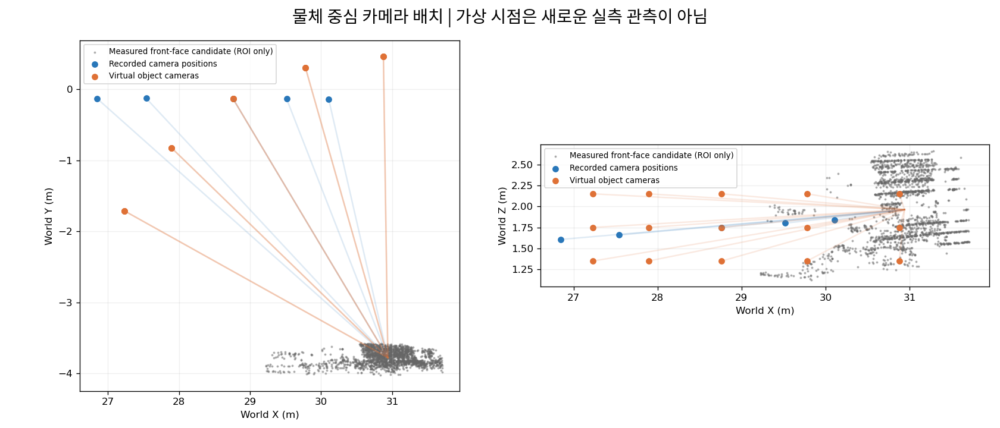
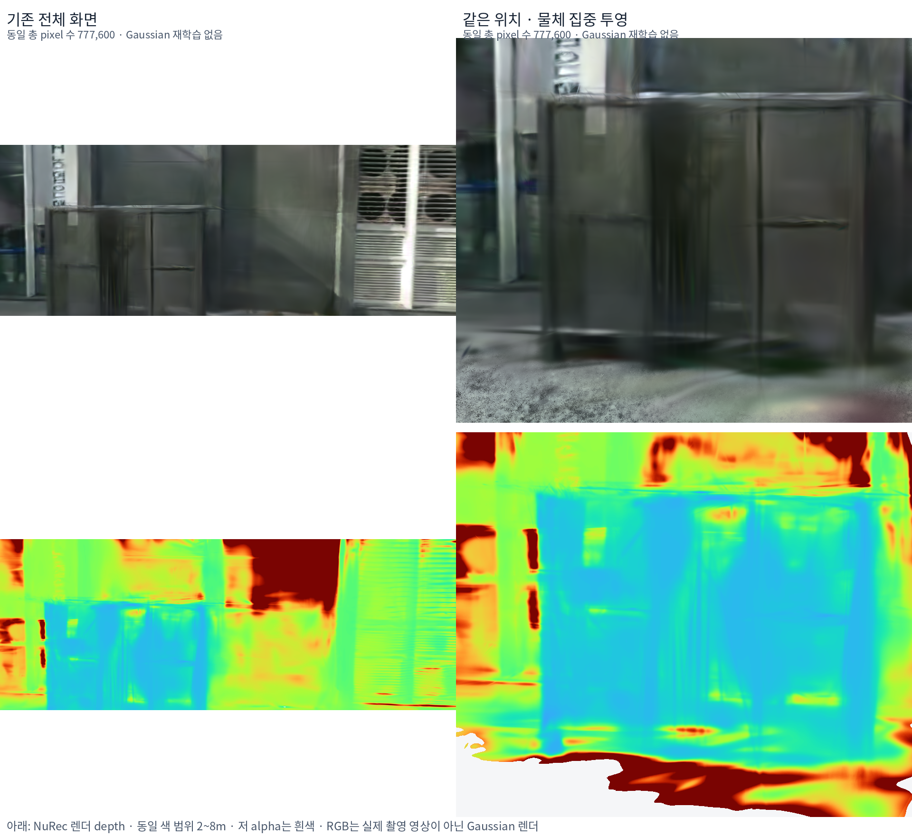
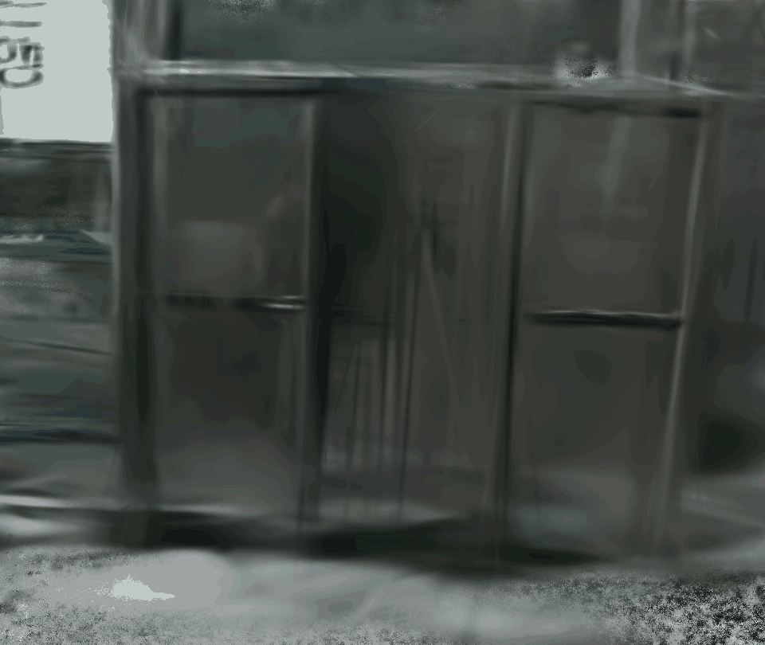
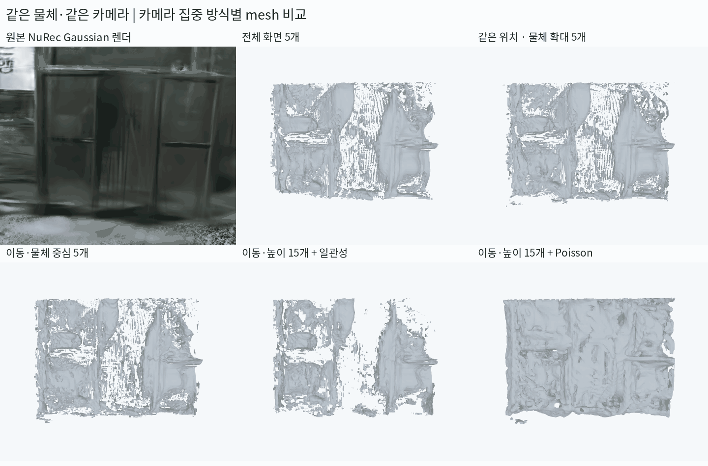
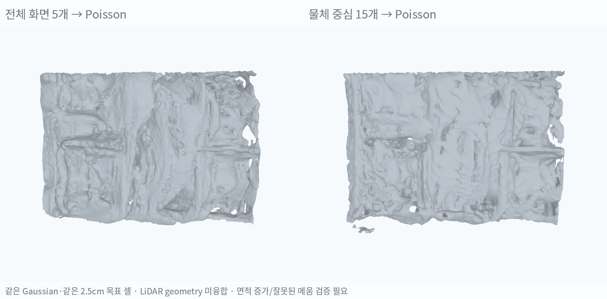

# 물체 중심 가상 카메라의 Gaussian Depth → Mesh 비교

> **물체를 크게 보고 여러 위치에서 depth를 추출하는 방식은 일부 개선 효과가 있었음. 같은 5시점 TSDF 비교의 LiDAR 거리 P90은 18.21→16.72cm, 5시점 전체 화면과 15시점 물체 중심 Poisson 비교는 13.20→8.68cm였음. 다만 단절·요철·불필요한 메움은 남아 정확한 collider 완성으로 판단하지 않음.**

실험일: 2026-10-26. 기존 ADI NuRec 18,000-step artifact를 그대로 사용함. Gaussian 재학습·생성 보완 없이 원래 NuRec renderer로 새로운 카메라의 RGB·depth·alpha를 실제 렌더링함.

## 1. 무엇을 비교했는가

앞선 instance 실험은 이미 추출한 점들을 나눠 Poisson을 계산한 비교였음. 이번에는 **depth를 얻는 카메라 배치 자체를 변경**함.

| 조건 | 카메라 수 | 변경한 것 |
|---|---:|---|
| 전체 화면 | 5 | 기존 실제 camera pose·K에 해당하는 Gaussian 렌더 |
| 같은 위치의 물체 확대 | 5 | 위치·회전은 유지하고 focal/principal point를 조정해 물체에 pixel 배분 |
| 물체 중심 이동 | 5 | 기준 위치 주변 −30°~+30°에서 물체를 향하도록 위치·회전 변경 |
| 물체 중심 이동·높이 | 15 | 같은 다섯 각도에 높이 −0.4·0·+0.4m 추가 |

전체 화면은 1440×540, 물체 집중 렌더는 960×810으로 **한 장의 총 pixel 수는 모두 777,600개**임. 화면 비율·frustum은 다르며, 센서 해상도 자체를 높인 실험은 아님. 같은 위치의 집중 렌더도 제자리에서 새 면을 관측한 것이 아니라 물체 주변 ray를 더 촘촘히 배치한 것임.

카메라 이동은 물체 주변의 제한된 60° 구간임. 360° 뒷면 복원 실험은 아님. 가상 방향은 사용한 실제 camera pose 방향에서 가장 가까운 것과 약 0~14° 차이가 나며, 이 각도가 작다고 미관측 표면의 정확성이 보장되지는 않음.

## 2. Native NuRec 렌더와 Depth 검증

실제 학습 artifact의 **모든 layer를 유지**하고 렌더링함. 물체 바깥 Gaussian을 지워 가림을 없애지 않음. Mesh에 넣는 depth만 공통 3D ROI로 선택함.

| 확인 | 결과 |
|---|---|
| Artifact | ADI full-scene 18k, background 403,869·road 5,728 Gaussians |
| Depth 단위 | Native ray distance를 world 거리로 환산한 뒤 실제 ray와 camera forward의 cosine을 곱해 camera Z로 변환 |
| Alpha 처리 | 추가 alpha 나눗셈 없음. Fusion에서 alpha >0.8 관측 선택 |
| 기존 캐시 대조 | 원래 5개 camera에서 RGB·alpha·depth 재현 검사 통과 |
| 재현 오차 | RGB MAE 최대 약 0.00073/255, legacy depth 대조 p99 절대차 약 0.000041m |
| Pixel-center 보정 | 실제 생성 ray 기준 Z와 예전 integer pixel 근사의 차이는 대표 대조에서 평균 약 1.35mm |

**렌더 depth는 학습된 Gaussian의 출력이지 실제 거리 정답이 아님.** 가상 카메라를 추가해도 원본에 없는 실측 정보를 새로 얻는 것은 아님.

36개 중간 카메라 위치에서 직접 렌더링한 RGB이며 이미지 보간·생성 모델 영상이 아님.

## 3. Mesh 생성 조건

| 항목 | 공통 적용 |
|---|---|
| Geometry 입력 | 새로 렌더링한 Gaussian depth만 사용 |
| RGB | 동일 카메라의 Gaussian RGB |
| LiDAR 사용 | 임시 물체 ROI와 평가 기준에만 사용. 점이나 LiDAR depth를 fusion geometry에 추가하지 않음 |
| ROI | 이전 train LiDAR 앞면 후보로 정의한 oriented volume. 뒤쪽 범위는 물체 완전 bbox 정답이 아닌 가설 |
| TSDF | Voxel 2.5cm·truncation 7.5cm |
| 일관성 처리 | 가까운 최대 4개 다른 카메라에 재투영. 1개 이상 depth 지지, 신뢰 표면 앞의 free-space 모순은 0개 |
| Depth 허용차 | max(5cm, camera Z의 1.5%) |
| Poisson 대조 | 같은 native depth의 영상 미분 normal, 목표 셀 2.5cm·지지거리 trim 10cm |

다른 시점의 더 가까운 표면 뒤에 가려진 점은 곧바로 모순으로 세지 않음. 이 필터도 물리적으로 검증된 가시성 모델은 아니며, Gaussian 자체의 depth 불일치 때문에 필요한 면을 제거할 수 있음.

## 4. 같은 카메라 구도의 Mesh 결과

왼쪽 위는 원본 Gaussian RGB임. Mesh 칸은 RGB 색상으로 오류를 가리지 않도록 무채색으로 표시함. 모든 칸의 preview camera·intrinsics·회전 시점은 동일함.

### 같은 5개 시점의 TSDF 대조

| 조건 | ROI depth 표본 합계 | 제외 LiDAR 거리 P90 ↓ | 10cm 이내 센서점 비율 ↑ |
|---|---:|---:|---:|
| 전체 화면 5개 | 594,179 | 18.21cm | 71.25% |
| 같은 위치의 물체 확대 5개 | 1,303,871 | 17.33cm | 71.70% |
| 물체 중심 이동 5개 | 1,290,580 | 16.72cm | 70.88% |

일관성 필터를 적용하지 않은 공통 TSDF 조건임. 물체 확대는 표본 수를 약 2.2배 늘렸지만 센서 잔차의 개선은 작았음. 위치를 바꾸면 P90은 약 **8.2% 개선**됐지만 10cm 비율까지 모두 좋아진 것은 아님.

### 일관성 필터와 시점 수

| 조건 | 필터 전 / 후 P90 | 필터 후 조각 수 | 해석 |
|---|---:|---:|---|
| 전체 화면 5개 | 18.21 / 26.31cm | 238 | 필요한 면도 삭제돼 잔차 악화 |
| 같은 위치의 물체 확대 5개 | 17.33 / 25.70cm | 221 | 확대만으로 geometry 일관성이 확보되지는 않음 |
| 물체 중심 이동 5개 | 16.72 / 31.22cm | 166 | 필터 통과 표면이 부족함 |
| 물체 중심 이동·높이 15개 | 16.85 / 16.46cm | 703 | 추가 중첩 시점에서 일부 보완. 단절은 남음 |

필터 뒤 조각 수가 줄어도 면이 더 잘 연결됐다는 뜻은 아님. 표면을 많이 삭제해도 수치가 줄어들 수 있음. 이번 필터를 전체 씬에 그대로 적용하지 않음.

## 5. 같은 Depth의 Poisson 대조

| 조건 | Triangle | 조각 수 | 면적 | 제외 LiDAR P90 |
|---|---:|---:|---:|---:|
| 전체 화면 5개 → Poisson | 89,052 | 38 | 19.30㎡ | 13.20cm |
| 물체 중심 이동·높이 15개 → Poisson | 167,564 | 108 | 35.62㎡ | 8.68cm |

**같은 Poisson에서도 물체 중심 시점을 늘리면 일부 면이 더 이어지고 센서 거리 P90은 약 34.2% 줄었음.** 다만 이 비교는 시점 위치와 시점 수가 함께 달라, 이동 효과만으로 개선됐다고 해석하지 않음.

면적도 약 84.5% 증가함. 더 많은 면이 센서점 근처에 생기면 nearest-surface 거리가 낮아질 수 있음. 따라서 **이 수치만으로 정확한 형상·얇은 판·완전한 collider가 복원됐다고 판단하지 않음.** 실제 그릴의 틈과 잘못 메워진 공간도 별도로 확인해야 함.

## 6. 평가 범위와 현재 결론

평가는 공통 ROI 안의 별도 scan LiDAR 4,025점과 mesh 사이의 거리임. Camera–LiDAR T·metric world·운동 추정의 잔여 오차가 포함돼 있으며 독립적인 형상 GT가 아님. Fusion에 이 점을 넣지는 않았지만, ROI 선택과 기존 Gaussian 학습 이력을 공유할 수 있음.

- **사용자 제안은 유효한 실험 방향임.** 이미 추출한 점을 나누는 것과 달리, 물체 중심 ray 배치와 위치 이동으로 실제 추출 결과가 달라짐.
- **확대만의 효과는 작고, 추가 시점과 복원 방법의 효과가 함께 나타남.** Poisson이 더 연속적으로 보여도 메움·두께 검증이 필요함.
- **카메라만 늘리면 완전한 mesh가 된다는 결과는 아님.** 동일 Gaussian의 불안정한 depth·가려진 면·실제 관측 부족은 남음.
- **다음은 실제 물체 면별 검증임.** 앞면의 평탄성·그릴 개구부·옆면 관측을 구분하고, 불필요한 메움을 줄이는 confidence·normal 일관성 처리를 비교함.
- 기존 도로·전체 배경·Genesis 결과는 교체하지 않음.

## 재현 자료

- `research/adi_object_focus.py`: camera plan·fusion·Poisson·평가·시각자료.
- `research/adi_object_native_render.py`: NuRec native renderer adapter.
- `adi_quality_20261018/object_focus_20261026/cameras.json`: 25개 카메라·ROI·조건.
- `native/manifest.json`, `native/validation.json`: 전체 모델·단위·캐시 대조.
- `fusion_results.json`, `poisson_results.json`: 모든 수치와 시점별 통과량.
- `tour_cameras.json`, `native_tour/`: 동일 비교 camera tour 36개.
- Camera 강체 변환·frustum 포함·동일 pixel 수·ROI 좌표 테스트 3개 통과함.
