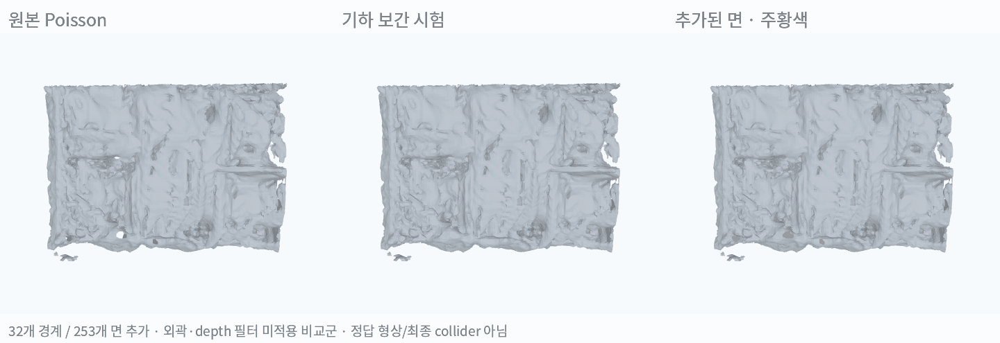
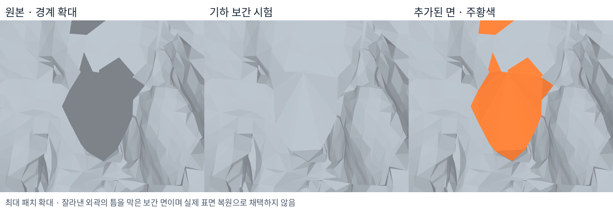
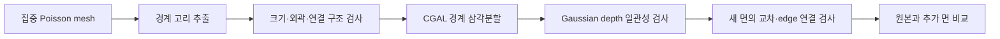

# Poisson Mesh 구멍 메움 실험

**작은 경계는 면으로 막을 수 있었으나, 현재 물체 mesh의 큰 단절과 요철은 해결되지 않음. 최종 collider로 채택하지 않음.**

## 1. 결과 비교

동일한 물체 중심 15-view Poisson mesh에 CGAL 경계 삼각분할을 적용함. 왼쪽은 원본, 가운데는 기하 보간 비교군, 오른쪽의 주황색은 추가한 면임. Gaussian 재학습이나 LiDAR geometry 추가는 하지 않음.

| 조건 | 메운 경계 | 추가 삼각형 | 추가 면적 | 결과 |
|---|---:|---:|---:|---|
| 원본 | 0 | 0 | 0 | 열린 경계 고리 45개 |
| 15cm 이하 + 외곽·depth 검사 | 0 | 0 | 0 | 채택 조건을 통과한 경계 없음 |
| 30cm 이하 + 외곽·depth 검사 | 0 | 0 | 0 | 채택 조건을 통과한 경계 없음 |
| 30cm 이하 기하 보간 비교군 | **32** | **253** | **0.118㎡** | 작은 틈은 닫히지만 관측 기반 복원으로 채택하지 않음 |

크기는 경계 정점의 **축별 최대 범위**이며, 반지름이나 둘레가 아님. 기하 보간 비교군에서도 자기 교차와 새로운 non-manifold edge를 만드는 패치는 제외함. 40개 삼각분할 후보 중 교차 검사로 3개, edge 연결 검사로 5개를 제외함.

## 2. 왜 큰 차이가 없었는가

- 열린 경계 고리 45개 중 **42개가 추출 ROI 외곽 1.5cm 이내에 닿음**. 모두 실제 표면의 결손이라고 단정할 수 없고, 영역을 잘라낸 영향이 섞여 있음.
- 나머지 3개도 평면성 또는 렌더링 depth 일관성 조건을 통과하지 못함.
- 기하 보간은 전체 면적 약 35.62㎡에 **약 0.33%**의 면을 추가했음. 크게 떨어진 조각과 표면 요철은 그대로임.
- 화면의 빈 부분이 항상 하나의 닫힌 경계 고리인 것은 아님. 열린 틈·분리된 조각·실제 개구부는 별도의 연결 판단이 필요함.

**이번 결과는 “삼각형을 추가할 수 있다”는 구현 확인이며, 빈 부분의 실제 형상이 복원됐다는 결과는 아님.**

## 3. 정량 확인

| 지표 | 원본 | 기하 보간 비교군 | 해석 |
|---|---:|---:|---|
| 열린 경계 edge | 2,179 | 1,862 | 작은 경계 감소 |
| 닫힌 경계 고리 | 45 | 13 | 32개 고리 메움 |
| 연결 성분 | 108 | 108 | 분리된 조각의 연결은 개선되지 않음 |
| Non-manifold edge | 282 | 282 | 기존 결함은 남으며 신규 증가는 차단 |
| 보류 LiDAR → mesh 거리 P90 | 8.68cm | 8.68cm | 측정 지표 개선 없음 |
| 보류 LiDAR 중 10cm 이내 | 92.05% | 92.05% | 측정 지표 개선 없음 |

보류 LiDAR 4,025점은 평가에만 사용함. 추정 T와 world 정렬에 의존하는 일방향 거리이므로 독립적인 GT 정확도가 아님. 면을 임의로 추가해도 이 지표가 악화되지 않을 수 있으므로, 구멍 감소만으로 품질 향상을 판단하지 않음.

## 4. 적용 방법과 검증

- CGAL `triangulate_hole_polyline`으로 경계 정점 사이에 삼각형을 생성함. **Refinement·fairing은 이번 실험에 미적용**임.
- 원본 정점과 면을 보존하고 새로운 삼각형만 덧붙임.
- depth 검사는 alpha 0.8 초과인 집중 시점 15개를 사용함. 표면 허용 오차는 5cm와 camera-Z의 1.5% 중 큰 값임.
- 패치 표본 중 한 시점 이상에서 depth가 지지하는 비율 50% 이상, 한 시점 이상에서 자유 공간과 충돌하는 비율 5% 이하를 요구함.
- 여기서 자유 공간 충돌은 **Gaussian 렌더링 depth와의 모순**임. 실제 공간이 비었다는 정답 판정은 아니며, 원래 depth의 불일치도 영향을 줌.
- 삼각분할은 면적을 알고 있는 볼록·오목 다각형으로 확인함. 최종 결과는 원본 면 보존과 non-manifold edge 증가 여부를 확인함.

## 5. 다음 개선 방향

**큰 빈 부분에는 경계 메움보다, 같은 표면에 속하는 조각을 찾아 연결하는 단계가 필요함.**

1. ROI 외곽과 실제 물체의 끝을 구분함. 외곽은 겹치는 구역에서 얻은 표면을 먼저 사용함.
2. 벽의 경우 인접 조각의 위치·normal·평면을 비교해 같은 면인지 판단함.
3. 같은 벽면의 작은 간극에만 평면 제약 패치를 생성하고, 관측에서 확인되는 통로·개구부는 유지함.
4. 보간으로 추가한 면과 관측으로 복원한 면을 별도로 기록하고, 카메라 depth 및 LiDAR와 교차검증함.

큰 틈에 추가 형상을 보간할 근거가 부족하면 미복원으로 남겨야 함. 이번 기하 보간 비교군은 최종 scene·Genesis collider를 대체하지 않음.

## 참고 및 재현 자료

- [Liepa, Filling Holes in Meshes (2003)](https://diglib.eg.org/items/bd5c3658-4de6-4336-a7bd-0baf4f5618ac): 경계 추출·삼각분할·refinement·fairing.
- [CGAL Polygon Mesh Repair](https://doc.cgal.org/latest/PMP_Mesh_repair/index.html): 경계 메움과 mesh 연결 구조 수정.
- [MeshFix 연구자 구현](https://github.com/MarcoAttene/MeshFix-V2.1): 구멍·자기 교차·연결 결함의 일괄 수정 후보. 이번에는 미실행.
- 코드: `instant_nurec/research/adi_object_hole_fill.py`, `adi_hole_triangulate.cpp`.
- 원본·생성 mesh 및 검사 결과: `instant_nurec/adi_quality_20261018/object_focus_20261026/hole_fill/`.
