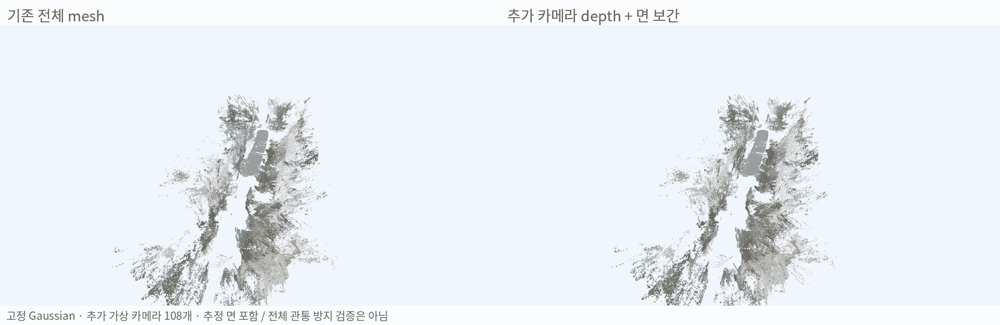
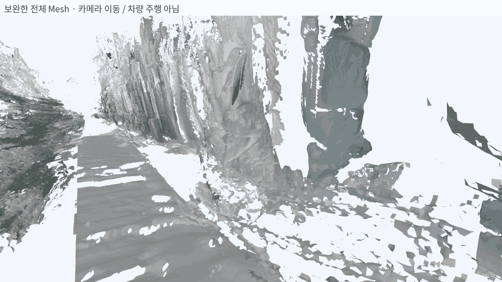
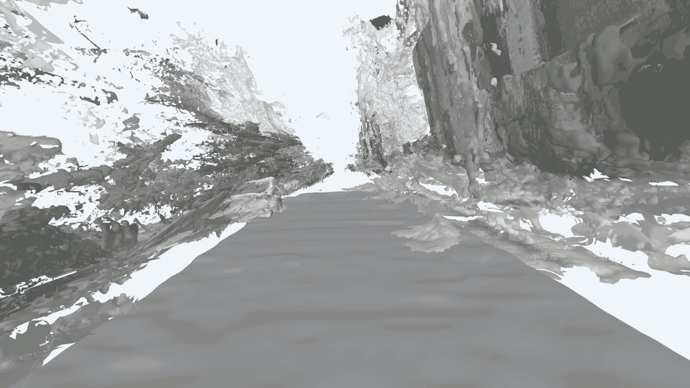
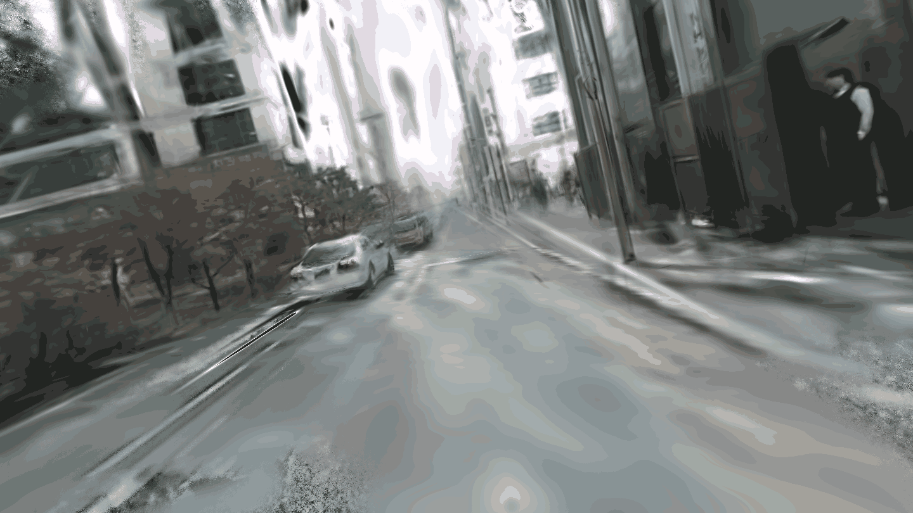
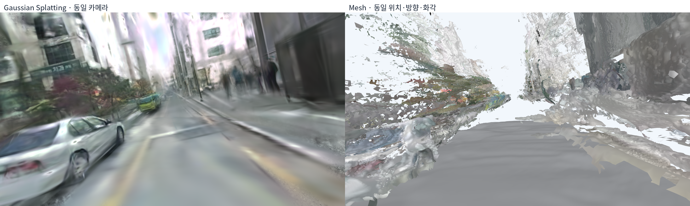
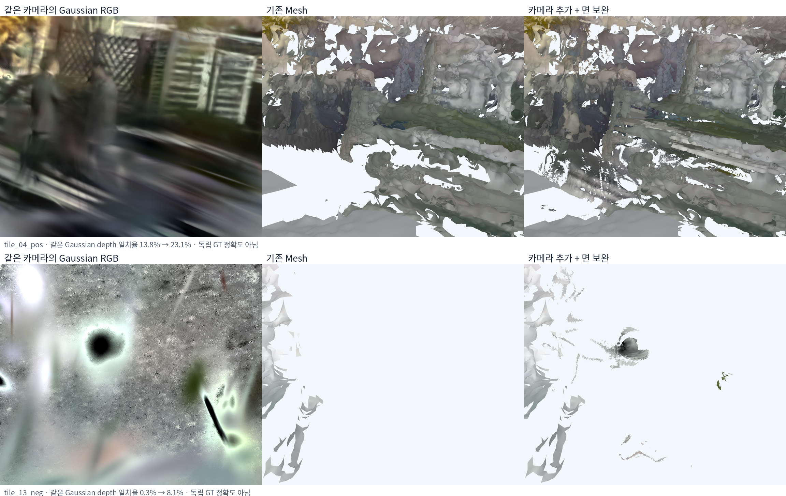
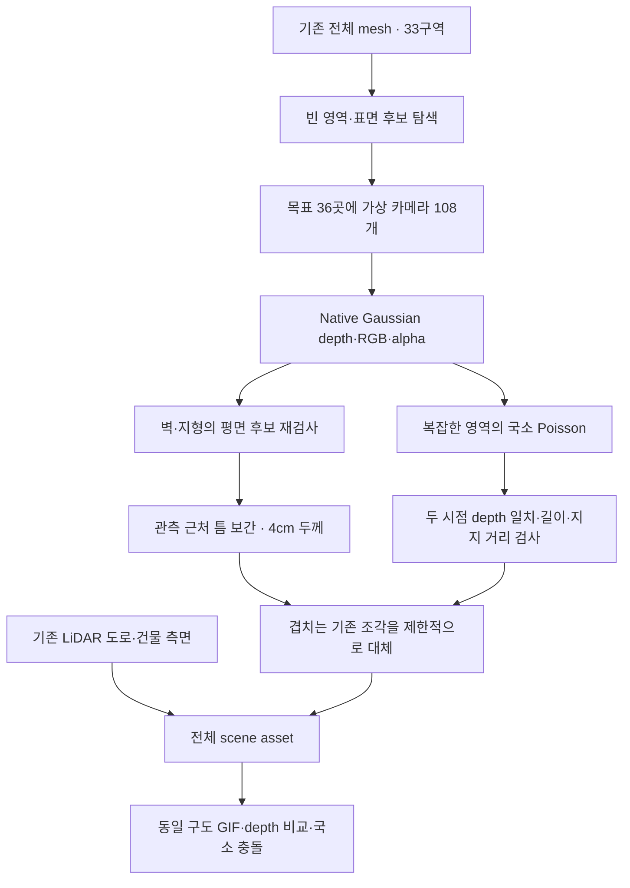
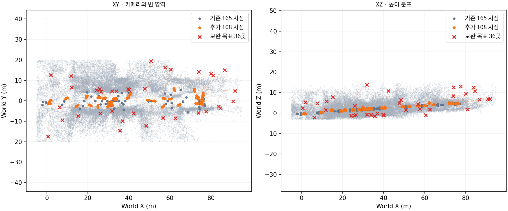
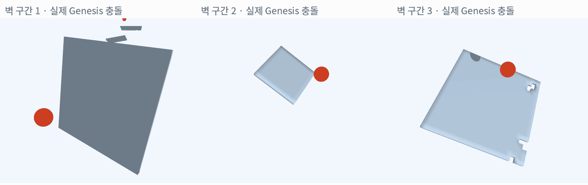

# 전체 Mesh 보완 및 추가 카메라 실험

**전체 씬에 추가 카메라 108개와 면 보간을 적용했지만, 씬 전체를 연속된 mesh로 채우는 데에는 이르지 못함. 일부 벽·지형은 보완됐고, 나무·불안정한 배경과 미관측 영역의 구멍은 남음.**

| 수행한 작업 | 최종 결과 |
|---|---|
| 기존 전체 씬 | 33구역·165개 가상 시점으로 만든 mesh 사용 |
| 빈 영역 집중 관측 | **36개 목표·108개 추가 가상 카메라** 실제 렌더링 완료 |
| 평면 후보 | 기존 8개 + 추가 depth에서 2개 발견 |
| 보간 면 | 약 **88.25㎡**의 패치 추가. 여러 평면의 합계이므로 중복 면적 포함 가능 |
| 비평면 보강 | 두 시점 이상이 지지하는 삼각형 **153,873개** 추가 |
| 충돌 시험 | 새 보완 면 중 3곳에서 Genesis 접촉·비관통 확인 |
| 한계 | 전체 씬의 watertight mesh·차량 주행·모든 위치의 비관통은 미검증 |

## 1. 결과 자료

### 전체 비교

왼쪽은 기존 전체 mesh, 오른쪽은 추가 depth·평면 패치·앞서 생성한 건물 측면을 조립한 최종 결과임. 같은 카메라와 같은 타이밍으로 비교함.

### 씬 내부 카메라 이동

mesh를 렌더링하며 카메라만 이동함. 실제 차량 주행 결과는 아님. 구멍과 늘어진 형상이 여전히 남아 있음.

### 도로 위 1인칭 검사

기존 14m 도로 경로를 따라 도로 높이에서 1.65m 위에 카메라를 배치함. 카메라 충돌을 강제하지 않는 검사 영상이며 물리 주행은 아님.

**탑뷰에서 점처럼 보이는 것은 point cloud 표시 모드가 아니라, 실제 삼각형들이 조각나 있거나 길게 늘어진 결과임.** 국소 벽의 보간 성공과 전체 씬의 표면 복원 성공은 구분해야 함. 현재 전체 결과는 연결된 환경 mesh로 채택하기 어려움.

### 같은 구도의 Gaussian 씬

기존 1인칭과 동일한 위치·방향·세로 FOV 60°·1440×810 해상도로 native Gaussian RGB를 직접 렌더링함. GIF도 같은 30개 원본 프레임 선택과 재생 시간을 사용함. 이미지 보간이나 mesh 합성으로 Gaussian 영상을 대신하지 않음.

### 기울기 확인

**Gaussian에서도 기울기가 보이며, BA 이후 궤적 기반 좌표 정렬이 주요 원인 후보로 확인됨. Camera deskew 오류로 단정할 근거는 아직 없음.**

| 검사 | 확인 결과 |
|---|---|
| 표시용 1인칭 카메라 roll | 채택한 월드 Z축 기준 0° |
| 표시용 pitch | 약 −2.15°, 약간 아래를 바라봄 |
| 현재 재구성 카메라의 평균 up과 월드 Z 차이 | **11.81°** |
| BA 후 원래 궤적에 맞추는 Sim3의 회전량 | **11.50°** |
| 그 회전을 역으로 적용한 up 방향 수치 검사 | 월드 Z와 차이가 **1.13°**로 감소 |
| BA 직후 / 궤적 정렬 후 pose 회전 RMSE | 기존 초기 pose 대비 **1.19° / 11.84°** |

`adi_joint_rig_ba.py`의 `align_to_seed`는 카메라 **중심 위치만**으로 Sim3를 맞추고 모든 pose·점에 적용함. 해당 궤적은 거의 직선이라 진행 방향 축 주변 회전이 약하게 구속됨. 정렬 공분산의 singular value는 약 `10.25, 0.00085, 0.000046`으로 이 조건을 뒷받침함.

기존 Z-up 변환은 이전 SfM 카메라의 평균 up을 사용했으며, 실측 IMU 중력으로 정한 값은 아님. 현재 재구성 카메라 up은 건물 측면 normal과 약 90.01°로 거의 직교하지만, 기존 월드 Z와는 약 11.8° 어긋남. 따라서 **직선 궤적 정렬이 불필요한 roll을 도입했는지 우선 검증할 필요가 있음.**

360도 원본도 물리 렌즈·stitch calibration이 확인된 것이 아니라 equirectangular 가정으로 가상 pinhole 영상을 추출했음. 이 문제와 LiDAR scan deskew는 별개임. 이번 비교에서는 확인을 위해 원래 모델·mesh·T를 바꾸지 않았으며, 기울기 보정만으로 mesh의 구멍과 depth 불일치가 해결된다고 해석하지 않음.

### 동일 시점 확대

왼쪽은 해당 가상 카메라의 Gaussian RGB이며 실측 GT 사진이 아님. 원래 Gaussian도 새로운 시점에서는 흐리거나 형상이 불명확해, 카메라만 추가해도 정확한 표면이 자동으로 생기지는 않음을 보여 줌. 그림은 검사 시점 중 일치율 개선이 큰 두 곳을 골랐으며 전체 평균을 대표하지 않음.

## 2. 어떤 정보를 사용했는가

| 입력 | 실제 사용 |
|---|---|
| ADI NuRec 18,000-step artifact | 고정된 Gaussian 씬. Background 403,869개·Road 5,728개 |
| 기존 165개 가상 시점의 depth·alpha·RGB | 전체 mesh·빈 영역·평면 후보의 기준 |
| 추가 108개 가상 시점의 depth·alpha·RGB | 같은 Gaussian을 새 위치에서 직접 렌더링해 보강 |
| 기존 RGB semantic 결과 | Building·Wall·Sidewalk·Terrain 후보 선택. 자동 추정값이며 정답 annotation이 아님 |
| 카메라 pose·intrinsics | 정확히 지정한 가상 카메라로 depth를 world에 역투영 |
| 기존 LiDAR 도로 | geometry 유지. 배경에서 도로와 중복되는 지면 제외에도 사용 |
| 앞선 건물 측면 mesh | 연결한 21m 측면을 최종 씬에 포함 |

**새로운 실측 영상이나 LiDAR를 추가하지 않았으며, Gaussian 재학습·센서 T 재추정도 하지 않음.** 추가 카메라는 고정된 씬에 이미 들어 있는 정보를 다른 방향·배율로 다시 읽는 것임.

## 3. 진행 순서

회색은 기존 가상 시점, 주황색은 추가 시점, 빨간 X는 보완 목표임. 대부분 기존 관측 경로 주변에서 옆으로 이동하거나 높이를 바꾸어 집중 관측함. 실제로 촬영하지 않은 뒷면의 정답 정보를 얻은 것은 아님.

### 표면 연결 조건

- 벽·건물·지형으로 추정되는 곳에서 plane RANSAC과 depth-gradient normal을 함께 검사함.
- 전체 씬 보완 패치에는 **5cm 격자·4cm 두께**를 사용함. 앞선 건물 측면의 2.5cm 격자는 그대로 유지함.
- 표면 지지점에서 40cm 이내인 영역과 작은 내부 구멍을 제한적으로 보간함. 실제 개구부를 잘못 막을 수 있음.
- 새 면과 겹치는 기존 평면 주변의 삼각형 **615,725개**를 결과에서 제외함. 입력 원본 파일은 보존함.
- 복잡한 영역의 Poisson은 목표 cell 3.5cm로 추출한 뒤, 최대 edge 20cm·정점 지지 거리 10cm·중심 지지 거리 8cm를 적용함.
- 목표 주변 2.5m 안에서 **최소 두 새 시점의 depth가 일치**하는 면만 남김. 허용 depth 차이는 8cm와 camera-Z의 1.5% 중 큰 값임.

## 4. 왜 보완량이 제한적인가

**초기에는 면을 많이 더할 수 있었지만, 늘어진 면과 시점마다 위치가 다른 조각이 함께 생겼음.** 그대로 채우는 것과 실제로 일관된 표면을 만드는 것은 달랐음.

| 검사 | 기존 mesh | 제한 없이 가까운 새 면 추가 | 최종 교차 검증 후 |
|---|---:|---:|---:|
| Mesh ray hit | 63.88% | 74.12% | **65.93%** |
| Gaussian depth와 일치 | 6.08% | 8.98% | **7.51%** |

검사는 빈 영역을 겨냥한 **36시점·고 alpha 픽셀 148,418개**에서 수행함. Depth 일치 허용 오차는 15cm와 기준 camera-Z의 2% 중 큰 값임.

- **Ray hit:** 그 방향에 mesh가 있으면 증가함. 잘못된 면을 추가해도 올라갈 수 있음.
- **Depth 일치:** 동일 시점의 Gaussian depth와 비슷한 위치에 mesh가 있는 비율임. Gaussian 자체가 불안정할 수 있어 실측 정확도는 아님.
- 최종본은 겹치는 기존 조각을 대체하므로 ray hit가 단순 추가본보다 낮아질 수 있음.
- 검사 대상은 일부러 빈 영역·어려운 시점을 골랐음. 이 비율을 전체 씬 평균 또는 독립 GT 정확도로 해석하지 않음.

**결과적으로 추가 가상 카메라만으로 전체 장면이 크게 개선됐다고 판단하기 어려움.** 표면이 안정적인 곳에서는 재표본화가 도움이 됐지만, 불안정한 Gaussian depth와 미관측 형상은 그대로 주요 병목으로 남음.

## 5. 충돌 확인

새 면에서 벽 후보 1곳·지형 후보 2곳을 골라 동일한 표면의 국소 tile을 Genesis에 등록함. 반지름 6cm 구를 normal 반대 방향으로 1.5m/s로 발사했고, 중력 없이 초기 속도만 부여함.

| 시험 | 접촉 step | 구 중심의 최소 표면 거리 | 표면 관통 |
|---|---:|---:|---|
| 벽 후보 보완 면 | 4 | 5.62cm | 없음 |
| 지형 후보 보완 면 1 | 4 | 5.62cm | 없음 |
| 지형 후보 보완 면 2 | 4 | 5.63cm | 없음 |

180 step·1.5초·substeps 4의 실제 물리 시험임. 시험 위치는 보완한 패치 내부이며, 입력 기록의 clearance는 **패치 내부 여유 거리**임. 원래 구멍의 실측 반경을 의미하지 않음.

**이 시험은 세 국소 보완 면이 충돌 대상으로 동작한다는 확인임.** 비평면 추가 mesh는 열린 얇은 면이 남아 있고, 전체 씬은 하나로 용접된 watertight collider가 아님. 전체 차량 주행이나 모든 위치의 관통 방지를 검증하지 않음.

## 6. 결과 파일과 현재 판단

- 주요 scene asset: `scene_completed.glb` — 약 925만 삼각형, 유지한 기존 배경 + 추가 표면 + 건물 측면 + LiDAR 도로.
- 추가 면: `additions_rgb.glb`. 보간한 평면과 새 depth 기반 면은 원본과 별도로 저장함.
- 코드: `instant_nurec/research/adi_scene_completion.py`, `adi_scene_completion_contact.py`.
- 대용량 중간 결과·검사: `/home/diglab/Documents/ChatGPT/3DGS mesh/work/scene_surface_completion_20261026/`.
- GIF·이미지: `instant_nurec/res_wjdaksry/1026/` 및 이 문서의 상대 경로.

**평평한 벽·지형의 빈 부분 보간에는 사용할 수 있지만, 현재 전체 씬의 정확한 표면 복원 방법으로 채택하기에는 부족함.** 다음에는 가상 시점 수를 더 늘리는 것보다 원본 관측이 있는 구역에서 depth·normal 자체의 일관성을 개선하고, 큰 미관측 영역은 별도로 처리해야 함.
