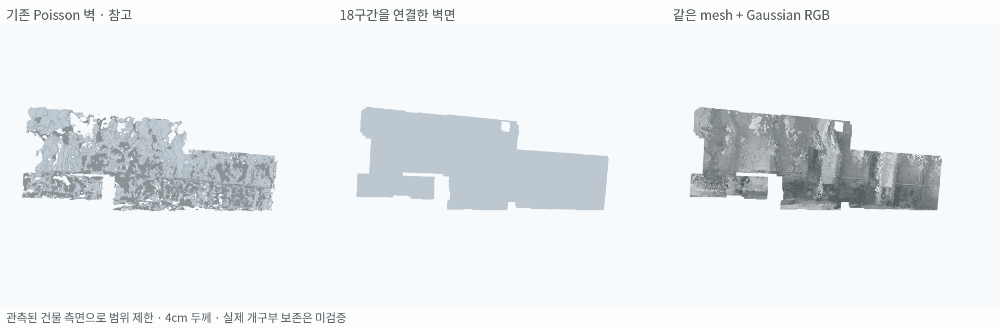
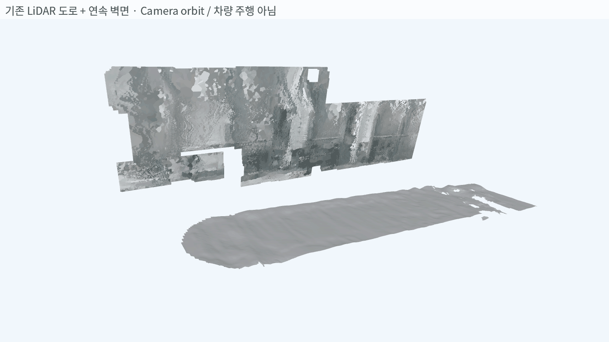
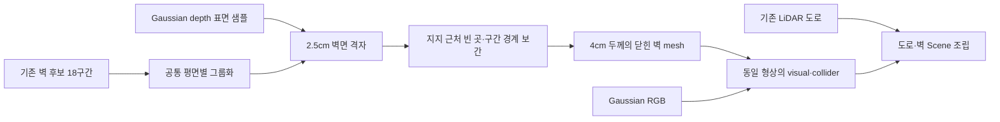
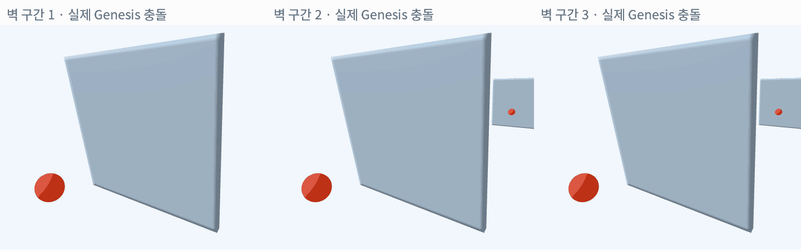

# 건물 측면 벽 연결 및 도로 조립

**기존 벽 후보 18구간을 연결해 폭 약 21m·전면 약 116.86㎡의 벽 mesh를 생성함. 동일한 형상을 visual·collider로 저장하고 기존 LiDAR 도로와 함께 배치함.**

이번 대상은 **같은 평면 가설에 속하는 건물 측면 한 면**임. 씬에 존재하는 모든 방향의 벽을 복원한 결과는 아님.

## 1. 결과

| 기존 Poisson 참고 결과 → 연속 벽면 → Gaussian RGB |
|---|
|  |

| 기존 LiDAR 도로 + 이번 벽 mesh |
|---|
|  |

도로+벽 GIF는 mesh를 배치한 뒤 카메라를 움직여 본 결과임. 차량 주행은 하지 않았으며, 도로와 벽 사이의 미관측 지형을 새로 생성하거나 두 mesh를 하나의 연속 지면으로 접합하지는 않음.

## 2. 사용한 정보

| 정보 | 실제 사용 |
|---|---|
| 기존 NuRec Gaussian 렌더링 depth | 벽 후보 발견과 평면 가설, 표면 지지점 234,132개 |
| Gaussian 렌더링 RGB | 벽면 정점 색상. 가까운 유효 표면 샘플의 색을 사용 |
| 기존 벽 후보 18개 | 각 구간의 범위·공통 평면으로 건물 측면 footprint 구성 |
| 현재 working-best T의 LiDAR | 가까운 학습 관측 38,307점으로 평면 위치 보정 가능성을 검사함. 이번 보정은 미채택 |
| 기존 LiDAR 도로 | 원본 도로 asset을 그대로 조립함. 표시 화면만 대상 구간 주변으로 잘라 봄 |

**LiDAR가 제안한 평면 이동량은 −18.52cm였고, 허용 범위 ±15cm를 넘어 자동 적용하지 않음.** 이번 확장 벽은 Gaussian 관측에서 얻은 공통 평면을 유지함. 앞선 국소 벽 실험에서 LiDAR 평면을 사용한 것과 이 부분이 다름.

위 LiDAR는 앞선 작업에서 Gaussian 지지 근처로 선택된 캐시임. 편향 없는 전체 원시 LiDAR를 새로 정합한 것으로 해석하지 않음. 재학습·T 재추정도 이번에 수행하지 않음.

## 3. 만드는 과정

- 서로 다른 평면의 벽을 하나로 합치지 않음. 이번 캐시 후보 18개는 모두 동일한 평면 가설이었음.
- 후보 범위와 표면 지지점에서 35cm 이내인 영역을 기본으로 채움. 약 60cm 폭의 closing으로 작은 간극을 연결함.
- 인위적인 구간 절단선이 벽에 틈을 만들지 않도록 같은 평면 구간 사이의 약 20cm 이하 경계 틈을 연결함.
- 최대 축 범위 60cm 이하·면적 0.1㎡ 이하의 작은 내부 구멍은 연속 벽 prior로 메움.
- 앞면을 그대로 뒤로 4cm 복제하고 측면을 연결함. 본체에 별도 convex hull을 덮어씌우지 않음.
- RGB는 vertex color이며 UV texture baking은 미실행임. 색상에 얼룩과 시점 혼합 흔적이 남아 있음.

## 4. 형상 검사

| 항목 | 결과 | 해석 |
|---|---:|---|
| 원래 후보 | 18구간 | 하나의 공통 평면 가설 |
| 평면 격자 범위 | 약 21.03 × 7.28m | 실제 벽을 포함한다고 선택한 chart 범위 |
| 채택한 전면 면적 | 116.86㎡ | 외곽의 미관측 부분은 제외 |
| 앞·뒤·측면 삼각형 | 753,652개 | 2.5cm 격자·4cm 두께 |
| 채택한 격자 | 186,977개 | 그중 38,592개는 관측 근처의 빈 곳을 보간 |
| 선택한 footprint의 ray hit | **35.74% → 100%** | 기존 Poisson 참고 결과와 새 평면의 표면 존재 비교 |
| Watertight·winding | 통과 | 닫힌 mesh·면 방향 확인 |
| 보류 LiDAR의 평면 거리 P90 | 28.06cm | 센서·Gaussian 형상이 완전히 일치하지 않음 |

Ray는 채택한 footprint에서 벽 normal 방향으로 쏨. 기존 결과는 가설 평면 앞·뒤 20cm 범위에 면이 있을 때 hit로 세었음. **100%는 선택한 영역에 면이 있다는 뜻이며 실제 벽 위치 정확도가 100%라는 뜻은 아님.**

기존 Poisson은 입력과 복원 제약이 다르므로 엄밀한 동일 입력 ablation이 아님. 표면을 평면으로 덮으면 coverage가 늘지만, 실제 구조를 잘못 막을 수도 있음.

## 5. Genesis 실제 충돌

건물 측면을 가로로 세 구간으로 나누고, 기존 mesh에서 ray가 빠지던 위치를 하나씩 골라 구를 발사함. 충돌 mesh는 최종 벽 chart에서 추출한 약 1m 크기의 **동일 형상 국소 tile**임. 시험용 tile의 외곽은 닫았으며 벽 표면에 별도 hull을 추가하지 않음.

구는 반지름 6cm, 초기 속도 1.5m/s로 움직임. 중력 0에서 초기 속도만 부여하며, 결과 위치를 강제로 고정하지 않음. Genesis 내부 SDF는 목표 cell 1cm·최대 해상도 128로 생성함.

**최종 연결부를 반영한 mesh에서도 세 위치 모두 접촉이 발생했고, 구 중심이 벽 전면을 넘어가지 않음.**

| 구간 | 접촉 step | 구 중심의 최소 전면 거리 | 전면 관통 |
|---|---:|---:|---|
| 1 | 4 | 5.62cm | 없음 |
| 2 | 4 | 5.62cm | 없음 |
| 3 | 4 | 5.62cm | 없음 |

각 시험은 180 step·1.5초·substeps 4로 진행함. 충돌 시험의 최종 wall asset 및 tile SHA-256이 저장된 생성물과 같은지 확인함. 전체 벽의 모든 위치를 시험한 것은 아니며, 각 구간의 국소 충돌 시험임.

## 6. 현재 해석

**지금은 “면이 없어 통과하는 문제”를 평면 보간으로 줄인 단계임. 실제 건물의 세부 형상까지 정확히 복원한 상태는 아님.**

- 문·창문 annotation이 없어 실제 개구부를 막았을 수 있음. 이 부분은 RGB를 보고 확인해야 함.
- 표면 위치·기울기와 도로 연결 정확도는 아직 개선 여지가 큼. LiDAR와 가설 평면의 P90 28.06cm가 이 한계를 보여 줌.
- 전체 벽의 모든 위치에 대한 충돌 또는 차량 주행 검증은 하지 않음.
- 원본 LiDAR 도로는 수정하지 않았으며 SHA-256은 `d87281b7cba89eeb445ef60c57847684341c911a4be5e843bbca7e397cf4e032`임.

코드: `instant_nurec/research/adi_wall_facade_completion.py`.

결과·검사: `instant_nurec/adi_quality_20261018/wall_facade_completion_20261026/`.

주요 자산: `walls_rgb.glb`, `walls_collider.obj`, `scene_rgb.glb`.
