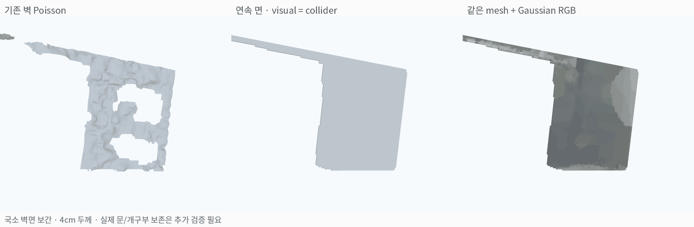
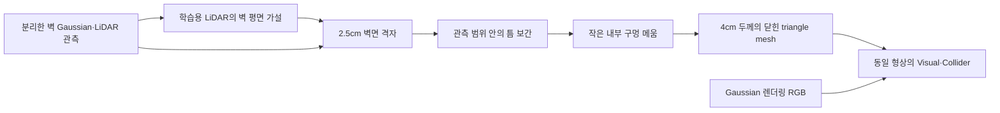
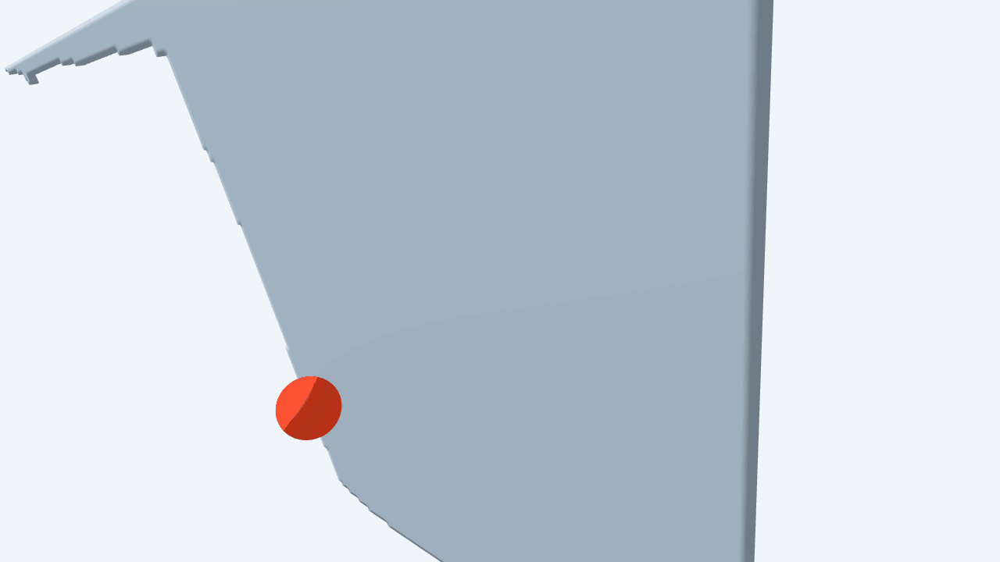

# 연속된 벽면 복원 및 충돌 검증

**기존 벽의 조각을 평면으로 묶고 그 사이를 보간해, 같은 형상을 visual·collider로 사용할 수 있는 벽 mesh를 생성함. 선택한 국소 벽면의 내부 구멍은 메웠으며 전체 배경 적용은 아직 하지 않음.**

## 1. 무엇이 달라졌는가

| 기존 Poisson | 이번 방법 |
|---|---|
| 관측된 점 주변의 굴곡과 빈 부분을 그대로 포함 | 같은 벽이라는 제약 아래 빈 부분을 평면으로 보간 |
| 조각난 부분으로 물체가 통과할 가능성 | 보간한 부분에도 삼각형 면과 두께를 부여해 충돌 대상으로 사용 |
| 원본의 요철·노이즈가 함께 남음 | 평면화로 요철과 실제 디테일도 일부 사라짐 |

왼쪽은 기존에 분리한 벽 Poisson, 가운데는 보간한 벽의 회색 표시, 오른쪽은 **같은 mesh에 Gaussian RGB를 투영한 결과**임. UV texture atlas는 만들지 않았으며 vertex color를 사용함.

## 2. 입력 및 생성 방법

- 벽으로 분리된 **Gaussian 표면 관측 1,661점 + 학습용 LiDAR 1,780점**을 사용함. 전체 background나 설비함 전면은 대상이 아님.
- 앞서 얻은 벽 평면을 재사용함. **이번 실행에서 Gaussian 재학습이나 T 재추정은 하지 않음.**
- 관측의 2D convex hull 안에서 가까운 지지를 가진 틈을 보간함. 기본 지지 거리 35cm, closing 폭 약 60cm를 사용함.
- 최대 축 범위 60cm 이하·면적 0.1㎡ 이하의 작은 내부 구멍은 연속된 벽이라는 가정으로 메움. 이 단계는 기본 지지 거리 제한보다 넓은 구멍 내부까지 보간할 수 있음.
- 4cm 두께를 부여하고 앞·뒤·측면을 연결함. 최종 선택 footprint 내부의 닫힌 구멍이 없는지 확인함.
- 기존 Gaussian depth가 여러 시점에서 모순되는 곳은 불확실성으로 기록함. **이번 연속 면 버전은 이 신호를 삭제 조건으로 쓰지 않고, 벽이 이어진다는 prior를 우선함.**

## 3. 결과와 범위

| 항목 | 결과 | 의미 |
|---|---:|---|
| 최종 벽 전면 면적 | **5.69㎡** | 선택한 국소 벽의 footprint |
| 격자 간격 / 두께 | 2.5cm / 4cm | 실제 표면 정확도를 의미하지 않음 |
| 삼각형 | 37,608개 | 앞·뒤·측면 포함 |
| 최종 벽면 격자 | 9,101개 | 이 중 4,113개는 지지 근처 빈 곳의 보간 |
| 작은 내부 구멍 메움 | 7개 | 실제 개구부를 막을 위험이 있는 추정 geometry |
| 선택 footprint의 ray hit | **73.12% → 100%** | 원래 빠지던 2,446개 격자에서 새 면과 교차 |
| 내부에 남은 닫힌 빈 격자 | 0개 | footprint 바깥과 외곽의 오목한 형태는 포함하지 않음 |
| Watertight / winding | 통과 | 닫힌 표면·면 방향의 일관성 확인 |
| 보류 벽 LiDAR → 가설 평면 P90 | 5.92cm | 조건부 평면 일관성. 독립 GT 또는 이전 mesh 대비 향상 지표 아님 |

Ray hit는 선택한 벽면에서 수직으로 ray를 쏘아 측정함. 평가 범위를 보간한 footprint로 제한한 값이며, 전체 씬 coverage나 실제 벽 형상의 정확도가 100%라는 뜻은 아님.

Gaussian RGB를 직접 투영할 수 있었던 전면 격자는 약 34.3%임. 나머지 색은 가까운 유효 투영 색으로 보완했으므로, 오른쪽 결과의 흐리거나 단조로운 색을 실제 고해상도 texture 복원으로 해석하지 않음.

## 4. 실제 Genesis 충돌 시험

기존 mesh에서 ray가 통과하던 위치에 반지름 6cm 구를 1.5m/s로 발사함. 중력 없이 초기 속도만 주고 움직이며, 충돌 뒤 위치를 강제로 고정하지 않음. 생성한 벽과 동일한 삼각형 mesh를 `convexify=False`, `decimate=False`로 등록함. Genesis 내부 충돌 계산에는 mesh에서 만든 SDF가 사용됨.

**최종 mesh에서도 구가 벽을 관통하지 않고 충돌 후 되돌아옴.**

| 실제 물리 시험 | 결과 |
|---|---:|
| 계산 구간 | 180 step · 1.5초 · substeps 4 |
| 구의 반지름 / 초기 속도 | 6cm / 1.5m/s |
| 접촉이 기록된 step | 4개 |
| 벽 전면과 구 중심의 최소 거리 | 5.63cm |
| 마지막 구 중심 거리 | 21.75cm |
| 구 중심이 벽 전면을 넘어감 | **아니오** |

이는 보간한 틈 한 위치의 실제 동역학 시험임. 접촉 계산에는 수치적인 침투 오차가 있으며, 차량 주행이나 전체 벽의 모든 위치에 대한 검증으로 확대 해석하지 않음.

## 5. 해석 및 남은 작업

**이번 결과는 빠진 벽의 실제 디테일을 복원한 것이 아니라, 관측과 평면 제약을 이용해 충돌 가능한 면을 보완한 것임.**

- 실제 문·창문·통로의 annotation이 없어 작은 실제 개구부까지 막았을 수 있음. 전체 씬 적용 전에는 RGB로 개구부를 확인해야 함.
- 벽 위치·기울기는 기존 추정 T와 LiDAR 평면 가설을 따름. 보간이 센서 정합 오차를 해결하지는 않음.
- 이번 생성물은 국소 벽면 하나이며, 전체 배경·도로와의 연결 및 차량 주행 검증은 별도임.
- 회색 mesh와 색상 mesh의 정점·삼각형 동일성을 확인함. 시각적으로 그린 벽과 물리적으로 막는 벽의 형상을 따로 두지 않음.

재현 코드: `instant_nurec/research/adi_wall_surface_completion.py`.

원본 관측·생성 mesh·검사 결과: `instant_nurec/adi_quality_20261018/wall_surface_completion_20261026/`.

생성 자산: `wall_rgb.ply`, `wall_rgb.glb`, `wall_collider.obj`. `guarded_*`는 Gaussian depth 모순을 삭제 조건으로 썼을 때의 보수적 비교 결과임.
