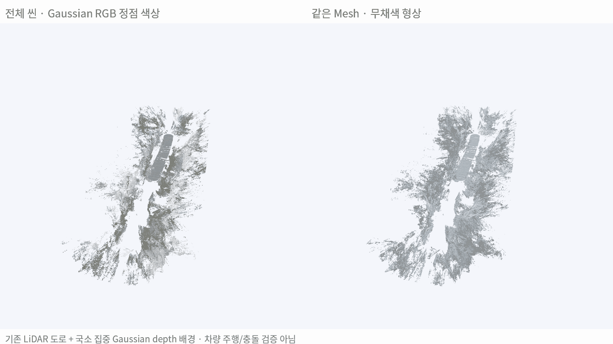
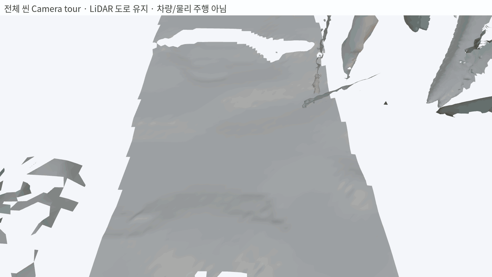

# 국소 집중 Gaussian Depth를 전체 ADI 씬으로 확대

> **기존 약 40초 ADI 씬의 배경을 33개 구역·165개 집중 시점으로 복원하고 LiDAR 도로와 조립함. 범위 확대는 완료했지만 구멍·요철·부유 조각이 많이 남아, 정확한 전체 collider로 채택할 상태는 아님.**

실험일: 2026-10-26. [물체 중심 실험](./[DIGLAB][26-10-26][정만교]_Object_focused_meshing.md)의 카메라 집중·Poisson 방식을 기존 장면 범위에 확대함. 원본 수분 영상 전체를 새로 학습한 결과가 아니라 **이미 만들어진 40초 Gaussian 씬**을 사용함.

## 결과 보기

왼쪽과 오른쪽은 같은 geometry임. 왼쪽은 Gaussian RGB 정점 색상, 오른쪽은 무채색임. UV texture나 별도 생성 영상이 아님. 회전 preview에서 geometry decimation은 하지 않음.

가까운 카메라 이동으로 실제 단절·요철을 확인하는 영상임. **Genesis 차량 주행이나 물리 충돌 시험 영상이 아님.**

## 적용 방법

| 항목 | 실제 적용 |
|---|---|
| 원본 | ADI NuRec full-scene 18k artifact, 재학습 없음 |
| 대상 범위 | 기존 미터 Z-up world: X −5~95m, Y −20~20m, Z −3~15m |
| 분할 | 길이 방향 6m core·1m overlap, 도로 양측의 배경 표면 후보 |
| 집중 대상 | 기존 Gaussian depth·원본 semantic으로 고른 구역별 표면. 모든 물체의 instance를 분리한 것은 아님 |
| 완료 | 33구역·각 5개 시점, 총 165개 native 렌더 |
| 제외 구역 | 1구역은 배경 seed 표본 부족. 실제 빈 공간인지 미관측인지 확정하지 않음 |
| 카메라 | 768×648, 원래 관측 위치 주변 ±12°·높이 ±0.4m 변화 |
| Geometry | Gaussian camera-Z depth·depth 미분 normal → 2.5cm 목표 셀 Poisson |
| RGB | 동일 가상 카메라의 Gaussian RGB. 정점 색상에 적용 |
| Road | 기존 LiDAR-only road geometry 유지. Footprint 안의 중복 ground 후보만 억제 |
| 경계 | Halo에서 복원 후 core 경계에서 삼각형 정확 절단. 최대 1cm·normal cosine≥0.8의 경계점만 연결 |

Gaussian 원본의 모든 layer를 유지해 렌더링함. 배경 외부 Gaussian을 지워 가림을 없애지 않음. 원본 semantic은 **카메라 목표 선택**에 사용했으며 새 가상 영상의 모든 pixel을 instance/semantic으로 재분리한 결과는 아님. 따라서 애매한 차량·움직임 흔적 등이 남을 수 있음.

## 생성 규모와 상태

| 항목 | 결과 |
|---|---:|
| 배경 Triangle | 8,609,075 |
| 기존 도로 Triangle | 187,821 |
| 조립 씬 Triangle | 8,796,896 |
| 배경 연결 성분 | 62,620 |
| 20면 미만 작은 성분의 전체 면 비율 | 약 4.45% |
| 가장 큰 10개 성분의 전체 면 비율 | 약 58.76% |

좌표가 유한한지·정점 색상 저장·도로 원본 SHA256 불변을 확인함. 경계 절단·근접 weld·원거리 오접합 방지 테스트 3개 통과함. Triangle 수가 많다는 것이 실제 표면 정확도나 완전한 연결을 의미하지 않음.

## 진단용 관측 비교

별도 시점의 LiDAR 41,145점을 현재 추정 T·camera world에 배치해 background와 비교함. 도로 footprint에서 road+8cm 이하 관측은 제외했지만 다른 ground·객체·운동/정합 오차는 포함될 수 있음.

| 참고 mesh | 센서 거리 P50 | P90 | 20cm 이내 |
|---|---:|---:|---:|
| 이번 집중 배경 | 27.17cm | 127.60cm | 40.43% |
| 이전 저장 배경 | 65.80cm | 2252.37cm | 25.08% |

**두 행은 통제된 알고리즘 성능 비교가 아님.** 이전 배경은 입력·해상도·융합과 실질적인 공간 coverage가 다르며, 특히 뒤쪽 구간의 미복원 영역이 큰 거리에 영향을 줌. 이번 값이 낮아졌다는 사실을 그 비율만큼 정확도가 개선됐다고 해석하지 않음. 실제 거리 정답 GT나 collider 검증도 아님.

## 실제 계산 시간

| 핵심 작업 | 저장된 작업별 시간 합계 |
|---|---:|
| Native 렌더 165개 | 약 47.6초 |
| 구역별 복원 33개 | 약 82.4초 |

이는 **전체 경과 시간이 아님.** 모델 로딩·초기 입력 수집·코드 구현·RGB 보완·전체 조립·경계 연결·평가·GIF·육안 검토 시간은 별도임. Producer/consumer로 일부 작업이 겹치므로 위 두 값의 합도 전체 wall-clock으로 해석하지 않음.

## 판단

- 작은 물체의 집중 복원을 전체 범위에 실행할 수는 있었음.
- 그러나 구역 중심 배치는 개별 물체·벽면 분리와 다름. 각 frustum 안에 다른 깊이·재질·가림이 계속 섞임.
- 전체 씬은 국소 설비함보다 실제 관측 범위·Gaussian depth·normal 일관성이 크게 다름. 같은 처리를 적용해도 매끈한 전체 면이 자동 생성되지는 않았음.
- 다음 개선은 카메라 수만 더 늘리기보다 **구역 내부의 표면 분리·depth/normal 신뢰도·미관측 영역 처리**를 보완하는 것임. 이번 mesh를 검증된 collider로 교체하지 않음.

## 재현 자료

- 코드: instant_nurec의 `research/adi_scene_focus.py`, `research/adi_scene_native_batch.py`
- 입력·출력: `adi_quality_20261018/scene_focus_20261026/`
- `cameras.json`, `native/manifest.json`, `parts_report.json`: 범위·구역·원본 렌더·구역 복원 기록.
- `background.ply`: 배경 full mesh. `scene.ply`: 기존 도로를 포함한 조립 mesh.
- `scene_report.json`, `component_diagnostic.json`, `evaluation.json`: 조립·연결·센서 일관성 진단.
