# visual 화질 병목: GS 씬과 mesh visual의 차이 (2026-11-07)

## 1. 문제 정의

**Genesis 에 올린 visual mesh 가 모자이크로 깨짐 — 같은 데이터로 학습한 2DGS 렌더는 선명함**

* 데이터 품질이 좋은 alphamayo 데이터로 확인 시 모자이크 현상이 데이터 품질이 원인이 아님을 확인

*  genesis에서 mesh에 2DGS를 붙일 수 없어서 gaussian RGB를 붙이는 방식으로 했었는데 이 과정에서 해상도 손실이 큼 
* vertex에 RGB를 붙이는 방식 &rarr; UV texture mapping 으로 해상도 처리에 대한 내용임(대안)

---

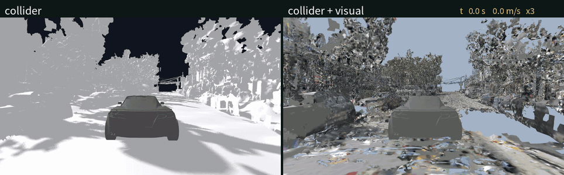
* Genesis 주행 화면. 왼쪽 = collider, 오른쪽 = collider + visual → 건물·노면이 모자이크 잡음, 전깃줄은 하늘색 띠로 보임

같은 장면(front 카메라, 학습에 안 쓴 프레임 100)을 세 방식으로 비교

#### ① GT — 실제 영상

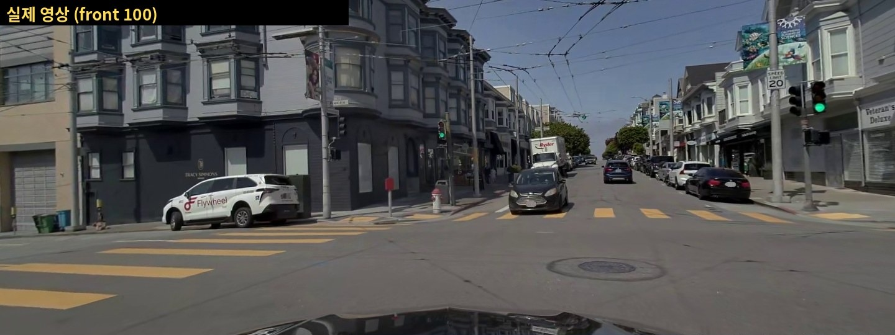

#### ② mesh-bound 2DGS 렌더 — 21.1 dB

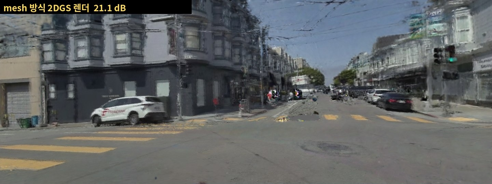

#### ③ 정점 색 mesh (Genesis 가 받는 visual, 조명 없음) — 14.9 dB

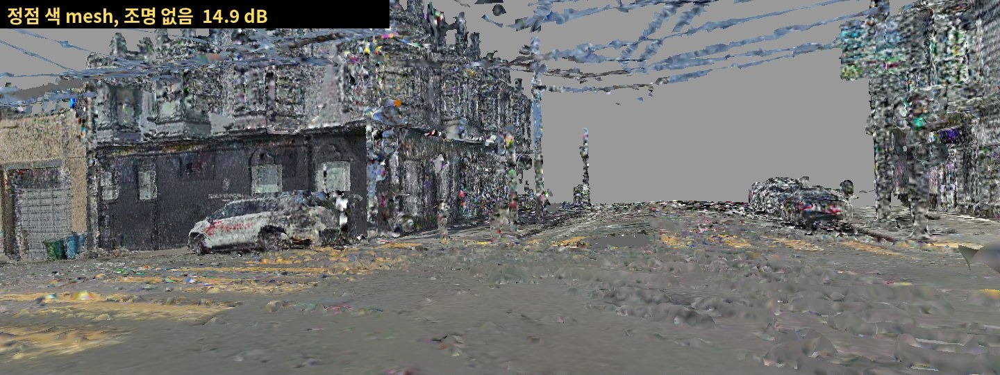

* ② 와 ③ 은 **같은 mesh** 임. 2DGS 색을 정점 색으로 옮기는 순간 모자이크로 깨짐 — 21.1 → 14.9 dB
* ③ 에서 건물 벽·노면에 잡음, 전깃줄이 하늘색 띠, 회색 바탕은 mesh 가 없는 하늘 자리

> 같은 데이터로 만든 3DGS 씬은 선명한데, collider 위에 2DGS를 학습해 Genesis로 옮긴 mesh visual은 화면이 크게 깨짐. 원인은 Gaussian을 mesh 표면에 붙이는 단계가 아니라, Gaussian 색을 mesh 정점 색으로 옮기는 단계임.


- 3DGS 씬, mesh-bound 2DGS, 정점 색 굽기, Genesis visual mesh 순서로 처리함. 붉은 칸(정점 색 굽기)이 손실이 가장 큰 단계임.

## 2. 표면에 붙이는 손실 (3DGS 씬 vs mesh-bound 2DGS)

| 데이터 | 3DGS 씬 | mesh-bound 2DGS | 차이 |
|---|---|---|---|
| Alpamayo | 20.9 dB | 19.7 dB | 1.2 dB |
| ADI seq60 | 15.7 dB | 15.6 dB | 0.1 dB |
| ADI forward40 | 17.1 dB | 16.7 dB | 0.4 dB |

**표면에 붙이는 손실은 0.1 dB에서 1.2 dB로 작음.** 학습에 안 쓴 프레임의 PSNR임.
- Gaussian을 표면에 강제로 붙인 구조가 한계라면 이 차이가 커야 하는데 그렇지 않음.
- ADI가 Alpamayo보다 전체적으로 4 dB에서 5 dB 낮은 것은 3DGS 씬부터 낮으므로 데이터 문제임 (렌즈와 stitch calibration 없음). mesh 변환과는 별개임.

## 3. 단계별 손실 — 병목은 정점 색 굽기

| 단계 (Alpamayo, 학습에 안 쓴 프레임 200장 중앙값) | PSNR |
|---|---|
| mesh-bound 2DGS 렌더 | 20.21 dB |
| 같은 mesh에 정점 색으로 구운 것 (Genesis가 받는 mesh, 조명 없이 측정) | 16.19 dB |

**병목은 정점 색 굽기임. 여기서 4.0 dB를 잃음** (가까운 카메라에서는 6 dB에서 9 dB).
- 정점 간격이 51 mm라 정점마다 색 하나만 담김. Gaussian 간격(28 mm)보다 성기고, 그 사이 무늬는 보간되며 사라짐.
- 정점 주변 12 cm 안의 Gaussian을 3D 거리로 평균 내므로, 가려진 Gaussian이나 뒷면 Gaussian 색까지 섞여 모자이크 잡음이 생김.
- Genesis 조명은 두 번째 원인임. 이미 햇빛이 든 색에 음영을 한 번 더 넣음.

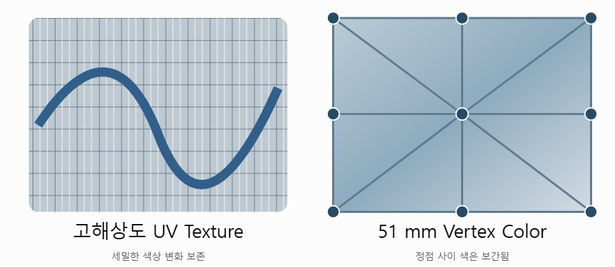
- 왼쪽: UV 텍스처는 형상과 따로 1 cm에서 2 cm 칸마다 색을 저장해 세밀한 색 변화가 남음.
- 오른쪽: 정점 색은 51 mm 간격 정점 사이를 보간하므로 정점보다 작은 무늬가 사라짐.

## 4. 방향: 정점 색 대신 UV 텍스처로 옮김

> collider 형상과 2DGS 학습은 그대로 둠. [파이프라인](./%5BDIGLAB%5D%5B26-11-07%5D_방향성.md) 5단계의 굽기만 바꿈. Gaussian Depth, TSDF, mesh 재구성은 이번 문제의 우선순위가 아님.

| 항목 | 기존 정점 색 굽기 | UV 텍스처 굽기 |
|---|---|---|
| 색 저장 위치 | mesh 정점 | 별도 텍스처 이미지 (mesh에 UV 좌표만 추가) |
| 해상도 | 정점 간격 51 mm | 지면 1 cm (위에서 내려다본 평면 UV), 벽과 차량과 나무 2 cm (xatlas UV) |
| 색 옮기는 방식 | 정점 주변 Gaussian 8개를 3D 거리로 평균 | 학습 카메라와 Genesis 추종 카메라 시점에서 2DGS 렌더를 그대로 맞추도록 텍스처를 최적화 |
| 가림 처리 | 없음 | 카메라 광선이 맞힌 면이고 2DGS 깊이와 mesh 깊이가 맞는 픽셀만 사용 |
| collider | 같음 | 같음 |

## 5. 용량 증가 (Alpamayo, 1700만 면, 표면 1.9만 m²)

| 항목 | 정점 색 | UV 텍스처 |
|---|---|---|
| mesh 파일 (OBJ) | 1.05 GB, 1개 | 1.5 GB, 95개 (차트 경계 정점 중복과 UV 좌표 추가) |
| 텍스처 이미지 (PNG) | 없음 | 295 MB, 95장 |
| 디스크 합계 | 1.05 GB | 약 1.8 GB (약 1.7배) |
| Genesis GPU 텍스처 메모리 | 거의 없음 | 약 1.2 GB (3.04억 칸, 압축 없는 RGBA 기준 추정) |

- 텍스처 칸 수가 표면적 기준 계산보다 많음. LiDAR mesh 표면이 잘게 구겨져 xatlas 차트가 작게 쪼개지고 차트마다 여백이 붙기 때문임. 지면 타일도 사각형 단위라 빈 칸이 포함됨.
- 경량화(차트 병합, 여백 축소, 텍스처 압축)는 품질 확인 뒤에 함.

## 6. Alpamayo 중간 결과

| 카메라 | mesh-bound 2DGS 렌더 | 기존 정점 색 | UV 텍스처 |
|---|---|---|---|
| front | 20.67 | 15.43 | **18.86** |
| left | 20.72 | 17.01 | **19.47** |
| right | 18.62 | 15.25 | **17.43** |
| rear left | 22.69 | 17.20 | **20.16** |
| rear right | 20.19 | 16.06 | **18.36** |
| 전체 200장 | 20.21 | 16.19 | **18.85** |

<sub>단위 dB. 학습에 안 쓴 프레임, mesh가 맞힌 픽셀 중 실제 카메라 시야 안, 두 mesh 모두 조명 없이 측정.</sub>

**정점 색 굽기에서 잃던 4.0 dB 중 2.7 dB(66%)를 회복함.**
- 최적화를 5배(30,000단계)로 늘려도 18.81 dB로 같았음. 남은 1.4 dB는 최적화 부족이 아니라 mesh 구멍, 튀어나온 면, Gaussian 겹침 같은 형상 쪽 원인으로 추정함.
- 남은 흠: 전깃줄 mesh에 하늘색이 입혀져 하늘에 파란 줄로 보임. 도로 위 작은 검은 점은 LiDAR mesh의 튀어나온 면으로 보임.
- 아직 안 한 것: Genesis 주행 영상(조명 포함), ADI 적용.

### 6.1 화질 비교 — 같은 장면(left 카메라, 학습에 안 쓴 프레임 100)을 네 방식으로

#### ① GT — 실제 영상

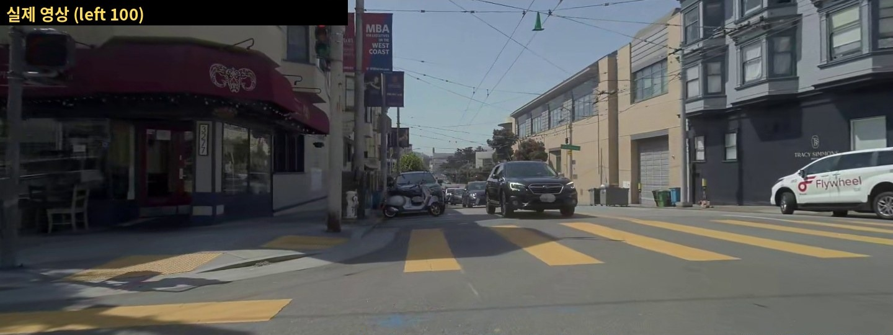

#### ② 2DGS 투영 mesh 렌더 (mesh-bound 2DGS) — 26.0 dB · 화질 최고, Genesis 사용 불가

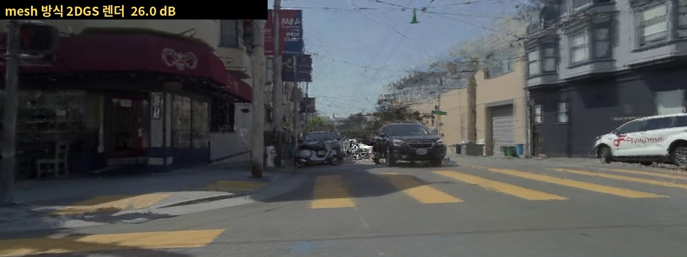

#### ③ 단순 Gaussian RGB (정점 색 굽기, 지금까지 쓰던 방법) — 16.8 dB

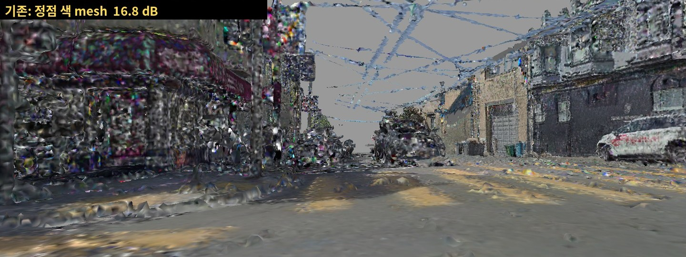

#### ④ 고화질 UV texture (신규) — 22.1 dB

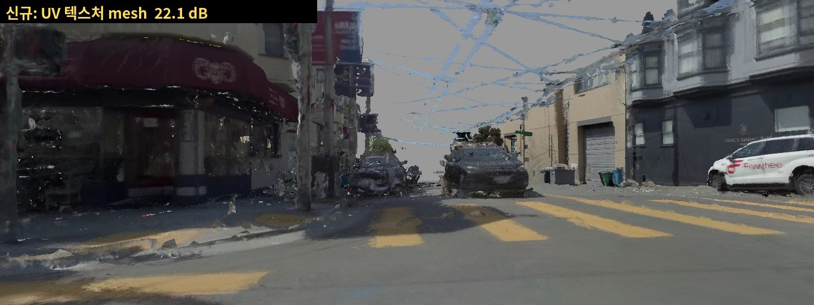

* ③ → ④ : 차양·간판·건물 벽 모자이크가 사라지고 횡단보도 무늬가 살아남
* ④ 에도 남은 흠: 전깃줄이 하늘색 띠, 회색 바탕 = mesh 가 없는 하늘 자리 (Genesis 에서는 배경색)

세 프레임 전체 수치 (원본 비교 그림: [pai_texbake_compare.jpg](../../res_wjdaksry/1107/pai_texbake_compare.jpg))

| 프레임 | ② 2DGS 렌더 | ③ 정점 색 | ④ UV texture |
|---|---|---|---|
| front 60 | **20.7** | 15.5 | 18.8 |
| front 100 | **21.0** | 14.9 | 18.9 |
| left 100 | **26.0** | 16.8 | 22.1 |

<sub>단위 dB. 학습에 안 쓴 프레임.</sub>

> **Genesis 에서는 ②를 쓸 수 없음 (화질은 가장 좋음) → 방법 개선 필요**

* ② 는 Gaussian 을 splatting 으로 그린 결과 → Genesis 는 mesh 만 렌더하므로 Gaussian 을 직접 못 띄움
* 그래서 Gaussian 색을 mesh 로 옮겨야 함 — ③ 정점 색은 모자이크로 깨지고, ④ UV texture 가 ② 에 가장 가까움
* ④ 도 ② 대비 2~4 dB 낮음 → ② 화질을 Genesis mesh 로 옮기는 방법 개선이 다음 과제

## 7. ADI forward40 결과 (UV texture 적용)

> Alpamayo와 같은 방법을 ADI forward40(영상 380~420 s, 블록 5개)에 적용함. collider와 2DGS 학습은 그대로이고 굽기만 바꿈.

**ADI는 텍스처 칸 크기를 거리별로 다르게 둠**

| 경로에서 거리 | 칸 크기 |
|---|---|
| 지면, 15 m 이내 | 1 cm (위에서 내려다본 평면 UV) |
| 나머지 면, 12 m 이내 | 2 cm |
| 나머지 면, 12 m에서 30 m | 4 cm |
| 나머지 면, 30 m 밖 | 8 cm |

- 정밀도로지도 바닥과 V-World 건물 벽처럼 넓은 면이 많아, 모두 2 cm로 두면 4.4억 칸이 되어 GPU 메모리를 넘음. 거리별로 나눠 1.66억 칸으로 줄임.
- 면 수는 580만 개로 Alpamayo(1700만 개)보다 적지만 면 하나하나가 큼.

| 카메라 (실제 방향) | 2DGS 렌더 | 정점 색 | UV texture |
|---|---|---|---|
| front | 17.07 | 13.84 | **15.60** |
| left | 16.85 | 14.69 | **16.11** |
| rear | 14.82 | 12.47 | **13.23** |
| right | 15.87 | 13.85 | **14.66** |
| 전체 160장 | 16.21 | 13.57 | **14.56** |

<sub>단위 dB. 학습에 안 쓴 프레임(40장, 카메라 4대), mesh가 맞힌 픽셀, 두 mesh 모두 조명 없이 측정. 2DGS 렌더가 넘을 수 없는 상한임.</sub>

**V-World·정밀도로지도로 만든 건물 mesh 는 있지만, 카메라·LiDAR 관측이 없는 면에는 UV texture mapping 을 넣지 못함**
- 건물은 V-World 외곽선과 정밀도로지도 좌표로 세운 사각형 박스(3D)로 들어가 있음.
- 위층·뒷면처럼 카메라와 LiDAR 가 보지 못한 면은 학습할 영상이 없음 → 색을 받을 곳이 없어 회색으로 남음.

| 프레임 | 2DGS 렌더 | 정점 색 | UV texture |
|---|---|---|---|
| front 100 | **23.3** | 13.9 | 17.4 |
| left 100 | **25.9** | 18.0 | 23.7 |
| front 60 | **19.3** | 14.2 | 15.9 |

<sub>단위 dB. 아래 비교 그림의 세 프레임.</sub>

### 7.1 화질 비교 (left 카메라, 학습에 안 쓴 프레임 100)

#### 실제 영상

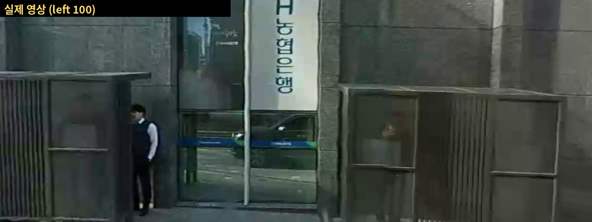

#### 2DGS 렌더 (mesh-bound 2DGS), 25.9 dB

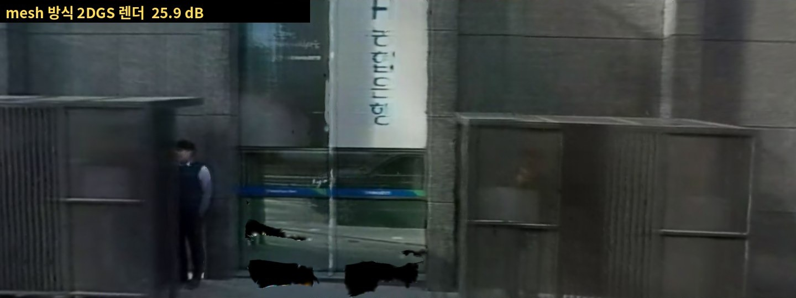

#### 정점 색 (지금까지 쓰던 방법), 18.0 dB

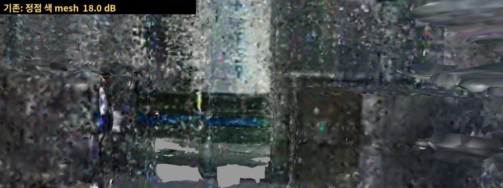

#### UV texture (신규), 23.7 dB

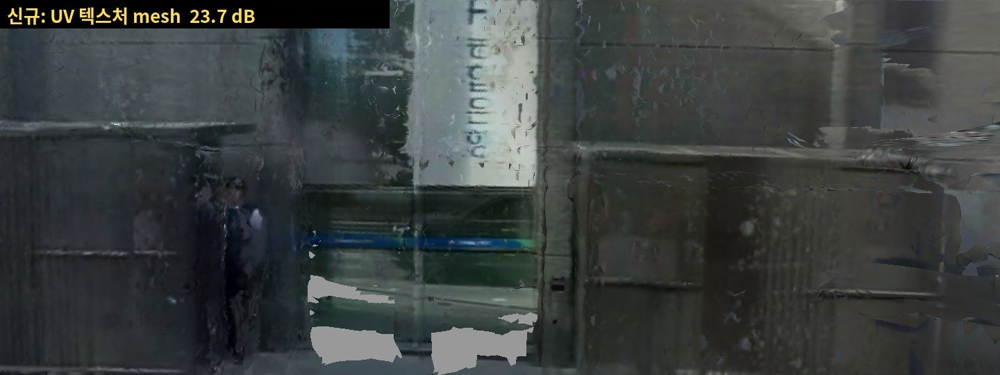

- 정점 색에서 알록달록하던 은행 간판, 출입문, 벽이 UV texture에서 형태를 되찾음.
- 아래쪽 회색 조각은 mesh가 있지만 Gaussian이 없어 색을 못 받은 면임. 2DGS 렌더의 검은 조각과 같은 자리임.

### 7.2 화질 비교 (front 카메라, 학습에 안 쓴 프레임 100)

#### 실제 영상

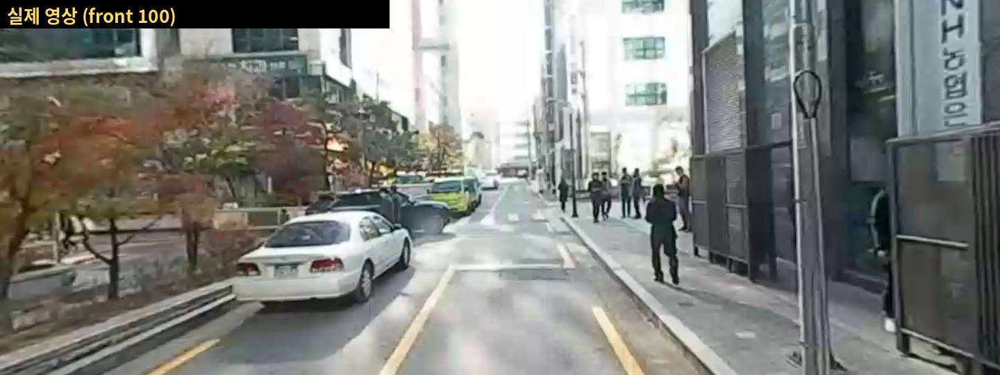

#### 2DGS 렌더 (mesh-bound 2DGS), 23.3 dB

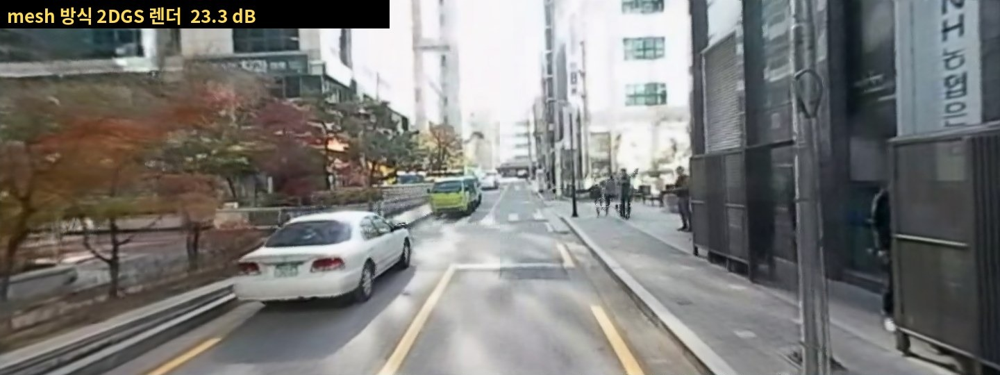

#### 정점 색 (지금까지 쓰던 방법), 13.9 dB

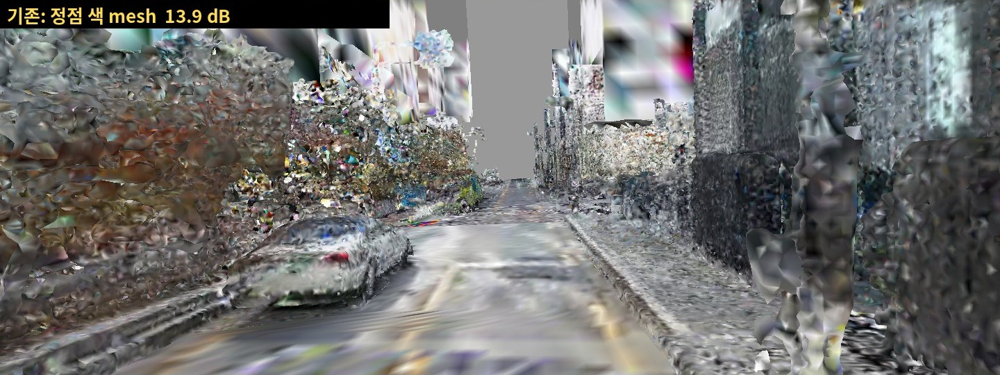

#### UV texture (신규), 17.4 dB

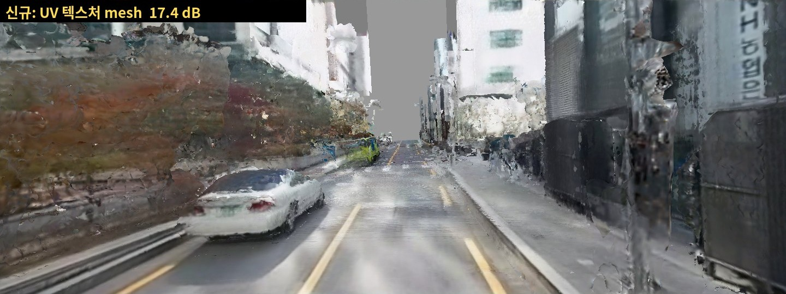

- 정점 색에서 깨지던 가로수·건물 벽이 UV texture에서 형태를 되찾음.
- 위쪽 회색 면은 영상이 닿지 않은 V-World 박스 면임.

### 7.3 화질 비교 (front 카메라, 학습에 안 쓴 프레임 60)

#### 실제 영상

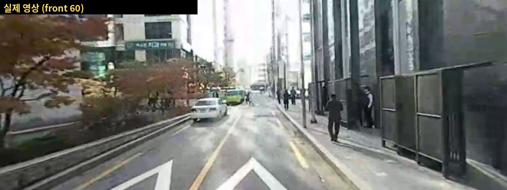

#### 2DGS 렌더 (mesh-bound 2DGS), 19.3 dB

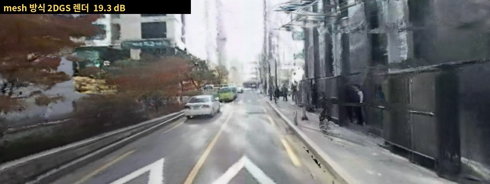

#### 정점 색 (지금까지 쓰던 방법), 14.2 dB

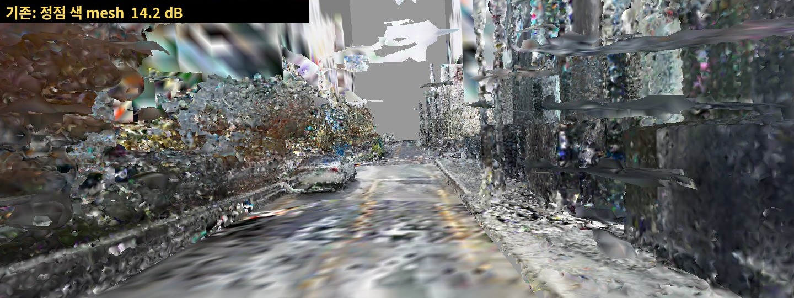

#### UV texture (신규), 15.9 dB

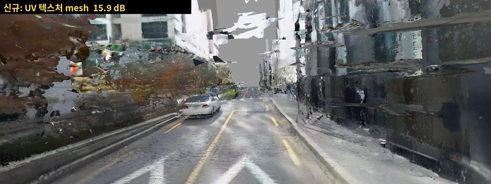

- 건물 벽의 가로 줄무늬는 2DGS 렌더에도 있음 → 굽기 문제가 아니라 V-World 박스 쪽 2DGS 문제임.
- 위쪽 회색 면은 영상이 닿지 않은 V-World 박스 면임.

<sub>원본 비교 그림: [adi_forward40_texbake_compare.jpg](../../res_wjdaksry/1106/adi_forward40_texbake_compare.jpg)</sub>

## 8. Genesis Nyx — 2DGS를 Genesis 안에서 직접 렌더

> 6.1의 "Genesis 에서는 2DGS 렌더를 쓸 수 없음"을 뒤집음. Genesis의 Nyx 렌더러 플러그인이 Gaussian splat을 직접 그림 → 정점 색이나 UV 텍스처로 옮기지 않고 2DGS 화질을 그대로 씀.

```
[1 2DGS 학습]   collider mesh 위에 붙인 2DGS (블록별) → 경로 하나로 합침 → 경로 전체 영상으로 미세학습
                │   (위치·방향은 mesh 에 고정, 색·투명도·크기만 학습)
[2 splat 변환]  3DGS 형식 .ply 로 내보냄 (기본 색만, 4 GiB 미만)
                │
[3 Nyx 렌더]    Genesis 카메라에 splat 을 light field 로 연결 → 학습에 안 쓴 프레임에서 실제 영상과 비교
                │
[4 주행]        같은 씬에서 collider 위를 주행 경로대로 주행 (collider 는 물리·raycast 전용, 화면에는 안 그림)
```

| 항목 | 내용 |
|---|---|
| 설치 | 기존 Genesis 가상환경(genesis-world 1.3.3)에 gs-nyx 0.1.5, gs-nyx-plugin 0.1.6 이 이미 있음 → 버전 업데이트 없음 |
| 차량 SDK | 변경 없음 |
| 렌더 속도 | 프레임당 약 12 ms (1440×540, 픽셀당 4샘플) |

### 8.1 화질 — 세 데이터 모두 2DGS와 0.4 dB 차이

| 데이터 | 기존 정점 색 | UV 텍스처 | 경로 전체 2DGS | **Genesis Nyx** | 2DGS 대비 |
|---|---|---|---|---|---|
| Alpamayo | 16.19 | 18.85 | 20.44 | **20.02** | −0.42 |
| ADI forward40 | 13.57 | 14.56 | 15.51 | **15.15** | −0.36 |
| ADI seq60 | 13.13 | 14.08 | 15.04 | **14.61** | −0.43 |

<sub>단위 dB. 학습에 안 쓴 프레임 중앙값(Alpamayo 200장, forward40 160장, seq60 240장), mesh가 맞힌 픽셀 중 카메라 시야 안.</sub>

**Nyx 가 UV 텍스처보다 0.5~1.2 dB, 정점 색보다 1.5~3.8 dB 높음**
- Nyx 는 2DGS 보다 10~20% 밝게 그림 → 데이터별 밝기 배율을 실제 영상에 맞춰 넣음 (0.86 / 0.89 / 0.87). 보정 전에는 2DGS 대비 0.8~1.9 dB 낮았음.
- 남은 0.4 dB 는 렌더러 차이임 (Nyx 는 3DGS 방식 타원으로 그리고, 학습은 2DGS 원판으로 함).

| splat 크기 | Gaussian 수 | .ply 용량 |
|---|---|---|
| Alpamayo | 1,741만 | 1.18 GB |
| ADI forward40 | 1,043만 | 0.71 GB |
| ADI seq60 | 2,775만 | 1.89 GB |

### 8.2 화질 비교 (Alpamayo, front 카메라, 학습에 안 쓴 프레임 100)

#### 실제 영상

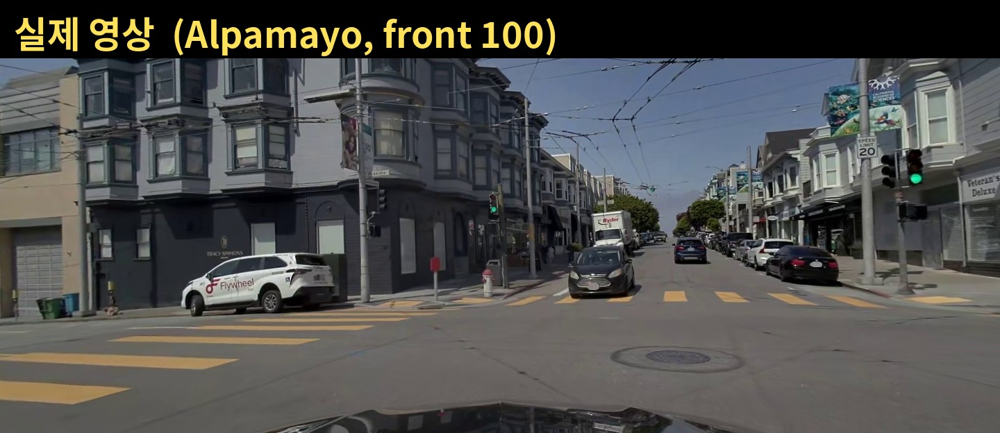

#### 2DGS 렌더 (경로 전체 학습), 20.3 dB

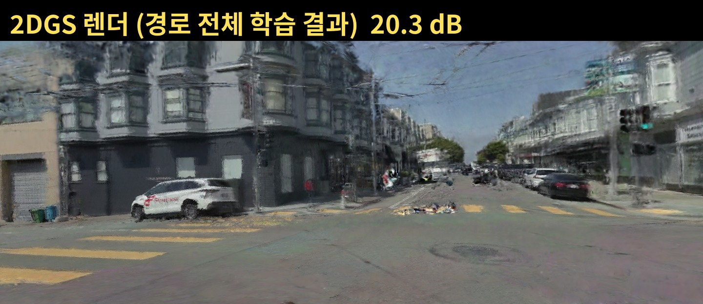

#### Genesis Nyx 렌더, 20.8 dB

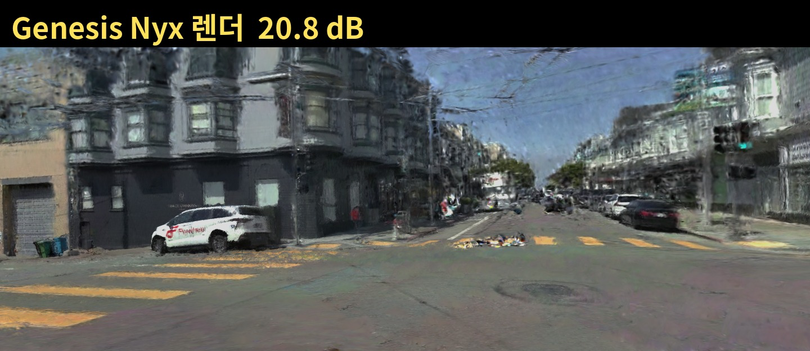

* 6.1 의 정점 색·UV 텍스처에서 깨지던 건물 벽·창문·횡단보도가 2DGS 와 같은 수준으로 나옴
* 교차로 중앙의 얼룩은 2DGS 에도 있음 → 렌더러가 아니라 학습 쪽 문제 (지나가는 차량 자리)

다른 프레임: [left 100](../../res_wjdaksry/1107/pai_left100_compare.jpg) (2DGS 24.6 / Nyx 22.6 dB), [front 60](../../res_wjdaksry/1107/pai_front60_compare.jpg) (21.6 / 21.1 dB)

### 8.3 화질 비교 (ADI forward40, left 카메라, 학습에 안 쓴 프레임 100)

#### 실제 영상

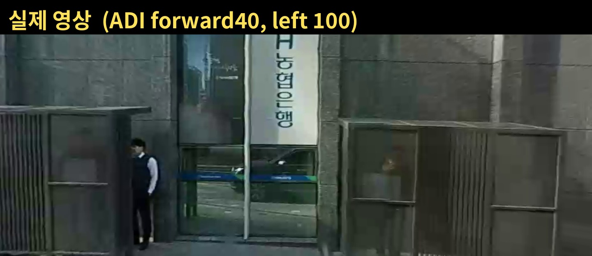

#### 2DGS 렌더 (경로 전체 학습), 21.6 dB

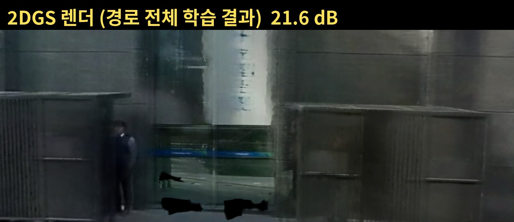

#### Genesis Nyx 렌더, 20.4 dB

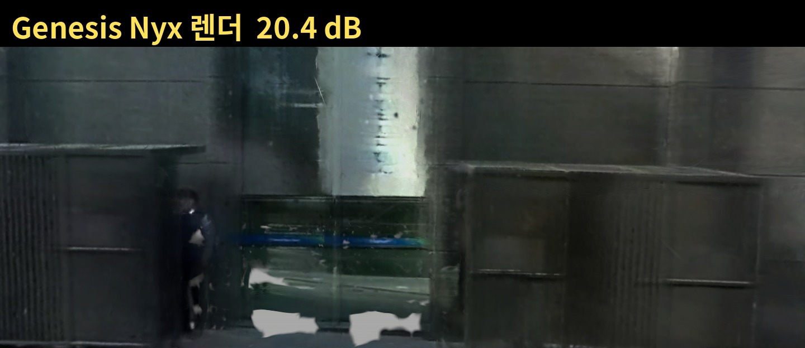

* 아래쪽 조각은 mesh 는 있지만 Gaussian 이 없는 자리임 (7.1 의 회색 조각과 같은 자리) — 2DGS 는 검정, Nyx 는 배경색으로 보임

다른 프레임: [front 100](../../res_wjdaksry/1106/f40_front100_compare.jpg) (18.8 / 18.8 dB), [front 60](../../res_wjdaksry/1106/f40_front60_compare.jpg) (15.8 / 16.0 dB)

### 8.4 화질 비교 (ADI seq60, front 카메라, 학습에 안 쓴 프레임 100)

#### 실제 영상

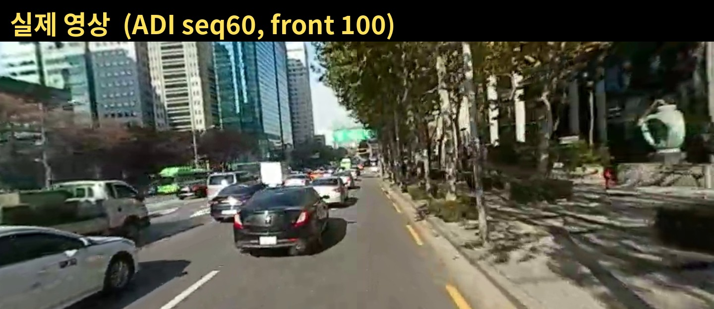

#### 2DGS 렌더 (경로 전체 학습), 15.2 dB

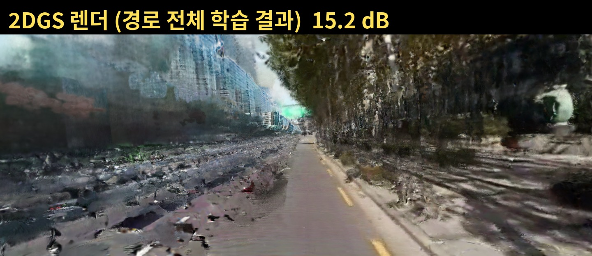

#### Genesis Nyx 렌더, 14.8 dB

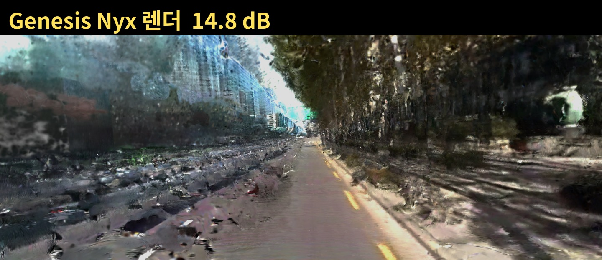

* 왼쪽 차로의 얼룩은 차량을 지운 자리임 — 2DGS 에도 똑같이 있음 → 렌더러 문제가 아님
* 오른쪽 보도·가로수·건물은 2DGS 와 같은 수준

다른 프레임: [left 100](../../res_wjdaksry/1106/s60_left100_compare.jpg) (18.1 / 17.9 dB), [front 200](../../res_wjdaksry/1106/s60_front200_compare.jpg) (14.1 / 15.7 dB)

### 8.5 주행 — 세 데이터 모두 완주

| 데이터 | 완주 | 진행 | \|CTE\| 최대 | 네 바퀴 접지 | roll 최대 |
|---|---|---|---|---|---|
| Alpamayo | 완주 | 99.6% | 0.114 m | 100% | 6.6° |
| ADI forward40 | 완주 | 99.4% | 0.003 m | 100% | 2.3° |
| ADI seq60 | 완주 | 99.9% | 0.093 m | 100% | 5.7° |

<sub>pure-pursuit, collider mesh 위 물리 주행, 화면은 1280×720 추종 카메라(차 뒤 6 m, 높이 1.6 m). 진행이 100% 가 아닌 것은 목표점 도달 판정 거리 안에서 멈추기 때문임.</sub>


* Alpamayo — 왼쪽 = collider (물리 mesh), 오른쪽 = Genesis Nyx 렌더


* ADI forward40


* ADI seq60 (전송용 압축본)

### 8.6 진행 중 막힌 것과 해결

| 문제 | 원인 | 해결 |
|---|---|---|
| 하늘이 잘림 | 렌더 거리 200 m < 하늘 dome 거리 약 300 m | 렌더 거리 1000 m |
| 블록을 그냥 합치면 경계 잡음 | 블록별 2DGS 가 겹치는 구간에서 충돌 | 합친 splat 을 경로 전체 영상으로 미세학습 (Alpamayo 20.21 → 20.44 dB) |
| .ply 를 읽으면 깨진 값 | 4 GiB 넘는 .ply (고차 색 계수 포함 4.3 GB) | 기본 색만 내보냄 |
| 차량을 못 그림 | Nyx 가 고정 링크를 합친 URDF 를 지원하지 않음 | 고정 링크 병합을 끄고 불러옴 — 이 URDF 는 고정 관절이 없어 물리는 같음 |

### 8.7 미해결

**바퀴가 안 보임** — 차체만 나옴
- 차량 SDK 가 바퀴를 Genesis 기본 렌더러 전용 방식으로 그림. 세 가지를 시도했으나 모두 실패해서 되돌림.

**ADI 는 경로 전체 미세학습이 블록별 2DGS 보다 낮음**
- 블록별 → 경로 전체: forward40 16.21 → 15.51, seq60 15.42 → 15.04 dB. Alpamayo 는 반대로 20.21 → 20.44 dB.
- ADI 카메라 calibration(렌즈·stitch 정보 없음) 때문으로 추정됨. 확인은 아직 안 함.

**Nyx 는 depth·segmentation 출력이 없음** — RGB 만 나옴

### 8.8 주행 카메라 앞 바닥이 깨지는 현상

> 주행 영상에서 차가 지나온 경로의 바닥이 색 얼룩과 구멍으로 깨짐. 학습에 안 쓴 프레임 PSNR 에는 안 잡혔음 — 평가는 학습 카메라 위치에서만 했기 때문임.

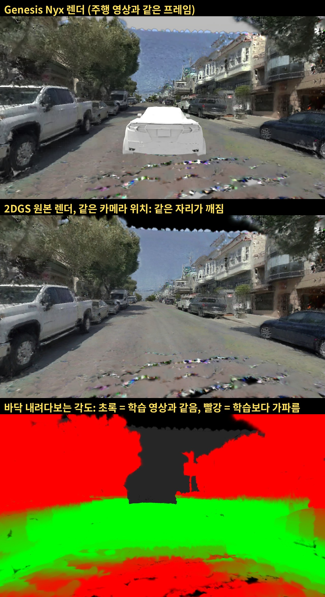
* 위 = Nyx 주행 화면, 가운데 = 같은 카메라 위치의 2DGS 원본 렌더, 아래 = 바닥을 내려다보는 각도 (초록 = 학습 영상과 같음, 빨강 = 학습보다 가파름. 위쪽 빨강은 벽·하늘이라 무관)
* 2DGS 원본도 같은 자리가 깨짐 → **Nyx 문제가 아님**

| 주행 카메라에서 거리 | 주행 카메라가 내려다보는 각도 | 학습 영상 중 가장 가파른 각도 | 화면 |
|---|---|---|---|
| 2~3 m | 31.6° | 15.9° | 깨짐 |
| 3~4 m | 24.1° | 15.2° | 깨짐 |
| 4~5 m | 19.6° | 15.8° | 경계 |
| 5~7 m | 15.4° | 16.0° | 정상 |
| 7~10 m | 11.2° | 15.7° | 정상 |

<sub>Alpamayo 주행 4초 지점, 차량 경로 폭 3 m 안의 바닥 Gaussian.</sub>

**원인: 학습 영상이 이 각도로 바닥을 본 적이 없음**
- 전방 카메라 아래쪽은 본넷이라 학습에서 가림 → 차 앞 4 m 안쪽 바닥은 15° 정도 낮은 각도로만 관측됨
- mesh 에 고정한 것은 원판의 위치·방향뿐이고, 크기·투명도·색은 학습이 정함 → 낮은 각도에서는 여러 원판이 한 픽셀에 겹쳐 평균만 맞으면 됨
- 깨지는 구간 원판(23,166개): 투명도 0.1 미만 13%, 이웃과 틈이 벌어진 원판 29%, 색 표준편차 0.24 → 가파르게 보면 투명한 원판 자리로 배경이 비치고(구멍), 제각각인 색이 드러남(얼룩)

### 8.9 노면 제약 결과 (Alpamayo)

> 노면 원판의 투명도 1 고정, 크기 하한 원판 간격 × 0.6, 이웃 4개와 색 차이 손실(가중치 1.0) → 경로 전체 미세학습에 추가. 노면 판정은 노면 높이 ±12 cm. 제약 상세는 [방향성 문서](./%5BDIGLAB%5D%5B26-11-07%5D_방향성.md) 1.6.

| 학습 | 노면 원판 | 2DGS PSNR | Genesis Nyx PSNR | 주행 화면 노면 |
|---|---|---|---|---|
| 제약 없음 | — | 20.44 | 20.02 | 넓게 깨짐 |
| 면이 위로 25° 이내만 노면 | 719만 | 20.71 | — | 작은 얼룩 남음 |
| **노면 높이 ±12 cm** | **915만** | **20.84** | **20.25** | 작은 검은 점 몇 개 |

<sub>단위 dB. 학습에 안 쓴 프레임 200장 중앙값. Nyx 밝기 배율 0.86 → 0.88.</sub>

**제약을 넣어도 PSNR 이 오름 (2DGS +0.40, Nyx +0.23 dB)** — 원판이 어느 각도에서나 같은 면이 되어 학습에 안 쓴 시점에서 덜 손해 봄
- 면 방향으로 노면을 고르면 깨지는 구간 원판의 64% 가 빠짐 (LiDAR 노면이 울퉁불퉁해 기울어진 면이 많음) → 높이 기준으로 바꿔 해결
- 주행 지표는 같음 (완주, 진행 99.6%, \|CTE\| 최대 0.114 m) — collider 는 바뀌지 않았으므로
- 남은 검은 점은 mesh 구멍이나 튀어나온 면 자리로 추정됨. 확인 안 함

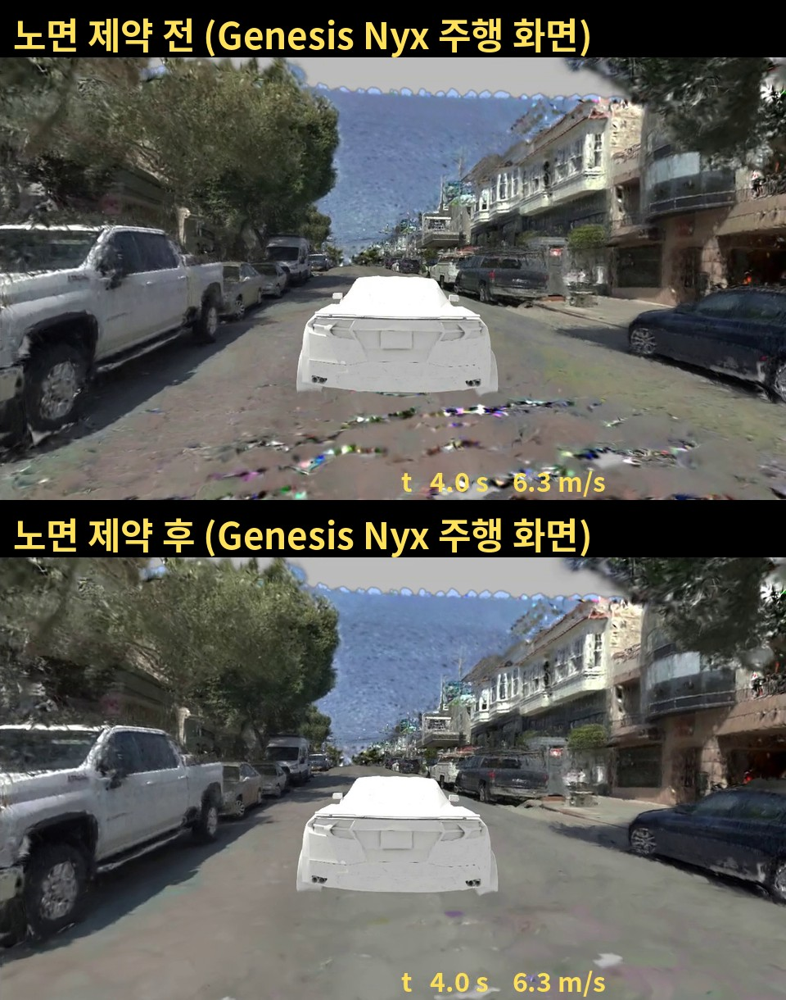
* 주행 4.0 s — 위 = 제약 전, 아래 = 제약 후. 차 뒤 노면의 색 얼룩·구멍이 사라짐

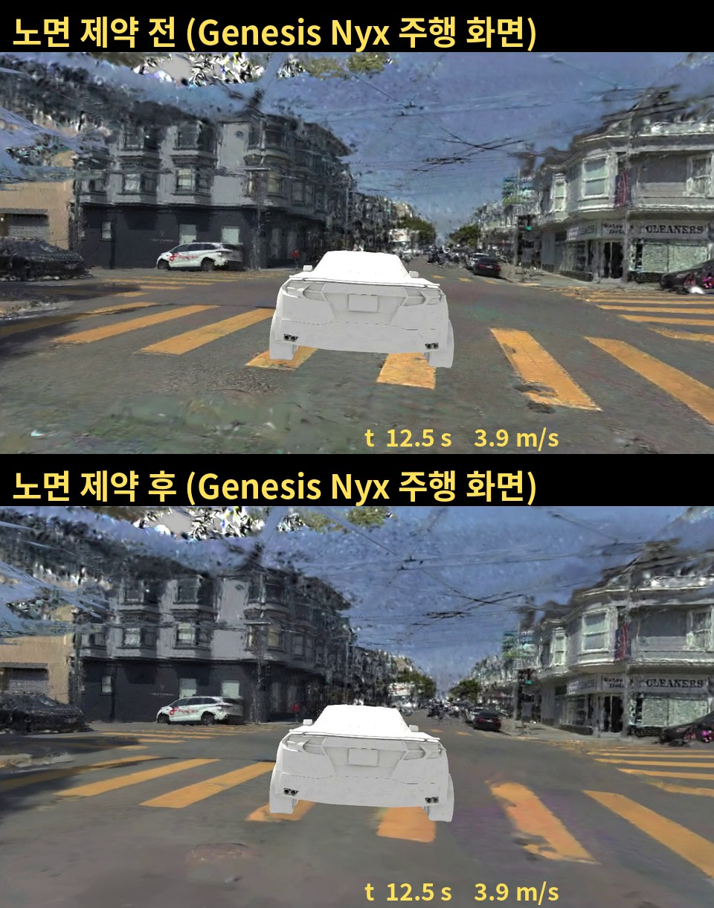
* 주행 12.5 s 교차로 — 화면 아래 노면 얼룩이 사라지고 횡단보도 경계는 남음


* 노면 제약 후 주행 — 왼쪽 = collider, 오른쪽 = Genesis Nyx
