# HD Map + V-World + LiDAR Scene Pipeline

> 실제 주행 데이터(ADI)로 Genesis 에서 달릴 수 있는 씬을 만드는 파이프라인. 공공 지도(정밀도로지도, V-World 건물)가 큰 틀과 좌표를, LiDAR 가 관측된 디테일을, ADI 영상이 색을 맡음. 화면은 Genesis Nyx 가 2DGS 를 직접 그림.

## 용어

| 용어 | 설명 |
|---|---|
| 정밀도로지도 (HD map) | 국토지리정보원 지도. 차도·보도 경계, 차선, 노면표시, 높이. 건물은 없음 |
| V-World 건물 | 건축물정보의 건물 외곽선 + 실제 높이(m). 세우면 박스 모양 건물 |
| collider | Genesis 에서 바퀴가 닿는 충돌 mesh |
| visual | 화면에 보이는 것 |
| 2DGS (mesh-bound) | 2D Gaussian Splatting. 납작한 원판(Gaussian)을 mesh 면 위에 고정하고 영상 색을 학습함 |
| splat | 학습이 끝난 Gaussian 묶음 파일 (.ply) |
| Genesis Nyx | Genesis 의 Gaussian splat 렌더러 플러그인 |
| Difix | NVIDIA 의 단일 스텝 diffusion 이미지 복원 모델 (Difix3D+). 깨진 렌더와 실제 영상을 넣으면 정리된 이미지를 돌려줌 |
| 궤적 밖 시점 | 학습 카메라가 지나가지 않은 시점. Genesis 추적 카메라가 여기에 해당 |
| LPIPS | 사람 눈에 가까운 이미지 차이 지표. 낮을수록 실제 영상과 비슷함 |

## 1. 전체 흐름

```
[1 기준 좌표]   정밀도로지도 + V-World → 절대 좌표 world
                 │
[2 기초 mesh]   정밀도로지도 차도·보도 바닥 + V-World 건물 박스
                 │
[3 LiDAR 정합]  LiDAR 궤적을 정밀도로지도 차선에 맞춤 → 카메라 위치도 같이 맞춰짐
                 │
[4 collider]    관측된 노면·건물 앞면은 LiDAR 면으로 교체, 나무·기둥·표지판·연석은 LiDAR 로 추가
                 │
[5 visual]      collider 위에 2DGS 학습 (블록별) → 경로 하나로 합쳐 미세학습 + 노면 제약 → Difix 로 궤적 밖 시점 보강
                 │
[6 Genesis]     collider = 물리, splat = Nyx 화면 → 주행 경로대로 주행
```

| 단계 | 입력 | 출력 | 맡는 것 |
|---|---|---|---|
| 1 기준 좌표 | 정밀도로지도, V-World | world 좌표 | 긴 거리에서도 오차가 쌓이지 않는 좌표 |
| 2 기초 mesh | 정밀도로지도 바닥, V-World 건물 | 넓고 반듯한 기초 형상 | 못 본 곳(바깥 차로, 건물 위층·뒷면)까지 비지 않게 |
| 3 LiDAR 정합 | ADI LiDAR 궤적 | 보정된 궤적·카메라 위치 | LiDAR 를 지도 좌표에 맞춤 (큰 경사·위치만) |
| 4 collider | 기초 mesh + LiDAR mesh | collider mesh | 관측된 디테일 (요철, 연석, 건물 앞면, 나무) |
| 5 visual | collider + ADI 4방향 영상 | splat | 색과 질감 |
| 6 Genesis | collider + splat + 주행 경로 | 주행 영상·지표 | 검증 |

## 2. 기준 좌표 — 정밀도로지도 · V-World

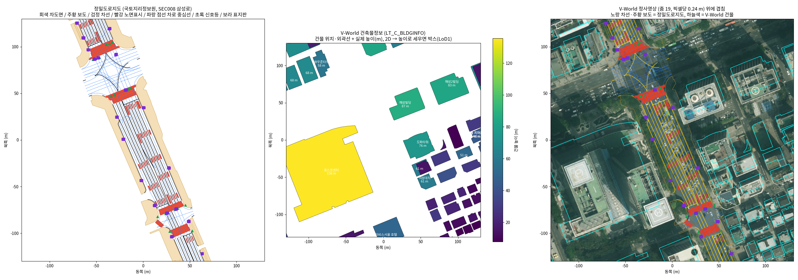
* 왼쪽 = 정밀도로지도 (삼성로): 차도면·보도·차선·노면표시
* 가운데 = V-World 건물 외곽선 + 실제 높이 → 세우면 박스
* 오른쪽 = 둘을 정사영상에 겹친 것 — 절대 좌표라 옮기지 않아도 맞음

**왜 지도가 기준인가** — 지도는 절대 좌표로 측량됨. LiDAR 궤적은 스캔을 이어 붙여 거리가 길수록 오차가 쌓임. 짧은 블록에서는 차이가 없지만 경로 전체(374 m)부터는 지도 기준이 나음.

| 항목 | 기준 |
|---|---|
| 전체 좌표, 긴 거리 형태 | 정밀도로지도·V-World |
| 차도 범위, 차로 수, 차선 | 정밀도로지도 |
| 못 본 건물 면, 위층 | V-World |
| 관측된 노면 요철·연석, 건물 앞면, 나무·기둥·표지판 | LiDAR |

### 바닥 위치가 맞는지 확인

> 건물은 바닥 외곽선에서 수직으로 세우므로 도로와 건물의 바닥 위치만 맞으면 됨.

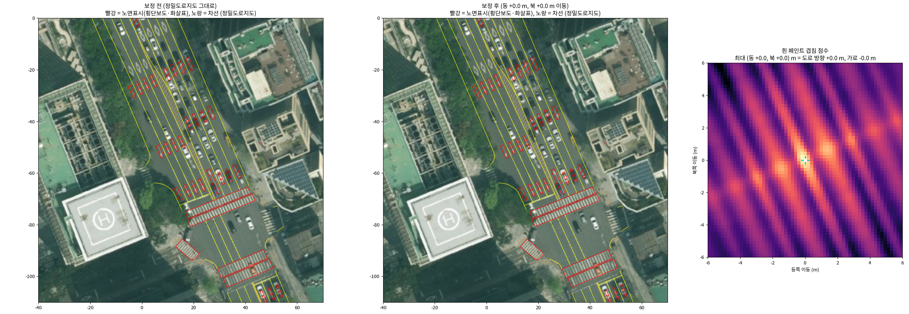
* 정밀도로지도 노면표시(빨강)·차선(노랑)을 정사영상에 겹친 것 — 옮기지 않은 상태에서 횡단보도가 사진과 가장 잘 겹침

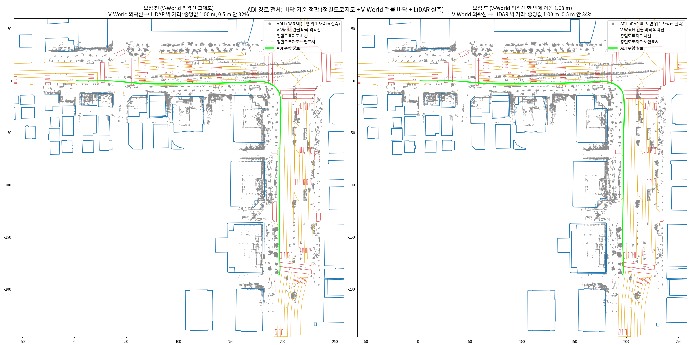
* 경로 전체에서 LiDAR 벽(회색)과 V-World 바닥 외곽선(파랑) 비교. 왼쪽 그대로, 오른쪽 한 번 옮긴 뒤
* 대부분 1 m 안쪽에서 맞고, 옮겨도 나아지지 않음 → V-World 외곽선은 그대로 씀

## 3. 기초 mesh 와 LiDAR

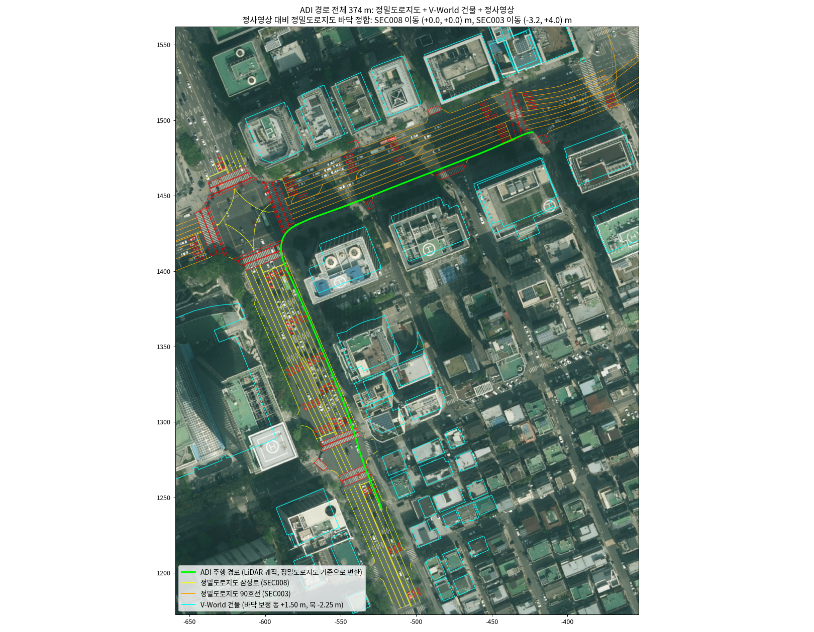
* 경로 전체(초록) 위에 정밀도로지도(노랑·주황), 노면표시(빨강), V-World 건물(하늘색)을 겹친 것. 경로 전체가 정밀도로지도로 덮임

**LiDAR 는 디테일만 맡음** — 위치와 큰 경사만 지도에 맞추고 요철·연석 같은 국소 형상은 건드리지 않음. ADI(2019) 와 정밀도로지도(2023) 사이에 도로가 바뀐 곳이 있을 수 있기 때문임.

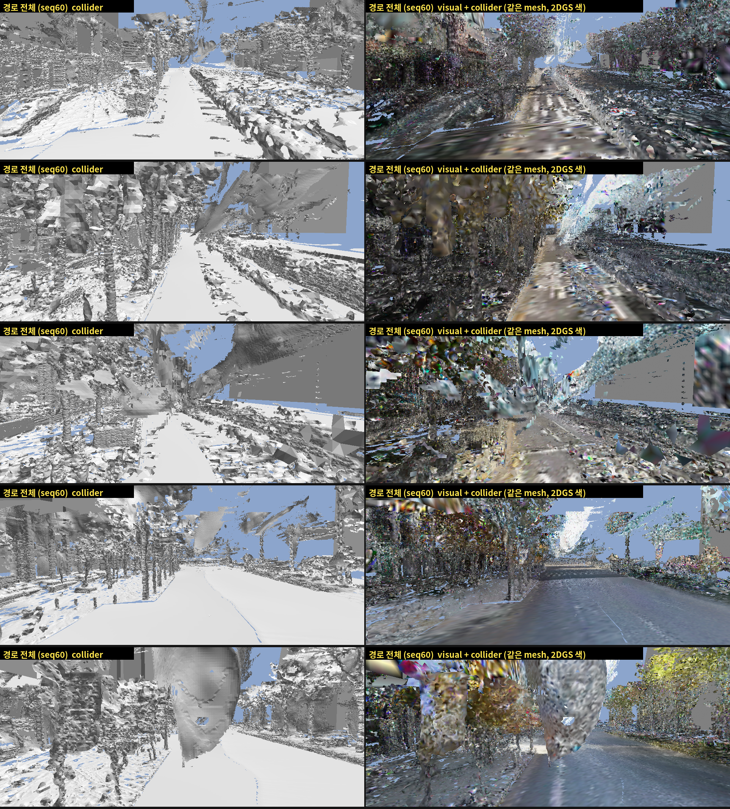
* 왼쪽 열 = LiDAR mesh collider: 가로수 줄기·화단·건물 앞면이 형상으로 있음 → 지도에 없는 디테일
* 형상이 있어야 그 색이 제자리에 붙음. 없으면 뒤 벽과 도로로 번짐

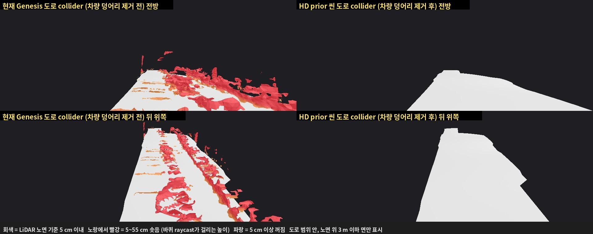
* 왼쪽 = LiDAR 노면: 요철을 담지만 차량 잔해도 같이 솟음
* 오른쪽 = 정밀도로지도 노면: 매끈하지만 요철·연석이 없음
* → 관측된 노면은 LiDAR, 못 본 차로는 정밀도로지도로 채움

## 4. visual — 2DGS 학습과 Genesis Nyx 렌더

```
collider mesh ──┐
                ├─→ mesh-bound 2DGS 학습 (블록별) ─→ 경로 하나로 합침 ─→ 경로 전체 영상으로 미세학습 + 노면 제약
ADI 영상 4방향 ─┘                                                              │
(+ 보정된 카메라 위치)                                                          ↓
                                                         splat (.ply) ─→ Genesis Nyx 가 직접 렌더
```

- 원판의 위치·방향은 collider 면에 고정하고 색·투명도·크기만 학습함 → **visual 과 collider 가 같은 면**
- 정점 색이나 UV 텍스처로 굽지 않음. 굽는 단계에서 화질 손실이 가장 컸고, Nyx 는 splat 을 그대로 그림
- Nyx 는 렌더러일 뿐 카메라·LiDAR 를 직접 쓰지 않음 → 화질은 2DGS 학습, 즉 카메라 calibration 과 LiDAR 정합이 정함

#### 실제 영상

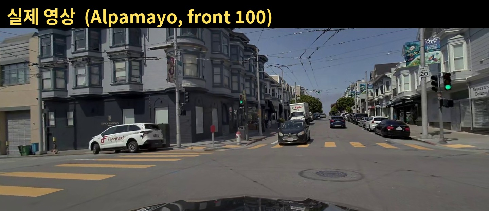

#### 2DGS 렌더

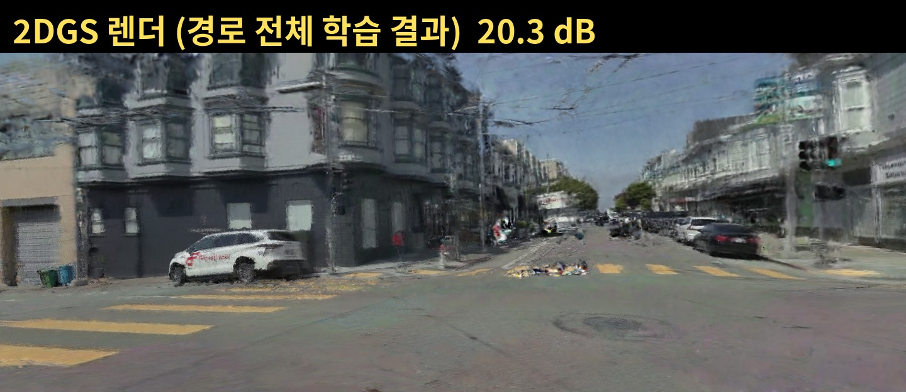

#### Genesis Nyx 렌더

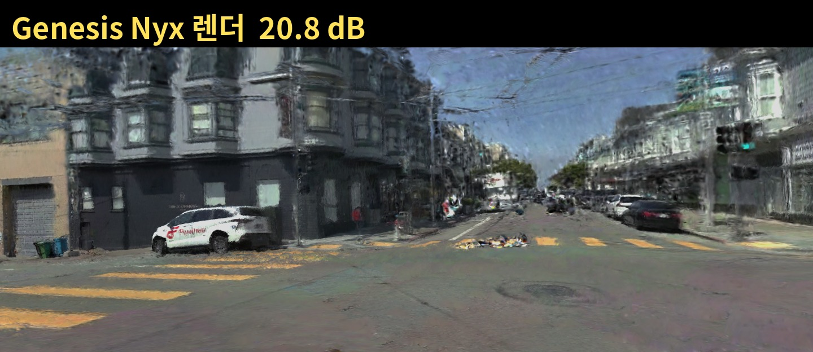

* Genesis 안에서 2DGS 와 같은 수준으로 그려짐 (Alpamayo, 학습에 안 쓴 프레임). 비교 상세는 [visual 업데이트 문서](./%5BDIGLAB%5D%5B26-11-05%5D_visual업데이트.md) 8장

### 노면 제약

**왜 필요한가** — 학습 영상은 노면을 낮은 각도로만 봄 (전방 카메라 아래쪽은 본넷이라 가림). 낮은 각도에서는 원판 여러 개가 한 픽셀에 겹쳐 평균만 맞으면 되므로, 원판마다 투명도·크기·색이 제멋대로 남음. 주행 카메라처럼 더 가파르게 내려다보면 구멍과 색 얼룩이 드러남.

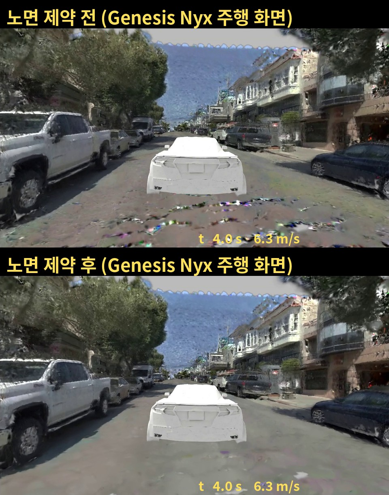
* 위 = 제약 전, 아래 = 제약 후 (Genesis Nyx 주행 화면). 차 뒤 노면의 얼룩·구멍이 사라짐

| 제약 | 내용 | 막는 것 |
|---|---|---|
| 노면 판정 | 바닥 높이에서 위아래 12 cm 안의 원판을 모두 노면으로 봄 (면 기울기는 안 따짐) | 울퉁불퉁한 LiDAR 노면의 기울어진 원판이 빠지는 것 |
| 투명도 고정 | 노면 원판은 완전 불투명 | 배경이 비치는 구멍 |
| 크기 하한 | 원판이 이웃과 틈이 생길 만큼 작아지지 않게 함 | 원판 사이 틈 |
| 이웃 색 맞춤 | 가까운 이웃과의 색 차이를 손실에 더함 (절댓값) | 색 얼룩. 차선·횡단보도 경계는 남음 |

- 노면 아닌 원판(벽·차량·나무)은 제약 없이 학습함
- 제약을 넣어도 학습에 안 쓴 프레임 화질이 떨어지지 않음 — 원판이 어느 각도에서나 같은 면이 되기 때문임

### Difix 로 궤적 밖 시점 보강

**왜 필요한가** — 카메라는 차가 지나간 경로만 찍음. 경로를 벗어난 시점은 학습 데이터가 없어 번짐과 얼룩이 드러남. Genesis 추적 카메라가 이 시점을 봄.

| 단계 | 내용 | 설정 |
|---|---|---|
| 1 궤적 밖 렌더 | 현재 2DGS 를 경로 밖에서 렌더 | 1 라운드 = 좌우 1 m + 뒤 6 m. 2 라운드 = 좌우 2 m + 뒤 6 m 지점에서 좌우 1 m. 3 라운드 = 좌우 3 m. 뒤 6 m 는 4도 아래를 봄 |
| 2 Difix 복원 | 깨진 렌더 + 같은 프레임 실제 영상 → 정리된 이미지 | 1440x536, 장당 약 0.9 s |
| 3 되먹임 학습 | 복원 이미지를 가짜 정답으로 실제 영상과 번갈아 학습 | 가중치 0.2, 라운드당 6000 iteration |
| 4 반복 | 1~3 을 시점을 벌려가며 반복 | 3 라운드 |

- 원판 위치·방향은 collider 면에 고정하고 색·투명도·크기만 학습함 → 물리와 collider 는 변하지 않음
- 결과가 splat 에 남음 → 주행 중에는 Difix 를 돌리지 않고 Nyx 가 splat 만 그림
- 학습에 안 쓴 프레임은 Difix 참조 영상으로도 쓰지 않음 (ADI 기준. Alpamayo 는 일부 섞임)

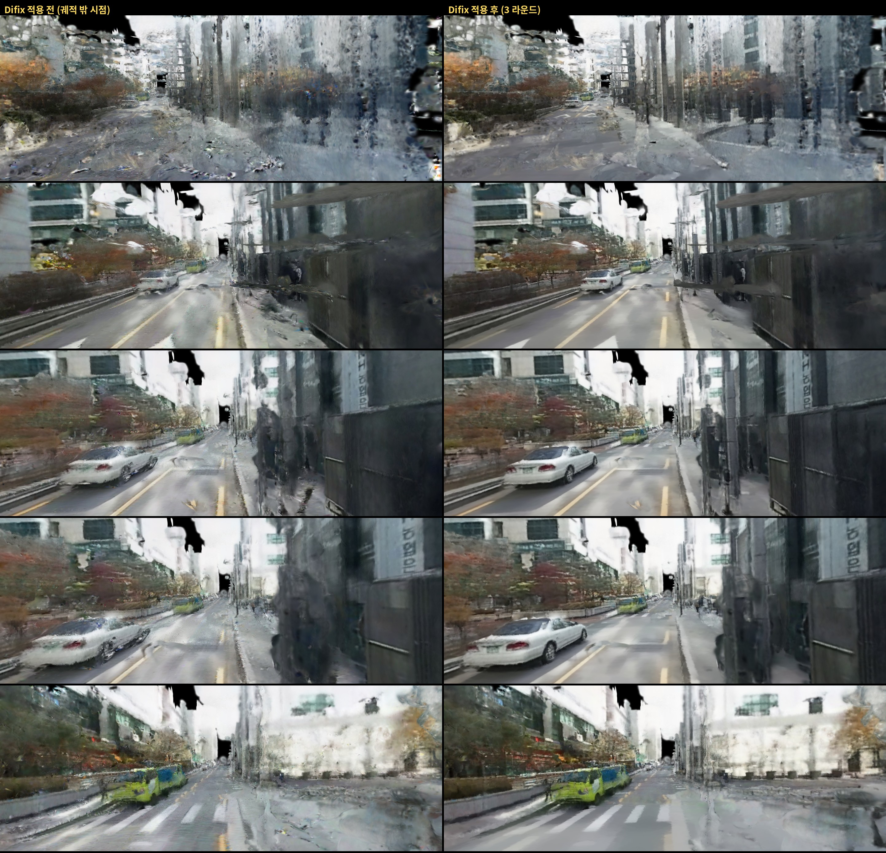
* ADI forward40 궤적 밖 시점 2DGS 렌더. 왼쪽 = Difix 전, 오른쪽 = 3 라운드 후

| 데이터 | 2DGS PSNR (dB) | LPIPS | Genesis Nyx PSNR (dB) |
|---|---|---|---|
| Alpamayo | 20.85 → 20.68 | 0.2807 → 0.2809 | 20.30 → 20.08 |
| ADI forward40 | 15.78 → 15.67 | 0.5118 → **0.5048** | 15.15† → 15.39 |
| ADI seq60 | 15.04 → 15.01 | 0.5610 → **0.5382** | 14.61 → 14.58 |

<sub>학습에 안 쓴 프레임, 3 라운드 전 → 후. PSNR 은 중앙값, LPIPS 는 평균. † 5 fps 모델 값 — 15 fps 모델의 Difix 전 Nyx 값은 재지 않음.</sub>

**궤적 위 PSNR 은 0.03~0.17 dB 내려가고, 궤적 밖 시점과 주행 화면은 육안으로 개선됨**

- 궤적 밖 시점은 정답 영상이 없어 PSNR 로 잴 수 없음 → 육안 비교임
- ADI 두 구간은 LPIPS 가 개선됨. Alpamayo 는 변화 없음
- 세 데이터 모두 1 라운드가 PSNR 최고 (20.91, 15.86, 15.12 dB). 최종본은 마지막 라운드인 3 라운드임 — 1 라운드 상태와의 궤적 밖 화질 비교는 아직 안 함

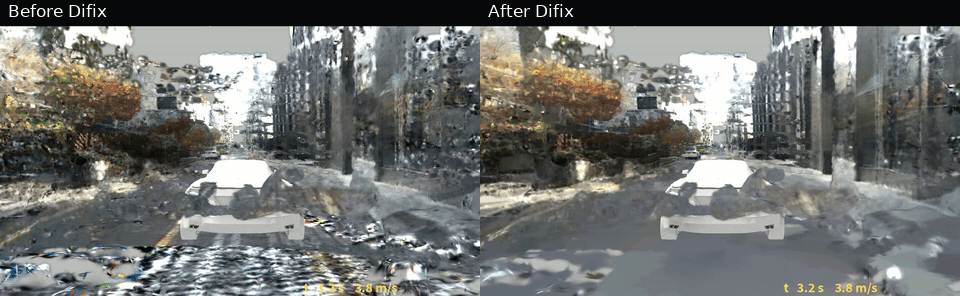

* ADI forward40 Genesis Nyx 주행. 왼쪽 = Difix 전 (5 fps 학습 모델), 오른쪽 = 15 fps 학습 모델 + Difix (2배속)

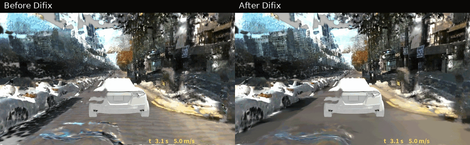

* ADI seq60 Genesis Nyx 주행. 왼쪽 = Difix 전, 오른쪽 = Difix 후 (4배속)

#### 한계

| 한계 | 현상 |
|---|---|
| 없던 세부 생성 | 생성 모델이라 색·그림자를 지어낼 수 있음. seq60 일부 구간에서 노란 차선이 끊겨 보임 (실제 영상과 미대조) |
| 노면 질감 | 얼룩과 함께 노면 질감도 매끈해짐 |
| 형상 문제는 못 고침 | mesh 가 없거나 틀린 곳의 하늘 쪽 구멍, 건물 번짐은 남음 |
| 라이선스 | 체크포인트 `nvidia/difix_ref` 는 연구·비상업 라이선스. 외부 제품에 쓰려면 확인 필요 |

## 5. Genesis 주행

- collider 는 물리·raycast 전용으로 화면에 그리지 않음. 화면은 Nyx 가 splat 으로 그림
- 차량은 고정 링크 병합을 끈 URDF 로 불러옴 (Nyx 제약). 바퀴는 아직 화면에 안 보임
- 검증: 주행 경로대로 완주하는지, 학습에 안 쓴 프레임 화질, 주행 카메라 시점에서 깨지는 곳이 없는지

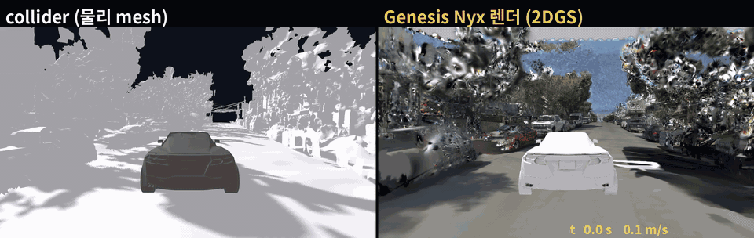

* 왼쪽 = collider (물리 mesh), 오른쪽 = Genesis Nyx 화면 (2배속, 원본 [mp4](../../res_wjdaksry/1107/pai_ground_drive_side.mp4))

> 노면 원판을 바퀴용으로 스무딩한 LiDAR 노면에 옮긴 뒤 재학습함 &rarr; 원판 99.7% 가 collider 5 mm 안, 바퀴가 도로 속으로 들어가 보이던 현상 사라짐. 카메라는 차체 자세에 고정 (기울어진 노면에서 차가 화면에 똑바로 보임).

## 6. 디테일 처리 기준

| 대상 | 처리 | 이유 |
|---|---|---|
| 나무·기둥·표지판·건물 앞면 | LiDAR 형상 + 2DGS 색 | 형상이 있어야 색이 제자리에 붙음 |
| 노면 | 관측 = LiDAR, 미관측 = 정밀도로지도 바닥. 2DGS + 노면 제약 | 요철은 LiDAR, 빈 차로는 지도 |
| 노면 얼룩·차량 그림자 | 정밀도로지도 노면표시·아스팔트 색으로 채움 | 지나간 차량 흔적 제거 |
| 정차 차량 | 지우고 노면을 채움 | VLP-16 으로 만든 차 형상은 덩어리라 모자이크로 보이고, 차 색이 노면·벽에 번짐 |
| 영상에 안 찍힌 면 (V-World 위층·뒷면) | 그 면에 Gaussian 을 만들어 채움 (예: V-World 3D 지도 화면을 투영한 색) | Gaussian 이 없으면 Nyx 화면에서 비어 보임 |
| 객체 복사 | 하지 않음 | 미관측 영역은 바닥과 건물 면만 채움 |

## 7. LiDAR 가 계속 필요한 이유

- 지도에 없는 디테일(나무, 기둥, 표지판, 연석, 차양)과 노면 요철을 줌
- 카메라 위치가 LiDAR 궤적에서 나옴 — 궤적을 지도에 맞추면 카메라 위치도 같이 맞춰짐
- 지도가 국소적으로 맞는지(도로 변경, 외곽선 오차) 재는 기준이 LiDAR 임
- LiDAR 가 없는 구간(테헤란로)은 지도 + 카메라만으로 만들고, 장난감 수준을 허용함
