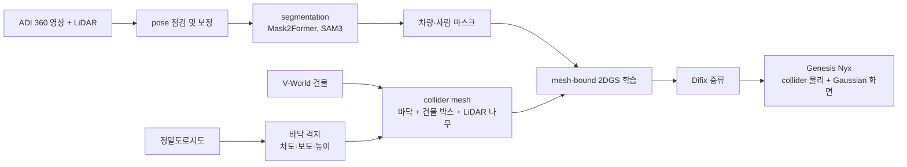
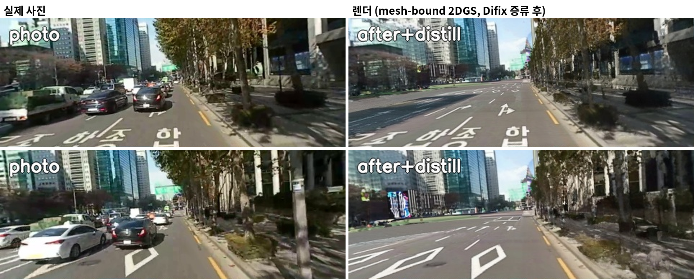
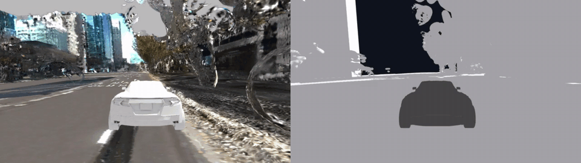
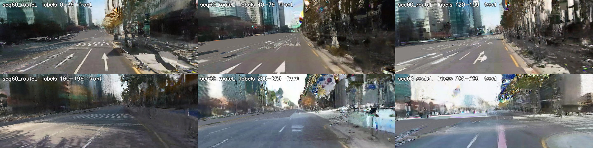
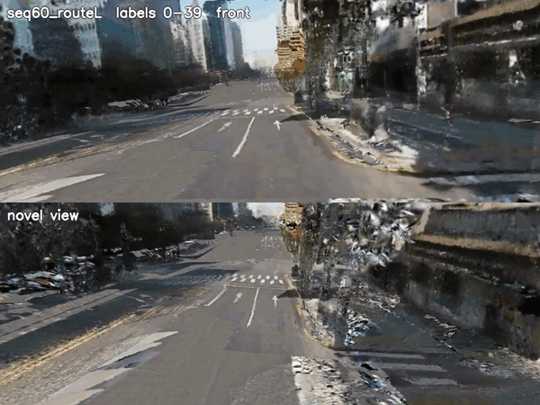
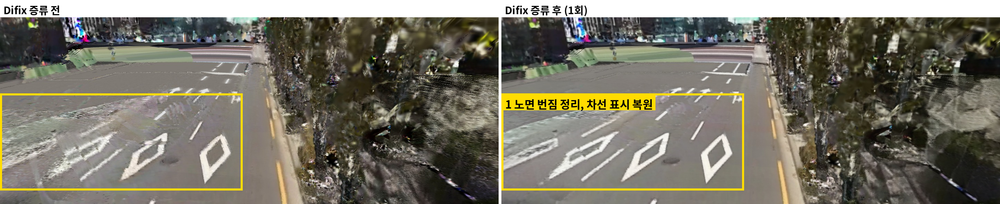
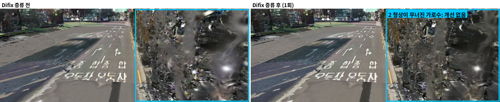
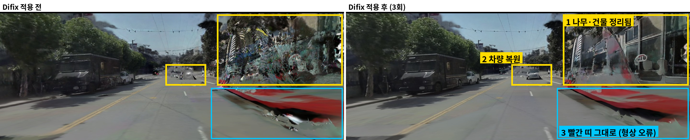
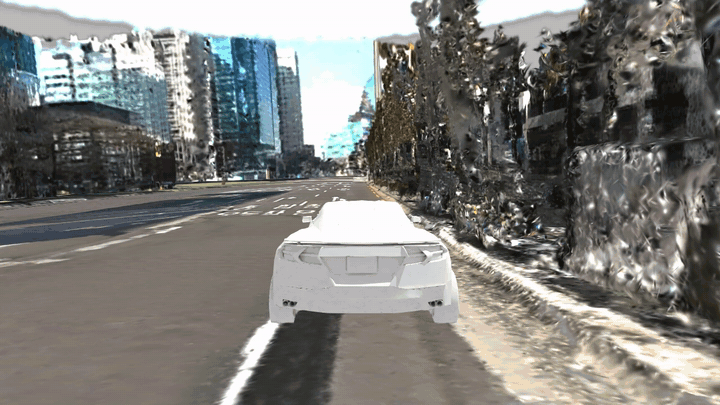

# 11-12 연구 현황 보고

> 11/13 기준 진행 상황. Alpamayo 주행을 Genesis에서 닫힌 루프로 돌리기 위한 ADI 실주행 씬 구축

## 용어

| 용어 | 설명 |
|---|---|
| ADI | 자체 실주행 데이터(카메라 + LiDAR). 대상 구간 seq60(구간 명칭) |
| mesh-bound 2DGS | LiDAR mesh 위에 2D Gaussian을 붙여 색만 학습하는 방식. 형상은 collider와 같음 |
| Genesis Nyx | Genesis의 Gaussian 렌더러 플러그인. 물리는 collider mesh, 화면은 Gaussian |
| 정밀도로지도 | 국토지리정보원 HD map. 차도 노면 높이와 차선에 사용 |
| Difix distillation | 학습된 씬을 옆으로 옮긴 카메라에서 렌더하고, Difix3D로 고친 이미지를 다시 학습에 넣는 방식 |
| holdout PSNR | 학습에 쓰지 않은 실제 프레임과 렌더 결과의 일치도. 높을수록 좋음 |
| novel view | 실제 주행 카메라에서 벗어난 시점(옆 차로, 차량 뒤 카메라 등). 학습 사진이 없는 시점 |

## 요약

**결과**
- seq60 블록 80(label 80에서 120) 씬을 인도는 LiDAR, 차도는 정밀도로지도로 구성함. holdout PSNR 18.70
- Difix 증류 1회로 18.76. 궤적 위 수치는 거의 그대로이고, novel view에서 형상이 맞는 노면만 좋아짐
- 경로 전체(label 0에서 300)를 같은 방식으로 구성함. 위치별 높이 보정을 넣어 바닥이 뜨는 문제를 해결함
- Genesis Nyx에서 collider 위로 차량 주행 확인함

**미해결**
- novel view 화질. 나무와 건물이 옆에서 보면 크게 무너짐
- 경로 후반(label 200 이후) 화질 저하와 하늘 영역 흰 번짐
- 기존 차량 Gaussian 제거 후 바닥 채움

## 현재까지

### 1. 씬 구축 파이프라인

| 단계 | 내용 |
|---|---|
| 형상 | 차도는 정밀도로지도, 건물은 V-World 박스, 나무·인도는 LiDAR |
| 화면 | ADI 영상으로 mesh 위 Gaussian 색 학습. 차량·사람은 마스크로 제외 |
| 실행 | 구간마다 config 하나로 전 단계 실행. 단계마다 실행 기록 남음 |

### 2. seq60 블록 80 씬

* 같은 프레임의 실제 사진과 렌더. 렌더에서는 주변 차량이 빠지고 차선, 노면 문자, 그림자가 맞음
* holdout PSNR 18.76 (학습에 쓰지 않은 프레임 기준)

### 3. Genesis 주행

* Nyx 화면과 collider mesh 비교. 바퀴가 collider 위로 주행함

| 항목 | 값 |
|---|---|
| 주행 거리 | 40.4 m |
| 진행률 | 98.9 % (목표 도달) |
| 경로 추종 CTE 최대 | 0.018 m |

### 4. 경로 전체 (label 0에서 300)

* 구간별 정면 카메라 렌더 6장
* 높이 보정을 위치별로 바꿔 바닥이 뜨던 문제(최대 0.78 m) 해결. 후반 구간 화질은 낮음

* 위는 정면 카메라, 아래는 novel view(차량 뒤 카메라). 2배속

---

### 5. 스트릿뷰 준비

| 항목 | 상태 |
|---|---|
| 네이버 지도 API | 등록 완료, 무료 한도 안으로 사용량 제한 설정 |
| 정합 코드 | LightGlue 설치, ADI 프레임 매칭 확인 (인접 프레임 977쌍, 20 label 차이 328쌍) |
| 수집 | 네이버 동의 전이라 수집하지 않음 |

### 6. Difix 증류 실험 (전후 비교)

> 비교마다 Difix 증류 하나만 바꿈. 씬 구성, mesh, 카메라는 같음

#### seq60 블록 80, novel view

* 1 왼쪽 차로: 늘어진 노면 번짐이 정리되고 마름모 표시와 차선이 또렷해짐

* 2 오른쪽 가로수: 형상 자체가 무너진 곳은 Difix 증류 후에도 개선 없음

| 구성 | holdout PSNR (궤적 위) |
|---|---|
| Difix 증류 전 | 18.70 |
| Difix 증류 1회 | **18.76** |

**궤적 위 수치는 거의 그대로임. novel view에서도 형상이 맞는 노면만 좋아지고, 형상이 무너진 곳은 그대로임**

#### Alpamayo 데이터, novel view (옆으로 옮긴 카메라)

* 노란 박스는 Difix로 좋아진 곳, 파란 박스는 그대로인 곳
* 1 나무·건물: 깨진 Gaussian 조각이 정리되어 건물 창과 나무 윤곽이 보임
* 2 먼 차량: 뭉친 덩어리가 차량 형태로 복원됨
* 3 빨간 띠: 형상(mesh) 자체가 틀린 곳이라 Difix로 고쳐지지 않음

#### Difix 증류 후 주행 영상

* Genesis Nyx에서 seq60 블록 80 주행, novel view(차량 뒤 카메라). Difix 증류 2회 적용 후

## 현재 진행 중

novel view 화질 문제를 풀기 위해 아래 논문을 읽는 중임.

| 대상 | 보는 이유 |
|---|---|
| 스트릿뷰 기반 씬 표현 (Urban Radiance Fields 등) | 주행 경로 밖 시점의 실제 사진을 추가 학습 시점으로 쓰는 방법 |
| Difix3D | 지금 쓰는 증류 방식의 원 논문. 효과가 작은 원인 확인 |
| Difix3D+ | 학습 중 증류와 렌더 후 보정을 함께 쓰는 확장판 |
| ArtiFixer | novel view 렌더 결함 보정의 대안 |

## 진행 방향

| 순서 | 내용 |
|---|---|
| 1 | 논문 정리 및 실험(difix3D/3D+, ArtiFixer, 스트릿뷰 연구) |
| 2 | 스트릿뷰는 정합 코드(LightGlue + PnP)는 준비 완료 |
| 3 | 기존 차량 Gaussian 제거 후 바닥 채움. LaMa와 SDXL Inpainting 비교 |
| 4 | 블록 단위에서 경로 전체로 확장하고 Genesis 주행 영상으로 확인 |
