# Difix3D+로 novel view 선명하게 하기 — 논문 핵심과 우리 맵 적용 결과

> LiDAR noise로 깨지는 novel view를 Difix3D+(CVPR 2025 Oral, NVIDIA)로 고치려 함. 논문 핵심을 정리하고, 우리 맵에 적용한 방법과 전후 결과를 정리함

## 용어

| 용어 | 설명 |
|---|---|
| novel view | 실제 주행 카메라에서 벗어난 시점. 학습 사진이 없는 시점 (예: 차 뒤 추종 카메라, 옆 차로) |
| Difix | 렌더 이미지의 결함을 한 번에 고치는 diffusion 모델. SD-Turbo를 미세조정함 |
| Difix3D | Difix로 고친 이미지를 다시 3D 학습에 넣는 방식(증류) |
| Difix3D+ | Difix3D에 더해 최종 렌더 화면에도 Difix를 한 번 더 적용하는 방식 |
| 점진적 3D 업데이트 | 학습 카메라에서 목표 시점 쪽으로 카메라를 조금씩 옮기며 증류를 반복하는 방식 |
| 참조 사진 | Difix에 함께 넣는 가장 가까운 실제 사진. 색과 질감의 기준이 됨 |
| mesh-bound 2DGS | LiDAR, 정밀도로지도, V-World mesh 위에 Gaussian을 고정하고 색만 학습하는 우리 방식 |
| DL3DV | 손으로 들고 찍은 사진 데이터셋. 공개 Difix 가중치의 학습 데이터 |
| RDS | NVIDIA 내부 주행 데이터셋. 논문의 주행 실험 모델이 이것으로 학습됨 |
| NVIDIA Fixer | 같은 계열 후속 모델(2025년 11월). 주행 데이터로 학습되고 상업적 사용 가능 |

## 1. 문제 정의

> 우리 맵은 학습 카메라 궤적 위에서는 맞지만, Genesis 주행 카메라처럼 궤적을 벗어난 novel view에서 깨짐 → Difix3D+로 novel view 렌더를 선명하게 고치고, 고친 이미지를 다시 맵에 증류하려 함

| 결함 | 원인 | novel view에서 보이는 모습 |
|---|---|---|
| 형상 noise | VLP-16(16줄) LiDAR mesh가 성김. 나무·가로수·차량이 덩어리나 판처럼 펴짐 | 가로수가 벽처럼 늘어나 보이고, 색이 판 위에 번짐 |
| 색 늘어붙음 | 색만 학습하므로 형상이 틀린 곳에 사진 색이 그대로 붙음 | 학습 시점에서는 맞지만 시점을 옮기면 얼룩으로 드러남 |
| 관측 부족 | 학습 사진은 ADI 4방향 카메라 궤적 위에서만 있음 | 옆 차로, 차 뒤 시점, 건물 위층에서 흐리거나 비어 보임 |

* 목표: novel view 렌더를 Difix로 고침 → 고친 이미지를 학습에 추가 → 맵 자체가 novel view에서 선명해짐
* 판단 기준은 **novel view에서 눈으로 본 화질**임

## 2. Difix3D+ 핵심

```
[1] 실제 사진으로 3D 학습
      │
[2] 학습 카메라를 목표 시점 쪽으로 조금 옮겨 렌더
      │
[3] Difix(렌더 + 가장 가까운 실제 사진)로 결함을 고침
      │
[4] 고친 이미지를 학습 데이터에 추가해 3D 재학습 → [2]로 돌아가 조금 더 옮김 (1,500 iteration마다)
      │
[5] 최종 렌더에도 Difix를 한 번 더 적용 (Difix3D+)
```

### 2.1 Difix 모델

| 항목 | 내용 |
|---|---|
| 기반 | SD-Turbo. 인코더는 고정하고 디코더는 LoRA로 학습 |
| 입력 | 결함 있는 렌더를 노이즈 대신 넣고 timestep 200에서 한 번만 복원 |
| 참조 사진 | 가장 가까운 학습 사진을 함께 넣고 attention으로 섞음 |
| 손실 | L2, LPIPS, Gram(스타일) 손실 |
| 학습 해상도 | 576x1024 |

### 2.2 학습 데이터 만드는 법

| 데이터 | 결함 이미지 만드는 법 | 규모 |
|---|---|---|
| DL3DV(기본 물체 difix 학습 데이터) | 프레임을 듬성듬성 빼고 학습, 또는 학습을 25%에서 75%만 진행 | 장면 112개, 이미지 쌍 8만 개 |
| RDS (내부 주행 데이터) | NeRF를 학습하고 1 m에서 6 m 옆으로 옮긴 경로를 렌더한 뒤, 그 렌더로 NeRF를 다시 학습함(cycle reconstruction) | 장면 40개, 이미지 쌍 10만 개 |

**주행용 Difix는 "옆으로 1~6 m 옮긴 시점의 결함"을 직접 학습했음 — 공개 가중치는 이 데이터를 보지 못했음**

### 2.3 논문 결과

* 주행 데이터에서 가운데 카메라로만 학습하고 양옆 카메라 시점을 고쳤을 때, 흐림과 잔상이 줄고 선명해짐
* 수치보다 보기 좋은 정도를 올리는 방법임. 한 번에 옮기는 거리는 논문에 숫자로 나오지 않음

### 2.4 논문이 밝힌 한계

* 처음 3D 복원 품질에 묶여 있음. 복원이 완전히 실패한 곳은 고치지 못함
* 관측이 적은 곳은 세부를 지어내고, 시점마다 다르게 지어낼 수 있음
* 입력 사진에서 멀어질수록 조건이 약해져 지어내는 부분이 늘어남

## 3. 우리 맵에 적용한 방법

```
mesh-bound 2DGS 맵 (LiDAR + 정밀도로지도 + V-World mesh, 색만 학습)
      │
novel view 렌더: 궤적에서 좌우 1.5 m, 뒤 6 m 옮긴 카메라
      │
nvidia/difix_ref (+ 가장 가까운 ADI 사진) 로 고침, 1440x536
      │
고친 이미지를 가중치 0.5로 학습에 추가 → 3회 반복
```

| 항목 | 논문 | 우리 |
|---|---|---|
| 3D 표현 | NeRF, 3DGS — 위치·투명도까지 바뀜 | mesh 위 2DGS — 색만 바뀜 |
| Difix 가중치 | 주행 결과는 RDS 학습 모델 (비공개) | 공개 nvidia/difix_ref (DL3DV만 학습) |
| 해상도 | 576x1024 | 1440x536 (가로가 길고 세로가 짧음) |
| 카메라 이동 | 조금씩 점진적으로 | 첫 회부터 좌우 1.5 m, 뒤 6 m로 바로 이동 |

* 변형으로 **지도 기반 Difix**도 시험함: 정밀도로지도 노면 표시를 입력과 정답에 고정

## 4. 결과: 기존 파이프라인과 Difix progressive

> seq60 블록 80에서 왼쪽 카메라를 학습에서 완전히 빼고, 그 왼쪽 카메라 실제 사진 40장을 정답으로 비교함. 학습에 없던 시점이라 novel view 화질을 수치로 잴 수 있음

| 항목 | 설정 |
|---|---|
| 맵 | mesh-bound 2DGS, 뒤, 앞, 오른쪽 카메라로만 학습 |
| Difix | 공개 nvidia/difix_ref, 참조 사진은 같은 지점을 보는 학습 사진 |
| 가상 시점 | 주행 방향 카메라를 왼쪽 카메라 쪽으로 30도, 60도, 90도 돌린 시점, 학습 지점 32곳 |
| 기존 파이프라인 | 가상 시점 160장을 처음 맵에서 한 번에 렌더하고 고쳐서 한 번 학습함 |
| Difix progressive | 30도 시점으로 학습한 맵에서 60도 시점을 렌더하고, 다시 그 맵에서 90도 시점을 렌더함. 3번 학습함 |
| 공통 | 가상 시점의 차량 영역은 학습에서 뺌 |

| 방법 | PSNR (높을수록 좋음) | LPIPS (낮을수록 좋음) |
|---|---|---|
| Difix 없음 | 13.57 | 0.693 |
| 렌더에 Difix만 적용, 증류 없음 | 13.11 | 0.651 |
| 기존 파이프라인 | **13.80** | 0.641 |
| Difix progressive | 13.62 | **0.635** |
| 참고: 같은 맵을 학습한 방향에서 잰 값 | 17.49 | 0.386 |

**두 방법의 차이는 LPIPS 0.006으로 사실상 같음.** Difix 증류 자체의 효과도 LPIPS 0.05 정도임

* 학습한 방향의 값(LPIPS 0.386)과 비교하면 novel view에는 LPIPS 0.25 차이가 그대로 남음
* 카메라를 조금씩 옮기는 방식으로 바꿔도 이 차이는 줄지 않음

### 4.1 장면별 비교 (위부터 실제 사진, 기존 파이프라인, Difix progressive)

#### 장면 1: 왼쪽 카메라 85번

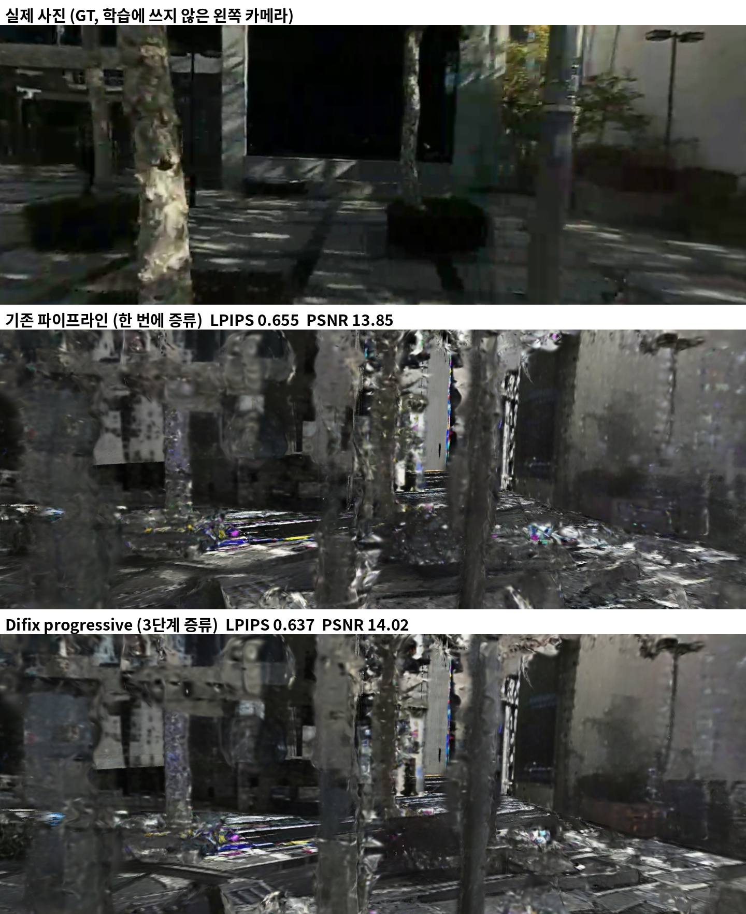

* 실제 사진에는 나무가 왼쪽에 하나인데, 렌더에는 화면 가운데에 줄기 서너 개가 서 있음
* 건물 입구는 사각형 조각 무늬가 되고, 바닥에는 보라색과 노란색 조각이 흩어짐
* 두 방법 모두 같은 자리에 같은 구조가 보임. 다른 것은 잡음의 양뿐임

#### 장면 2: 왼쪽 카메라 100번

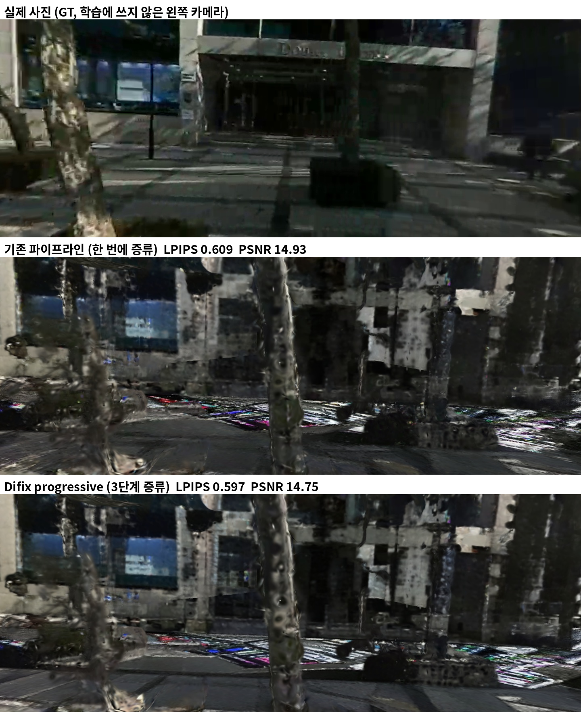

* 실제 사진은 건물 입구와 화단인데, 렌더는 화면 가운데에 큰 나무 줄기가 서 있음
* 건물 벽은 실제 모양 대신 사각형 조각이 이어 붙은 무늬로 보임
* 바닥에는 형광색 줄무늬가 남음. 다른 각도에서 학습된 색이 이 시점에서 드러난 것임

#### 장면 3: 왼쪽 카메라 115번

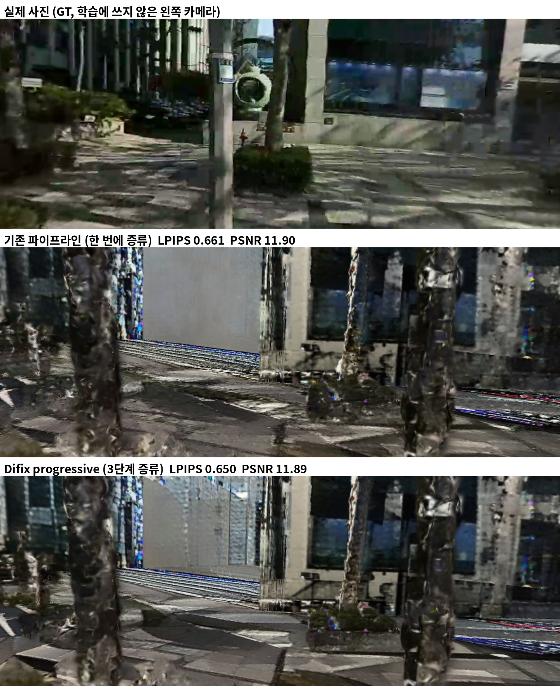

* 실제 사진의 전봇대, 조형물, 화단 대신 렌더에는 큰 나무 줄기 두 개와 무늬 없는 회색 벽이 보임
* Difix progressive는 그 회색 벽에 창문 같은 무늬를 그려 넣었음. 실제 사진에는 없는 무늬임
* 구조 자체는 두 방법이 같음

### 4.2 옆면 확대: 잡음은 지우지만 형상은 그대로

> 4방향 카메라를 모두 학습한 블록 80 맵을 궤적 밖 시점 3곳에서 원본 해상도로 렌더하고, 좌우 옆면만 잘라 확대함. 왼쪽은 Difix 없음, 오른쪽은 지금 파이프라인(Difix 2회 증류)

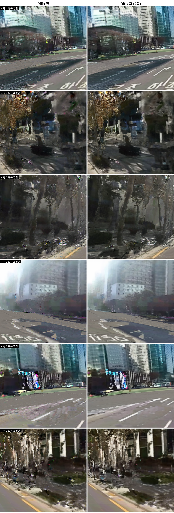

* 건물 벽, 노면, 그림자 경계의 자글자글한 점 잡음은 지워짐
* 나무는 줄기와 잎이 세로로 늘어진 모양이 그대로이고, 간판 위치의 알록달록한 얼룩도 남음
* Difix는 없던 세부를 만들지 않았음. 옆면이 좋아 보이는 것은 잡음이 빠졌기 때문임

### 4.3 할루시네이션: 형상이 틀린 렌더를 Difix가 다른 장면으로 바꿈

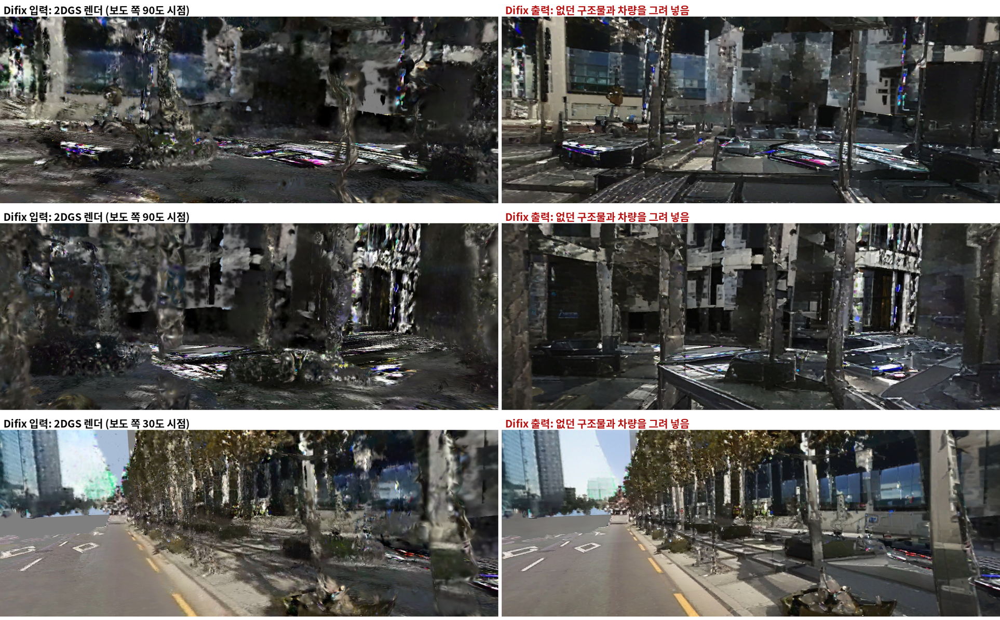

* 왼쪽은 Difix에 넣은 렌더, 오른쪽은 Difix 출력임. 보도 쪽으로 크게 돌린 가상 시점일수록 심함
* 렌더에서 형상이 무너진 곳을 Difix가 유리 부스, 난간, 탁자 같은 구조물이나 주차된 차량으로 그려 넣음. 실제 장소에는 없는 것임
* 가상 시점에서 Difix가 그린 차량 영역은 평균 9%에서 15%였고, 가장 많은 시점은 화면의 43%였음
* 이 이미지를 그대로 학습하면 없는 구조물의 색이 mesh 위에 칠해짐. 차량은 마스크로 뺐지만 구조물은 뺄 방법이 없음

### 4.4 ADI 경로 전체: 실제 사진과 Difix 전후

> 4방향 카메라로 학습한 ADI 경로 전체 맵(11/09)에서 학습에 안 쓴 프레임을 렌더함. 위부터 실제 사진, Difix 전, Difix 3회 증류 후. 시점은 궤적 위라 형상 오류가 덜 드러나는 쪽임

#### forward40 rear 160 — 실제 사진

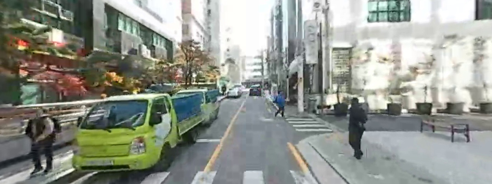

#### forward40 rear 160 — Difix 전

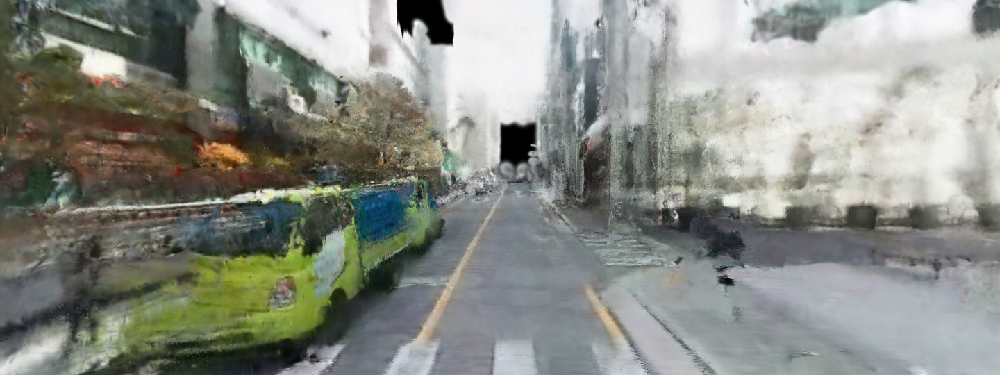

#### forward40 rear 160 — Difix 후

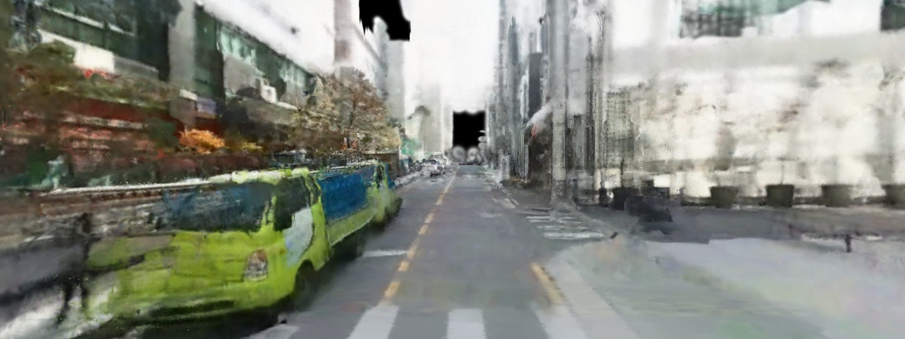

* 노면과 보도 경계의 점 잡음이 줄어듦
* 트럭과 보행자, 오른쪽 건물 벽의 번진 형상은 그대로임

#### forward40 front 45 — 실제 사진

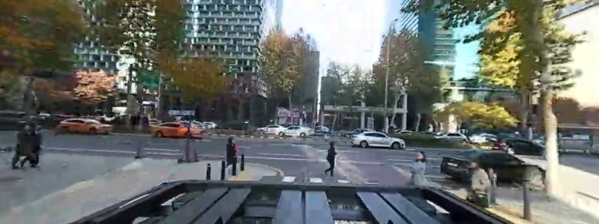

#### forward40 front 45 — Difix 전

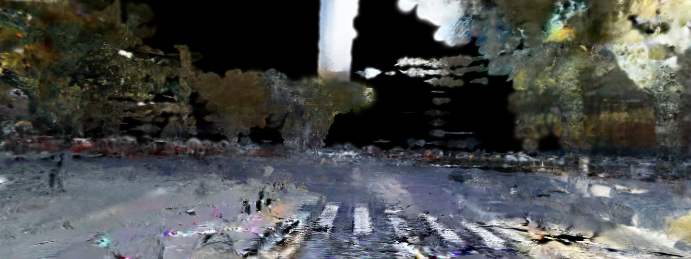

#### forward40 front 45 — Difix 후

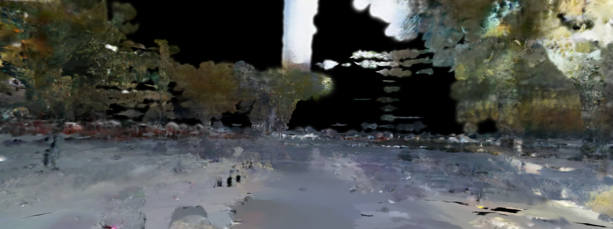

* 교차로 노면에 흩어져 있던 색 조각이 사라짐
* 나무와 건물은 뭉개진 채이고, 하늘의 검은 빈 곳도 그대로임

#### seq60 rear 25 — 실제 사진

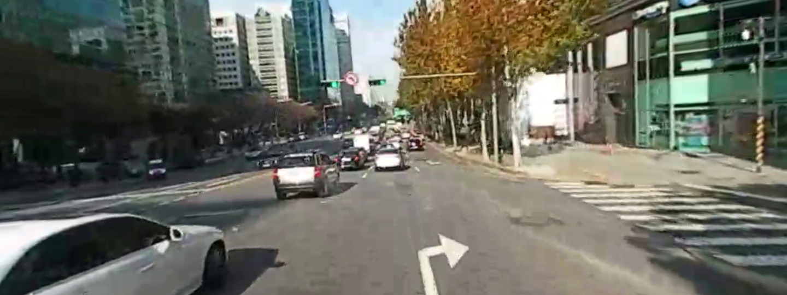

#### seq60 rear 25 — Difix 전

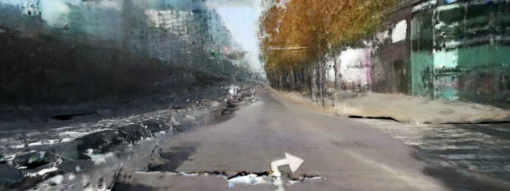

#### seq60 rear 25 — Difix 후

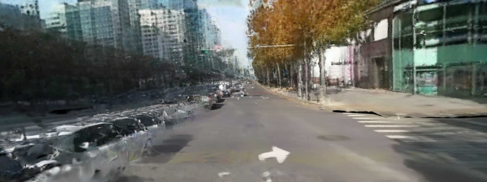

* 노면 화살표 주변의 깨진 조각이 정리되고 노면이 매끈해짐
* 왼쪽 주차 차량들은 덩어리 모양 그대로임

#### seq60 front 200 — 실제 사진

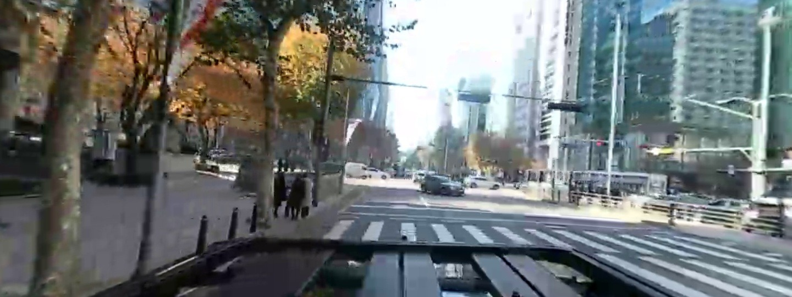

#### seq60 front 200 — Difix 전

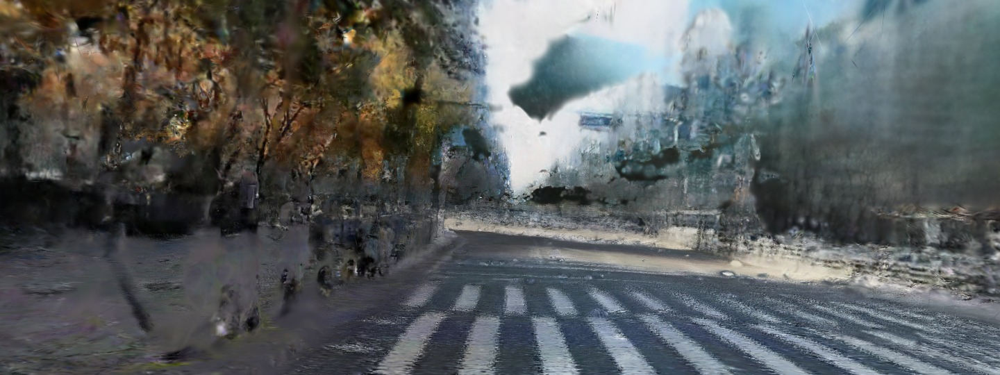

#### seq60 front 200 — Difix 후

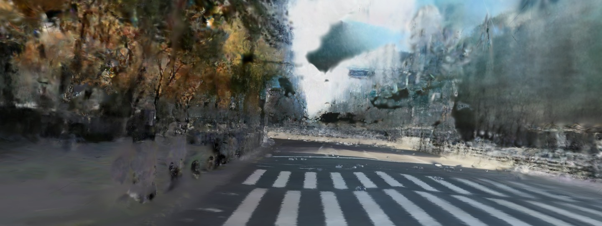

* 횡단보도 줄무늬가 또렷해지고 보도의 잡음이 줄어듦
* 나무와 건물, 하늘은 그대로임

**궤적 위에서도 4.2와 같은 결과임 — 노면 잡음은 지우지만 나무, 건물, 차량의 형상은 바꾸지 못함**

## 5. 결론: mesh 형상이 정확해야 함

**Difix는 형상이 맞는 곳의 색 잡음만 고침. 우리 맵의 novel view 오차는 대부분 형상이 틀린 데서 오므로, 증류 방식을 바꾸는 것보다 mesh를 정확하게 만드는 것이 먼저임**

| 근거 | 관찰 | 수치 |
|---|---|---|
| 1. 증류 방식은 결과를 바꾸지 못함 | 한 번에 증류와 점진적 증류가 같은 결과 | LPIPS 0.641과 0.635 |
| 2. 남은 오차가 증류 효과보다 훨씬 큼 | novel view와 학습 방향의 차이가 그대로 남음 | 증류 효과 LPIPS 0.05, 남은 차이 0.25 |
| 3. 렌더러는 원인이 아님 | 같은 mesh에 2DGS와 3DGS를 써도 같음 | 모든 단계에서 LPIPS 차이 0.01 이내 |
| 4. 형상이 움직일 수 있으면 수치가 크게 오름 | 위치까지 학습하는 free 3DGS는 같은 사진으로 훨씬 높음 | 왼쪽 카메라 PSNR 13.57에서 16.05, 학습 방향 17.49에서 21.87 |
| 5. 눈으로 보는 오류가 형상 오류임 | 없는 나무 줄기, 실제와 다른 벽, 판처럼 펴진 가로수 | 4.1, 4.2 그림 |
| 6. 형상이 틀리면 Difix가 지어냄 | 무너진 렌더를 다른 구조물로 바꿈 | 4.3 그림, 차량 영역 최대 43% |

* 4번의 free 3DGS는 novel view에서 형상이 흐려져 보기 좋지 않아 쓰지 않기로 했음. 그래도 형상이 사진에 맞게 바뀔 수 있을 때 수치가 크게 오른다는 점은 형상이 병목이라는 근거가 됨
* 경로 전체 Nyx 주행 화면이 흐린 원인도 같은 방향임. 렌더러와 영상 압축은 원인이 아니었고, 흐린 2019년 ADI 사진, V-World 상자 건물, 거친 나무 mesh가 원인이었음

### 다음에 할 것

| 항목 | 내용 |
|---|---|
| 건물 형상 | V-World 상자 대신 스트릿뷰 사진으로 건물 mesh 생성. 동욱 학생의 생성 모델 방식(건물별 사진 9장, 윤곽 기둥 틀, 정리 규칙, 사진 텍스처)을 적용 |
| LiDAR 범위 | 지금은 거리 40 m와 높이 9 m에서 잘려 있음. 제한을 풀면 경로를 향한 낮은 벽의 21%를 LiDAR로 확인할 수 있음 |
| 나무 형상 | 증류로는 못 고침. 나무 형상 자체를 바꾸는 시험을 따로 진행 |
| Difix 모델 | 형상을 고친 뒤 주행 데이터로 학습한 NVIDIA Fixer와 비교 |

<sub>출처: Difix3D+ 논문 https://arxiv.org/abs/2503.01774 , 공개 가중치 https://huggingface.co/nvidia/difix_ref , NVIDIA Fixer https://huggingface.co/nvidia/Fixer</sub>
