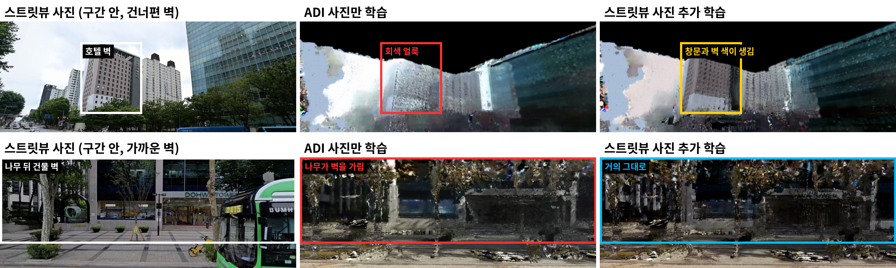
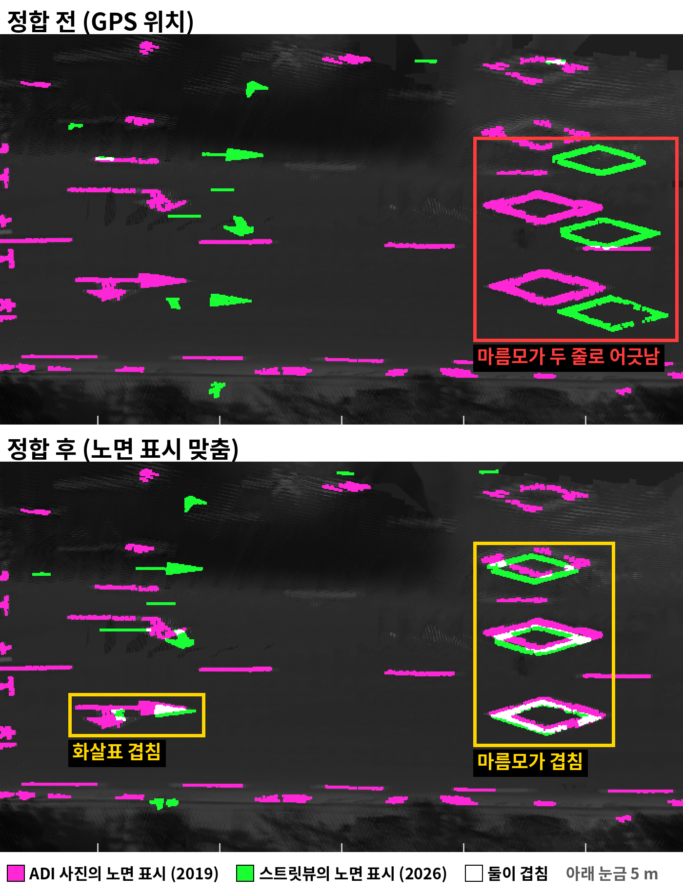

# Difix와 스트릿뷰로 궤적 밖 화질 올리기 시도 결과

> 11/14에서 11/16 진행. seq60 블록 80에서 학습 궤적을 벗어난 시점(Genesis 주행 카메라)의 화질을 올리려 함

## 요약

| 시도 | 결과 | 효과 |
|---|---|---|
| Difix 증류 | 노면 잡음만 줄어듦. 나무와 건물은 그대로 | 작음 |
| 스트릿뷰 사진 추가 학습 | ADI가 못 본 건물 벽은 채워짐. 원래 주행 시점에는 얼룩 | 섞임 |
| 구조 나무 | 수관 끝 잡음만 조금 줄어듦 | 작음 |
| 안 본 바닥 채움 | 차선 복원, 노면 글자 유지 | 큼 |

**병목은 Difix가 아니라 mesh geometry(나무, 건물)와 adi 영상 화질임. 나무 개선 방향 결정이 필요**

* 우리 방식은 형상이 mesh로 고정되고 색만 학습함. 그래서 Difix나 스트릿뷰로 색을 고쳐도 형상이 틀린 곳(나무, 건물)은 안 바뀜

## 용어

| 용어 | 설명 |
|---|---|
| 궤적 위 / 밖 | ADI 카메라가 지나간 위치 / 거기서 벗어난 위치 |
| mesh-bound 2DGS | mesh 위에 Gaussian을 고정하고 색만 학습하는 우리 방식. 화면 형상 = 물리 collider |
| Difix 증류 | 가상 시점 렌더를 Difix(NVIDIA diffusion 모델)로 고치고 다시 학습에 넣는 방식 |
| 수관 | 나무의 잎이 달린 윗부분 |

* 그림 박스: **빨강 = 문제, 노랑 = 좋아짐, 파랑 = 변화 없음, 흰색 = 실제 사진 위치 표시**
* 그림 순서: 실제 사진 → 전 → 후

## 1. 문제: 궤적 밖에서 깨짐

#### 그림 1. Genesis 주행 화면 (궤적 밖, 11/15 경로 전체 맵)

| 원인 | 내용 | 대응 |
|---|---|---|
| 관측 부족 | 학습 사진이 ADI 궤적 위에만 있음 | Difix 가상 사진, 스트릿뷰 사진 (2장) |
| 형상 오류 | LiDAR가 성겨서 나무, 건물 mesh가 실제와 다름 | 나무, 바닥 직접 수정 (3장) |

## 2. 관측 부족 대응

### 2.1 Difix: 노면만 좋아짐

#### 그림 2. Difix 전후 (궤적 위, 학습에 안 쓴 ADI 프레임)

* 노면은 잡음이 사라짐. 정밀도로지도로 만들어 형상이 맞는 곳임
* 나무, 건물은 그대로임. mesh가 틀린 곳임
* 나무와 보도까지 넓힌 전체 화면 Difix, 스트릿뷰를 참조로 쓴 Difix도 변화가 거의 없었음

**Difix는 형상이 맞는 곳의 색 잡음만 고침**

### 2.2 Difix 할루시네이션

#### 그림 3. 보도 쪽으로 30도, 90도 돌린 가상 시점 (궤적 밖)

* 무너진 렌더에 Difix가 유리 부스, 탁자, 기둥 같은 없는 구조물을 그려 넣음
* 이걸 학습하면 없는 구조물 색이 mesh에 칠해짐. 그래서 Difix 이미지 비중을 낮게 둘 수밖에 없음
* Difix를 두 번 반복하면 오히려 나빠짐. GT 이미지 해상도가 낮아 diffusion model이 형상을 제대로 판단하지 못한 것일 가능성도 있음

### 2.3 스트릿뷰 사진 추가 학습

* 스트릿뷰(2026년 7월)를 ADI(2019년 가을) 좌표에 맞춰 학습에 추가함. 맞추는 방법은 부록 A
* 스트릿뷰는 건물 벽 픽셀만 학습에 씀

#### 그림 4. 궤적 밖: 도로 건너편 교차로 (학습에 안 쓴 스트릿뷰 위치)

* 건물 벽: 회색 얼룩 → 창문 있는 흰 벽과 입구가 생김
* 나무: 그대로 깨짐. 하늘, 나무, 바닥은 스트릿뷰로 학습하지 않아 ADI 결과 그대로임

#### 그림 4b. ADI 구간 안의 스트릿뷰 시점

* 위 줄(건너편 약 90 m 호텔 벽): 갈색 벽과 창문 줄이 뚜렷하게 생김
* 아래 줄(가까운 벽): 나무 mesh가 앞을 가려 거의 같음(가우시안 강제 제약의 한계 추정)

#### 그림 5. 궤적 위: 원래 주행 시점 (학습에 안 쓴 ADI 프레임)

* 건물 모서리에 흰 번짐, 건물 밑에 검은 조각이 생김. 2026년 색이 2019년 벽에 섞인 것으로 추정됨

**스트릿뷰는 ADI가 못 본 건물 벽을 채워 주지만, 원래 주행 시점에는 연도 차이로 얼룩을 남김. 나무에는 효과 없음**

## 3. 형상 직접 수정

### 3.1 구조 나무 (LiDAR 기반 나무 골격 복원)

**목표**: LiDAR mesh로는 덩어리로 나오는 가로수를 줄기, 가지, 잎이 있는 형상으로 바꿔 궤적 밖에서도 나무 모양이 유지되게 함

**방법**: 레이저 스캔 점에서 나무 골격을 복원하는 기존 방식[1]을 따름. 점을 그래프로 만들고, 줄기 밑동에서 최단 경로 트리를 구해 골격으로 씀. 같은 계열로 [2], [3]이 있음

| 단계 | 알고리즘 / 자료구조 | 근거 | 우리 설정 |
|---|---|---|---|
| 1. 줄기 검출 | DBSCAN 밀도 군집 | [4] | 지면 위 0.6에서 2.4 m의 가늘고 수직인 점 군집 |
| 1-1. 나무 구분 | 최근접 줄기 배정 (줄기 위치 기준 Voronoi 분할) | - | 각 점을 6 m 안에서 가장 가까운 줄기에 배정 |
| 2. 점 정리 | 복셀 다운샘플링 → 그래프 노드 | [1] | 0.25 m 복셀 하나 = 노드 하나 |
| 3. 이웃 그래프 | 반경 그래프 (노드, 간선) | [1] | 0.6 m 안의 노드를 간선으로 연결 |
| 4. 골격 | Dijkstra 최단 경로 트리 | [1], [5] | 줄기 밑동을 root로 각 노드의 부모를 정함 |
| 5. 가지 정리 | 자손 수 기준 가지치기 | [1], [3] | 자손 노드가 적은 가지를 잡음으로 제거 |
| 6. 가지 굵기 | Pipe model (단면적 ∝ 위에 달린 가지 양) | [6] | 간선마다 원기둥 mesh |
| 7. 잎 | 잎 카드 | [1] | 0.25 m 사각 판을 가지 끝과 수관 안에 배치 |

* 적용: seq60 블록 80 가로수 28그루
* 각 단계의 알고리즘은 논문의 방식이지만, 표의 수치(높이 범위, 복셀 크기, 연결 반경, 가지치기 기준)는 우리 데이터에 맞춰 직접 정한 값임

#### 그림 6. 나무 한 그루 (블록 80, 줄기 x 135.6 m): 점 배정 / 골격 그래프 / 최종 형상

* 1: 초록 = 이 나무에 배정된 점, 회색 = 이웃 나무와 기둥의 점
* 2: 수관 왼쪽은 점이 이어져 가지가 생겼지만, 오른쪽은 점이 성겨 그래프가 끊기고 가지가 없음
* 3: 가지가 없는 오른쪽은 잎 카드만 채워짐
* 28그루 중 9그루는 골격 노드가 8개 이하로, 줄기 외에 가지가 거의 만들어지지 않음
* 나무 구분은 줄기까지 수평 거리만 보는 단순 규칙이라, 수관이 겹치는 곳에서는 이웃 나무 점이 섞일 수 있음

#### 그림 6b. 기존 LiDAR 나무와 구조 나무 (궤적 위)

* 수관 끝이 하늘 쪽으로 이어지고 색 잡음이 줄어듦
* 그 외 모양은 거의 같음

**결과: 수관 끝만 조금 개선됨**

**한계**: [1]에서 [3]은 지상 레이저 스캔처럼 가지를 따라 점이 촘촘한 데이터를 전제로 함. 차량 LiDAR는 나무 점이 성기고 가려진 부분이 많아, 점을 잇는 방식으로는 골격이 끊김

**대안**: Space Colonization[7]. 수관 점을 가지가 자라 갈 목표로 두고 줄기에서 가지를 키우는 방식이라 점끼리 이어질 필요가 없음. 성긴 LiDAR에서도 수관 모양을 따라 가지를 채울 수 있어 다음 시험 후보임

* 스트릿뷰로 건물 벽 형상(위치, 요철)도 만들어 봤지만(4동), 주행 시점에서는 V-World 상자와 거의 같았음

**참고문헌**

1. H. Xu, N. Gossett, B. Chen, "Knowledge and Heuristic-based Modeling of Laser-Scanned Trees," ACM Transactions on Graphics 26(4), 2007
2. Y. Livny, F. Yan, M. Olson, B. Chen, H. Zhang, J. El-Sana, "Automatic Reconstruction of Tree Skeletal Structures from Point Clouds," ACM Transactions on Graphics 29(6) (SIGGRAPH Asia), 2010
3. S. Du, R. Lindenbergh, H. Ledoux, J. Stoter, L. Nan, "AdTree: Accurate, Detailed, and Automatic Modelling of Laser-Scanned Trees," Remote Sensing 11(18), 2074, 2019
4. M. Ester, H.-P. Kriegel, J. Sander, X. Xu, "A Density-Based Algorithm for Discovering Clusters in Large Spatial Databases with Noise," KDD, 1996
5. E. W. Dijkstra, "A Note on Two Problems in Connexion with Graphs," Numerische Mathematik 1, 1959
6. K. Shinozaki, K. Yoda, K. Hozumi, T. Kira, "A Quantitative Analysis of Plant Form: The Pipe Model Theory I," Japanese Journal of Ecology 14(3), 1964
7. A. Runions, B. Lane, P. Prusinkiewicz, "Modeling Trees with a Space Colonization Algorithm," Eurographics Workshop on Natural Phenomena, 2007

### 3.2 안 본 바닥 채움

* 문제: ADI 촬영 때 차가 서 있던 자리는 차량 마스크로 빠져 어떤 사진에도 안 찍힘. 그래서 회색 바닥에 차선이 없음

#### 그림 7. 바닥 채움 비교 (궤적 위). 위 줄 = 노면 글자 장면, 아래 줄 = 차가 서 있던 장면

| 방식 | 차 밑 바닥 | 노면 글자 |
|---|---|---|
| 채움 전 | 회색, 차선 없음 | 있음 |
| 11/15: 차로 전체를 정밀도로지도 차선으로 덮음 | 차선 생김 | 지워짐 |
| 이번: 사진이 안 본 바닥에만 차선을 칠함 | 차선 생김 | 유지 |

**안 본 바닥만 채워서 차선과 노면 글자를 함께 살림**

## 4. Difix가 안 통한 이유

#### 그림 8. 같은 사진으로 학습한 우리 방식과 free 3DGS (궤적 위)

| | Difix3D+ 논문 | 우리 |
|---|---|---|
| 3D 표현 | NeRF, 3DGS. 형상도 학습 | mesh 위 2DGS. 색만 학습 |
| Difix가 바꾸는 것 | 색과 형상 | 색만 |
| 주행용 Difix | 옆으로 1에서 6 m 옮긴 주행 데이터로 학습 (비공개) | 일반 사진으로 학습한 공개 모델 |

* 논문도 "처음 3D 복원이 실패한 곳은 못 고친다"고 밝힘
* 우리 방식은 mesh에 없는 것(수관 사이, 조형물)은 어떤 학습으로도 생기지 않음. free 3DGS는 Gaussian이 움직여서 생김

**우리 씬의 문제는 대부분 형상이 틀린 곳이라 Difix로 개선이 거의 없었음**

* free 3DGS로 바꾸는 것은 답이 아님. 궤적 밖에서 더 흐려졌고(11/15), 시뮬레이터는 화면과 collider가 같아야 함
* 자세한 정리는 [Difix3D+ 인사이트](%5BDIGLAB%5D%5B26-11-14%5D_Difix3D+_%EC%9D%B8%EC%82%AC%EC%9D%B4%ED%8A%B8.md)

## 5. 남은 문제와 판단 필요

| 문제 | 내용 |
|---|---|
| 나무 | 골격이 끊기고 잎 카드가 뭉침. 나무가 사진보다 낮음 |
| 건물 | 스트릿뷰 벽 형상은 4동만. 나머지는 V-World 상자 |
| 스트릿뷰 정합 | 경로 후반 일부가 도로 가로 방향으로 3에서 4 m 어긋남 |
| 경로 전체 화질 | 흐린 2019년 사진(GT 사진), 상자 건물(geometry), 거친 나무 mesh(tree LiDAR) |

**판단 필요**

* 나무 개선 방향
  * A: 끊긴 골격을 수관 점까지 이어 붙임
  * B: 블렌더 Sapling 같은 절차적 나무 생성기에 줄기 위치, 높이, 수관 폭을 넣음
* 구조 나무와 바닥 채움을 경로 전체로 넓힐지

**next step**

* Alpamayo 데이터로 같은 파이프라인을 학습해, 화질 한계가 파이프라인 문제인지 GT 영상(ADI) 화질 때문인지 검증 중

## 부록 : streetview 활용 테스트

### A. 스트릿뷰를 ADI 좌표에 맞추기

* 경로 76곳 수집. 위치는 우리 정합 코드로 ADI 데이터에 직접 맞춤. GPS는 시작값으로만 씀

| 맞추는 값 | 기준 데이터 |
|---|---|
| 앞뒤 위치 | ADI 사진의 노면 표시 (그림 A1) |
| 좌우 위치, 높이, 방향 | ADI LiDAR 표면 |
| 일부 지점은 전체 | ADI 사진과 스트릿뷰 사진의 특징점 매칭 |

#### 그림 A1. 노면 표시 겹치기 (블록 80 가운데, 눈금 하나 5 m)

* 정합 전: GPS 위치 그대로면 스트릿뷰 마름모(초록)와 ADI 마름모(분홍)가 약 2.6 m 어긋남
* 정합 후: 겹쳐서 흰색으로 보임. 블록 80 구간 14곳 정합
