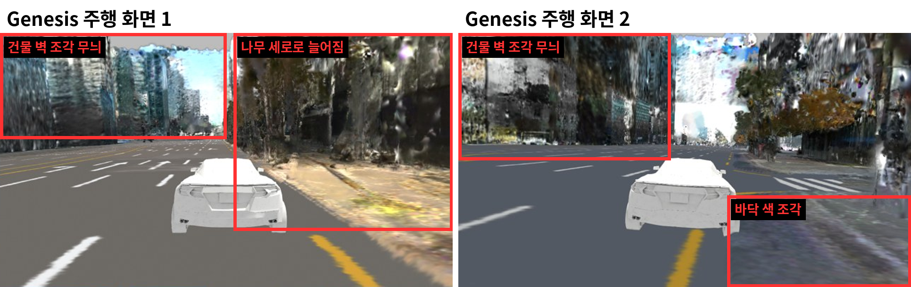
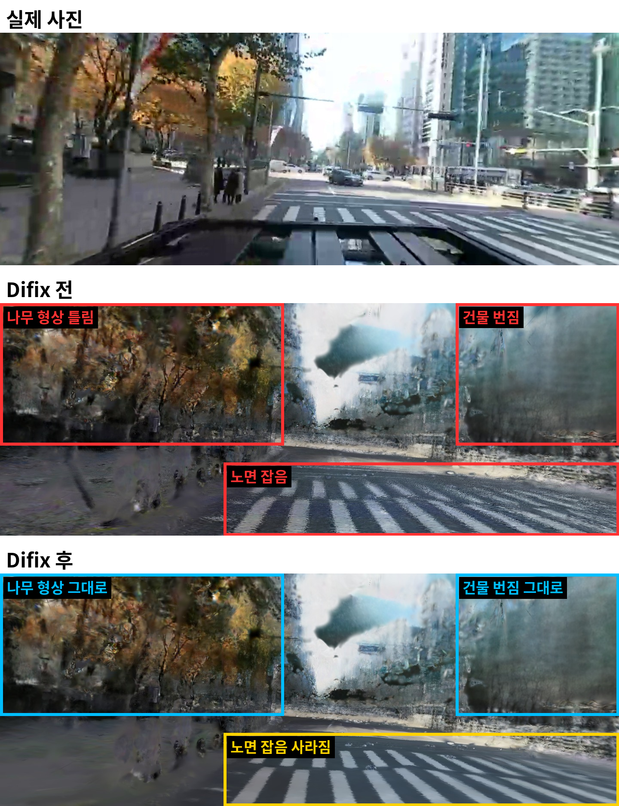
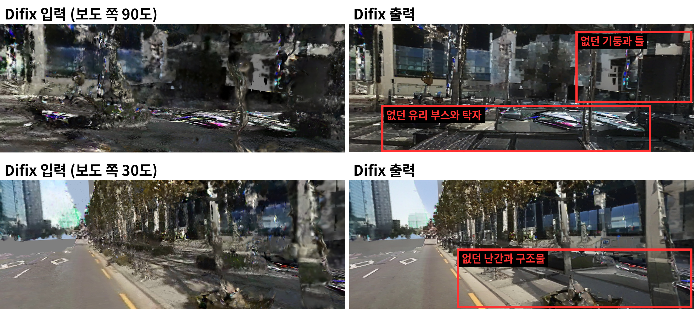
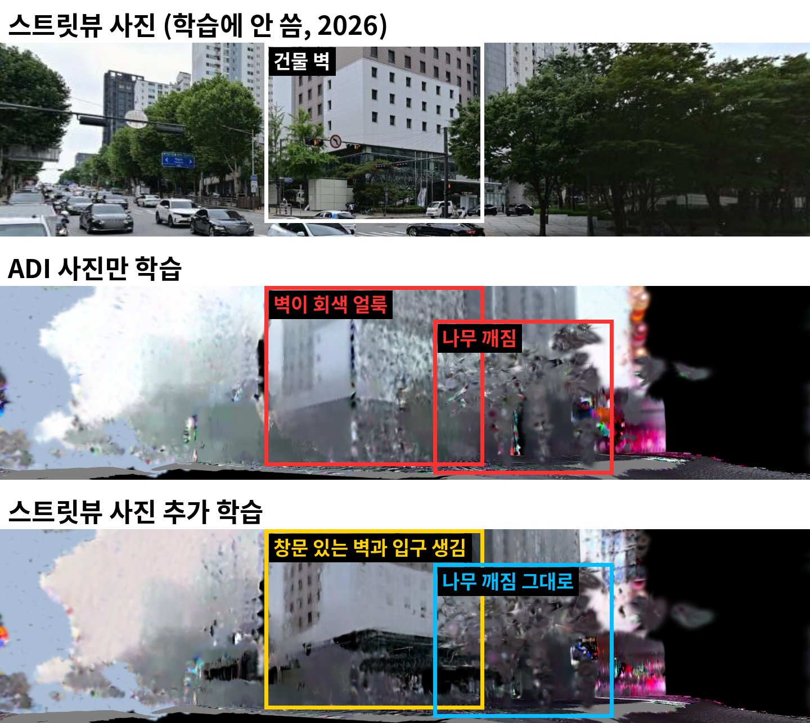
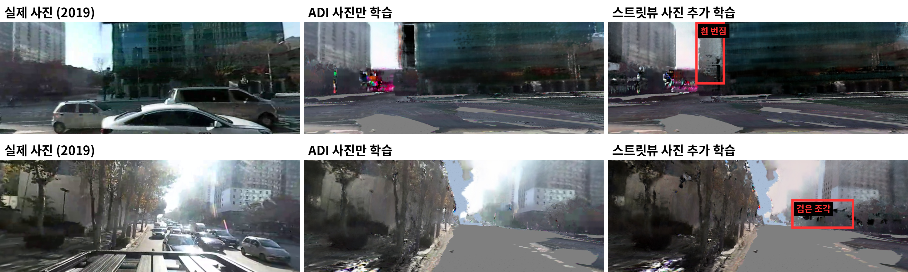
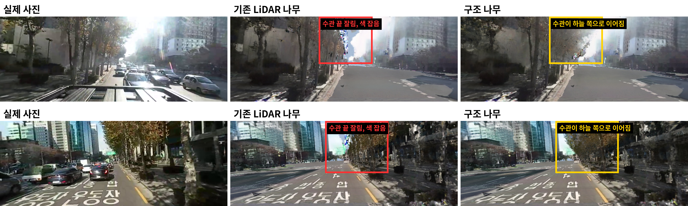
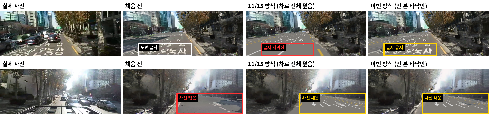
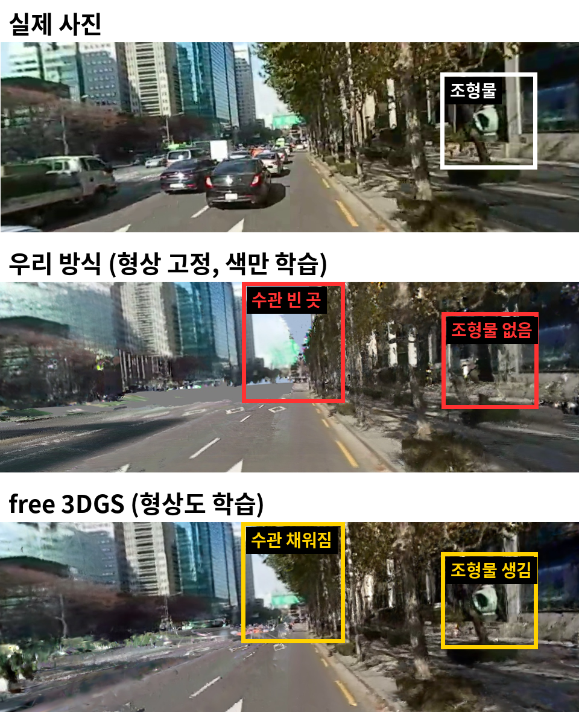
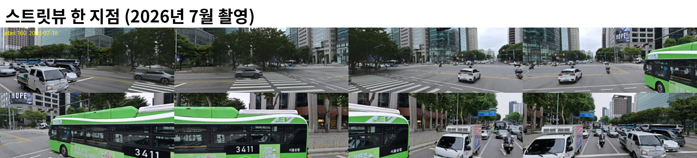
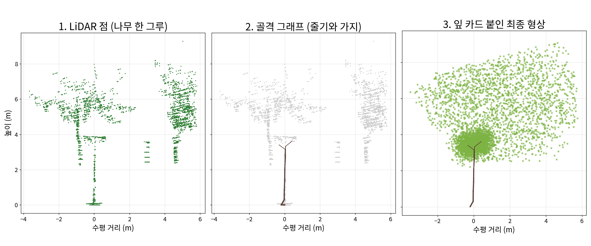

# Difix와 스트릿뷰로 궤적 밖 화질 올리기 시도 결과

> 11/13 보고 이후(11/14에서 11/16) 진행. seq60 블록 80에서 Genesis 주행 카메라처럼 학습 궤적을 벗어난 시점의 화질을 올리려 함

## 요약

| 질문 | 답 |
|---|---|
| Difix가 효과 있었나 | 노면 잡음만 줄어듦. 나무와 건물은 그대로 |
| 스트릿뷰가 효과 있었나 | ADI가 못 본 건물 벽은 채워짐. 대신 주행 시점에 얼룩이 생김 |
| 형상을 직접 고치면 | 바닥 채움은 확실히 개선. 구조 나무는 수관 끝만 조금 개선 |
| 왜 Difix가 안 통했나 | 우리 방식은 형상이 mesh로 고정되어 색만 바뀜. 문제는 대부분 형상이 틀린 곳임 |

**병목은 Difix가 아니라 mesh geometry(나무, 건물)와 adi 영상 화질임. 나무 개선 방향 결정이 필요**

## 용어

| 용어 | 설명 |
|---|---|
| 궤적 위 / 궤적 밖 | ADI 카메라가 실제로 지나간 위치 / 거기서 벗어난 위치(Genesis 주행 카메라, 옆 차로, 보도 쪽) |
| 블록 80 | seq60 경로 중 시험 구간 하나 |
| mesh-bound 2DGS | LiDAR, 정밀도로지도(HD map), V-World mesh 위에 Gaussian을 고정하고 색만 학습하는 우리 방식. 화면 형상과 물리 collider가 같음 |
| free 3DGS | Gaussian의 위치와 모양까지 학습하는 일반 3DGS |
| Difix | 렌더 이미지의 결함을 고치는 diffusion 모델(NVIDIA). 가장 가까운 실제 사진을 참조로 함께 넣음 |
| Difix 증류(distilled) | novel view 렌더를 Difix로 고치고, 고친 이미지를 다시 학습에 넣는 방식 |
| 수관 | 나무의 잎이 달린 윗부분 |

* 그림의 박스 색: **빨강 = 문제, 노랑 = 좋아짐, 파랑 = 변화 없음, 흰색 = 실제 사진에서 위치 표시**
* 모든 그림은 위에서부터(또는 왼쪽부터) 실제 사진 → 전 → 후 순서임

## 1. 목표와 원인

#### 그림 1. 궤적 밖에서 깨지는 모습

* 시점: 궤적 밖 (Genesis 주행 카메라, 차 뒤 3인칭). 11/15 경로 전체 맵

* 궤적 위에서는 사진과 비슷하지만, 궤적을 벗어나면 나무가 세로로 늘어지고 건물 벽이 조각 무늬가 되고 바닥에 색 조각이 흩어짐
* 목표는 궤적 밖 시점에서 눈으로 봤을 때 덜 깨지는 씬임

| 원인 | 내용 | 시도한 대응 |
|---|---|---|
| 관측 부족 | 학습 사진이 ADI 4방향 카메라의 궤적 위에만 있음 | Difix 가상 사진, 스트릿뷰 실제 사진으로 채움 (3장) |
| 형상 오류 | LiDAR가 성겨서 나무와 건물 mesh 자체가 실제와 다름 | 나무, 건물 벽, 바닥을 직접 고침 (4장) |

## 2. 결과 한눈에

| 원인 | 방법 | 한 일 | 결과 | 효과 | 절 |
|---|---|---|---|---|---|
| 관측 부족 | Difix 증류 | 궤적에서 옆과 위로 옮긴 가상 시점을 Difix로 고쳐 다시 학습. 카메라를 조금씩 옮기는 점진적 방식도 시험 | 노면 잡음만 줄고 나무와 건물은 그대로 | 작음 | 3.1 |
| 관측 부족 | 전체 화면 Difix | 나무와 보도까지 Difix 대상으로 넓힘. ADI 사진만 참조, 차량과 사람과 하늘은 제외 | Difix 중 가장 나았지만 변화 작음 | 작음 | 3.1 |
| 관측 부족 | 스트릿뷰 참조 Difix | 건물 벽을 Difix로 고칠 때 스트릿뷰를 참조로 씀 | 효과 없음 | 없음 | 3.1 |
| 관측 부족 | 스트릿뷰 사진 추가 학습 | 스트릿뷰 사진을 학습 사진에 추가 | 못 본 벽은 채워지나 주행 시점에 얼룩 | 섞임 | 3.3 |
| 형상 오류 | 구조 나무 | LiDAR로 줄기와 가지 골격을 만들고 잎 카드를 붙임. 블록 80 나무 28그루 | 수관 끝 잡음이 일부 줄어듦 | 작음 | 4.1 |
| 형상 오류 | 스트릿뷰로 건물 벽 형상 | V-World 상자 대신 여러 스트릿뷰 사진으로 벽 위치, 요철, 텍스처를 만듦. 블록 80 건물 4동 | 주행 시점에서는 상자와 거의 같음 | 없음 | 4.2 |
| 바닥 | 안 본 바닥 채움 | 사진이 한 번도 안 본 바닥에만 정밀도로지도 차선을 칠함 | 차선 복원, 노면 글자 유지 | 큼 | 4.3 |

* 스트릿뷰를 쓰기 위한 수집과 위치 맞추기(경로 76곳, 블록 80 정합 완료)는 부록 A

## 3. 관측 부족 대응: Difix와 스트릿뷰

### 3.1 Difix는 노면 잡음만 줄임

#### 그림 2. Difix 전후

* 시점: 궤적 위 (학습에 안 쓴 ADI 프레임). ADI 경로 전체 맵(11/09), Difix 3회 증류

* 노면(빨강 → 노랑): 횡단보도 줄무늬의 자글자글한 잡음이 사라지고 매끈해짐. 노면은 정밀도로지도로 만들어 형상이 맞는 곳임
* 나무, 건물(빨강 → 파랑): 사진과 다른 덩어리 모양과 번진 무늬가 그대로임. 둘 다 mesh가 틀린 곳임
* 나무와 보도까지 Difix를 넓힌 전체 화면 Difix도 변화가 작았고, 스트릿뷰를 참조로 넣은 Difix는 효과가 없었음

**Difix는 형상이 맞는 곳의 색 잡음만 고치고, 형상이 틀린 곳은 바꾸지 못함 (이유는 5장)**

### 3.2 Difix 할루시네이션

#### 그림 3. 무너진 렌더에 Difix가 없는 구조물을 그려 넣음

* 시점: 궤적 밖 (보도 쪽으로 30도, 90도 돌린 가상 시점)

* 보도 쪽으로 많이 돌릴수록 렌더가 많이 무너짐
* 무너진 곳을 Difix가 유리 부스, 탁자, 기둥, 난간 같은 구조물로 그려 넣음. 실제 장소에는 없는 것임
* 이 이미지를 학습에 넣으면 없는 구조물의 색이 mesh 위에 칠해짐. 차량은 마스크로 뺄 수 있지만 구조물은 뺄 방법이 없음

**할루시네이션 때문에 Difix 이미지의 학습 비중을 낮게 둘 수밖에 없고, 그만큼 효과도 더 작아짐**

* Difix를 두 번 반복하면 오히려 나빠졌음. 잘못 고친 이미지가 다시 학습되며 오류가 쌓이는 것으로 추정됨
* GT 이미지의 해상도가 낮아서 diffusion model 자체가 어떤 형상인지 제대로 판단하지 못해 생기는 hallucination일 가능성도 있음

### 3.3 스트릿뷰 사진을 학습에 넣었을 때

* 스트릿뷰는 2026년 7월 촬영, ADI는 2019년 가을 촬영이라 계절, 간판, 공사 상태가 다름 (부록 A)

#### 그림 4. 궤적 밖: 못 본 건물 벽이 채워짐

* 시점: 궤적 밖 (학습에 안 쓴 스트릿뷰 사진 위치. 도로 건너편 교차로 쪽이라 ADI 카메라가 거의 못 본 곳)

* 건물 벽(빨강 → 노랑): ADI 사진만으로는 회색 얼룩. 스트릿뷰를 추가하면 창문 있는 흰 벽과 1층 입구 모양이 생김
* 나무(빨강 → 파랑): 두 경우 모두 깨진 채임. 나무 mesh가 이 방향에서 보면 실제 모양과 다르기 때문임
* 그림은 위쪽만 잘라 보임. 아래쪽 바닥은 회색 판과 검은 띠로 나오는데, 학습 사진이 한 번도 안 본 바닥이기 때문임 (부록 B). 4.3의 바닥 채움을 넣으면 해결됨

#### 그림 4b. ADI 카메라 구간 안의 스트릿뷰 시점

* 시점: ADI 카메라 구간 안(x 113 m)의 학습에 안 쓴 스트릿뷰 파노라마. 위 줄 = 도로 건너편 약 90 m 벽, 아래 줄 = 같은 쪽 약 10 m 벽

* 위 줄: 건너편 호텔 벽은 스트릿뷰를 넣으면 갈색 벽과 창문 줄이 뚜렷하게 생김. 그림 4보다 결과가 좋음
* 아래 줄: 가까운 벽은 나무 mesh가 앞을 가려서 두 경우 모두 거의 같음(가우시안 강제 제약의 한계 추정)

#### 그림 5. 궤적 위: 원래 주행 시점에는 얼룩이 생김

* 시점: 궤적 위 (학습에 안 쓴 ADI 프레임)

* 위 빨간 박스: 건물 모서리에 흰 번짐. 2026년 스트릿뷰 사진의 색이 2019년 벽 위에 섞인 것으로 추정됨
* 아래 빨간 박스: 건물 밑에 검은 조각. 그 외 나무와 바닥은 거의 같음

**스트릿뷰는 ADI가 못 본 건물 벽을 채워 주지만, 원래 주행 시점에는 연도와 계절 차이로 얼룩을 남김. 나무와 바닥에는 효과 없음**

## 4. 씬을 직접 고친 결과

### 4.1 구조 나무

* LiDAR 나무 점에서 줄기와 가지 골격을 찾고, 가지를 원기둥 mesh로 만들고, 잎 카드(0.25 m 사각 판)를 붙임. 11/14에 한 그루로 시험한 방법을 블록 80 나무 28그루에 적용함
* 만드는 단계와 자료구조는 부록 C

#### 그림 6. 기존 LiDAR 나무와 구조 나무

* 시점: 궤적 위 (ADI 사진 시점)

* 빨간 박스: 기존 나무는 수관 끝이 잘려 하늘과 맞닿는 곳에 알록달록한 색 잡음이 생김
* 노란 박스: 구조 나무는 수관이 하늘 쪽으로 이어지고 색 잡음이 줄어듦
* 그 외 나무 모양은 거의 같음. LiDAR 점이 가로줄 몇 개로만 찍혀 골격이 줄기와 짧은 가지에서 끊기고, 잎 카드 절반이 줄기 끝에 공처럼 뭉치기 때문임 (부록 C 그림)

**구조 나무는 수관 끝을 조금 채웠지만, LiDAR가 성겨 골격이 끊기는 한계가 있음**

### 4.2 건물 벽 (스트릿뷰로 형상 만들기)

* V-World 상자 대신 여러 스트릿뷰 사진으로 벽 위치, 요철, 벽 텍스처를 만듦. 블록 80 건물 4동
* 주행 시점에서는 상자와 거의 같게 보임. 주행 카메라가 벽을 비스듬히 봐서 요철 차이가 드러나지 않는 것으로 추정됨

### 4.3 안 본 바닥 채움 (차선 복원)

* 문제: ADI 촬영 때 도로에 차가 서 있었고, 학습에서 차량은 마스크로 빼므로 차 밑 바닥은 어떤 사진에도 안 찍힘. 그 자리는 Difix 가상 사진이 회색 맨바닥으로 학습시켜 차선이 없음

#### 그림 7. 바닥 채움 방식 비교

* 시점: 궤적 위 (ADI 사진 시점). 위 줄 = 노면 글자가 있는 장면, 아래 줄 = 차가 서 있던 장면
* 왼쪽부터 실제 사진 / 채움 전 / 11/15 방식 / 이번 방식

| 방식 | 한 일 | 차 밑 바닥 | 노면 글자 |
|---|---|---|---|
| 채움 전 | 없음 | 회색, 차선 없음 | 있음 |
| 11/15 방식 | 차로 전체를 평탄한 아스팔트와 정밀도로지도 차선으로 덮음 | 차선 생김 | 지워짐. 정밀도로지도에는 "종합운동장" 같은 글자가 없음 |
| 이번 방식 | 사진이 한 번도 안 본 바닥에만 차선을 칠함 | 차선 생김 | 유지 |

**안 본 바닥만 채우는 방식으로 차선과 노면 글자를 함께 살림**

## 5. Difix가 우리 씬에서 안 통한 이유

| 항목 | 내용 |
|---|---|
| 논문 방식 | 학습 카메라를 목표 시점 쪽으로 조금씩 옮겨 렌더하고, Difix로 고쳐 다시 학습. 마지막 렌더에도 Difix를 한 번 더 적용 |
| 논문이 밝힌 한계 | 처음 3D 복원이 실패한 곳은 고치지 못함. 관측이 적은 곳은 hallucination, 멀수록 hallucination 늘어남 |
| 논문과 우리 차이 1 | 논문은 NeRF와 3DGS라 형상까지 바뀜. 우리는 **mesh 위 2DGS라 색만 바뀜** |
| 논문과 우리 차이 2 | 논문의 주행용 Difix는 옆으로 1에서 6 m 옮긴 주행 데이터로 학습한 비공개 모델. 우리는 손으로 찍은 사진으로만 학습한 공개 모델을 씀 |

#### 그림 8. 같은 사진으로 학습한 우리 방식과 free 3DGS

* 시점: 궤적 위 (11/14)

* 우리 방식은 mesh가 없는 자리에 색을 칠할 곳이 없음. 그래서 수관 사이로 하늘이 비치고, 오른쪽 조형물도 나오지 않음
* free 3DGS는 Gaussian이 사진에 맞게 움직여서 수관이 채워지고 조형물도 나타남

**Difix3D+는 3DGS에서 형상 자체를 바꾸지만, 우리 방식은 화면 형상이 곧 mesh라서 mesh에 없는 것은 어떤 학습으로도 생기지 않음. 우리 씬의 문제는 대부분 형상이 틀린 곳이라 Difix로 개선이 거의 없었음**

* free 3DGS로 바꾸는 것은 답이 아님. 궤적 밖에서 형상이 흐려져 더 나빴고(11/15 결정), 시뮬레이터에서는 화면과 collider가 같아야 함
* 자세한 정리는 [Difix3D+ 인사이트](%5BDIGLAB%5D%5B26-11-14%5D_Difix3D+_%EC%9D%B8%EC%82%AC%EC%9D%B4%ED%8A%B8.md)

## 6. 남은 문제와 판단 필요

| 문제 | 내용 |
|---|---|
| 나무 | 골격이 끊기고 잎 카드가 뭉침. LiDAR 수관 윗부분이 잘려 나무가 사진보다 낮음 |
| 건물 | 스트릿뷰 벽 형상은 블록 80 건물 4동만 만들었음. 나머지는 V-World 상자 |
| 스트릿뷰 정합 | 경로 후반 일부 파노라마가 도로 가로 방향으로 3에서 4 m 어긋남 |
| 경로 전체 화질 | 흐린 원인은 렌더러가 아니라 흐린 2019년 사진(GT 사진), 상자 건물(geometry), 거친 나무 mesh(tree LiDAR)임 |

**판단 필요**

* 나무 개선 방향
  * A: 끊긴 골격을 수관 점까지 이어 붙임
  * B: 블렌더 Sapling 같은 절차적 나무 생성기에 줄기 위치, 높이, 수관 폭을 넣음
* 구조 나무와 이번 바닥 채움을 경로 전체로 넓힐지

**next step**

* Alpamayo 데이터로 같은 파이프라인을 학습해, 화질 한계가 파이프라인 문제인지 GT 영상(ADI) 화질 때문인지 검증 중

## 부록

### A. 스트릿뷰 수집과 정합

* 경로 76곳에서 스트릿뷰를 수집함
* 스트릿뷰 위치는 ADI 데이터에 직접 맞춰서 구함 (우리 정합 코드). GPS는 시작값으로만 씀

| 단계 | 기준 데이터 | 맞추는 값 |
|---|---|---|
| 시작값 | 스트릿뷰 GPS + 수평 | 대략적인 위치 |
| 도로 방향 위치 | ADI 사진의 노면 표시 (그림 A2) | 앞뒤 위치 |
| 도로 가로 위치, 높이, 방향 | ADI LiDAR 표면 | 좌우 위치, 높이, yaw |
| 일부 지점 | ADI 사진과 스트릿뷰 사진의 특징점 매칭 | 위치와 방향 전체 |

* 그래서 스트릿뷰 카메라가 ADI 사진, LiDAR, 정밀도로지도와 같은 좌표에 놓임

#### 그림 A1. 한 지점에서 네 방향으로 본 스트릿뷰

* 2026년 7월 촬영이라 나무가 초록색임. ADI 사진(2019년 가을)과 계절, 간판, 공사 상태가 다름

#### 그림 A2. 노면 표시로 스트릿뷰를 ADI 좌표에 맞춤

* ADI 사진과 스트릿뷰 사진을 각각 정밀도로지도 바닥에 투영해 위에서 본 노면을 만들고 겹쳐 봄. 7년 사이에 노면 표시는 거의 그대로라 정합 기준으로 씀
* 블록 80 가운데 지점(스트릿뷰 25번). 가로가 도로 방향, 아래 눈금 하나가 5 m

* 정합 전: GPS 위치 그대로면 스트릿뷰의 마름모(초록)와 ADI의 마름모(분홍)가 도로 방향으로 약 2.6 m 어긋남
* 정합 후: 마름모와 화살표가 겹쳐 흰색으로 보임
* 블록 80 구간 14곳이 이렇게 정합됨. 노면 표시가 적은 곳은 기준이 없어 값이 튀고, 경로 후반 일부는 아직 도로 가로 방향으로 3에서 4 m 어긋남

### B. 그림 4 아래쪽 바닥이 회색과 검은색인 이유

| 보이는 것 | 원인 |
|---|---|
| 회색 바닥 | 학습 사진이 한 번도 칠하지 않은 바닥 Gaussian이 초기 색(회색)으로 남은 것. 이 자리 Gaussian의 99%가 관측 0회임. ADI 사진에서는 교차로의 차들이 차량 마스크로 빠졌고, 스트릿뷰 사진은 건물 영역만 학습에 썼음. 이 비교 모델에는 바닥 채움을 넣지 않았음 |
| 검은 띠 | 40 m쯤 떨어진 먼 바닥에는 Gaussian이 없어서 배경색이 보이는 것 |

### C. 구조 나무 만드는 단계

| 단계 | 자료구조 | 내용 |
|---|---|---|
| 줄기 찾기 | 점 군집 | 지면 위 0.6에서 2.4 m의 가늘고 수직인 LiDAR 점 덩어리를 줄기로 봄 |
| 골격 | 그래프(노드와 간선) | 나무 점을 0.25 m 칸으로 묶어 노드를 만들고, 0.6 m 안의 노드끼리 간선으로 이음 |
| 가지 구조 | 최단 경로 트리 | 줄기 밑동에서 각 노드까지 최단 경로를 구해 부모와 자식 관계를 만듦. 자손이 적은 잔가지는 버림 |
| 가지 굵기 | pipe model | 자손이 많은 가지일수록 굵게 함. 각 간선을 원기둥 mesh로 만듦 |
| 잎 | 잎 카드 | 0.25 m 사각 판. 절반은 가지 끝 주변, 절반은 수관 점들의 외곽선 안에 뿌림 |

#### 그림 C1. 나무 한 그루: LiDAR 점 / 골격 그래프 / 최종 형상

* LiDAR 점이 가로줄 몇 개로만 찍혀 있고, 줄기와 수관 사이가 비어 있음
* 그래서 골격이 줄기와 짧은 가지 몇 개에서 끊기고, 잎 카드 절반이 줄기 끝에 공처럼 뭉침. 28그루 대부분이 이런 상태임
