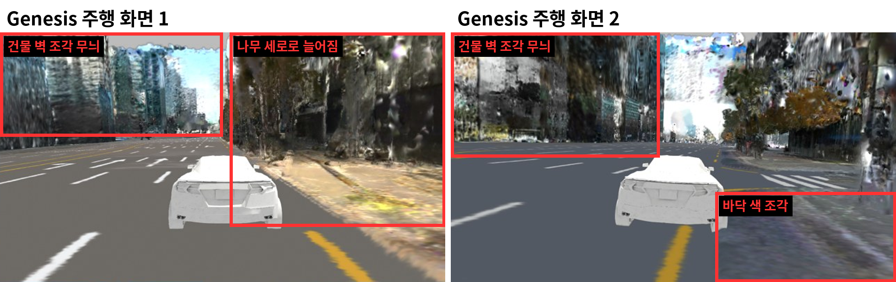
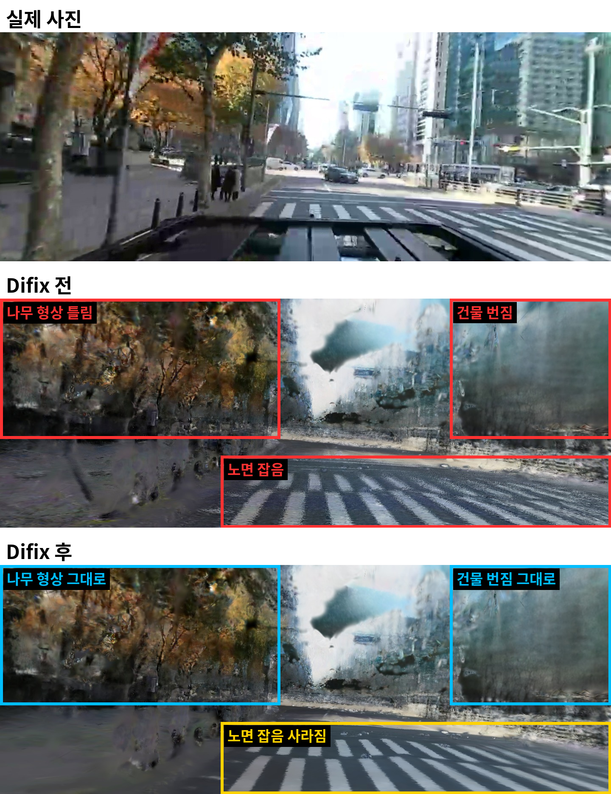
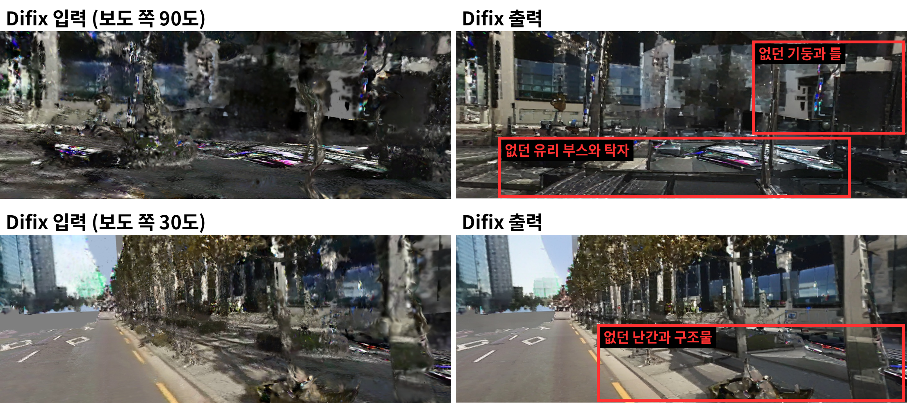
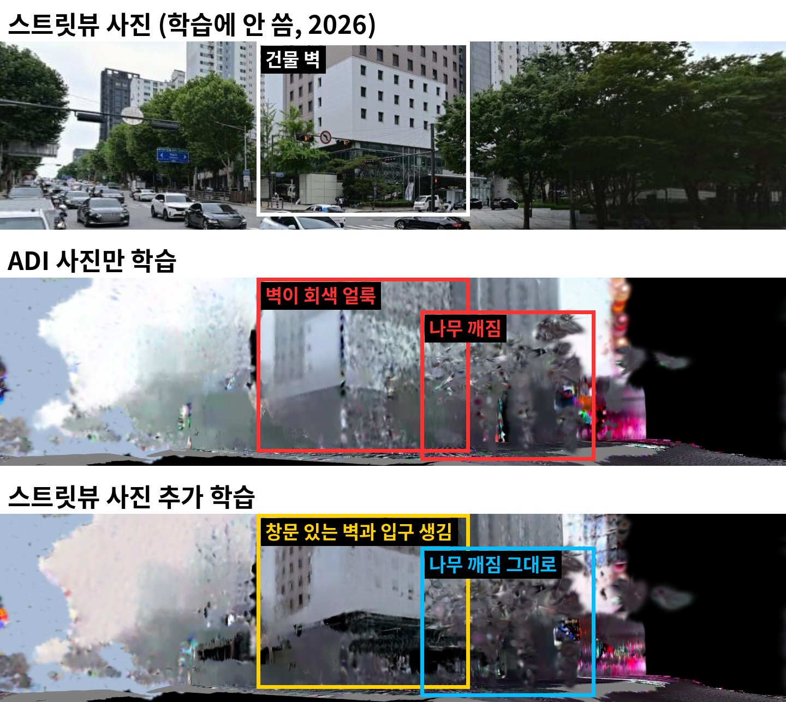
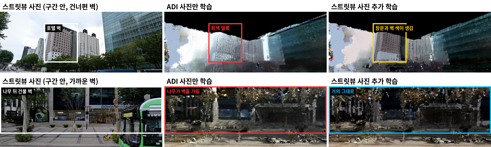
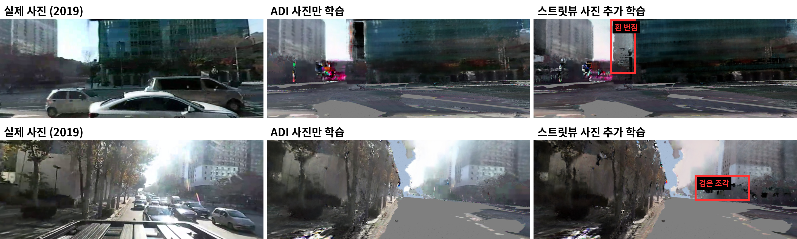
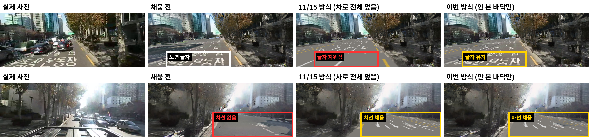
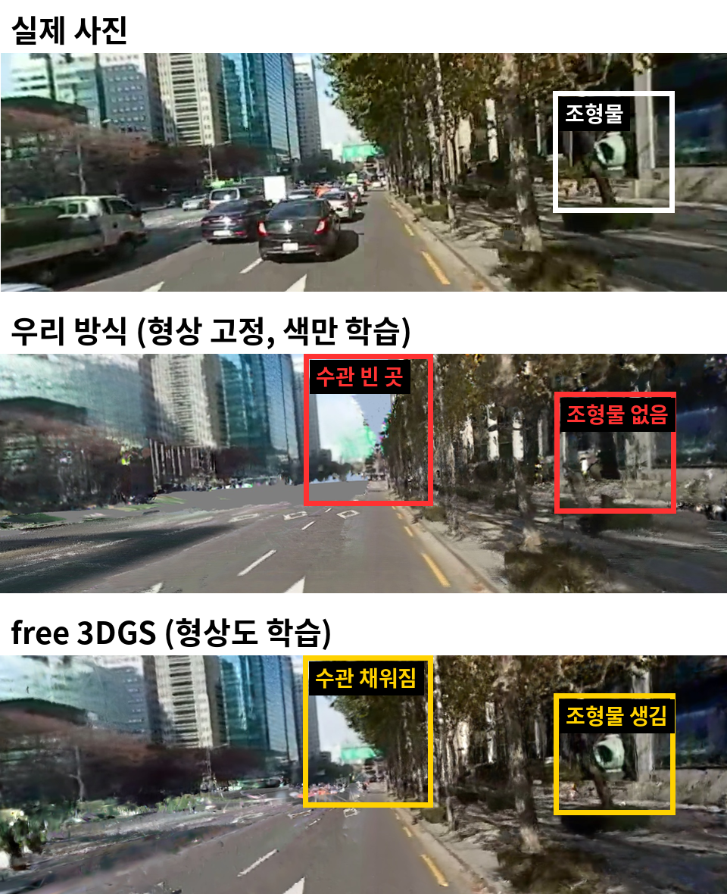

# Difix와 스트릿뷰로 궤적 밖 화질 올리기 시도 결과

> 11/14에서 11/16 진행. seq60 블록 80에서 학습 궤적을 벗어난 시점(Genesis 주행 카메라)의 화질을 올리려 함

## 요약

| 시도 | 결과 | 효과 |
|---|---|---|
| Difix 증류 | 노면 잡음만 줄어듦. 나무와 건물은 그대로 | 작음 |
| 스트릿뷰 사진 추가 학습 | ADI가 못 본 건물 벽은 채워짐. 원래 주행 시점에는 얼룩 | 섞임 |
| 구조 나무 | 수관 끝 잡음만 조금 줄어듦 | 작음 |
| 안 본 바닥 채움 | 차선 복원, 노면 글자 유지 | 큼 |

**병목은 Difix가 아니라 mesh geometry(나무, 건물)와 adi 영상 화질임. 나무 개선 방향 결정이 필요**

* 우리 방식은 형상이 mesh로 고정되고 색만 학습함. 그래서 Difix나 스트릿뷰로 색을 고쳐도 형상이 틀린 곳(나무, 건물)은 안 바뀜

## 용어

| 용어 | 설명 |
|---|---|
| 궤적 위 / 밖 | ADI 카메라가 지나간 위치 / 거기서 벗어난 위치 |
| mesh-bound 2DGS | mesh 위에 Gaussian을 고정하고 색만 학습하는 우리 방식. 화면 형상 = 물리 collider |
| Difix 증류 | 가상 시점 렌더를 Difix(NVIDIA diffusion 모델)로 고치고 다시 학습에 넣는 방식 |
| 수관 | 나무의 잎이 달린 윗부분 |

* 그림 박스: **빨강 = 문제, 노랑 = 좋아짐, 파랑 = 변화 없음, 흰색 = 실제 사진 위치 표시**
* 그림 순서: 실제 사진 → 전 → 후

## 1. 문제: 궤적 밖에서 깨짐

#### 그림 1. Genesis 주행 화면 (궤적 밖, 11/15 경로 전체 맵)

| 원인 | 내용 | 대응 |
|---|---|---|
| 관측 부족 | 학습 사진이 ADI 궤적 위에만 있음 | Difix 가상 사진, 스트릿뷰 사진 (2장) |
| 형상 오류 | LiDAR가 성겨서 나무, 건물 mesh가 실제와 다름 | 나무, 바닥 직접 수정 (3장) |

## 2. 관측 부족 대응

### 2.1 Difix: 노면만 좋아짐

#### 그림 2. Difix 전후 (궤적 위, 학습에 안 쓴 ADI 프레임)

* 노면은 잡음이 사라짐. 정밀도로지도로 만들어 형상이 맞는 곳임
* 나무, 건물은 그대로임. mesh가 틀린 곳임
* 나무와 보도까지 넓힌 전체 화면 Difix, 스트릿뷰를 참조로 쓴 Difix도 변화가 거의 없었음

**Difix는 형상이 맞는 곳의 색 잡음만 고침**

### 2.2 Difix 할루시네이션

#### 그림 3. 보도 쪽으로 30도, 90도 돌린 가상 시점 (궤적 밖)

* 무너진 렌더에 Difix가 유리 부스, 탁자, 기둥 같은 없는 구조물을 그려 넣음
* 이걸 학습하면 없는 구조물 색이 mesh에 칠해짐. 그래서 Difix 이미지 비중을 낮게 둘 수밖에 없음
* Difix를 두 번 반복하면 오히려 나빠짐. GT 이미지 해상도가 낮아 diffusion model이 형상을 제대로 판단하지 못한 것일 가능성도 있음

### 2.3 스트릿뷰 사진 추가 학습

* 스트릿뷰(2026년 7월)를 ADI(2019년 가을) 좌표에 맞춰 학습에 추가함. 맞추는 방법은 부록 A
* 스트릿뷰는 건물 벽 픽셀만 학습에 씀

#### 그림 4. 궤적 밖: 도로 건너편 교차로 (학습에 안 쓴 스트릿뷰 위치)

* 건물 벽: 회색 얼룩 → 창문 있는 흰 벽과 입구가 생김
* 나무: 그대로 깨짐. 하늘, 나무, 바닥은 스트릿뷰로 학습하지 않아 ADI 결과 그대로임

#### 그림 4b. ADI 구간 안의 스트릿뷰 시점

* 위 줄(건너편 약 90 m 호텔 벽): 갈색 벽과 창문 줄이 뚜렷하게 생김
* 아래 줄(가까운 벽): 나무 mesh가 앞을 가려 거의 같음(가우시안 강제 제약의 한계 추정)

#### 그림 5. 궤적 위: 원래 주행 시점 (학습에 안 쓴 ADI 프레임)

* 건물 모서리에 흰 번짐, 건물 밑에 검은 조각이 생김. 2026년 색이 2019년 벽에 섞인 것으로 추정됨

**스트릿뷰는 ADI가 못 본 건물 벽을 채워 주지만, 원래 주행 시점에는 연도 차이로 얼룩을 남김. 나무에는 효과 없음**

## 3. 형상 직접 수정

* 구조 나무(LiDAR 점으로 가로수 골격 복원)는 수관 끝만 조금 개선됨. 자세한 내용은 [구조 나무 문서](%5BDIGLAB%5D%5B26-11-16%5D_%EA%B5%AC%EC%A1%B0%EB%82%98%EB%AC%B4.md)
* 스트릿뷰로 건물 벽 형상(위치, 요철)도 만들어 봤지만(4동), 주행 시점에서는 V-World 상자와 거의 같았음

### 3.1 안 본 바닥 채움

* 문제: ADI 촬영 때 차가 서 있던 자리는 차량 마스크로 빠져 어떤 사진에도 안 찍힘. 그래서 회색 바닥에 차선이 없음

#### 그림 6. 바닥 채움 비교 (궤적 위). 위 줄 = 노면 글자 장면, 아래 줄 = 차가 서 있던 장면

| 방식 | 차 밑 바닥 | 노면 글자 |
|---|---|---|
| 채움 전 | 회색, 차선 없음 | 있음 |
| 11/15: 차로 전체를 정밀도로지도 차선으로 덮음 | 차선 생김 | 지워짐 |
| 이번: 사진이 안 본 바닥에만 차선을 칠함 | 차선 생김 | 유지 |

**안 본 바닥만 채워서 차선과 노면 글자를 함께 살림**

## 4. Difix가 안 통한 이유

#### 그림 7. 같은 사진으로 학습한 우리 방식과 free 3DGS (궤적 위)

| | Difix3D+ 논문 | 우리 |
|---|---|---|
| 3D 표현 | NeRF, 3DGS. 형상도 학습 | mesh 위 2DGS. 색만 학습 |
| Difix가 바꾸는 것 | 색과 형상 | 색만 |
| 주행용 Difix | 옆으로 1에서 6 m 옮긴 주행 데이터로 학습 (비공개) | 일반 사진으로 학습한 공개 모델 |

* 논문도 "처음 3D 복원이 실패한 곳은 못 고친다"고 밝힘
* 우리 방식은 mesh에 없는 것(수관 사이, 조형물)은 어떤 학습으로도 생기지 않음. free 3DGS는 Gaussian이 움직여서 생김

**우리 씬의 문제는 대부분 형상이 틀린 곳이라 Difix로 개선이 거의 없었음**

* free 3DGS로 바꾸는 것은 답이 아님. 궤적 밖에서 더 흐려졌고(11/15), 시뮬레이터는 화면과 collider가 같아야 함
* 자세한 정리는 [Difix3D+ 인사이트](%5BDIGLAB%5D%5B26-11-14%5D_Difix3D+_%EC%9D%B8%EC%82%AC%EC%9D%B4%ED%8A%B8.md)

## 5. 남은 문제와 판단 필요

| 문제 | 내용 |
|---|---|
| 나무 | 골격이 끊기고 잎 카드가 뭉침. 나무가 사진보다 낮음 |
| 건물 | 스트릿뷰 벽 형상은 4동만. 나머지는 V-World 상자 |
| 스트릿뷰 정합 | 경로 후반 일부가 도로 가로 방향으로 3에서 4 m 어긋남 |
| 경로 전체 화질 | 흐린 2019년 사진(GT 사진), 상자 건물(geometry), 거친 나무 mesh(tree LiDAR) |

