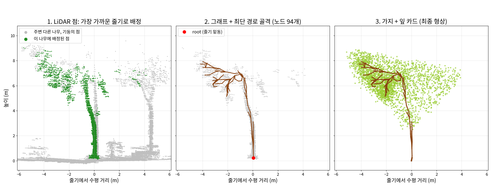
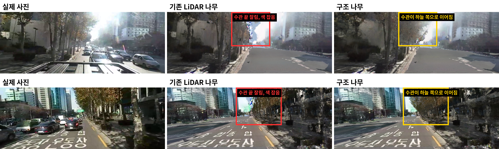

# 구조 나무: LiDAR 점에서 가로수 골격 복원

> 11/14에서 11/16 진행. [11/16 progress status](%5BDIGLAB%5D%5B26-11-16%5D_progress_status.md)에서 분리한 문서. seq60 블록 80 가로수 28그루에 적용

## 용어

| 용어 | 설명 |
|---|---|
| 수관 | 나무의 잎이 달린 윗부분 |
| 골격 | 줄기와 가지를 선으로 나타낸 나무의 뼈대 |
| 잎 카드 | 잎 덩어리를 대신하는 작은 사각 판 |

**목표**: LiDAR mesh로는 덩어리로 나오는 가로수를 줄기, 가지, 잎이 있는 형상으로 바꿔 궤적 밖에서도 나무 모양이 유지되게 함

**방법**: 레이저 스캔 점에서 나무 골격을 복원하는 기존 방식[1]을 따름. 점을 그래프로 만들고, 줄기 밑동에서 최단 경로 트리를 구해 골격으로 씀. 같은 계열로 [2], [3]이 있음

| 단계 | 알고리즘 / 자료구조 | 근거 | 우리 설정 |
|---|---|---|---|
| 1. 줄기 검출 | DBSCAN 밀도 군집 | [4] | 지면 위 0.6에서 2.4 m의 가늘고 수직인 점 군집 |
| 1-1. 나무 구분 | 최근접 줄기 배정 (줄기 위치 기준 Voronoi 분할) | - | 각 점을 6 m 안에서 가장 가까운 줄기에 배정 |
| 2. 점 정리 | 복셀 다운샘플링 → 그래프 노드 | [1] | 0.25 m 복셀 하나 = 노드 하나 |
| 3. 이웃 그래프 | 반경 그래프 (노드, 간선) | [1] | 0.6 m 안의 노드를 간선으로 연결 |
| 4. 골격 | Dijkstra 최단 경로 트리 | [1], [5] | 줄기 밑동을 root로 각 노드의 부모를 정함 |
| 5. 가지 정리 | 자손 수 기준 가지치기 | [1], [3] | 자손 노드가 적은 가지를 잡음으로 제거 |
| 6. 가지 굵기 | Pipe model (단면적 ∝ 위에 달린 가지 양) | [6] | 간선마다 원기둥 mesh |
| 7. 잎 | 잎 카드 | [1] | 0.25 m 사각 판을 가지 끝과 수관 안에 배치 |

* 적용: seq60 블록 80 가로수 28그루
* 각 단계의 알고리즘은 논문의 방식이지만, 표의 수치(높이 범위, 복셀 크기, 연결 반경, 가지치기 기준)는 우리 데이터에 맞춰 직접 정한 값임

#### 그림 1. 나무 한 그루 (블록 80, 줄기 x 135.6 m): 점 배정 / 골격 그래프 / 최종 형상

* 1: 초록 = 이 나무에 배정된 점, 회색 = 이웃 나무와 기둥의 점
* 2: 수관 왼쪽은 점이 이어져 가지가 생겼지만, 오른쪽은 점이 성겨 그래프가 끊기고 가지가 없음
* 3: 가지가 없는 오른쪽은 잎 카드만 채워짐
* 28그루 중 9그루는 골격 노드가 8개 이하로, 줄기 외에 가지가 거의 만들어지지 않음
* 나무 구분은 줄기까지 수평 거리만 보는 단순 규칙이라, 수관이 겹치는 곳에서는 이웃 나무 점이 섞일 수 있음

#### 그림 2. 기존 LiDAR 나무와 구조 나무 (궤적 위)

* 수관 끝이 하늘 쪽으로 이어지고 색 잡음이 줄어듦
* 그 외 모양은 거의 같음

**결과: 수관 끝만 조금 개선됨**

**한계**: [1]에서 [3]은 지상 레이저 스캔처럼 가지를 따라 점이 촘촘한 데이터를 전제로 함. 차량 LiDAR는 나무 점이 성기고 가려진 부분이 많아, 점을 잇는 방식으로는 골격이 끊김

**대안**: Space Colonization[7]. 수관 점을 가지가 자라 갈 목표로 두고 줄기에서 가지를 키우는 방식이라 점끼리 이어질 필요가 없음. 성긴 LiDAR에서도 수관 모양을 따라 가지를 채울 수 있어 다음 시험 후보임

**참고문헌**

1. H. Xu, N. Gossett, B. Chen, "Knowledge and Heuristic-based Modeling of Laser-Scanned Trees," ACM Transactions on Graphics 26(4), 2007
2. Y. Livny, F. Yan, M. Olson, B. Chen, H. Zhang, J. El-Sana, "Automatic Reconstruction of Tree Skeletal Structures from Point Clouds," ACM Transactions on Graphics 29(6) (SIGGRAPH Asia), 2010
3. S. Du, R. Lindenbergh, H. Ledoux, J. Stoter, L. Nan, "AdTree: Accurate, Detailed, and Automatic Modelling of Laser-Scanned Trees," Remote Sensing 11(18), 2074, 2019
4. M. Ester, H.-P. Kriegel, J. Sander, X. Xu, "A Density-Based Algorithm for Discovering Clusters in Large Spatial Databases with Noise," KDD, 1996
5. E. W. Dijkstra, "A Note on Two Problems in Connexion with Graphs," Numerische Mathematik 1, 1959
6. K. Shinozaki, K. Yoda, K. Hozumi, T. Kira, "A Quantitative Analysis of Plant Form: The Pipe Model Theory I," Japanese Journal of Ecology 14(3), 1964
7. A. Runions, B. Lane, P. Prusinkiewicz, "Modeling Trees with a Space Colonization Algorithm," Eurographics Workshop on Natural Phenomena, 2007

## 판단 필요

* 나무 개선 방향
  * A: 끊긴 골격을 수관 점까지 이어 붙임
  * B: 블렌더 Sapling 같은 절차적 나무 생성기에 줄기 위치, 높이, 수관 폭을 넣음
  * C: Space Colonization[7]으로 수관 점을 따라 가지를 생성
* 구조 나무를 경로 전체로 넓힐지
