# Difix 학습을 논문 방식으로 다시 세움

> 11/16 밤에서 11/17 진행. seq60 블록 80. 렌더와 collider를 분리하고, 도로는 바닥에 고정, 건물과 나무는 학습하는 구성에서 Difix를 논문 방식으로 다시 적용함

## 요약

| 항목 | 내용 |
|---|---|
| 발견 1 | 지금까지 Difix 학습은 논문 방식이 아니었음. 30,000번 학습을 다 끝낸 뒤 1,500번씩 10번 미세조정한 것이었음 |
| 발견 2 | 11/16 보고의 "나무 3DGS로 PSNR 17.78에서 20.23" 향상은 대부분 건물 등 나머지 부분의 색을 다시 학습한 효과였음. 건물을 고정하면 나무만으로는 거의 안 오름 |
| 바꾼 것 | 한 번의 30,000번 학습 안에서 3,000번부터 1,500번마다 Difix 결과를 넣음. 바닥만 고정하고 건물과 나무는 학습함 |
| 비교 | 2DGS, 3DGS, 2DGS + Difix, 3DGS + Difix 4개를 같은 학습 코드로 돌림 |
| 결과 | **3DGS + Difix가 화면 전체 PSNR 20.10 dB로 가장 좋음** (2DGS 18.73, 기존 최종본 17.78). 3DGS와 Difix 효과가 각각 0.6 dB에서 0.9 dB 정도이고 합쳐짐. Difix가 길 건너편에 파란 물체를 만듦 |
| 오후 점검 | 밤사이 비교는 조건이 공정하지 않았음. 3DGS는 두께 1 mm 판에서 시작해 98 %가 판으로 남았고, 2DGS에는 크기 제한과 공간 비우기 규칙이 빠져 있었음 (8절) |
| 미팅 반영 결과 | 도로는 mesh 위 2DGS 고정, 나무와 배경은 두께로 시작하는 3DGS, Difix는 주행 정면과 후면만. **인도 쪽 건물 PSNR 19.86에서 21.16**, 화면 전체 20.10에서 20.35. 길 건너편 건물과 LPIPS는 밤사이 결과가 조금 더 좋음. 주행 영상 위쪽에 회백색 번짐이 새로 생김 (8절) |
| 재검토 | 밝기를 사진에 맞춰 다시 재면 **Difix가 더한 것은 인도 쪽 건물 0.34 dB뿐**이고 화면 전체는 0.00 dB임. 앞 줄의 Difix 향상은 대부분 밝기 이동이었음. **길 건너편은 나무와 기둥이 실제(약 30 m)보다 10 m에서 21 m 뒤에 그려져 가로로 번짐**. 네 모델 모두 같음 (8.5절) |
| 네이버 거리뷰만 | 깊이 손실이 하늘 제외 PSNR 1.1 dB 개선 (13.22에서 14.31). 하지만 학습에서 뺀 파노라마 위치는 재구성 실패, 도로에 차 자리 얼룩 |

## 용어

| 용어 | 설명 |
|---|---|
| 고정 그룹 | 학습하지 않는 Gaussian. 바닥(차도와 인도)과 하늘 |
| 학습 그룹 | 학습하는 Gaussian. 건물, 나무, 기둥 등 바닥과 하늘이 아닌 모든 것 |
| 2DGS | 학습 그룹을 mesh 위에 붙여 둔 채 색, 불투명도, 면 안 크기만 학습 |
| 3DGS | 학습 그룹의 위치, 크기, 회전, 색까지 학습하고 Gaussian을 늘리고 지움 |
| 가상 시점 | 사진이 없는 카메라 위치. 지금 모델로 렌더한 뒤 Difix로 고쳐 학습 사진처럼 씀 |
| 목표 시점 | 가상 시점이 최종적으로 도착할 위치. 시뮬레이터에서 실제로 볼 시점 |
| 참조 사진 | Difix에 같이 넣는 실제 ADI 사진. 색과 질감을 가져오는 용도 |
| v4 / v5 | 학습 판 이름. v4 = 11/16 밤 학습 (1절에서 7절), v5 = 11/17 오후 미팅 반영 학습 (8절) |
| 인도 쪽 건물 / 길 건너편 건물 | ADI 차는 맨 오른쪽 차로를 달림. 인도 쪽 = 주행 방향 오른쪽 가까운 건물, 길 건너편 = 왼쪽 먼 건물 |
| 밝기 맞춘 PSNR | 렌더의 색 채널마다 밝기와 대비를 사진에 맞춘 뒤 잰 PSNR. 노출 차이를 빼고 형상과 무늬 차이만 봄 |

* 그림 박스: **빨강 = 문제, 노랑 = 좋아짐, 파랑 = 변화 없음**

## 1. 문제: 이전 Difix 학습은 논문 방식이 아니었음

| 항목 | 논문과 공식 코드 | 11/16까지 우리 |
|---|---|---|
| Difix 넣는 때 | 한 번의 학습 안에서, 형상이 아직 덜 잡힌 초반부터 | 30,000번 학습이 다 끝난 뒤 |
| 학습 횟수 | 공식 코드 60,000번 안에서 29회. 논문 본문은 1,500번마다 | 30,000번 뒤에 1,500번씩 10회 덧붙임 |
| Gaussian 늘리고 지우기 | 초반에 켜져 있어 Difix 사진이 형상에 반영됨 | 꺼짐. 기존 Gaussian 색과 모양만 조금 바뀜 |
| 옵티마이저 상태 | 끝까지 이어짐 | 단계마다 새로 시작 |

**형상이 다 굳은 뒤에 Difix 사진을 넣어서, 형상을 거의 바꾸지 못했음**

* Difix 효과가 작게 나온 원인 가운데 하나로 봄

## 2. 문제: 건물을 고정하면 3DGS 이득이 거의 없음

| 학습 제외 ADI 사진 32장 | 화면 전체 PSNR | 나무 화소 PSNR |
|---|---|---|
| 2DGS (기존 최종본) | 17.78 | 17.58 |
| 나무 3DGS, 건물 색도 학습 (11/16 보고) | **19.90** | **19.99** |
| 나무 3DGS, 건물 완전 고정 | 17.44 | 17.87 |

**11/16의 향상은 나무를 3DGS로 바꾼 효과가 아니라 건물 색 재학습 효과였음**

* 건물을 고정하면 나무 화소는 0.3 dB만 오르고, 화면 전체는 오히려 떨어짐
* 그래서 고정은 바닥(도로)만 하고 건물은 학습하도록 바꿈

#### 그림 1. 건물을 고정하고 나무만 3DGS로 학습한 결과 (궤적 위, 학습 제외 사진)

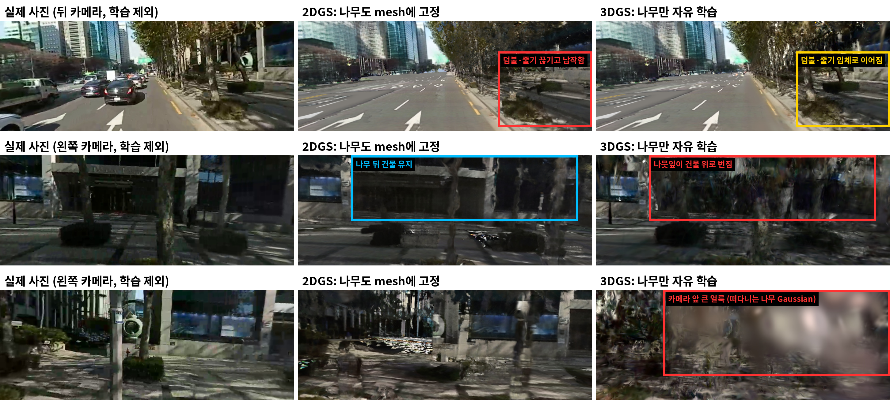

* 1행: 나무 아래 덤불과 줄기는 3DGS가 입체로 이어짐
* 2행: 나뭇잎이 건물 위로 번짐
* 3행: 카메라 바로 앞에 떠다니는 나무 Gaussian이 큰 얼룩을 만듦

## 3. 바꾼 방법

> **굵은 글씨 = 11/17 사용자 지시로 반영한 부분**

### 3.1 데이터

| 항목 | 내용 |
|---|---|
| 학습 사진 | 블록 80, 프레임 80에서 119 중 5의 배수를 뺀 32곳, 카메라 4대(앞, 왼쪽, 오른쪽, 뒤). 128장 |
| 평가 사진 | 5의 배수 프레임 8곳, 카메라 4대. 32장. 학습에 안 씀 |
| 손실에서 빼는 화소 | 학습 사진의 차량과 사람 마스크, 앞 카메라에 보이는 ADI 차 자체 |

### 3.2 시작 모델과 고정 범위

| 그룹 | Gaussian 수 | 학습 여부 |
|---|---|---|
| 바닥 (정밀도로지도 바닥면 3 cm 이내: 차도와 인도) | 2.61M | 고정 (위치, 색 모두) |
| 하늘 (150 m 밖) | 0.11M | 고정 |
| 나무 | 0.99M | 학습 |
| 건물 등 나머지 | 0.83M | 학습 |

* 시작은 블록 80 기존 2DGS 최종본임

### 3.3 학습 4개 (모두 30,000번)

| 이름 | 학습 그룹 표현 | Difix |
|---|---|---|
| 3DGS | 위치, 크기, 회전, 불투명도, 색(시점 따라 변함), Gaussian 추가와 삭제(15,000번까지) | 없음 |
| 2DGS | mesh 위에 고정. 색, 불투명도, 면 안 크기만 | 없음 |
| 3DGS + Difix | 3DGS와 같음 | 있음 |
| 2DGS + Difix | 2DGS와 같음 | 있음 |

* 도로는 넷 모두 같은 고정 2DGS. 2DGS와 3DGS 비교는 표현의 효과, Difix 있음과 없음 비교는 Difix의 효과
* 3DGS 제한
  * 나무 Gaussian은 LiDAR 나무 영역 안에서만 움직임. **영역 범위 1.5 m에서 3 m로 넓힘**
  * 건물 등은 바닥 아래로 내려갈 수 없음. **차도 위에서는 바닥에서 3 m 아래만 지움 (위로 뻗은 가지는 허용)**
  * 크기 상한은 나무 0.25 m, 나머지 1 m
* 손실은 L1 0.8, SSIM 0.2이고, 사진마다 밝기 보정이 있음

### 3.4 Difix (두 Difix 학습 공통)

| 항목 | 내용 |
|---|---|
| 회차 | 3,000번부터 1,500번마다 18회 |
| 가상 시점 | **새 목표**: 학습 위치 16곳마다 9개, 144장. **왼쪽 3 m와 왼쪽 6 m 차로**에서 정면, 왼쪽, 오른쪽, 뒤 4방향, 그리고 **뒤 추종(6 m 뒤, 지면 1.6 m)**. 모두 차도 위 |
| 시점 이동 | 같은 방향 ADI 카메라에서 목표까지 매 회차 18분의 1씩 |
| Difix 입력 | 지금 모델의 렌더, 참조 사진(실제 ADI 사진, 차 적은 사진 우선), 문장 "remove degradation". 1024 by 576 |
| 참조 사진 차량 | **차량 마스크와 ADI 차 영역을 같은 카메라 위치의 지금 모델 렌더로 채워서 넣음** (차량 hallucination 원인 차단) |
| 학습에 쓰는 화소 | **바닥과 하늘이 아닌 모든 화소** (렌더에 보이는지와 상관없음. 빠진 부분도 채울 수 있게). 차량 마스크 없음, **SAM3 없음** |
| 사용 방식 (공식 코드와 같음) | 가장 최근 회차만, 30% 확률, 손실 가중치 0.3 |

### 3.5 쓴 자료

| 자료 | 용도 |
|---|---|
| ADI 블록 80 사진 128장 (32곳, 카메라 4대) | 학습 |
| ADI 블록 80 사진 32장 (5의 배수 프레임) | 평가. 학습에 안 씀 |
| ADI 사진 차량과 사람 마스크 (SAM3와 Mask2Former) | 학습 손실에서 제외, 참조 사진 정리 |
| 블록 80 기존 2DGS 최종본 | 시작 Gaussian |
| 정밀도로지도 바닥면 mesh와 차도 영역 | 고정 그룹 판정, 차도 위 제한 |
| LiDAR 나무 점 | 나무 그룹 판정과 나무 영역 |
| Difix (`nvidia/difix_ref`) | 가상 시점 보정 |

### 3.6 논문과 같은 점, 다른 점

| 항목 | 논문 | 우리 | 같음 여부 |
|---|---|---|---|
| 학습 안에서 점진적으로 Difix 추가 | 1,500번마다 | 1,500번마다 | 같음 |
| Difix 입력 | 렌더와 가장 가까운 학습 사진 | 렌더와 차를 지운 학습 사진 | 다름 |
| 학습 화소 | 이미지 전체 | 바닥과 하늘 제외 | 다름 (바닥 고정이라) |
| 시점 이동 | 회당 고정 거리 0.5, 도착하면 멈춤 | 회당 전체 거리의 18분의 1 | 다름 |
| 최종 렌더 보정 | 학습 뒤 렌더마다 Difix 한 번 더 | 안 함 (실시간 렌더) | 안 함 |

### 3.7 학습 전 점검에서 고친 것

| 문제 | 영향 | 조치 |
|---|---|---|
| 정밀도로지도 차도 격자를 행과 열을 바꿔 읽음 | 차도 위 삭제 규칙이 인도 덤불, 화단, 건물 벽 아랫부분 약 6만 개를 지움 | 고침. 고친 뒤 차도 위 삭제는 2천 개. 11/16 깨끗한 합성의 인도 판정도 같은 실수였음 |
| 오른쪽 옆 차로 목표가 인도 위 | ADI는 맨 오른쪽 차로를 달림. 오른쪽 3 m는 나무 줄기와 기둥 바로 옆 | 왼쪽 3 m, 왼쪽 6 m 차로로 바꿈 |
| 뒤 추종 목표가 나무 수관 안 | 16곳 중 13곳이 물체에서 1 m 안 | Genesis 추종 카메라와 같은 지면 1.6 m로 낮춤 |
| 주행 영상의 시점 의존 색 | Genesis 좌표가 113도 돌아가 있어 그대로 쓰면 색 방향이 틀림 | 주행 영상은 4개 모두 시점 무관 색으로 통일 |
| 3DGS에서 카메라 바로 앞 큰 얼룩 (학습 중 발견) | 나무 영역이 ADI 주행 차로까지 덮고, 나무는 차도 위 규칙에서 빠져 있었음 | 차도 위 3 m 아래 금지를 나무에도 적용, ADI 카메라 궤적 1.2 m 안 (바닥 위 0.3 m에서 3.5 m)은 비움. 3DGS 두 학습을 다시 돌림. 화면 전체 PSNR 18.94에서 19.38로 오름 |

## 4. 차량 hallucination 처리

**Difix 출력마다 SAM3로 차량을 지우던 단계를 뺌**

#### 그림 2. Difix 출력과 SAM3 차량 판정 (11/17 3DGS + Difix 학습 중)

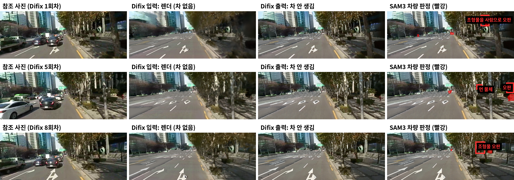

* 렌더에는 차가 없고 Difix 출력에도 새 차가 생기지 않음
* SAM3가 잡은 빨간 영역은 대부분 조형물이나 먼 물체를 잘못 잡은 것. 화면의 0.5% 정도
* 차가 생기는 원인은 참조 사진의 차를 옮겨 그리는 것이라, 참조 사진의 차를 미리 지우는 방식으로 바꿈
* 바닥은 고정이라 차도 위에 차가 그려져도 학습에 안 들어감

## 5. 결과: 3DGS + Difix가 가장 좋음

| 학습 제외 ADI 사진 32장 | 화면 전체 PSNR | 화면 전체 LPIPS | 나무 화소 PSNR | 나무 화소 LPIPS |
|---|---|---|---|---|
| 2DGS (11/16 기존 최종본) | 17.78 | 0.419 | 17.58 | 0.188 |
| 2DGS | 18.73 | 0.400 | 18.44 | 0.178 |
| 2DGS + Difix | 19.30 | 0.389 | 19.30 | 0.169 |
| 3DGS | 19.38 | 0.379 | 19.13 | 0.165 |
| **3DGS + Difix** | **20.10** | **0.366** | **20.02** | **0.155** |

**3DGS와 Difix 효과가 각각 있고, 둘을 합치면 가장 좋음**

* Difix 효과: 2DGS에서 화면 전체 0.57 dB, 나무 화소 0.86 dB. 3DGS에서 0.72 dB, 0.89 dB 오름
* 3DGS 효과: Difix 없이 0.65 dB, Difix와 함께 0.80 dB 오름
* 같은 코드의 2DGS가 기존 최종본보다 0.95 dB 높음. 바닥 외 부분의 색, 불투명도, 면 안 크기를 이 학습기에서 다시 학습한 효과로 봄
* 점수는 궤적 위 평가임. 궤적 밖은 사진이 없어서 그림으로만 비교함

#### 그림 3. 궤적 위 비교 (학습 제외 사진)

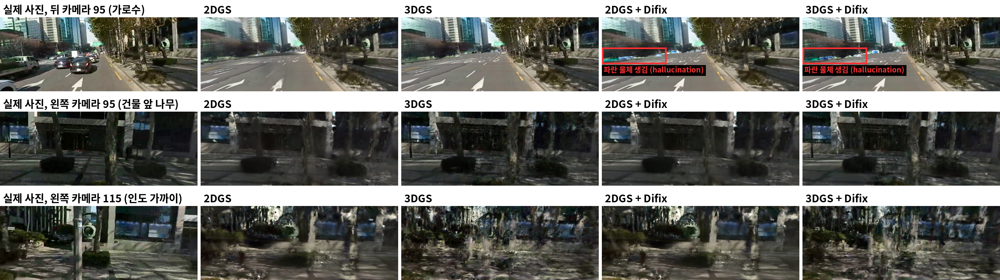

* 1행: 두 Difix 학습 모두 길 건너편 먼 곳에 **파란 물체가 생김 (hallucination)**. 실제 사진에는 없음
* 2행, 3행: 3DGS 쪽이 줄기와 덤불이 더 입체적임. 3행(인도 가까이)은 넷 모두 아직 흐림

#### 그림 4. 궤적 밖 비교 (옆 차로, 뒤 추종. 사진 없음)

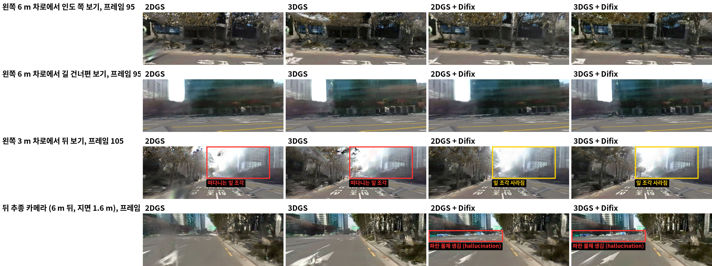

* 3행: 2DGS와 3DGS는 하늘 근처에 떠다니는 잎 조각이 있고, Difix를 넣으면 사라짐
* 4행: 뒤 추종 시점에도 같은 파란 물체가 보임
* 1행, 2행: 인도 쪽과 길 건너편은 넷의 차이가 작음. 길 건너편 건물은 넷 모두 흐림

#### 그림 5. Difix 회차별 변화 (3DGS + Difix, 왼쪽 3 m 차로에서 인도 쪽 시점)

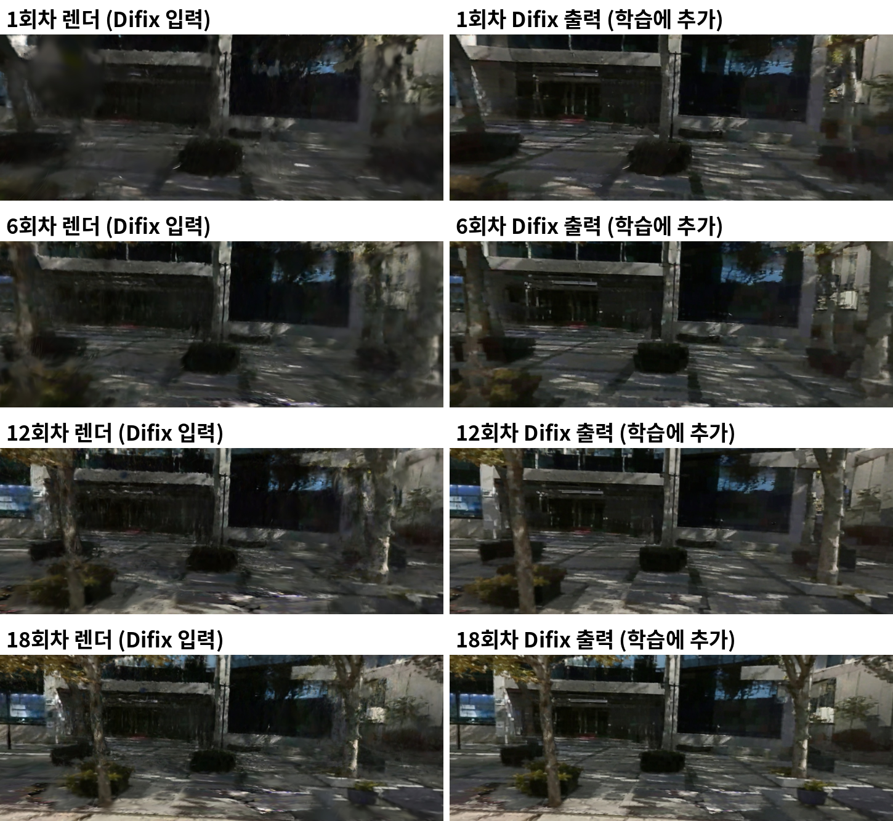

* 회차가 지날수록 렌더(왼쪽) 자체가 선명해짐. 1회차 렌더의 흐린 줄기가 18회차에는 또렷함
* Difix 출력(오른쪽)은 회차마다 렌더보다 선명하고, 이게 다음 학습에 들어감

#### 그림 6. 가상 시점 이동과 회차별 렌더 (GIF)

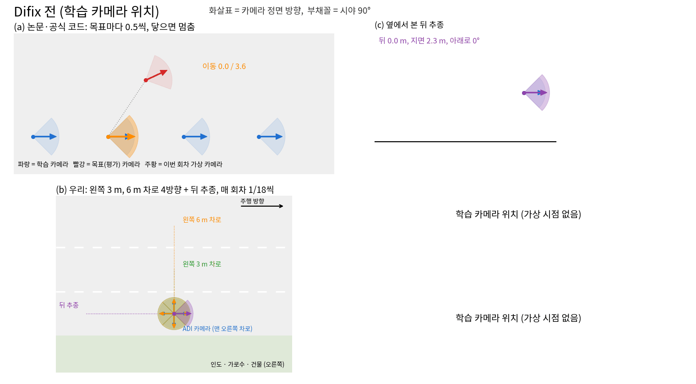

* 화살표는 카메라 정면 방향, 부채꼴은 시야
* 왼쪽 3 m와 6 m 차로의 가상 카메라 4방향이 회차마다 18분의 1씩 옮겨 가고, 뒤 추종 카메라는 6 m 뒤로 가며 지면 1.6 m까지 내려감

#### 영상 1. Genesis 주행 (같은 collider, 같은 제어기, 추종 카메라)

* 위 줄 2DGS, 3DGS. 아래 줄 2DGS + Difix, 3DGS + Difix
* 3DGS 쪽 가로수에 줄기가 보이고, 2DGS는 잎이 납작하게 뭉침
* Difix 쪽은 왼쪽 먼 곳에 파란 물체가 보임 (그림 3, 4와 같은 hallucination)

#### 영상 2. Genesis 주행 (운전석 카메라)

* 주행 영상은 4개 모두 시점 무관 색만 씀 (Genesis 좌표 회전 때문). 그래서 3DGS 쪽 유리 건물에 줄무늬가 보임. 평가 점수는 원래 색으로 렌더한 것임

#### 남은 확인

| 항목 | 상태 |
|---|---|
| Genesis 주행 영상 4개 (추종 카메라, 운전석 카메라) | 완료 (영상 1, 2). 8개 모두 목표 지점 도달 |
| 네이버 거리뷰만으로 블록 80 free 3DGS | 완료 (6절) |

## 6. 네이버 거리뷰만으로 블록 80 free 3DGS

> 2026년 7월 네이버 거리뷰 사진과 깊이 맵만으로 장면이 재구성되는지 확인함 (11/16 대기열 4번)

| 항목 | 내용 |
|---|---|
| 데이터 | 파노라마 22개, 시점 351장 (1440 by 540, 수평 시야 90도) |
| 학습과 평가 | 파노라마 16개 255장 학습, 파노라마 6개 96장 평가 (파노라마 통째로 뺌) |
| 학습기 | 11/15 free 3DGS 코드를 고쳐 씀. 30,000번, 시작 점 30만 개 (네이버 깊이 점) |
| 손실 | 차량, 사람 화소 제외. 하늘은 그릴 것이 없어 사진 손실에서 빼고 하늘 자리의 불투명도를 0으로 미는 손실 추가 |
| 사진 손실만 | 18분, Gaussian 276만 개, GPU 최대 5.1 GB |
| 사진 + 깊이 손실 | 깊이 상대 오차 손실 가중치 0.05. 20분, Gaussian 313만 개, GPU 최대 6.0 GB. 학습 끝 깊이 상대 오차 0.19 |

| 학습 제외 파노라마 96장 | PSNR (하늘 포함) | PSNR (하늘 제외) | LPIPS | LPIPS (하늘 제외) |
|---|---|---|---|---|
| 사진 손실만 | 10.37 | 13.22 | 0.593 | 0.534 |
| 사진 + 깊이 손실 | **10.49** | **14.31** | **0.535** | **0.481** |

**깊이 손실이 하늘 제외 PSNR 1.1 dB, LPIPS 0.05를 개선했지만, 네이버 사진만으로는 학습에서 뺀 파노라마 위치를 재구성하지 못함**

* 하늘 포함 PSNR이 낮은 건 하늘을 그리지 않아 검게 나오기 때문
* 학습에서 뺀 파노라마는 학습 파노라마에서 수 m에서 십수 m 떨어져 있어, 사진이 드문드문한 거리뷰로는 사이 시점이 어려움

#### 그림 7. 학습에서 뺀 파노라마 시점 (건물, 나무, 바닥)

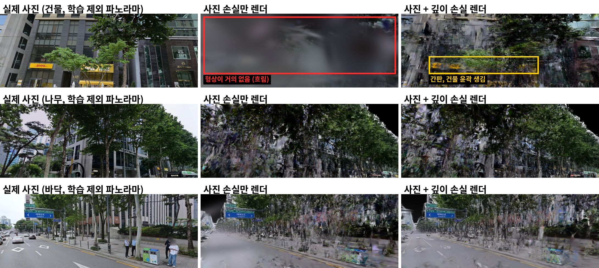

* 1행: 사진 손실만 쓰면 형상이 거의 없음. 깊이 손실을 넣으면 간판과 건물 윤곽이 생김
* 2행, 3행: 나무와 표지판 위치는 맞지만 잎과 건물 면이 세로로 번짐

#### 그림 8. 궤적 밖 시점 (학습 카메라 오른쪽 3 m, 30도 회전)

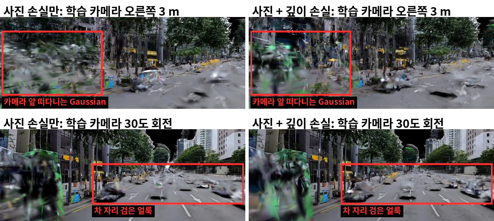

* 도로에 차가 있던 자리마다 검은 얼룩이 남음. 차량 화소는 손실에서 뺐지만 그 아래 도로를 본 사진이 부족함
* 카메라 바로 앞에 떠다니는 Gaussian이 있음 (가로수 가까이)

#### 실패와 미확인

| 항목 | 내용 |
|---|---|
| 학습 제외 파노라마 재구성 | 실패. 위 점수와 그림 |
| 차 자리 검은 얼룩 | 남음. 거리뷰 촬영 때 차가 많은 구간 |
| 하늘 | 그리지 않음 (검게 나옴). 사양에 없는 처리라 별도 표시 |
| 깊이 정합 | 네이버 깊이를 z 깊이로 바꾸는 식은 점군 생성 코드와 같음을 확인. mesh 깊이와 건물 화소 비교는 시점마다 0.7에서 1.1배로 흩어짐 (확인 못 한 시점 있음) |

## 7. 판단 필요

| 항목 | 내용 |
|---|---|
| 참조 사진 고르기 | 차 적은 사진을 우선하는 규칙이 남아 있음. 차를 지우게 되었으니 논문처럼 가장 가까운 사진으로 바꿀 수 있음 |
| Difix 시작 시점 | 공식 코드 기준 3,000번. 논문 본문에는 시작 시점이 없음 |
| 학습 그룹 제한 | 풀수록 빠진 가지와 수관을 채울 수 있지만 떠다니는 Gaussian 위험이 커짐. 3DGS에서 카메라 앞 얼룩이 생겨 ADI 카메라 궤적 주변을 비우는 규칙을 추가했음 |
| 파란 물체 hallucination | 길 건너편 먼 곳에 생김. 참조 사진의 차는 지웠으므로 Difix가 스스로 그린 것으로 보임. 먼 배경(예: 30 m 밖)은 Difix 학습 화소에서 빼는 방법이 있음 |

### 미팅 후 피드백

* 일단 road는 2DGS mesh
* 나무 및 배경은 3DGS로 진행하여 collider 보다는 visual 우선으로
* 주행 정면/후면 샷만 difix로 퀄리티 높이기(건물 및 나무)
* 알파마요 scene difix 사용하여 퀄리티 높여주기

## 8. 미팅 피드백 반영 (11/17 오후)

> 도로는 mesh 위 2DGS (화면과 collider가 같은 형상), 나무와 배경은 3DGS (화면 우선), Difix는 주행 정면과 후면 시점만. 알파마요는 동료 담당이고 우리는 맵만 만듦

### 8.1 밤사이 비교(v4)에서 찾은 문제

| 문제 | 확인한 수치 | 조치 (v5) |
|---|---|---|
| 3DGS가 실제로는 판이었음 | 두께 있는 나무 Gaussian 1.5 % (가장 짧은 축이 가장 긴 축의 0.3배 이상인 것). mesh에서 중앙값 0.15 m만 이동 | 학습 그룹은 두께를 면 방향 짧은 축과 같게 넣고 시작 |
| 2DGS에 크기 제한과 공간 비우기 규칙이 없었음 | 긴 축 1 m 넘는 판 약 1만 7천 개, 최대 1,183 m. 차도 시점에서 큰 흰 번짐 | 나무와 건물의 2DGS 학습은 중단 (미팅 결정) |
| 11/16의 "3DGS가 잎이 풍부함"은 학습 데이터 차이였음 | 이전 2DGS 최종본은 ADI 사진 128장 + 거리뷰 255장 + Difix 가상 시점 512장으로 20,000번. ADI 사진 비중 14 %, 장당 약 22번. 512장은 구조 나무를 넣기 전 형상의 렌더로 만든 것 | 조치 없음. v4부터는 ADI 사진만으로 30,000번 |

**v4의 2DGS 대 3DGS 비교는 두 방식 모두 조건이 틀려 있었음**

* 3DGS 쪽은 판을 조금 움직일 수 있는 2DGS였고, 2DGS 쪽은 일부 판이 수십 m까지 커졌음
* Difix 가중치는 문제가 아니었음. 가상 시점 비율 30 %, 가중치 0.3은 공식 코드 기본값과 같음

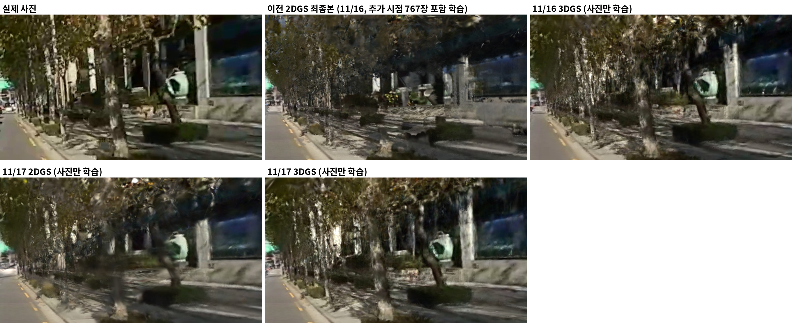

* 뒤 카메라 95의 나무 부분. 이전 2DGS 최종본만 잎이 뭉개짐. 사진만으로 학습한 것은 2DGS도 잎이 살아남

### 8.2 바꾼 설정

| 항목 | v4 | v5 |
|---|---|---|
| 학습 | 2DGS, 3DGS, 각각 Difix 유무 4개 | 3DGS, 3DGS + Difix 2개 |
| 도로와 인도 바닥 | mesh 위 2DGS 고정 | 같음. 학습 뒤 위치, 크기, 색, 불투명도 변화 0 확인 |
| 3DGS 시작 모양 | 두께 1 mm 판 | 두께 있는 Gaussian |
| 크기 규칙 | 절대 상한 (나무 0.25 m, 나머지 1 m) | 논문 규칙만. 씬 크기 1 % 넘으면 쪼갬, 3,000번 이후 씬 크기 10 % 또는 화면 20 px 넘으면 지움 |
| Difix 목표 | 9종, 회차당 144장 | 5종 (왼쪽 3 m, 6 m 차로의 정면과 후면, 뒤 추종), 회차당 80장 |
| Difix 화소 | 바닥과 하늘 제외 전부 | 같음 (먼 건물도 포함) |

### 8.3 결과

학습에서 뺀 ADI 사진, PSNR / LPIPS. 화면 전체와 나무는 32장, 건물은 24장.

| 모델 | 화면 전체 | 나무 | 인도 쪽 건물 | 길 건너편 건물 |
|---|---|---|---|---|
| v4 3DGS | 19.38 / 0.379 | 19.13 / 0.165 | 19.10 / 0.288 | 20.61 / 0.245 |
| v4 3DGS + Difix | 20.10 / **0.366** | 20.02 / **0.155** | 19.86 / 0.275 | **21.79** / **0.234** |
| v5 3DGS | 20.00 / 0.371 | 19.73 / 0.164 | 20.66 / 0.268 | 20.33 / 0.245 |
| v5 3DGS + Difix | **20.35** / 0.370 | **20.27** / 0.162 | **21.16** / **0.263** | 21.12 / 0.239 |

**인도 쪽 건물은 1.3 dB 올랐고, 나머지는 v4 3DGS + Difix와 비슷하거나 조금 낮음**

* 인도 쪽 건물 향상은 대부분 두께로 시작한 효과임 (Difix 없이 20.66). Difix가 0.5 dB를 더함
* v5의 Difix 효과는 PSNR 0.35 dB에서 0.8 dB, LPIPS는 거의 그대로 (0.371에서 0.370). v4보다 작음
* 길 건너편 건물은 v4 3DGS + Difix가 0.7 dB 높음. 밝기 차이였음 (8.5절)

> 이 표의 PSNR은 밝기 차이를 포함함. 밝기를 맞춘 값과 해석은 8.5절에서 다시 씀

#### 그림 9. 궤적 위, 학습에서 뺀 사진 시점

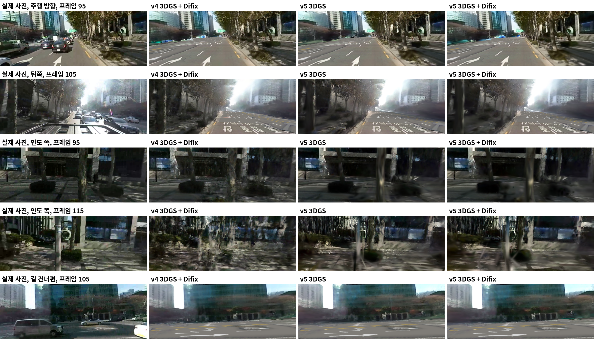

* 4행(인도 가까이): v4의 잘게 부서진 줄무늬가 v5에서 줄고 조금 흐려짐
* 1행: v5 3DGS + Difix에도 길 건너편 파란 물체가 생김

#### 그림 10. 궤적 밖, 옆 차로와 뒤 추종 시점

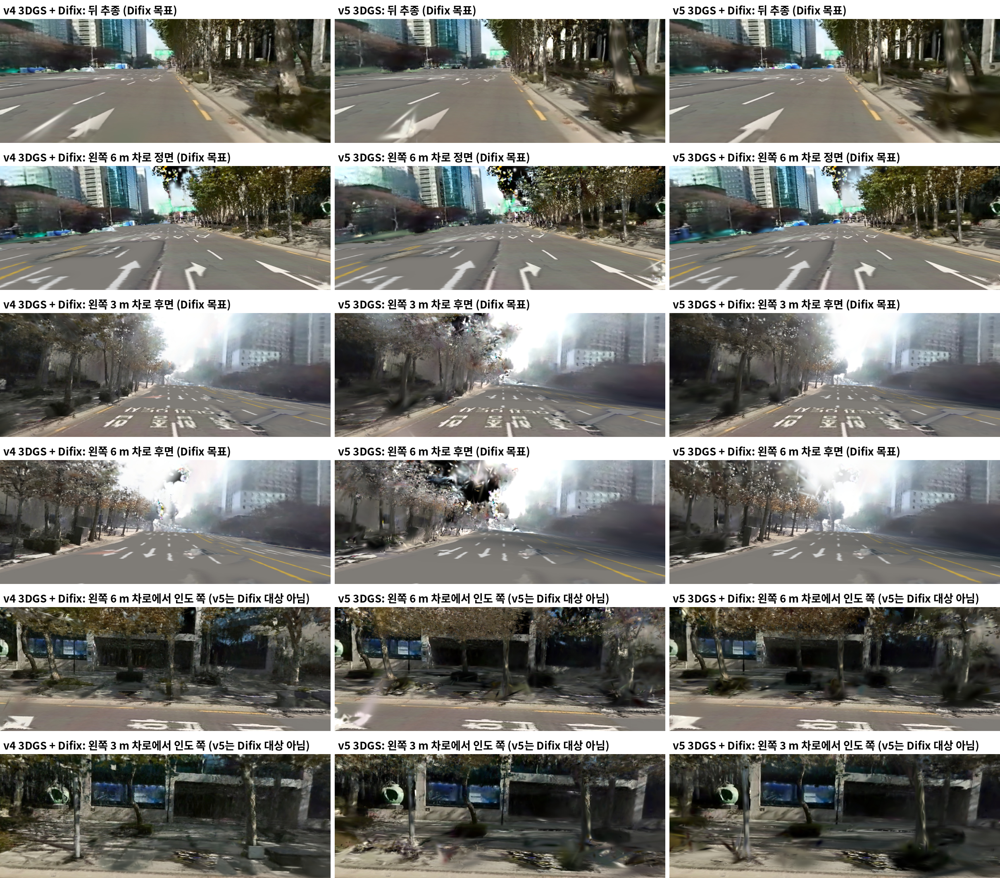

* 1행(뒤 추종): Difix 없는 v5는 차도 화살표 위에 흰 얼룩이 떠 있고, Difix를 넣으면 사라짐
* 3행, 4행(옆 차로 후면): 하늘 근처 조각이 Difix로 줄지만 6 m 차로 후면에는 흰 번짐이 남음
* 5행, 6행(인도 쪽을 옆으로 보는 시점, v5에서 Difix 대상 아님): Difix를 넣어도 넣지 않은 것과 비슷함

#### 그림 11. Difix 회차별 입력과 출력 (v5 3DGS + Difix)

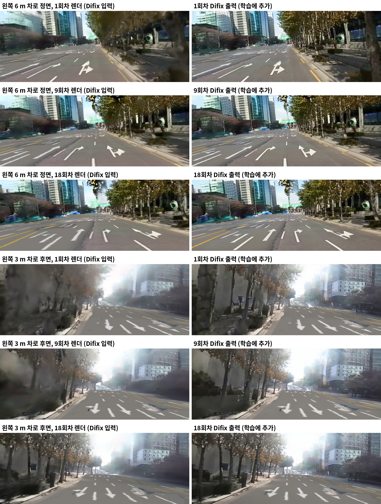

#### 영상 3. Genesis 주행, 추종 카메라 (왼쪽부터 v4 3DGS + Difix, v5 3DGS, v5 3DGS + Difix)

#### 영상 4. Genesis 주행, 운전석 카메라

* 네 주행 모두 목표 도달 (collider와 제어기는 v4와 같음)
* **v5 두 모델은 화면 위쪽 나무와 하늘 경계에 회백색 번짐이 보임. v4에는 없음**
* 주행 영상은 시점 무관 색만 써서 평가 렌더보다 번짐이 더 밝게 보임

### 8.4 남은 문제

| 항목 | 수치 | 원인으로 보이는 것 |
|---|---|---|
| 주행 영상 위쪽 회백색 번짐 | 긴 축 1 m 넘는 Gaussian 1만 3천 개에서 1만 7천 개, 대부분 높이 20 m 이상 | 절대 상한을 없앴고, 큰 것을 지우는 논문 규칙은 15,000번까지만 동작함 |
| 하늘을 칠하는 밝은 Gaussian | 하늘 화소 위에 약 3만 4천 개 (v4는 약 5만 3천 개) | 하늘 화소가 사진 손실에 들어가는데 하늘을 그릴 대상이 없음 |
| 두께가 다시 줄어듦 | 두께 있는 나무 Gaussian 3,500번 91 %, 30,000번 약 30 % | 미확인 |
| 파란 물체 | v5 3DGS + Difix에도 생김 | 먼 배경도 Difix 대상에 포함 (결정 사항) |
| 옆을 보는 시점 | Difix 대상에서 빼서 개선 없음 | 결정 사항 |

### 8.5 재검토: Difix 향상은 대부분 밝기였고, 길 건너편은 깊이가 틀려 있음

> 8.3의 PSNR만 보고 Difix가 0.35 dB에서 0.8 dB를 더했다고 썼음. 밝기를 사진에 맞춘 뒤 다시 재면 그 향상이 거의 사라짐

밝기 맞춘 PSNR (dB). 사진과 장수는 8.3과 같음.

| 모델 | 화면 전체 | 나무 | 인도 쪽 건물 | 길 건너편 건물 |
|---|---|---|---|---|
| v4 3DGS | 20.81 | 21.67 | 19.58 | 23.18 |
| v4 3DGS + Difix | 20.97 | 21.71 | 20.29 | 22.94 |
| v5 3DGS | **21.52** | 22.17 | 21.19 | **23.42** |
| v5 3DGS + Difix | **21.52** | **22.19** | **21.53** | 23.15 |

**v5에서 Difix가 더한 것은 인도 쪽 건물 0.34 dB뿐임. 화면 전체 0.00 dB, 나무 0.02 dB, 길 건너편 건물은 0.27 dB 낮아짐**

* v4에서 v5로 바꾼 효과(두께로 시작, 논문 규칙)는 밝기를 맞춰도 남음. 화면 전체 0.71 dB, 인도 쪽 건물 1.61 dB
* 길 건너편을 보는 카메라의 건물 화소 평균 밝기: 사진 0.278, Difix 없는 모델 0.367, v4 3DGS + Difix 0.324, v5 3DGS + Difix 0.351. Difix 가상 시점에는 사진별 밝기 보정이 없어 모델 밝기가 사진 쪽으로 끌려갔고, 8.3의 PSNR 향상은 이 이동임
* v4 3DGS + Difix가 길 건너편에서 0.7 dB 높았던 것도 같은 이유임. v4는 옆을 보는 가상 시점이 있어 밝기가 더 많이 움직였음
* 평가 사진은 모두 궤적 위임. 궤적 밖 시점은 정답 사진이 없어 이 표로 잴 수 없음

#### 길 건너편 건물 화질이 오르지 않는 이유

| 확인한 것 | 수치 |
|---|---|
| 선명도 (화소 밝기 변화량, 사진 = 100 %) | v4 3DGS 70 %, v4 3DGS + Difix 71 %, v5 3DGS 72 %, v5 3DGS + Difix 75 % |
| LiDAR가 잰 길 건너편 물체 (나무, 기둥, 담) | 지면 위 2만 8천 점. 차에서 옆으로 24 m에서 32 m에 대부분. 40 m 넘는 점 없음 |
| 학습을 시작할 때 길 건너편 Gaussian | 48 m에서 56 m의 벽 한 장에 1만 9천 개, 간격 0.21 m (인도 쪽 0.05 m). 16 m에서 48 m 사이 0개 |
| 모델이 그린 거리 (LiDAR 점이 찍힌 화소, 중앙값) | LiDAR 29.5 m. v4 3DGS + Difix 49.6 m, v5 3DGS 38.5 m, v5 3DGS + Difix 41.8 m |
| 그 거리 차이로 생기는 화면 어긋남 | 사진 한 장 간격(0.83 m)마다 5 px에서 8 px, 블록 전체 약 190 px에서 320 px |

**길 건너편 나무와 기둥이 제자리(약 30 m)가 아니라 뒤쪽 벽 위치(40 m에서 50 m)에 그려져 있음. 차가 움직이면 사진마다 다른 자리에 찍히므로 평균되어 가로로 번짐**

* 시작 형상은 mesh 표면에서만 뽑았고, 길 건너편 mesh에는 먼 벽 한 장뿐임. LiDAR 점은 시작 형상에 쓰지 않았음
* 3DGS는 이미 있는 Gaussian 근처에서만 복제하고 쪼갬. 30 m 자리에 씨앗이 없어 30,000번 뒤에도 그 구간이 거의 비어 있음 (v4 0개, v5 약 2천 5백 개)
* Difix는 형상 오차를 고치지 못함. v5의 가상 시점은 정면과 후면뿐이라 길 건너편을 마주 보는 시점도 없음
* 화면에서의 Gaussian 크기는 양쪽이 비슷함 (길 건너편 중앙값 3.5 px, 인도 쪽 3.9 px에서 4.6 px). Gaussian 수 부족은 주된 원인이 아님
* 대조: 인도 쪽을 같은 방법으로 재면 모델이 LiDAR보다 1.7 m에서 3.5 m 앞임 (나무에 가려진 LiDAR 점이 섞임). 이 측정의 오차는 수 m 수준이고, 길 건너편의 10 m에서 21 m는 그보다 큼
* 유리 외벽의 반사는 보는 위치마다 달라서 형상을 맞춰도 남을 수 있음 (미확인)

#### 그림 12. 길 건너편을 보는 카메라의 사진, 렌더, 거리

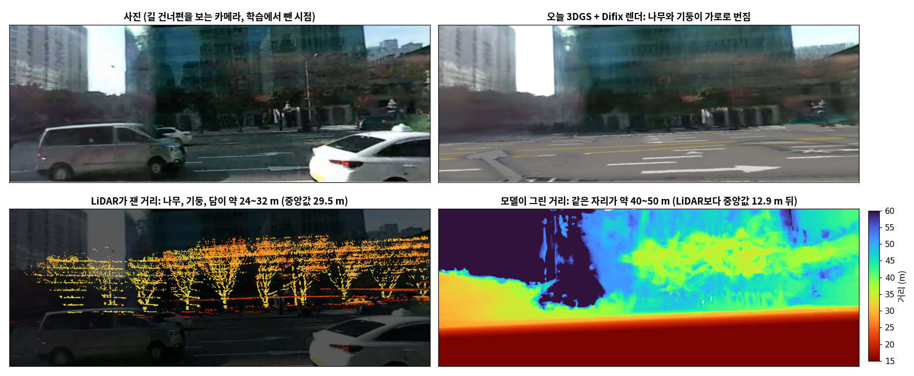

* 아래 왼쪽: LiDAR 점은 가로수 줄기와 가지 모양이 보이고 거리는 24 m에서 32 m (주황, 노랑)
* 아래 오른쪽: 모델은 같은 자리를 40 m에서 50 m (초록, 하늘색)의 넓은 덩어리로 그림. 나무 모양이 없음

#### 주행 시점에서 Difix가 모델에 남지 않는 이유

> 11/18 추가: 아래의 일정 설명은 원인이 아니었음. 목표 차로에 6회차에 도착해 12회차를 반복하도록 바꿔도 결과가 같았음 (11/18 보고서 3.5절)

마지막 회차의 주행 시점(왼쪽 3 m, 6 m 차로의 정면과 후면, 뒤 추종. 종류마다 2장)에서 Difix 손실에 쓰는 화소만 잰 값.

| 화면 | 선명도 | Difix 출력과의 PSNR (dB) |
|---|---|---|
| Difix 입력 (28,500번째 모델 렌더) | 0.0207 | 26.01 |
| Difix 출력 | 0.0243 | 기준 |
| v5 3DGS + Difix 최종 (30,000번) | 0.0207 | 26.23 |
| v5 3DGS 최종 (Difix 없음) | 0.0251 | 16.93 |

**Difix는 주행 시점 화면을 17 % 더 선명하게 만듦. 그런데 그 화면으로 1,500번 학습한 뒤의 모델은 입력과 같음 (선명도 그대로, Difix 출력 쪽으로 0.22 dB 이동)**

* 모델에 남은 것은 큰 얼룩과 조각을 지운 효과임. Difix 없는 모델은 같은 시점에서 Difix 출력과 16.93 dB로 멀고 선명도 값이 높은 것도 조각 때문임
* 모델에 남지 않은 것은 창틀 같은 세부임
* 목표 차로(3 m, 6 m)에는 18회차 중 마지막 회차에만 도달함. 그 화면은 장당 약 6번, 가중치 0.3으로만 쓰임. ADI 사진은 장당 약 170번, 가중치 1. 이때 위치 학습률은 처음의 1.3 %이고 Gaussian 추가는 15,000번에 끝나 있음
* 회차마다 시점이 0.17 m(3 m 차로) 또는 0.33 m(6 m 차로)씩 달라져 같은 시점의 Difix 화면을 두 번 쓰지 않음. 공식 코드는 가상 시점이 목표 시점에 도달하면 그 자리에 머물고 남은 회차 동안 같은 시점을 다시 고침 (29회차, 회차당 2,000번)
* Difix가 만든 세부가 시점끼리 서로 맞는지는 재지 않았음 (미확인)
* Difix 기준 사진의 16 %에서 25 %는 차량을 지운 자리에 모델 렌더를 채운 것임. 파란 물체가 한 번 생기면 기준 사진에도 들어가 다음 회차에서 유지됨

#### 그림 13. 왼쪽 3 m 차로 정면 시점의 길 건너편 부분

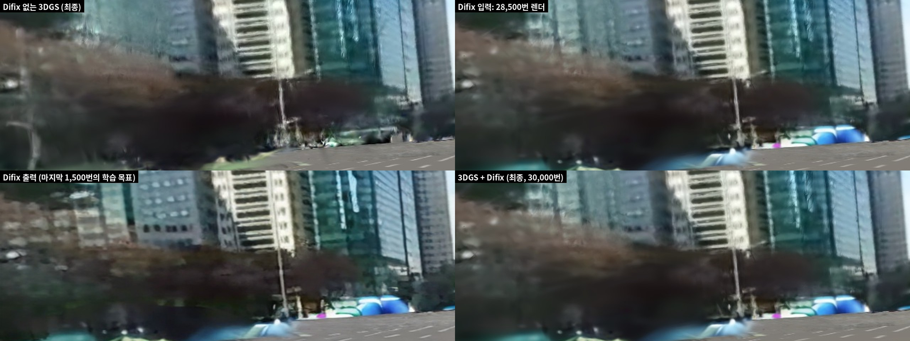

* 아래 왼쪽(Difix 출력)은 건물 창이 또렷함. 아래 오른쪽(최종 모델)은 위 오른쪽(Difix 입력)과 거의 같음
* 갈색 띠는 길 건너편 가로수임. 제자리에 Gaussian이 없어 Difix 없는 모델에서도 같은 번짐임

