# 주행 시점의 길 건너편 건물을 네이버 거리뷰와 초해상도로 보강

> 11/18 새벽 진행. seq60 블록 80. 주행 시점에서 길 건너편 건물 윤곽이 Difix 뒤에도 흐린 문제를, 건물에 쓰는 자료를 바꿔서 풀어 봄. 나무와 도로는 v5 그대로 둠

## 요약

| 항목 | 내용 |
|---|---|
| 문제 | 주행 시점에서 길 건너편 먼 건물은 Difix를 거치면 잡음은 줄지만 윤곽선이 흐림. 원본 ADI 사진이 흐려서 모델도 Difix도 그 이상으로 못 감 (11/17 확인) |
| 시도 | 건물 화소만 다른 자료로 학습함. 네이버 거리뷰 3가지 방식, 초해상도 모델 1가지, 둘의 조합 1가지. 한 번에 하나씩 30,000번 |
| 결과 1 | **네이버 건물 직접 학습은 후면 건물을 크게 살림.** 학습에서 뺀 네이버 사진 대비 선명도 25 %에서 88 %, 밝기 맞춘 PSNR 16.22에서 19.94 |
| 결과 2 | 같은 학습이 정면 건물 일부는 망침. 흰 줄무늬 건물의 무늬가 뒤섞임. 2019년 맑은 날 ADI와 2026년 흐린 날 네이버에서 같은 건물의 모습이 다른 것이 원인으로 보임 |
| 결과 3 | **네이버 사진을 Difix 기준 사진으로 쓰면 Difix 출력은 훨씬 또렷해지지만 (렌더 대비 81 %), 그 출력으로 학습한 모델은 v5와 같음.** Difix가 고친 화면이 모델에 남지 않는 11/17의 문제가 그대로임 |
| 결과 4 | 초해상도 건물 학습은 정면 건물 윤곽을 조금 살림 (ADI 사진 대비 선명도 73 %에서 82 %). 건물 모습은 ADI 그대로이고 부작용이 없음. 후면은 원본이 뿌옇기 때문에 그대로임 |
| 결과 5 | 건물을 mesh에 고정하면 후면은 또렷하지만 정면에 검은 구멍이 생김. 건물 판의 65 %가 투명해짐 |
| 조합 | **정면은 초해상도, 후면은 네이버로 학습한 조합이 가장 고름.** 정면 선명도 83 %, 후면 선명도 97 %, 뒤섞임과 구멍 없음 |
| 추가 시험 | 조합 학습에 길 건너편 LiDAR 점 19,188개를 시작 Gaussian으로 넣어 봄. 길 건너편 깊이 오차가 6.0 m에서 4.9 m로 조금 줄고 기둥이 생겼지만, 가로수 번짐은 대부분 그대로임 |
| Difix 일정 | 11/17에 내가 제안한 일정 변경(목표 차로에 일찍 도착해 같은 시점을 반복)을 시험함. **효과 없음.** Difix 출력이 모델에 남는 정도가 v5와 같음. 일정은 원인이 아니었음 |
| 그대로인 것 | 나무와 인도 쪽 건물은 모든 학습에서 v5와 같음 (밝기 맞춘 PSNR 차이 0.2 dB 안) |
| **판단 필요** | 조합 학습을 기본으로 올릴지. 후면 건물이 2026년 여름 흐린 날 모습이 되어 나머지 장면(2019년 가을 맑은 날)과 분위기가 다름 |

## 용어

| 용어 | 설명 |
|---|---|
| 길 건너편 건물 | ADI 차는 맨 오른쪽 차로를 달림. 주행 시점에서 왼쪽에 보이는 건물. 정면을 보면 왼쪽 앞, 후면을 보면 오른쪽 뒤 |
| 주행 시점 | 우리 차가 도로에서 정면 또는 후면을 보는 시점. ADI 차로, 왼쪽 3 m 차로, 왼쪽 6 m 차로 |
| v5 3DGS + Difix | 11/17 기본 학습. 도로는 mesh 위 2DGS 고정, 나무와 배경은 3DGS, Difix는 주행 정면과 후면 가상 시점. 이 문서의 비교 기준 |
| 건물 화소 | SAM3가 building으로 고른 화소에서 나무, 차량, 사람, 기둥을 몇 화소 넓혀 뺀 것 |
| 추가 시점 | ADI 사진과 Difix 가상 시점 외에 학습에 더 넣은 사진. 마스크 안 건물 화소만 손실에 씀 |
| 확대 시점 | 같은 카메라 위치에서 길 건너편 건물 쪽으로 돌려 2배 확대한 시점 (초점 1440 px) |
| 밝기 맞춘 PSNR | 렌더의 색 채널마다 밝기와 대비를 사진에 맞춘 뒤 잰 PSNR. 노출 차이를 빼고 형상과 무늬만 봄 |
| 선명도 | 화소 밝기 변화량의 평균. 사진을 100 %로 둔 비율로 씀. 사진이 없는 시점은 값 그대로 씀. 잡음도 선명도를 올리므로 그림과 같이 봐야 함 |
| 학습에서 뺀 네이버 사진 | 블록 안 파노라마 1곳 (블록 시작에서 14.6 m)의 8장. 네이버 차로는 ADI 경로 왼쪽 4.6 m라서 왼쪽 차로 주행 시점의 정답 사진 역할을 함 |

## 1. 문제

- 11/17 확인: 원본 ADI 사진이 천장임. Difix 출력은 기준 사진과 같은 선명도 (101 %)에서 멈추고, 모델은 그보다 낮음 (76 %에서 87 %)
- 주행 시점의 길 건너편 먼 건물은 Difix를 거쳐도 윤곽선이 확실하지 않음
- 사진에 없는 정보를 밖에서 가져오는 방법 두 가지를 시험함 (11/18 사용자 지시)

| 지시 | 반영 |
|---|---|
| 네이버 거리뷰에서 건물 부분만 가져와 Difix로 증류 학습 | 네이버 사진을 Difix 기준 사진으로 쓰는 학습, 그리고 건물 화소를 직접 학습하는 학습 둘 다 진행 |
| 네이버 대신 초해상도 모델 | Real-ESRGAN으로 ADI 주행 방향 사진을 키워 학습 |
| 거리뷰에서 차량과 나무는 모두 가림 | SAM3 건물 화소만 씀. 나무, 차량, 사람, 기둥은 5 px 넓혀 뺌 |
| 주행 시점에서 보이는 것만 | 네이버 사진은 정면, 후면, 왼쪽 대각선만 씀. 건물 화소 중 우리 차 주행 시점 화면에 들어오는 곳만 남김 |
| 마스크는 SAM3 | 네이버 쪽은 기존 마스크가 SAM3 결과. ADI 주행 방향 사진 80장과 목표 시점 렌더 1,640장은 새로 돌림 |
| 나무는 파이프라인대로, 도로는 2DGS | v5 그대로 |

## 2. 시도한 방법

| 방법 | 건물에 쓴 자료 | 학습에 넣는 방식 | ADI 건물 화소 | Difix |
|---|---|---|---|---|
| v5 3DGS + Difix (기준) | ADI 사진 | 사진 손실 | 사용 | v5 |
| 네이버 건물 직접 학습 | 네이버 거리뷰 120장 | 추가 시점. 본 학습 한 번 뒤 확률 0.3으로 한 번 더 | 주행 방향 사진에서 뺌 | v5 |
| 네이버 건물 학습, 건물은 mesh에 고정 | 위와 같음 | 위와 같음. 건물 Gaussian은 mesh 위 판으로 두고 색, 불투명도, 면 방향 크기만 학습 | 뺌 | 건물 화소는 Difix 손실에서도 뺌 |
| 네이버 사진을 Difix 기준으로 | 네이버 정면, 후면 사진 30장 | 회차마다 Difix를 한 번 더 돌려 건물 화소만 그 출력으로 바꿈 | 사용 | 건물 화소만 네이버 기준 출력 |
| 초해상도 건물 학습 | ADI 주행 방향 사진 64장을 4배로 키운 것 | 2배 확대 시점 64장을 추가 시점으로 | 뺌 | v5 |
| 조합 학습 | 정면은 초해상도 확대 시점 32장, 후면은 네이버 후면과 왼쪽 뒤 대각선 60장 | 추가 시점. 확률 0.4 | 뺌 | v5 |

쓴 자료.

| 자료 | 내용 |
|---|---|
| 네이버 거리뷰 | 2026년 7월 촬영. 파노라마 16곳 (블록 앞뒤 약 100 m), 한 곳당 8방향과 2가지 기울기. 1440 by 540, 수평 시야 90도. 차로는 ADI 경로 왼쪽 4.6 m |
| 네이버 학습 시점 | 정면, 후면, 왼쪽 앞 대각선, 왼쪽 뒤 대각선 120장 (파노라마 15곳). 옆을 보는 시점은 뺌. 쓴 화소는 장당 평균 8.0 % |
| 네이버 자세 | 11/15에 맞춘 자세 그대로. 블록 안 정면 시점에서 v5 렌더와 건물 위치 차이가 가로 3 px, 세로 6 px 안 |
| 초해상도 모델 | Real-ESRGAN x4plus. 따로 학습하지 않음 |
| 초해상도 확대 시점 | ADI rear, front 학습 사진마다 1장. 쓴 화소는 장당 평균 33.3 % |
| 마스크 | SAM3. 낱말은 building, sky, tree, pole, traffic sign, car, truck, bus, van, motorcycle, bicycle, person |

#### 그림 1. 네이버 사진과 학습에 쓴 화소

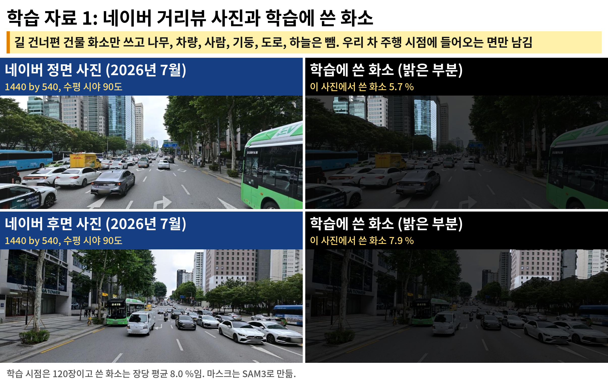

* 오른쪽이 학습에 쓴 화소. 길 건너편 건물만 밝게 남기고 나무, 차량, 도로, 하늘은 뺌
* 위는 정면 사진, 아래는 후면 사진이고 둘 다 학습에 쓴 사진임

#### 그림 2. 초해상도 입력

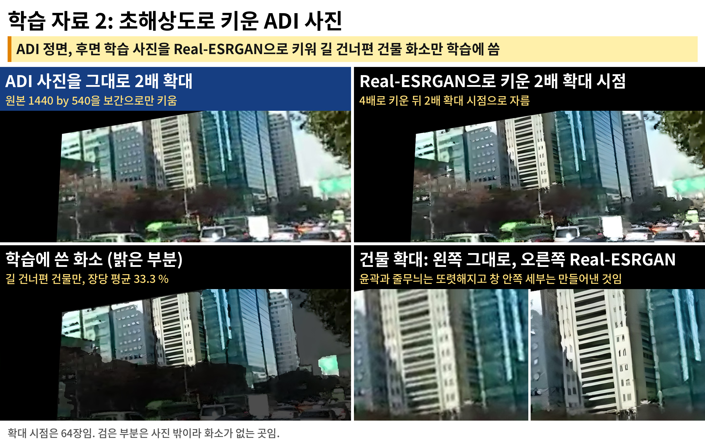

* 오른쪽 위가 Real-ESRGAN으로 키운 것, 오른쪽 아래가 건물 부분 확대 비교. 건물 윤곽과 줄무늬가 또렷해짐. 창 안쪽 같은 세부는 만들어낸 것임

## 3. 결과

길 건너편 건물 화소만 잰 값. 정면은 ADI 평가 사진 8장, 후면은 학습에서 뺀 네이버 사진 4장, 왼쪽 3 m 차로는 사진이 없어 선명도 값만 씀 (각 40장). 정면 선명도는 ADI 사진을, 후면 선명도는 네이버 사진을 100 %로 둔 값.

| 방법 | 정면 밝기 맞춘 PSNR | 정면 선명도 | 후면 밝기 맞춘 PSNR | 후면 LPIPS | 후면 선명도 | 왼쪽 3 m 차로 정면 | 왼쪽 3 m 차로 후면 |
|---|---|---|---|---|---|---|---|
| v5 3DGS + Difix (기준) | **18.00** | 73 % | 16.22 | 0.450 | 25 % | 0.0292 | 0.0090 |
| 네이버 건물 직접 학습 | 14.55 | 92 % | 19.94 | 0.272 | 88 % | 0.0358 | 0.0249 |
| 네이버 건물 학습, 건물은 mesh에 고정 | 13.73 | 88 % | 19.86 | 0.282 | 91 % | 0.0342 | 0.0262 |
| 네이버 사진을 Difix 기준으로 | 17.87 | 71 % | 16.44 | 0.434 | 29 % | 0.0284 | 0.0094 |
| 초해상도 건물 학습 | 17.63 | 82 % | 16.25 | 0.450 | 25 % | 0.0321 | 0.0094 |
| 조합 학습 | 17.45 | 83 % | **20.00** | **0.260** | **97 %** | 0.0323 | 0.0263 |

#### 한눈에 보기 (왼쪽 정면, 오른쪽 후면)

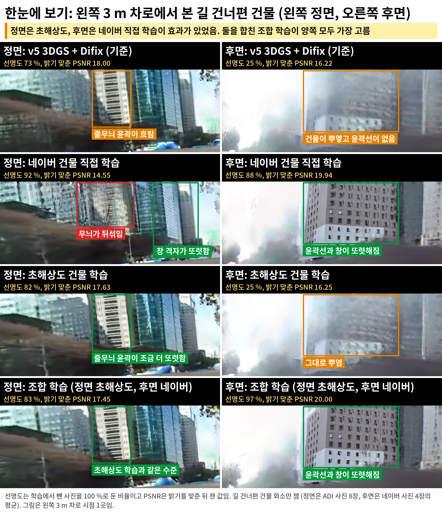

**후면은 네이버 자료를 직접 학습한 것만 살아남. 정면은 초해상도가 안전하게 조금 올림. 조합 학습이 두 쪽을 모두 가짐**

* 네이버 직접 학습의 정면 선명도 92 %는 뒤섞인 무늬가 포함된 값임. 정면 PSNR이 3.5 dB 떨어진 것이 그 증거임
* 네이버 사진을 Difix 기준으로 쓴 학습은 모든 값이 v5와 같음
* 초해상도와 조합 학습의 정면 PSNR이 v5보다 0.4 dB에서 0.6 dB 낮음. 또렷해진 윤곽이 흐린 ADI 사진과 화소 단위로는 덜 맞기 때문으로 보임

#### 그림 3. 왼쪽 3 m 차로, 후면 시점의 길 건너편 건물

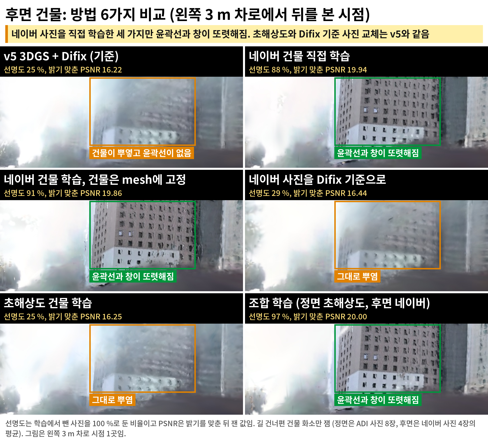

* 초록 = 좋아진 곳, 주황 = 그대로인 곳
* 네이버 건물 화소를 직접 학습한 세 가지만 윤곽선과 창이 또렷함

#### 그림 4. 왼쪽 3 m 차로, 정면 시점의 길 건너편 건물

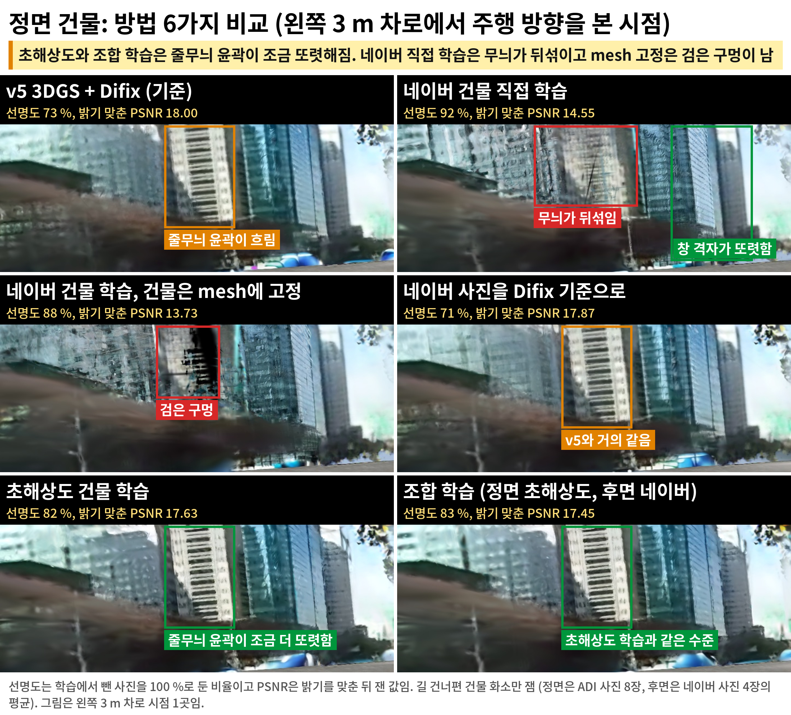

* 빨강 = 나빠진 곳. 네이버 직접 학습은 줄무늬 건물이 뒤섞이고, mesh 고정은 검은 구멍이 남
* 초해상도와 조합 학습은 줄무늬 윤곽이 조금 더 또렷하고 뒤섞임이 없음

#### gif 1. 네이버 쪽 비교 (기준, 직접 학습, mesh 고정, Difix 기준 순서)

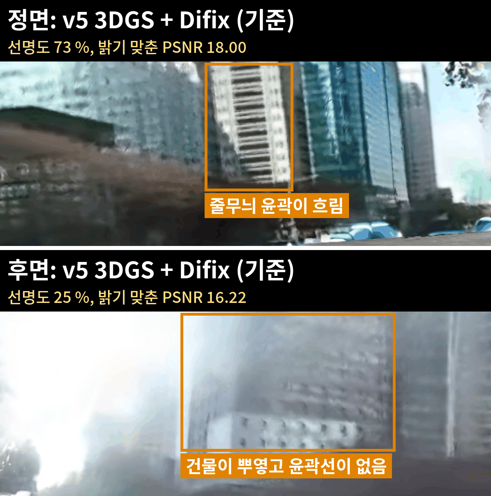

#### gif 2. 초해상도 쪽 비교 (기준, 초해상도 순서)

#### gif 3. 조합 학습 (기준, 조합 순서)

#### gif 4. 왼쪽 3 m 차로 주행, 후면 시점 (위부터 기준, 네이버 직접 학습, 조합 학습)

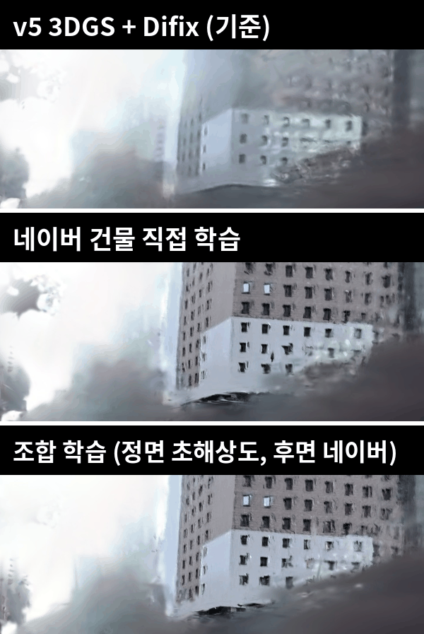

#### gif 5. 왼쪽 3 m 차로 주행, 정면 시점 (위부터 기준, 초해상도, 조합 학습)

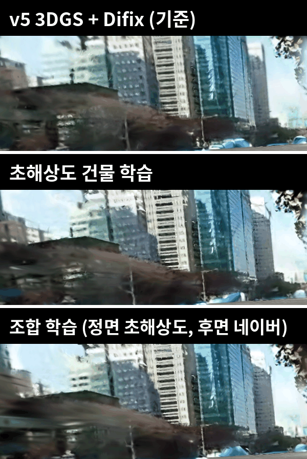

### 3.1 네이버 사진을 Difix 기준 사진으로 썼을 때

학습 전에 Difix 출력만 먼저 비교함. v5 최종 모델을 마지막 회차 목표 80곳에서 렌더하고, Difix를 ADI 기준과 네이버 기준으로 각각 돌림.

| 길 건너편 건물 화소 선명도 | 렌더 | Difix 출력, ADI 기준 | Difix 출력, 네이버 기준 |
|---|---|---|---|
| 80곳 평균 | 0.0214 | 0.0270 (렌더보다 26 % 높음) | **0.0387 (81 % 높음)** |
| 왼쪽 3 m 차로 정면 | 0.0290 | 0.0368 (27 %) | 0.0455 (57 %) |
| 왼쪽 3 m 차로 후면 | 0.0091 | 0.0117 (29 %) | 0.0275 (204 %) |

**Difix 출력은 기준 사진을 따라감. 그런데 이 출력으로 30,000번 학습한 모델은 v5와 같음**

* 가상 시점 손실은 전체의 약 11 %이고, 같은 건물 면을 ADI 사진이 89 %의 비중으로 계속 흐리게 학습시킴
* 11/17에 확인한 "Difix가 고친 화면이 모델에 남지 않음"이 기준 사진을 바꿔도 그대로임
* 네이버 기준 출력에는 렌더에 없던 건물과 물체가 생기기도 함. 학습에는 건물 화소만 가져옴

#### 그림 5. Difix 출력 비교 (학습 없음)

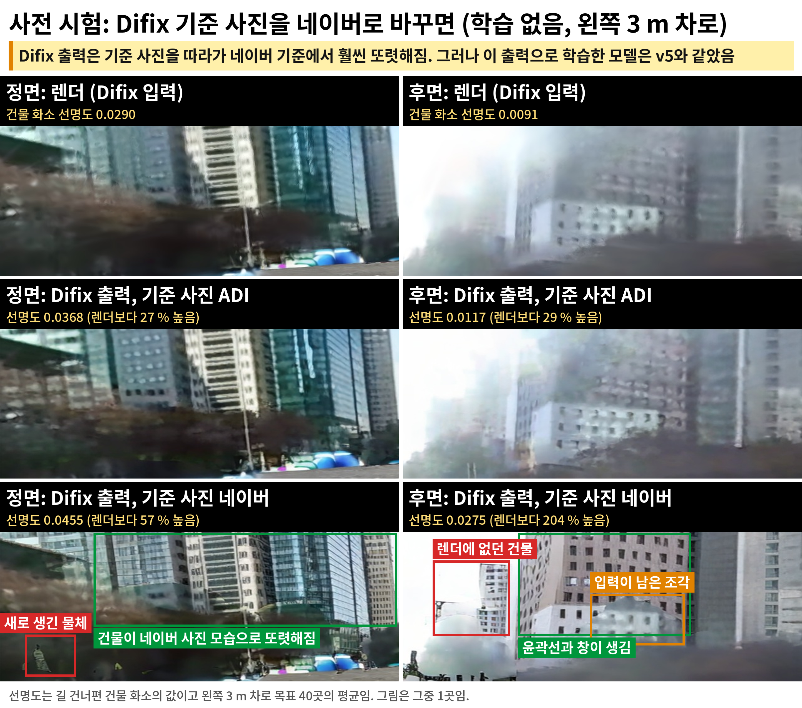

### 3.2 학습에서 뺀 네이버 사진과 비교

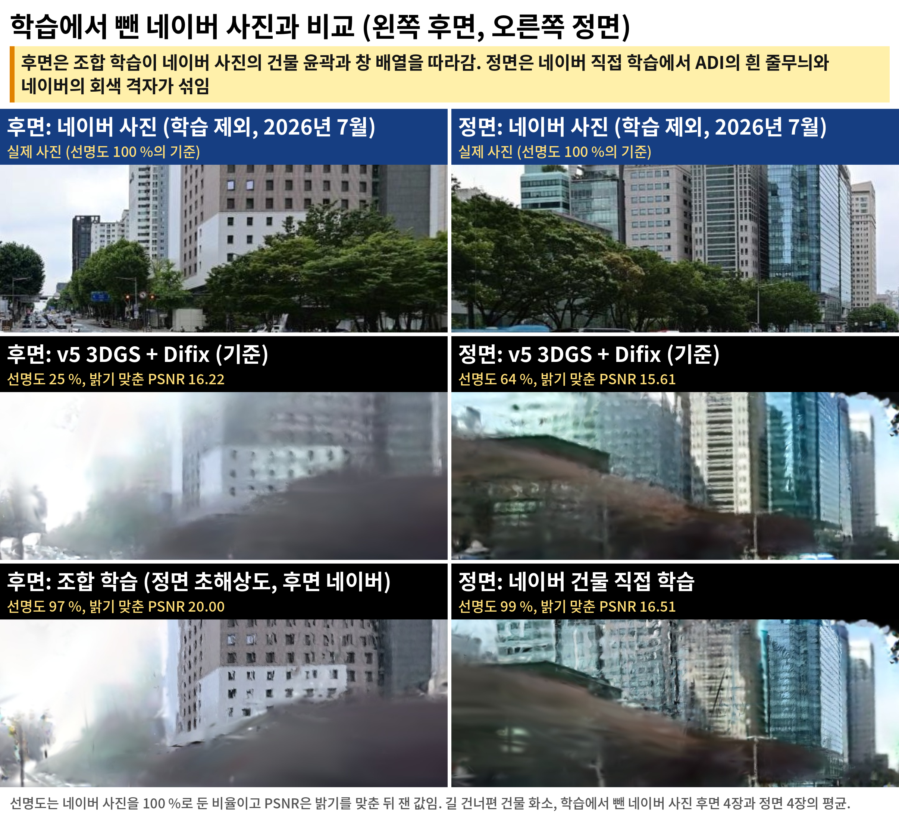

* 왼쪽 열 후면: v5는 건물이 뿌옇고, 조합 학습은 네이버 사진의 건물 윤곽과 창 배열을 따라감
* 오른쪽 열 정면: 네이버 사진의 건물은 흐린 날의 회색 격자이고, ADI의 같은 건물은 햇빛을 받은 흰 줄무늬임. 네이버 직접 학습은 이 두 모습이 섞임

### 3.3 나무와 인도 쪽 건물

학습에서 뺀 ADI 사진 32장 (인도 쪽 건물은 24장), 밝기 맞춘 PSNR.

| 방법 | 화면 전체 | 나무 | 인도 쪽 건물 |
|---|---|---|---|
| v5 3DGS + Difix (기준) | 21.52 | 22.19 | 21.53 |
| 네이버 건물 직접 학습 | 20.46 | 22.00 | 21.48 |
| 네이버 건물 학습, 건물은 mesh에 고정 | 20.45 | 21.98 | 21.49 |
| 네이버 사진을 Difix 기준으로 | 21.45 | 22.05 | 21.45 |
| 초해상도 건물 학습 | 21.47 | 22.11 | 21.55 |
| 조합 학습 | 20.76 | 21.98 | 21.56 |

**나무와 인도 쪽 건물은 그대로임**

* 화면 전체 값이 네이버를 쓴 학습에서 낮은 것은 길 건너편 건물이 ADI 사진과 다른 모습이 되었기 때문임

### 3.4 추가 시험: 길 건너편 LiDAR 씨앗

11/17에 확인한 문제(길 건너편 가로수가 뒤쪽 벽 위치에 그려짐)를 같이 풀 수 있는지 조합 학습에 한 가지만 더해 봄. 길 건너편 LiDAR 점(지면 위 0.5 m 이상, 15 cm 칸마다 1점) 19,188개를 학습 그룹 Gaussian으로 넣고 시작함.

| 길 건너편을 보는 카메라, LiDAR 점이 찍힌 화소 | v5 3DGS + Difix | 조합 학습 | 조합 + LiDAR 씨앗 |
|---|---|---|---|
| 모델 거리 중앙값 (LiDAR 29.5 m) | 41.8 m | 34.5 m | 33.9 m |
| LiDAR보다 뒤에 그려진 거리 (중앙값) | 12.9 m | 6.0 m | **4.9 m** |
| LiDAR와 3 m 안으로 맞는 화소 | 2 % | 20 % | **32 %** |
| 길 건너편 건물 밝기 맞춘 PSNR (옆 카메라 8장) | **25.28** | 24.39 | 24.59 |

**씨앗의 효과는 작음. 깊이가 조금 맞아지고 기둥이 생기는 정도이고 가로수 번짐은 남음**

* 길 건너편 건물 값(정면 선명도 83 %, 후면 선명도 99 %)은 조합 학습과 같음
* 조합 학습만으로도 깊이 오차가 12.9 m에서 6.0 m로 줄었음. 이유는 확인하지 않음
* 옆 카메라에서 본 길 건너편 건물은 조합 학습 쪽이 v5보다 0.7 dB에서 0.9 dB 낮음

#### 그림 6. 길 건너편을 보는 카메라

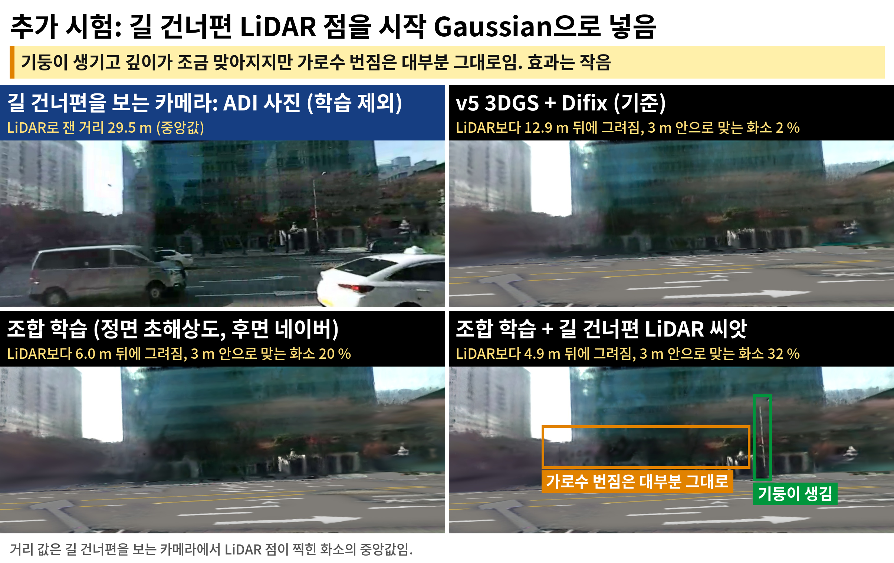

### 3.5 추가 시험: Difix 일정 변경

11/17에 "목표 차로에 마지막 회차에만 도착해서 Difix 화면이 모델에 남지 않는다"고 보고 일정 변경을 제안했음. v5에서 일정만 바꿔 확인함. 가상 시점이 6회차에 목표 차로(3 m, 6 m)에 도착하고, 7회차에서 18회차까지 12번은 같은 시점을 다시 고침.

| 마지막 회차 목표 시점 10곳, Difix 손실 화소 | v5 3DGS + Difix | 일정 변경 |
|---|---|---|
| Difix 입력 렌더 선명도 | 0.0207 | 0.0207 |
| Difix 출력 선명도 | 0.0243 | 0.0246 |
| 최종 모델 선명도 | 0.0207 | 0.0208 |
| 최종 모델과 Difix 출력의 PSNR | 26.23 | 26.48 |
| 왼쪽 3 m 차로 정면 선명도 (건물, 나무, 기둥 화소, 40장) | 0.0286 | 0.0292 |
| 화면 전체 밝기 맞춘 PSNR (ADI 평가 사진 32장) | 21.52 | 21.44 |

**같은 시점을 12번 반복해도 최종 모델의 선명도는 Difix 입력과 같음. 일정은 원인이 아니었고, 11/17의 내 제안은 틀렸음**

* 차로 시점 선명도는 5종 모두 2 % 오르는 데 그침
* 남는 설명은 두 가지임. Difix가 만드는 세부가 회차와 시점마다 달라 평균되어 사라짐. 같은 면을 ADI 사진이 훨씬 큰 비중으로 흐리게 학습시킴. 둘 다 따로 확인하지는 못함
* 네이버 사진을 Difix 기준으로 쓴 학습이 변화가 없었던 것과 같은 현상임

## 4. 실패와 원인

### 4.1 네이버 직접 학습의 정면 무늬 뒤섞임

| 확인한 것 | 내용 |
|---|---|
| 뒤섞인 건물 | 흰 줄무늬 건물과 그 왼쪽 건물. ADI에서는 햇빛 받은 흰 줄무늬, 네이버에서는 흐린 날 회색 격자 |
| 또렷해진 건물 | 유리 건물, 후면 건물. 두 자료에서 모습이 비슷하거나 ADI 쪽이 뿌연 것 |
| 같은 면을 ADI 모습으로 학습시킨 것 | Difix 가상 시점 (ADI 기준 사진), ADI 옆 카메라 |

* 원인으로 보는 것: 같은 건물 면을 두 자료가 서로 다른 무늬로 학습시킴. 따로 실험해 확인하지는 못함
* 건물 화소를 Difix 손실에서도 빼 본 것이 mesh 고정 학습인데, 아래 구멍 문제가 생겨 이 원인만 따로 가리지는 못했음

### 4.2 mesh 고정 학습의 검은 구멍

* 건물 판이 64,422개에서 564,333개로 늘었고 그중 65 %가 불투명도 0.02 미만임
* 네이버 마스크가 닿지 않는 건물 면은 ADI 손실과 Difix 손실에서 모두 빠져 있었음. 3,000번마다 하는 불투명도 초기화 뒤에 다시 살아날 근거가 없었던 것으로 보임
* 후면 건물은 네이버 사진이 충분히 덮어서 또렷하게 남음

### 4.3 남은 한계

| 항목 | 내용 |
|---|---|
| 계절과 날씨 | 네이버로 학습한 건물은 2026년 7월 흐린 날 모습임. 나머지 장면은 2019년 가을 맑은 날 |
| 후면 건물의 ADI 사진 대비 값 | 조합 학습은 ADI 후면 평가 사진 대비 밝기 맞춘 PSNR이 28.01에서 19.47로 내려감. ADI 후면 사진이 역광으로 뿌옇기 때문에 생기는 차이임 |
| 창 모양 | 네이버로 학습한 후면 건물의 창이 일부 찌그러져 보임 |
| 길 건너편 가로수 | 모든 결과에서 건물 아래쪽의 갈색 번짐이 그대로임 (11/17 원인: 가로수가 뒤쪽 벽 위치에 그려짐) |
| 가장 먼 건물 | 블록 중심에서 150 m 밖은 고정 그룹이라 어떤 학습에서도 바뀌지 않음 |
| 옆에서 본 길 건너편 | 길 건너편을 옆으로 보는 카메라의 건물 값은 조합 학습에서 v5보다 0.9 dB 낮음 (25.28에서 24.39) |

### 4.4 진행 중 처리한 것

| 항목 | 내용 |
|---|---|
| 디스크 | 여유 4.8 GB로 시작해 2.0 GB로 끝남. 네이버 직접 학습, 네이버 Difix 기준, mesh 고정, LiDAR 씨앗, Difix 일정 변경 학습의 모델 파일은 지움 (렌더, 평가, 로그는 남김). 남긴 모델은 초해상도 학습과 조합 학습. 조합 학습은 Nyx 뷰어 파일도 만들어 둠 |
| 취소한 학습 | 네이버 직접 학습에서 Difix 손실의 건물 화소만 빼는 학습. mesh 고정 학습과 같은 구멍이 예상되어 돌리지 않음 |
| 설명 정정 | 새벽 중간 보고에서 "네이버 기준 Difix는 정면에서 창 격자가 조금 또렷해지는 정도"라고 한 것은 시점을 잘못 짝지은 것이었음. 3 m 차로 정면은 건물 전체가 네이버 모습으로 다시 그려짐 |

## 5. 판단 필요

* **판단 필요** 조합 학습을 v5 대신 기본으로 올릴지. 후면 건물은 확실히 좋아지고 정면은 조금 좋아짐. 후면 건물의 계절과 날씨가 나머지와 다름
* **판단 필요** Difix 증류를 계속 쓸지. 얼룩과 조각을 지우는 효과는 있지만, 기준 사진을 바꿔도 일정을 바꿔도 세부는 모델에 남지 않았음
* **판단 필요** 정면 건물에도 네이버를 쓰려면 같은 건물 면에서 ADI 쪽 학습을 완전히 빼야 함. 네이버가 덮는 면만 골라 빼는 처리가 필요함
