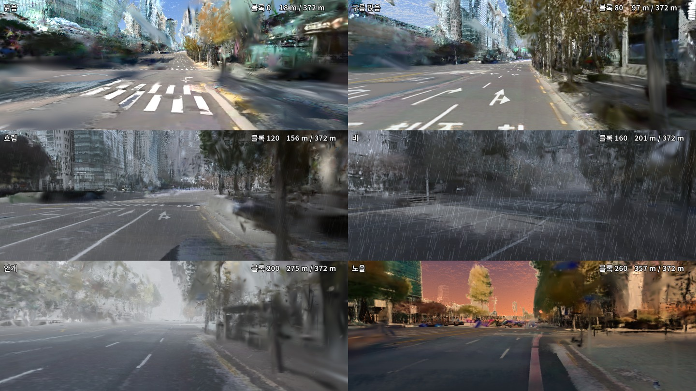
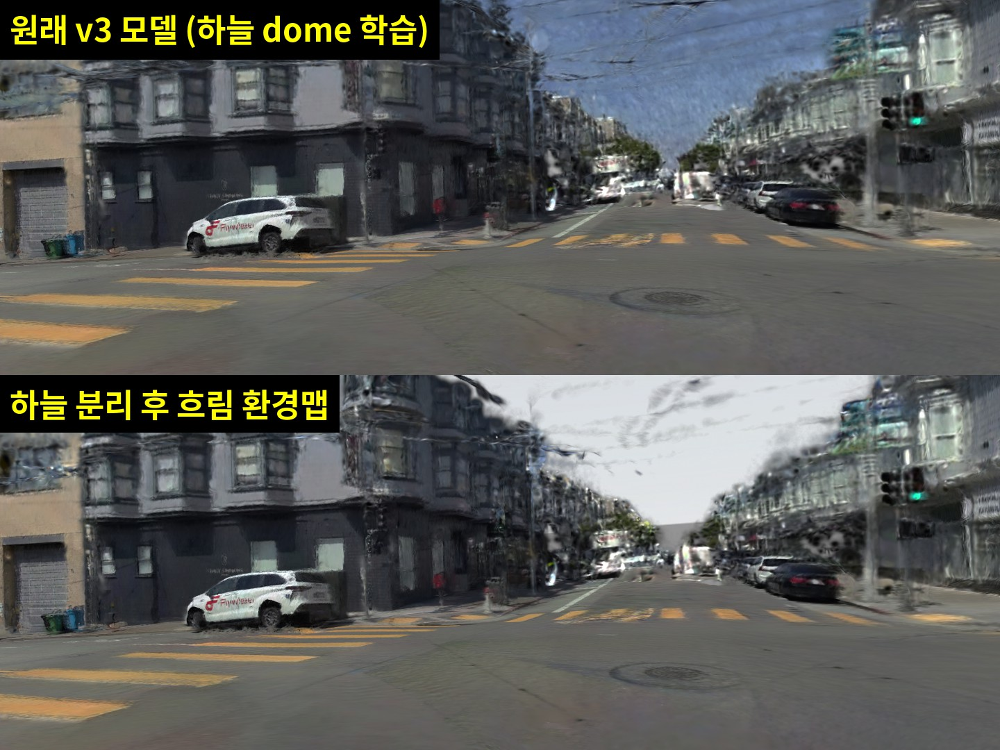
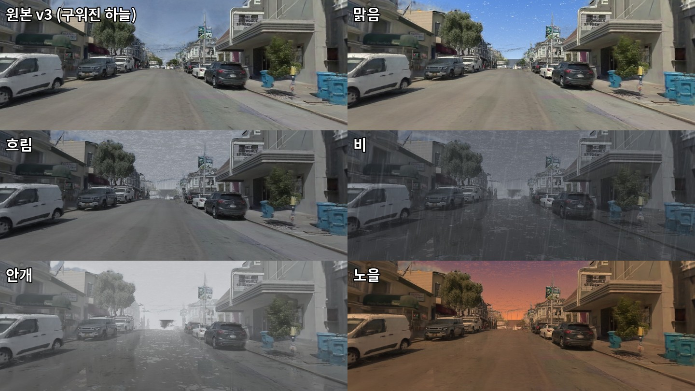
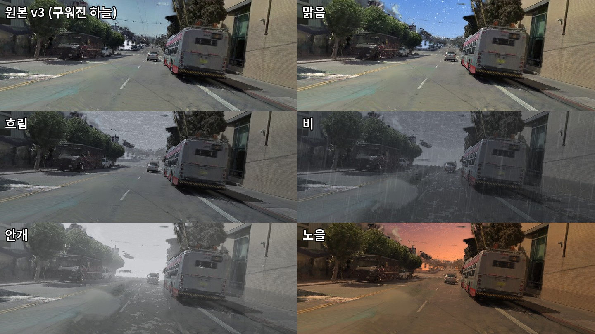
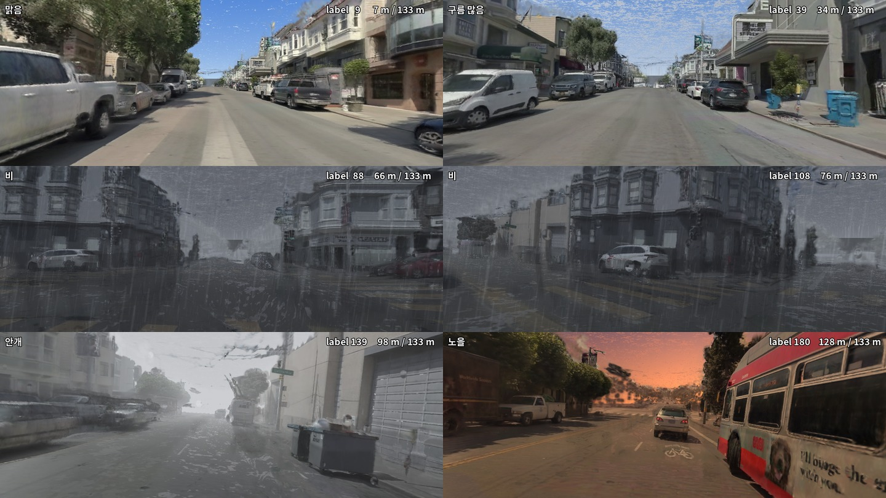
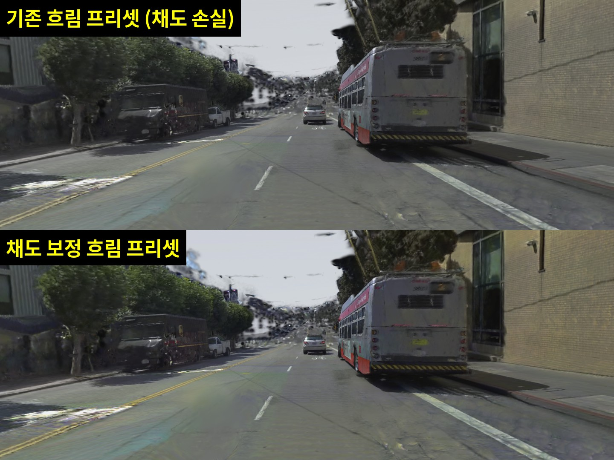

# Render-Time Weather on 2DGS Scenes: ADI seq60 and Alpamayo

> 다시 학습하지 않고 렌더 단계 합성만으로 ADI seq60과 Alpamayo 058bf960 씬의 날씨를 바꾼 기록임. 11/23에 ADI 방식(절차적 하늘, 깊이 안개, 비와 젖은 노면)을 Alpamayo에도 적용해 11/19 방식(환경맵과 LUT)을 대체함

## 문제 정의

- 두 씬 모두 맑은 날 한 번 찍은 주행으로 학습함. 학습된 씬도 맑은 날 모습만 가짐
- 주행 정책 평가에는 날씨가 다른 같은 장면이 필요함. 날씨마다 사진을 새로 찍거나 다시 학습할 수 없음
- 하늘이 Gaussian으로 남아 있으면 배경만 바꿔도 옛 하늘이 그대로 보임
- 확인할 것은 세 가지임. 다시 학습하지 않고 날씨를 바꿀 수 있는지, 비와 안개처럼 색 보정만으로 안 되는 날씨를 만들 수 있는지, 그 상태의 렌더 속도

## 용어

| 용어 | 정의 |
|---|---|
| ADI seq60 | 국내 주행 데이터 seq60 경로(label 0에서 299, 약 372 m) |
| k5cr | ADI seq60의 11/21 모델. 블록 8개(label 40개 단위) 각각 바닥 2DGS와 자유 3DGS로 학습하고 네이버 스트리트뷰 건물 사진을 더한 k5에 블록 사이 색 맞춤을 적용한 것 |
| Alpamayo v3 | Alpamayo 058bf960 full clip의 11/19 2DGS 모델(label 0에서 198, 약 133 m) |
| v3 하늘 투명 모델 | v3에서 하늘 dome Gaussian을 골라 투명하게 만든 모델(11/19). 11/23 Alpamayo 날씨의 입력 |
| dome Gaussian | 씬 중심에서 반지름 300 m 구면 위에 둔 하늘용 Gaussian. Alpamayo v3에만 있음 |
| ADI 방식 | 11/22 ADI에서 만든 렌더 후 합성 날씨. v1(11/22)과 v2(11/23)가 있음 |
| v1 / v2 | ADI 방식 판본. v1 = 절차적 하늘, 색 보정, 깊이 안개, 빗줄기, 번개 / v2 = v1에 젖은 노면 반사, 빗줄기 3층, 앞유리 물방울 추가 |
| 11/19 방식 | Alpamayo에 먼저 쓴 날씨. HDR 환경맵과 3D LUT를 Nyx에서 바꿔 끼우는 방식 |
| 절차적 하늘 | 사진 없이 수식으로 그린 하늘. 천정과 지평선 색 그라데이션, 구름층, 해 |
| fBm | fractal Brownian motion. 크기가 다른 노이즈를 겹친 무늬. 구름과 물웅덩이 모양에 씀 |
| alpha | 화소마다 Gaussian이 덮은 정도(0에서 1). 0인 곳에 하늘을 깜 |
| 기대 깊이 | 화소에 겹친 Gaussian 깊이의 가중 평균. 안개와 노면 판정에 씀 |
| 거울 렌더 | 카메라를 바닥 평면에 대해 뒤집어 한 번 더 렌더한 그림. 젖은 노면에 비치는 모습 |
| Fresnel | 비스듬히 볼수록 반사가 세지는 성질. Schlick 근사, 수직 반사율 F0 0.02 |
| 프리셋 | 날씨 한 벌의 설정값 묶음(하늘 색, 구름 양, 노출, 채도, 안개 거리, 비, 젖음, 해) |
| 키프레임 보간 | 경로 위 지점마다 프리셋을 두고 그 사이를 smoothstep으로 섞는 것. 한 주행 안에서 날씨가 바뀜 |
| LUT | 3D Look-Up Table. 렌더된 색을 다른 색으로 바꾸는 33단계 색 격자 표. 11/19 방식에서만 씀 |
| Nyx | Genesis에 붙은 Gaussian 실시간 렌더러 |
| SAM3 | 글자로 대상을 지정하는 분할 모델. "sky"로 하늘 마스크를 만듦 |
| CARLA 날씨 변수 | CARLA 시뮬레이터의 날씨 입력 이름(cloudiness, fog_density 등). 바깥에서 쓰는 이름으로 빌려 씀 |

## 요약

**결과**

- ADI seq60 전체 경로(372 m)를 한 주행 안에서 맑음 → 구름 많음 → 흐림 → 비 → 안개 → 노을로 바꾼 영상을 만들었음. 다시 학습하지 않았음
- v2에서 비를 다시 만들었음. 노면이 젖어 주변이 비치고, 빗줄기가 거리별 3층이고, 앞유리에 물방울이 맺힘
- 같은 ADI 방식을 Alpamayo v3에 옮겼음. 하늘 투명 모델 하나에 합성만 바꿔서 날씨 6종이 나옴
- Alpamayo에서 11/19 방식으로 못 만들던 비, 깊이 안개, 노을이 생겼음. LUT를 쓰지 않아 11/21 채도 손실 문제도 없음
- Alpamayo 렌더 시간 ≈ 26 ms(마른 날), ≈ 39 ms(비) 실측 합산(RTX 4090, 가로 1440, 세로 540)

**미해결**

- ADI 방식은 PyTorch 후처리임. Nyx에는 아직 없어서 Genesis 주행 중에는 쓸 수 없음
- 사진에 구워진 햇빛 그림자는 그대로임. 비, 안개, 노을에서도 낮 그림자가 남음
- 구름 노이즈가 지평선 근처에서 깨져 하늘에 흰 점처럼 보임(ADI, Alpamayo 같음)
- Alpamayo는 맑은 하늘 뒤에 숨어 있던 하늘 조각과 공중 부유물이 새 하늘 앞에서 드러남
- **판단 필요** Alpamayo 날씨를 Nyx로 옮길지. 옮기면 실시간이지만 거울 렌더와 비 효과를 Nyx 안에 다시 짜야 함

## 두 씬

| 항목 | ADI seq60 (k5cr) | Alpamayo v3 |
|---|---|---|
| 장소 | 국내 도심, 372 m | 미국 San Francisco, 133 m |
| Gaussian | 18,941,885 (블록 8개를 경로 기준으로 합침) | 15,245,271 (mesh-bound 2DGS) |
| 하늘 | Gaussian 없음. 학습 때 하늘 화소 alpha를 0으로 미는 손실 | dome Gaussian이 있음. 11/19에 골라서 투명하게 만듦 |
| 바닥 높이 | 바닥에 고정된 2DGS의 높이 중앙값 | 불투명도 0.3 이상 Gaussian의 높이 중앙값 |
| 카메라 높이(바닥 위) | 중앙값 2.22 m | 중앙값 1.45 m (1.38에서 1.51) |
| 주행 경로 | 실제 전방 카메라 경로, 프레임당 0.4 m, 931 프레임 | 실제 전방 카메라 경로, 프레임당 0.25 m, 532 프레임 |
| 거울 렌더 대상 | 7,798,060 | 8,279,935 |

**하늘을 비우는 방법만 다르고 합성 단계는 같음**

- ADI는 처음부터 하늘 Gaussian이 없어서 바로 합성함
- Alpamayo는 11/19에 만든 하늘 분리와 투명화 결과를 그대로 다시 씀(아래 Alpamayo 하늘 비우기)

## 파이프라인 (ADI 방식)

| 단계 | 하는 일 | 학습 |
|---|---|---|
| 1 렌더 | 프레임마다 색, alpha, 기대 깊이를 한 번에 얻음 | 없음 |
| 2 색 보정 | 노출, 채도, 색조를 렌더 색에 바로 곱함 | 없음 |
| 3 젖은 노면 (v2) | 바닥 화소만 어둡게 하고 거울 렌더를 Fresnel 비율로 섞음 | 없음 |
| 4 깊이 안개 | 투과율 exp(−깊이 / 안개 거리)로 안개 색을 섞음 | 없음 |
| 5 하늘 | alpha가 빈 만큼 절차적 하늘을 깜. 구름층은 고도 1.5 km에 세계 좌표로 고정되고 바람에 흐름 | 없음 |
| 6 비 | 옅은 물안개(대비 10% 감소), 빗줄기, 앞유리 물방울, 번개 1회 | 없음 |
| 7 날씨 보간 | 경로 진행률에 따라 프리셋 사이를 smoothstep으로 섞음. 안개 거리는 로그 공간에서 섞음 | 없음 |

**모든 단계가 렌더 뒤에 일어남**

- Gaussian 파일은 날씨와 상관없이 하나임
- 날씨는 프리셋 숫자만 바뀜. 새 날씨는 숫자 한 벌을 더하면 됨

### 날씨 프리셋

| 프리셋 | 구름 양 | 노출 | 채도 | 안개 거리 (m) | 비 | 젖음 | 해 |
|---|---|---|---|---|---|---|---|
| 맑음 | 0.12 | 1.05 | 1.08 | 3000 | 0 | 0 | 고도 38°, 보임 |
| 구름 많음 | 0.55 | 0.97 | 0.98 | 1500 | 0 | 0 | 고도 38°, 60% |
| 흐림 | 0.97 | 0.82 | 0.72 | 450 | 0 | 0 | 가림 |
| 비 | 1.0 | 0.66 | 0.62 | 160 | 1.0 | 1.0 | 가림 |
| 안개 | 1.0 | 0.88 | 0.60 | **38** | 0 | 0.7 | 가림 |
| 노을 | 0.38 | 0.82 | 1.12 | 900 | 0 | 0.35 | 고도 4°, 주황 |

안개 거리 = 투과율이 1/e(37%)가 되는 거리. 젖음은 비가 그친 뒤에도 남게 둠(안개 0.7, 노을 0.35). ADI와 Alpamayo가 같은 값을 씀.

**안개만 거리를 짧게 두고 나머지는 하늘과 색으로 구분함**

- 비 160 m, 안개 38 m. 안개에서는 20 m 앞 차도 흐려짐
- 해 방향은 경로 진행 방향 기준으로 정함. 노을은 경로 끝 방향의 지평선 근처

### 젖은 노면 (v2)

| 요소 | 방법 |
|---|---|
| 바닥 높이 | label마다 카메라 수평 2.5 m 안, 카메라보다 0.8 m 이상 낮은 Gaussian 높이의 중앙값. label 방향으로 매끄럽게 함 |
| 노면 화소 | 기대 깊이로 되돌린 세계 좌표 높이가 바닥 + 0.2 m 아래인 화소 |
| 거울 렌더 | 카메라를 바닥 평면에 대해 뒤집어 렌더함. 바닥 Gaussian(바닥 + 0.2 m 아래)은 빼고, 빈 곳은 뒤집은 방향의 하늘로 채움 |
| 젖은 색 | 노면 밝기 42% 낮춤 |
| 반사 비율 | Fresnel(F0 0.02) × (0.55 + 0.45 × 물웅덩이) + 0.25 × 물웅덩이, 최대 0.9 |
| 물웅덩이 | 세계 xy 좌표의 fBm. 차가 지나가도 같은 자리에 있음. 웅덩이는 또렷하게, 밖은 세로로 번지게 비침 |

**멀리 볼수록 많이 비치고, 웅덩이에서는 거울처럼 비침**

- 차와 건물이 노면에 거꾸로 비침. 아스팔트의 세로 번짐은 웅덩이 밖에서만 보임
- 노면 높이는 한 label 안에서 평면으로 봄. 경사가 바뀌는 곳에서는 반사가 어긋날 수 있음

### 비 효과 (v2)

| 요소 | 방법 |
|---|---|
| 빗줄기 | 3층. 가까운 층은 굵고 길고 흐리고 빠름(120줄), 먼 층은 가늘고 짧음(2200줄). 밝은 배경 앞에서는 덜 보이게 함 |
| 물안개 | 화면을 안개 색 쪽으로 10% 섞음 |
| 앞유리 물방울 | 초점이 안 맞은 렌즈처럼 주변 화면을 거꾸로 작게 비춤. 생기고, 커지고, 일부는 흘러내리고, 사라짐 |
| 번개 | 경로 55% 지점에서 3 프레임 밝아짐 |

**빗줄기는 화면에 붙은 그림이고 3D 입자가 아님**

- 카메라가 돌아도 빗줄기 위치는 같은 속도로 내려옴
- 차 속도에 따라 빗줄기가 기울지 않음

## ADI seq60 결과

### v1 (11/22)

* 한 주행 안에서 키프레임 보간으로 바뀌는 날씨. 위 왼쪽부터 맑음(블록 0), 구름 많음(블록 80), 흐림(블록 120), 비(블록 160), 안개(블록 200), 노을(블록 260)
* 맑음과 구름 많음의 하늘에 구름 노이즈가 흰 점처럼 깨지는 곳이 있음

### v1의 비가 현실적이지 않았음 — 노면이 마른 채였음

| 항목 | v1 (11/22) | v2 (11/23) |
|---|---|---|
| 노면 | 색만 어두워짐 | 젖은 색 + 거울 렌더 반사 + 물웅덩이 |
| 빗줄기 | 한 층, 굵기 같음 | 거리별 3층, 밝은 배경 앞에서 약하게 |
| 앞유리 | 없음 | 물방울이 맺히고 흘러내림 |
| 비 그친 뒤 | 바로 마름 | 안개와 노을에서도 젖음 남음 |
| 안개 깊이 | 깊이 중앙값 | 기대 깊이 |

**비가 와도 노면에 반사가 없어서 흐린 날에 빗줄기만 그린 것처럼 보였음**

- 사용자 피드백("비는 좀 현실적이지 않은데?")으로 v2를 만듦
- v2부터 프레임마다 거울 렌더를 한 번 더 함. 렌더 비용이 늘어남(아래 속도)

* v2. 위 4장은 비(블록 160)와 비가 그친 뒤 안개(블록 200), 아래는 노을(블록 260)과 맑음(블록 0)
* 비 장면에서 횡단보도와 나무가 젖은 노면에 비침. 노을에서도 노면이 조금 젖어 있음

https://github.com/user-attachments/assets/59bc4c6c-e5a9-4230-85ad-520db9717c12

* ADI seq60 v2 주행. 25 fps, 931 프레임, 약 37초. 같은 Gaussian 파일이고 다시 학습하지 않았음

## Alpamayo v3에 ADI 방식 적용 (11/23)

### Alpamayo 하늘 비우기

11/19에 만든 하늘 분리와 투명화를 그대로 씀.

| 판정 | 기준 | 개수 |
|---|---|---|
| dome Gaussian 전체 | 구 중심에서 300 m, 오차 2 m 안 | 379,752 |
| 남김 | 관측의 20% 이상이 하늘 마스크 밖(먼 건물, 잎, 전선) | 239,061 |
| 지움 | 관측 대부분이 하늘 마스크 안 | 92,254 |
| 지움 | 한 번도 안 보였고 앙각 2도 이상 | 34,998 |
| 남김 | 한 번도 안 보였고 앙각 2도 미만(지평선 근처) | 13,439 |

**하늘 마스크만으로 지우지 않고, 20% 기준으로 먼 배경을 남김**

- 하늘 마스크는 학습 사진 995장(label 0에서 198, 카메라 5대)에 SAM3로 만듦
- 지운 뒤 땅에서 2.5 m보다 높은 Gaussian 4,236,602개의 불투명도만 하늘 화소에서 내리는 학습을 3000번 함(약 8분). 색, 크기, 위치는 고정

* front 카메라 label 100. 위는 원래 v3, 아래는 하늘 분리와 투명화 뒤 환경맵을 깐 모습(11/19)

### 옮길 때 바꾼 것

| 항목 | ADI | Alpamayo |
|---|---|---|
| 렌더러 | 3DGS rasterizer, SH 3차 색 | 2DGS surfel rasterizer, 단색(SH0) |
| 입력 모델 | k5cr 블록 8개를 경로 기준으로 합침 | v3 하늘 투명 모델 하나 |
| 바닥 높이 후보 | 바닥에 고정된 2DGS | 불투명도 0.3 이상 전체(mesh-bound라 고정 표시가 없음) |
| 거울 렌더 대상 | 바닥 + 0.2 m 위 전체 | 바닥 + 0.2 m 위이면서 불투명도 0.005 이상 |
| 프레임 간격 | 0.4 m | 0.25 m (경로가 짧아서) |
| 프리셋, 키프레임, 비 효과 | 그대로 | 그대로 |

**합성 단계와 프리셋 숫자는 하나도 바꾸지 않았음**

- 바뀐 것은 렌더러와 바닥 높이를 고르는 Gaussian뿐임
- 해 방향은 경로 가운데 label의 진행 방향 기준이라 씬마다 자동으로 정해짐

### 결과

* front 카메라 label 40, 프리셋 고정. 위 왼쪽은 원본 v3(구워진 맑은 하늘), 그 뒤로 맑음, 흐림, 비, 안개, 노을
* 안개에서 먼 길이 흐려지고 가까운 차는 남음. 11/19 안개 프리셋은 색만 바꿔서 이 거리 차이가 없었음
* 안개와 비에서 길 끝 소실점에 어두운 조각이 드러남. 원본에서는 맑은 하늘 색에 묻혀 안 보이던 것

* label 160. 흐림과 비의 하늘에 검은 공중 부유물 두 개가 보임
* 비 장면 왼쪽 노면에 밝은 번짐이 있음. 거울 렌더에 빈 곳이 생겨 뒤집은 하늘이 비친 것으로 보임

* 한 주행 안에서 키프레임 보간으로 바뀌는 날씨. 맑음(label 9), 구름 많음(label 39), 비(label 88, 108), 안개(label 139), 노을(label 180)

https://github.com/user-attachments/assets/26439cd9-063c-45e4-a7a2-c55c5e9736b4

* Alpamayo v3 날씨 주행. 실제 전방 카메라 경로, 25 fps, 532 프레임, 약 21초. 하늘 투명 모델 하나로 렌더함

### 속도

| 단계 | 시간 (ms) | 언제 |
|---|---|---|
| 본 렌더 (15,245,271개) | 24.7 | 매 프레임 |
| 젖은 노면 (거울 렌더 8,279,935개 + 섞기) | 9.8 | 젖음이 있을 때 |
| 안개, 하늘, 비, 물방울 | 0.9 (마른 날) / 4.7 (비) | 매 프레임 |
| **합계** | **≈ 26 (≈ 39 fps) / ≈ 39 (≈ 25 fps)** | 마른 날 / 비 |

RTX 4090, 가로 1440, 세로 540, PyTorch. 단계별 중앙값(처음 5 프레임 제외)을 더한 값이고 영상 쓰기는 뺐음. ADI는 따로 재지 않았음.

**비 장면은 거울 렌더 때문에 1.5배 느려짐**

- 본 렌더가 거의 전부이고 합성은 1에서 5 ms임
- 11/19 방식의 Nyx 측정(114에서 124 fps, spp 4)과는 렌더러가 달라서 바로 비교하면 안 됨

### 11/19 방식과 비교

| 항목 | 11/19 방식 (환경맵, LUT) | ADI 방식 |
|---|---|---|
| 하늘 | HDR 환경맵 그림 하나, 움직이지 않음 | 절차적 하늘. 구름 양이 바뀌고 바람에 흐름 |
| 색 | 3D LUT | 노출, 채도, 색조를 직접 곱함 |
| 안개 | 색만 바꿈 | 깊이에 따른 지수 감쇠 |
| 비 | 없음 | 빗줄기 3층, 젖은 노면 반사, 물방울, 번개 |
| 노을 | 없음 | 있음 (해 고도 4°) |
| 날씨 전환 | 에피소드 시작 때 프리셋 고정 | 프레임마다 키프레임 보간 |
| 렌더러 | Nyx, 실시간 | PyTorch 후처리, Nyx 미이식 |
| 병렬 환경마다 다른 날씨 | 확인함 | 확인 안 함 |

**날씨 표현은 ADI 방식이 넓고, 실시간과 Genesis 연결은 11/19 방식만 됨**

- 하늘 분리와 투명화(준비 단계)는 두 방식이 같이 씀. 바뀐 것은 그 뒤 합성뿐임
- ADI 방식을 시뮬레이터 평가에 쓰려면 Nyx 이식이 먼저임

## 11/19 방식에서 LUT를 거치면 채도가 25% 빠졌음

| 렌더 | 화면 아래쪽 채도 |
|---|---|
| 원래 v3, LUT 없음 | 0.097 |
| 하늘 분리, 흐림 환경맵, LUT 없음 | 0.097 |
| 하늘 분리, 흐림 환경맵, 색을 바꾸지 않는 LUT | 0.073 |
| 흐림 약하게 LUT (11/19 영상) | 0.063 |
| 흐림 채도 보정 LUT (11/21) | 0.095 |

front 카메라 label 100 기준. 채도 = (최댓값 − 최솟값) / 최댓값의 화면 아래쪽 절반 평균. 채도 보정 LUT는 label 40, 100, 160 평균 0.100으로 원본 평균 0.102와 거의 같음.

**하늘 분리와 환경맵은 채도를 바꾸지 않았고, LUT를 거치는 것만으로 채도가 빠졌음**

- 원인은 찾지 못했음. Nyx 입력 곡선을 채널마다 따로 되돌리지 않았을 가능성이 있음
- 11/21에 LUT 채도를 1.65배로 올려 메웠음. ADI 방식은 LUT를 쓰지 않아 이 문제가 없음

* front 카메라 label 160. 위는 11/19 흐림 약하게 LUT, 아래는 11/21 채도 보정 LUT

<b>11/19 방식 프리셋과 실행 중 전환 시험</b> — 환경맵, LUT 설정, Nyx 시험 결과 (펼치기)

| 프리셋 | 환경맵 | LUT 설정 |
|---|---|---|
| 원본 | 흐린 하늘 | 없음 |
| 흐림 | 흐린 하늘 | 대비 0.75, 그림자 들어올림 0.10, 채도 0.70, 약간 푸른 색조 |
| 흐림 약하게 | 흐린 하늘 | 노출 0.97, 대비 0.95, 그림자 들어올림 0.02, 채도 1.0 |
| 흐림 채도 보정 (11/21) | 흐린 하늘 | 흐림 약하게와 같고 채도만 1.65 |
| 안개 | 안개 하늘 | 대비 0.50, 채도 0.45, 옅은 회청색 |

| 시험 | 결과 |
|---|---|
| 한 씬, 병렬 환경 2개에 서로 다른 환경맵 | 환경 0은 맑은 하늘, 환경 1은 흐린 하늘로 동시에 렌더됨 |
| 한 씬, 카메라 2대에 서로 다른 LUT | LUT 없는 카메라 0.3 ms, 흐림 LUT 카메라 1.9 ms 읽기 |
| 렌더 속도 | 가로 1440, 세로 540, spp 4에서 114에서 124 fps |
| 씬 불러오기 | 21.2초 |

* front 카메라 label 40. 위는 흐림 프리셋, 아래는 안개 프리셋(색만 바꿈)

* 왼쪽 원래 v3, 오른쪽 하늘 분리, 흐림 환경맵, 채도 보정 LUT. Nyx 주행 기록의 추적 카메라 경로, 24 fps, 579 프레임

## CARLA 날씨 변수 대응

| CARLA 변수 | ADI 방식 프리셋 값 |
|---|---|
| cloudiness | 구름 양(0에서 1). 하늘 색과 노출, 채도를 같이 바꿈 |
| fog_density, fog_distance | 안개 거리(m). 투과율 exp(−깊이 / 안개 거리) |
| precipitation | 비(0에서 1). 빗줄기 세기, 물안개, 물방울 생성 빈도 |
| wetness | 젖음(0에서 1). 노면 어둡기와 반사 비율 |
| sun_altitude_angle, sun_azimuth_angle | 하늘의 해 위치와 빛 번짐만 바뀜. 구워진 그림자는 다시 계산할 수 없음 |
| precipitation_deposits | 물웅덩이 크기로 쓸 수 있음. 지금은 고정 |
| wind_intensity | 구름 흐름 속도로 쓸 수 있음. 지금은 고정 |

**11/19 방식에서 지원하지 않던 precipitation과 wetness가 대응됨**

- 변수 값을 프리셋 숫자로 바꾸는 식은 아직 정하지 않았음. 지금은 프리셋 6개를 손으로 정함

## 한계

| 항목 | 내용 | 해당 |
|---|---|---|
| 구워진 그림자 | Gaussian 색에 맑은 날 그림자와 밝은 면이 들어 있음. 흐림, 비, 노을에서도 남음 | 둘 다 |
| 구름 노이즈 | 지평선 근처에서 고주파 노이즈가 깨져 흰 점으로 보임 | 둘 다 |
| 빗줄기 | 화면에 붙은 2D 층. 카메라 회전과 차 속도에 반응하지 않음 | 둘 다 |
| 노면 반사 | label마다 평면 하나로 봄. 경사가 바뀌는 곳과 거울 렌더의 빈 곳에서 어긋남 | 둘 다 |
| 하늘 조각, 부유물 | 맑은 하늘 색에 묻혀 있던 조각이 새 하늘 앞에서 드러남 | Alpamayo |
| Nyx 미이식 | Genesis 주행 중에 쓸 수 없음. 병렬 환경마다 다른 날씨도 확인 안 함 | 둘 다 |
| 눈 | 만들지 않았음 | 둘 다 |

## Reference

| 문헌 | 이 작업에서 쓴 부분 |
|---|---|
| Yan et al., Street Gaussians: Modeling Dynamic Urban Scenes with Gaussian Splatting, ECCV 2024 | 하늘 화소의 누적 불투명도를 0으로 미는 하늘 손실. ADI는 학습 중, Alpamayo는 내리는 방향만 씀 |
| Carion et al., SAM 3: Segment Anything with Concepts, Meta AI, 2025 | 글자 지정("sky")으로 학습 사진의 하늘 마스크 생성 |
| Koschmieder, 1924 | 안개 투과율이 거리에 따라 지수적으로 줄어드는 법칙. 깊이 안개 식 |
| Schlick, An Inexpensive BRDF Model for Physically-based Rendering, Computer Graphics Forum 1994 | Fresnel 근사. 젖은 노면 반사 비율 |
| Perlin, An Image Synthesizer, SIGGRAPH 1985 | 노이즈를 겹친 절차적 무늬. 구름층과 물웅덩이 |
| Garg and Nayar, Photorealistic Rendering of Rain Streaks, SIGGRAPH 2006 | 관련 연구. 빗줄기의 물리 기반 렌더. 이 작업은 2D 층 3개로 단순화함 |
| Debevec, Rendering Synthetic Objects into Real Scenes, SIGGRAPH 1998 | 11/19 방식의 HDR 환경맵 |
| Adobe, Cube LUT Specification 1.0, 2013 | 11/19 방식의 3D LUT 파일 형식 |
| Dosovitskiy et al., CARLA: An Open Urban Driving Simulator, CoRL 2017 | 바깥에서 쓰는 날씨 변수 이름 |
| Li et al., ClimateNeRF: Extreme Weather Synthesis in Neural Radiance Field, ICCV 2023 | 관련 연구. NeRF 씬에 물리 시뮬레이션으로 눈, 홍수, 안개를 넣음. 이 작업은 렌더 뒤 합성만 하는 더 가벼운 방식임 |

<b>재현 경로</b> — 스크립트와 모델 위치 (펼치기)

| 대상 | 경로 |
|---|---|
| ADI v1 | `instant_nurec/results/adi/seq60/scene_L000-300_lidar/k1/scripts/k5_weather_drive.py` |
| ADI v2 | 같은 폴더 `k5_weather_drive2.py` |
| Alpamayo ADI 방식 | `instant_nurec/results/alpamayo/058bf960/alpamayo_full_clip/weather/v2_adi/alp_weather_v2.py` (렌더러 `gsr.py`, 단계별 시간 `stats.json`, 프리셋 고정 렌더 `renders/`) |
| v3 하늘 투명 모델 | `/dev/shm/alpamayo_v3/weather_train/colors_2dgs_alpamayo_v3_skycut_down3000.npz` (바탕은 11/19 v3 최종 startfix) |
| 실행 환경 | pgsr_env python, PYTHONPATH `2dgs_deps:2dgs_runtime` |

## next step
