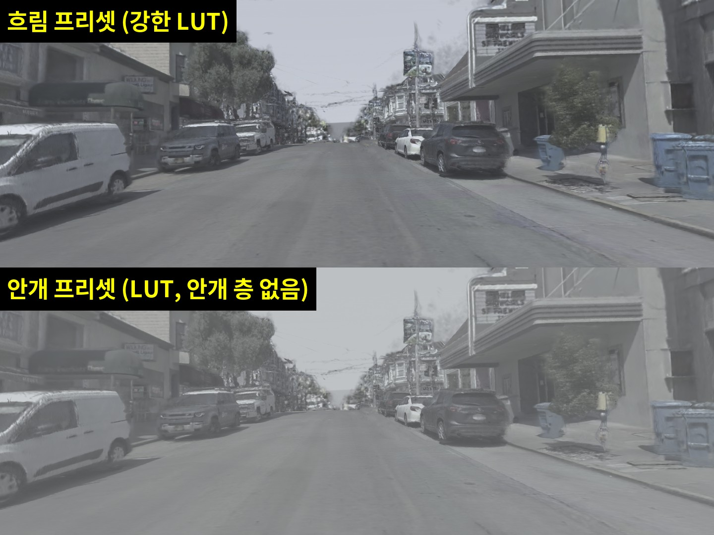

# Render-Time Weather Change on the Alpamayo 2DGS Scene

> 다시 학습하지 않고, 렌더 단계 설정만으로 Alpamayo 058bf960 씬을 맑은 날에서 흐린 날로 바꾼 방법과 결과 기록임

## 문제 정의

- Alpamayo 학습 데이터는 맑은 날 한 번 찍은 주행임. 학습된 씬도 맑은 날 모습만 가짐
- 주행 정책 평가에는 날씨가 다른 같은 장면이 필요함. 날씨마다 사진을 새로 찍거나 다시 학습할 수 없음
- 하늘이 Gaussian으로 구워져 있어서 배경만 바꾸려 해도 하늘 Gaussian이 그대로 남음
- 확인할 것은 두 가지임. 다시 학습하지 않고 날씨를 바꿀 수 있는지, 그리고 그 상태로 실시간 렌더가 유지되는지

## 용어

| 용어 | 정의 |
|---|---|
| v3 | Alpamayo 058bf960 full clip의 11/19 2DGS 모델. 날씨 실험의 기준 씬 |
| dome Gaussian | 씬 중심에서 반지름 300 m 구면 위에 둔 하늘용 Gaussian. 학습 중 하늘 색을 배움 |
| 하늘 분리 | dome Gaussian 중 실제로 하늘인 것만 골라 투명하게 만드는 단계 |
| 환경맵 | 씬을 둘러싼 360도 하늘 그림(HDR, 위도 경도 배치). Gaussian이 투명한 곳에 보임 |
| LUT | 3D Look-Up Table. 렌더된 색을 다른 색으로 바꾸는 33단계 색 격자 표. 파일 형식은 .cube |
| 프리셋 | 환경맵, LUT, 씬 밝기 배율을 묶은 날씨 설정 한 벌 |
| Nyx | Genesis에 붙은 Gaussian 실시간 렌더러. 환경맵과 LUT를 카메라마다 따로 둘 수 있음 |
| SAM3 | 글자로 대상을 지정하는 분할 모델. 여기서는 "sky"로 하늘 마스크를 만듦 |
| 채도 | 색이 회색에서 얼마나 먼지를 나타내는 값. 여기서는 (최댓값 빼기 최솟값) 나누기 최댓값의 화면 아래쪽 절반 평균 |
| CARLA 날씨 변수 | CARLA 시뮬레이터의 날씨 입력 이름(cloudiness, fog_density 등). 바깥에서 쓰는 이름으로 빌려 씀 |

## 요약

**결과**

- 다시 학습하지 않고 프리셋 선택만으로 맑은 날 씬을 흐린 날로 바꿨음. 하늘 투명화에 3000번 짧은 학습을 한 번 했고, 날씨를 바꿀 때는 학습이 없음
- 렌더 속도는 날씨를 바꿔도 같음. 가로 1440, 세로 540, spp 4에서 114에서 124 fps(RTX 4090 실측)
- 한 씬 안에서 병렬 환경마다 다른 환경맵, 카메라마다 다른 LUT를 동시에 쓸 수 있음을 확인함
- 11/19 흐린 날 영상이 원본보다 흐렸던 원인을 찾았음. 색을 바꾸지 않는 LUT만 거쳐도 채도가 약 25% 빠짐. LUT 채도를 1.65배로 올려 원본 채도에 맞춘 영상을 새로 만들었음

**미해결**

- 사진에 구워진 햇빛 그림자는 지울 수 없음. 흐린 날인데 그림자가 남음
- 하늘과 건물 경계, 나뭇잎 사이에 하늘 조각이 남는 곳이 있음
- 안개 층, 비, 눈, 젖은 노면, 해 질 녘은 만들지 않았음
- **판단 필요** 흐린 날 채도를 원본과 같게 둘지, 조금 낮출지. 실제 흐린 날은 채도가 낮지만 너무 낮추면 화면이 흐려 보임

## 파이프라인

| 단계 | 하는 일 | 학습 | 걸린 시간 |
|---|---|---|---|
| 1 하늘 마스크 | 학습 사진 995장(label 0에서 198, 카메라 5대)에 SAM3로 하늘 마스크를 만듦 | 없음 | 사진당 1회 |
| 2 하늘 분리 | dome Gaussian을 모든 사진에 투영해서 하늘 마스크 밖에 떨어지는 비율로 하늘인지 판정함 | 없음 | 21초 |
| 3 하늘 투명화 | 땅에서 2.5 m보다 높은 Gaussian의 불투명도만, 하늘 화소에서만 낮추는 짧은 학습 | 3000번 | 약 8분 |
| 4 환경맵 | 투명해진 하늘 자리에 흐린 하늘 HDR 그림을 깔음 | 없음 | 씬 불러올 때 |
| 5 LUT | 렌더된 화면 전체 색을 흐린 날 색감으로 바꿈 | 없음 | 씬 불러올 때 |

**날씨를 바꿀 때 Gaussian 색은 건드리지 않음**

- 1에서 3은 한 번만 하는 준비 단계임. 4와 5만 바꿔 끼우면 날씨가 바뀜
- 그래서 다른 날씨를 추가해도 다시 학습할 필요가 없음

## 방법

### 하늘 분리

| 판정 | 기준 | 개수 |
|---|---|---|
| dome Gaussian 전체 | 구 중심에서 300 m, 오차 2 m 안 | 379,752 |
| 남김 | 관측의 20% 이상이 하늘 마스크 밖(먼 건물, 잎, 전선) | 239,061 |
| 지움 | 관측 대부분이 하늘 마스크 안 | 92,254 |
| 지움 | 한 번도 안 보였고 앙각 2도 이상 | 34,998 |
| 남김 | 한 번도 안 보였고 앙각 2도 미만(지평선 근처) | 13,439 |

- 관측은 Gaussian 중심이 화면 안에 있고, 카메라에서 그 점까지 collider에 가리는 것이 없을 때만 셈
- 20% 기준을 둔 이유: dome에는 하늘뿐 아니라 먼 건물과 나무도 같이 학습되어 있음. 하늘 마스크만으로 지우면 먼 배경까지 사라짐

### 하늘 투명화

| 항목 | 값 |
|---|---|
| 학습 대상 | 땅 격자에서 2.5 m보다 높은 Gaussian 4,236,602개(전체 15,245,271개 중)의 불투명도만 |
| 고정 | 색, 크기, 회전, 위치 |
| 손실 | 하늘 화소에서 누적 불투명도를 0으로 미는 손실 하나. 불투명도를 올리는 방향은 쓰지 않음 |
| 반복 | 3000번, 학습 사진 995장 |

* front 카메라 label 100. 위는 원래 v3, 아래는 하늘 분리와 투명화 후 흐림 환경맵을 깐 모습
* 하늘에 박혀 있던 파란 얼룩이 빠지고 환경맵의 흐린 하늘이 보임. 오른쪽 건물 위쪽에는 하늘 조각이 남음

### 환경맵과 LUT

| 프리셋 | 환경맵 | LUT 설정 |
|---|---|---|
| 원본 | 흐린 하늘 | 없음 |
| 흐림 | 흐린 하늘 | 대비 0.75, 그림자 들어올림 0.10, 채도 0.70, 약간 푸른 색조 |
| 흐림 약하게 | 흐린 하늘 | 노출 0.97, 대비 0.95, 그림자 들어올림 0.02, 채도 1.0 |
| 흐림 채도 보정 (11/21) | 흐린 하늘 | 흐림 약하게와 같고 채도만 1.65 |
| 안개 | 안개 하늘 | 대비 0.50, 채도 0.45, 옅은 회청색 |

- 흐림 LUT의 그림자 들어올림은 맑은 날 사진에 구워진 그림자를 약하게 보이게 하려는 설정임. 그림자 방향이나 위치는 바뀌지 않음
- Nyx는 LUT에 넣기 전에 자체 입력 곡선을 거치고 출력을 sRGB로 바꿈. LUT를 만들 때 이 두 변환을 되돌려 계산함

* front 카메라 label 40. 위는 흐림 프리셋, 아래는 안개 프리셋
* 안개 프리셋은 색만 바꾼 것임. 거리에 따라 뿌옇게 되는 안개 층은 들어가지 않았음

### 실행 중 날씨 바꾸기

| 시험 | 결과 |
|---|---|
| 한 씬, 병렬 환경 2개에 서로 다른 환경맵 | 환경 0은 맑은 하늘, 환경 1은 흐린 하늘로 동시에 렌더됨 |
| 한 씬, 카메라 2대에 서로 다른 LUT | LUT 없는 카메라 0.3 ms, 흐림 LUT 카메라 1.9 ms 읽기 |
| 씬 불러오기 | 21.2초 |

- 프리셋은 씬을 불러올 때 정하고 한 에피소드 동안 고정하는 방식으로 정했음
- 날씨마다 Gaussian 파일을 따로 둘 필요가 없음. 같은 파일 하나를 모든 날씨가 같이 씀

### CARLA 날씨 변수 대응

| CARLA 변수 | 이 씬에서의 처리 |
|---|---|
| cloudiness | 0에서 40은 원본, 40에서 100은 흐림 프리셋 |
| fog_density | 0에서 10은 안개 없음, 그 이상은 안개 프리셋 |
| fog_distance, fog_falloff | 안개 층의 시작 거리와 높이 감쇠로 쓸 예정. 안개 층은 아직 없음 |
| sun_altitude_angle, sun_azimuth_angle | 하늘 그림 선택과 회전만 바뀜. 구워진 그림자는 다시 계산할 수 없음 |
| precipitation, wind_intensity | 만들지 않음 |
| wetness, precipitation_deposits | 지원하지 않음 |

## 11/19 흐린 날 영상이 흐렸던 원인

| 렌더 | 화면 아래쪽 채도 |
|---|---|
| 원래 v3, LUT 없음 | 0.097 |
| 하늘 분리, 흐림 환경맵, LUT 없음 | 0.097 |
| 하늘 분리, 흐림 환경맵, 색을 바꾸지 않는 LUT | 0.073 |
| 흐림 약하게 LUT (11/19 영상) | 0.063 |
| 흐림 채도 보정 LUT (11/21) | 0.095 |

front 카메라 label 100 기준. 채도 보정 LUT는 label 40, 100, 160 평균 0.100으로 원본 평균 0.102와 거의 같음.

**하늘 분리와 환경맵은 채도를 바꾸지 않았고, LUT를 거치는 것만으로 채도가 빠졌음**

- 색을 바꾸지 않도록 만든 LUT도 채도를 25% 낮춤. 11/19에는 이 LUT가 원본 밝기를 화소값 2 안에서 재현한다고 확인했으나, 그 확인은 밝기만 본 것으로 추정됨
- 원인은 아직 모름. Nyx 입력 곡선을 채널마다 따로 되돌리지 않았을 가능성이 있음
- 지금은 LUT 채도를 1.65배로 올려 손실을 메웠음. 원인을 고치면 채도 1.0으로 돌아가야 함

* front 카메라 label 160. 위는 11/19 흐림 약하게 LUT, 아래는 채도 보정 LUT
* 버스의 빨간색, 나무의 초록색, 노란 중앙선이 원본 수준으로 돌아옴

## 영상

[맑은 날과 흐린 날 주행 영상](../../res_wjdaksry/1121/alpamayo_weather_clear_vs_overcast_sat_discord.mp4)

* 왼쪽은 원래 v3(맑은 날), 오른쪽은 하늘 분리, 흐림 환경맵, 채도 보정 LUT를 쓴 흐린 날
* v3 주행 기록의 추적 카메라 경로를 그대로 따라 렌더함. 24 fps, 579 프레임, 약 24초
* 두 화면 모두 같은 Gaussian 파일이고 다시 학습하지 않았음

## 한계

| 항목 | 내용 |
|---|---|
| 구워진 그림자 | Gaussian 색에 맑은 날 그림자가 들어 있음. LUT로 약하게 보이게만 할 수 있음 |
| 빛 방향 | 해 위치를 바꿔도 건물과 차의 밝은 면, 어두운 면은 그대로임 |
| 하늘 조각 | 하늘 마스크가 잎과 전선 사이를 정확히 못 가르는 곳에 dome Gaussian이 남음 |
| 안개 층 | 큰 반투명 Gaussian을 격자로 깔아 거리에 따라 흐려지게 하는 코드는 있으나 결과를 확인하지 않았음 |
| 비, 눈, 젖은 노면 | 노면 반사와 입자가 필요해서 이 방식으로는 만들 수 없음 |

## Reference

| 문헌 | 이 작업에서 쓴 부분 |
|---|---|
| Yan et al., Street Gaussians: Modeling Dynamic Urban Scenes with Gaussian Splatting, ECCV 2024 | 하늘 화소의 누적 불투명도를 0으로 미는 하늘 손실. 여기서는 내리는 방향만 씀 |
| Carion et al., SAM 3: Segment Anything with Concepts, Meta AI, 2025 | 글자 지정("sky")으로 학습 사진 995장의 하늘 마스크 생성 |
| Debevec, Rendering Synthetic Objects into Real Scenes, SIGGRAPH 1998 | HDR 환경맵으로 장면 바깥 하늘과 빛을 표현하는 방식 |
| Adobe, Cube LUT Specification 1.0, 2013 | 3D LUT 파일 형식(.cube, 격자 33, 빨강 채널이 가장 빨리 바뀌는 순서) |
| ITU-R BT.709 | 채도 조절 때 밝기 계산에 쓴 RGB 가중치 0.2126, 0.7152, 0.0722 |
| Koschmieder, 1924 | 안개 투과율이 거리에 따라 지수적으로 줄어드는 법칙. 안개 층 밀도 설계와 측정 기준 |
| Dosovitskiy et al., CARLA: An Open Urban Driving Simulator, CoRL 2017 | 바깥에서 쓰는 날씨 변수 이름 |
| Li et al., ClimateNeRF: Extreme Weather Synthesis in Neural Radiance Field, ICCV 2023 | 관련 연구. NeRF 씬에 물리 시뮬레이션으로 눈, 홍수, 안개를 넣음. 이 작업은 렌더 단계 색과 하늘만 바꾸는 더 가벼운 방식임 |

## next step
