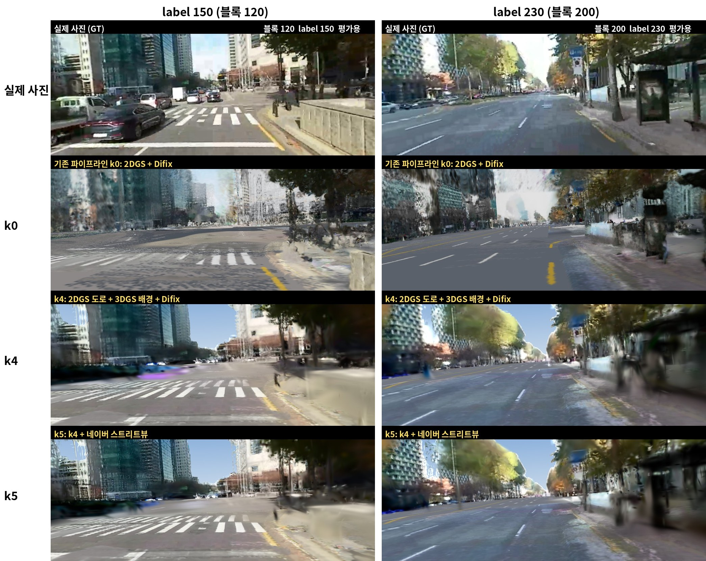
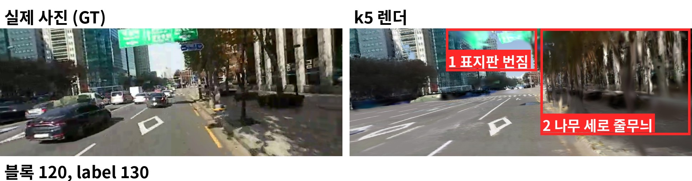
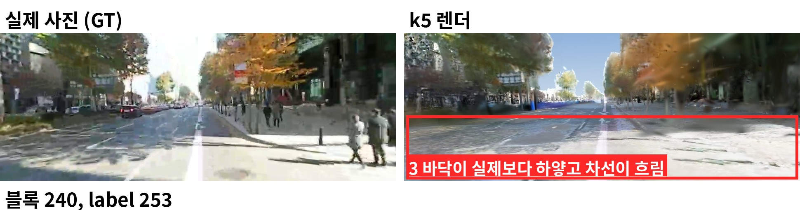

# Progress Summary: seq60 Full Route Comparison of k0, k4, k5

> ADI seq60 전체 경로(label 0에서 299)를 실제 사진과 세 파이프라인 렌더로 나란히 놓고 비교한 기록임

## 문제 정의

- 기존 파이프라인 k0은 모든 것을 경로 mesh 위 2DGS로 묶어 학습함. LiDAR 표면이 불완전한 나무와 건물이 틀린 형상에 고정되어 퍼져 보임
- k4는 바닥만 2DGS로 묶고 나머지를 자유 3DGS로 풀어 이 문제를 줄이려는 구성임
- k5는 k4에 네이버 스트리트뷰 건물 사진을 더해 ADI 사진이 부족한 건물 세부를 채우려는 구성임
- 확인할 것은 두 가지임. 경로 전체에서 세 구성이 실제 사진과 얼마나 비슷해 보이는지, 그리고 네이버 사진이 실제로 도움이 되는지

## 용어

| 용어 | 정의 |
|---|---|
| k0 | 기존 파이프라인(11/15). 경로 mesh 위 mesh-bound 2DGS와 Difix, 블록 8개를 합친 모델 |
| k4 | 11/20 구성. 바닥은 2DGS, 나무와 건물과 배경은 자유 3DGS, 학습 중 Difix |
| k5 | 11/21 구성. k4 설정 그대로에 네이버 스트리트뷰 건물 화소를 추가 학습 |
| mesh-bound 2DGS | Gaussian 위치를 mesh 표면에 고정하고 색, 불투명도, 면 안 크기와 회전만 학습하는 방식 |
| 3DGS | 위치와 모양까지 자유롭게 학습하는 Gaussian splatting |
| Difix | 렌더의 깨진 부분을 실제 사진을 참고해 고치는 생성 모델. 여기서는 학습 중 가상 시점을 고쳐 학습 사진으로 추가하는 방식만 씀 |
| Difix3D+ | 최종 렌더에 프레임마다 Difix를 다시 거는 후처리. 세 구성 모두 쓰지 않음 |
| 가상 시점 | 실제 카메라 위치를 옆이나 뒤로 옮긴 렌더 시점. Difix 보정 대상 |
| 블록 | 경로를 label 40개 단위로 나눈 학습 단위. 0, 40, 80, 120, 160, 200, 240, 260의 8개 |
| 평가용 label | label 번호가 5의 배수인 위치. k4와 k5 학습에서 뺐음 |
| 정밀도로지도 | 국토지리정보원 HD map. 바닥 mesh와 차선, 신호등, 표지 위치의 출처 |
| V-World 건물 상자 | 국토교통부 V-World 건물 외곽과 높이로 만든 상자 mesh |
| SH0 | 시점에 따라 바뀌지 않는 단색 Gaussian 색 |
| PSNR | 렌더와 사진의 화소 차이 지표. 단위 dB, 높을수록 비슷함 |

## 요약

**결과**

- 경로 전체 4행 비교 영상을 만들었음. 실제 사진, k0, k4, k5 순서이고 각 label은 그 label을 맡은 블록 모델로 렌더함
- k4와 k5는 하늘, 나무 윤곽, 건물 윤곽이 k0보다 실제 사진에 가까움
- k5는 네이버 평가 사진의 건물 화소 점수가 8블록 모두 k4보다 높음. 앞쪽 5블록은 0.3에서 0.6 dB 오름
- k0은 노면이 가장 깨끗한 장면이 있으나 건물이 퍼지고 하늘에 흰 덩어리가 남음

**미해결**

- k5의 ADI 평가 점수가 8블록 모두 0.2에서 0.8 dB 내려감
- 뒤쪽 블록 200, 240, 260은 네이버 파노가 1개에서 2개뿐이라 네이버 효과가 0.1 dB 이하임
- 세 구성을 같은 조건으로 잰 점수가 없음. k0 점수 14.28 dB는 k4, k5 표와 직접 비교하면 안 됨
- 실제 사진에 차가 있던 자리에 k4와 k5는 푸른 번짐이 남음
- **판단 필요** 도로 위 Gaussian 정리 방식. 모두 지우면 신호등과 표지판 지주가 같이 사라짐

## 파이프라인 비교

| 항목 | k0 | k4 | k5 |
|---|---|---|---|
| 형상 | 경로 mesh 전체에 2DGS 고정 (정밀도로지도 바닥, LiDAR 물체, V-World 건물 상자, 하늘 dome) | 바닥만 2DGS 고정, 나무와 건물과 배경은 자유 3DGS | k4와 같음 |
| 하늘 | dome Gaussian으로 남김 | Gaussian 없음. 하늘 화소는 색 손실에서 빼고 alpha를 0으로 미는 손실. 렌더 때 단순 그라데이션 | k4와 같음 |
| 깊이 손실 | 없음 | LiDAR 희소 깊이 손실, 가중치 0.1 | k4와 같음 |
| Difix | 블록마다 2회차, 회차마다 가상 시점 생성 후 다시 학습 | 학습 중 2000번마다 가상 시점 80장, 30000번 동안 14회 | k4와 같음 |
| 바닥 처리 | 그림자 제거, 정밀도로지도 차선 그림으로 차도 평탄화 | 본 바닥은 유지하고 안 본 바닥만 15 m 안에서 채움 (노면 글씨 보존) | k4와 같음 |
| 추가 설정 | 빈 곳 채우기, 하늘 켜기, 무지개 색 보정 | 바늘 모양 Gaussian 억제, 인도에서 차도 위로 뻗은 긴 Gaussian 제거, 길 건너편 시작 Gaussian, 먼 배경 densify 절반 | k4와 같음 |
| 추가 학습 사진 | 없음 | 없음 | 네이버 스트리트뷰 건물 화소 |
| 블록 처리 | 8블록 합치기, 블록 사이 색 맞춤, 경계 12 m 보정 학습 4000번 | 블록별 모델 그대로 렌더, 합치기 없음 | k4와 같음 |
| Gaussian 수 | 24,634,322개 (합친 뒤) | 블록별 | 블록별 |

**k4와 k5의 차이는 네이버 사진 한 가지뿐임**

- k0과 k4는 형상 방식, 하늘, 깊이 손실, Difix 주기, 블록 처리가 모두 다름. 어느 차이가 화질을 바꿨는지는 이 비교로 가를 수 없음
- k4가 2DGS를 바닥에만 쓴 이유는 LiDAR 표면이 불완전한 곳에서 Gaussian이 틀린 형상에 묶이기 때문임

### k5의 네이버 사진 사용 방식

| 항목 | 값 |
|---|---|
| 학습 화소 | SAM3 분할의 건물 화소만. 나무, 차량, 사람, 하늘, 기둥, 도로는 제외 |
| 사진 선택 | 건물이 2% 미만인 사진 제외. 파노 번호가 4의 배수면 평가용으로 뺌 |
| 비중 | 학습 반복의 25%에서 뽑힘, 가중치 0.5. 사진마다 색 gain과 bias를 같이 학습 |
| ADI와의 역할 분담 | 같은 건물에서 ADI 사진과 Difix 가상 시점은 8배 줄인 해상도(8 화소 블록 평균)로만 비교함. 색감은 ADI, 세부 무늬는 네이버가 맡게 하려는 설정 |
| 파노 위치, 앞쪽 블록 0에서 120 | 11/16 노면 정합 위치, 파노 42개 |
| 파노 위치, 뒤쪽 블록 160에서 260 | 지도 렌더 정합 위치와 ADI 사진 특징점 PnP 위치가 1 m 안에서 일치한 파노 9개만 두 위치를 평균해서 씀 (46, 54, 60, 62, 63, 66, 71, 72, 75번) |

- 해상도를 줄여 비교한 이유: 11/18 시험에서 촬영 날짜, 계절, 카메라가 달라 ADI와 네이버의 건물 정면 무늬가 서로 충돌했음
- 뒤쪽 블록은 위치가 확실한 파노만 남겨서 블록당 학습 파노가 1개에서 2개뿐임

## 영상

https://github.com/user-attachments/assets/37457825-71d8-4185-8d00-161d36722ad3

- 위에서부터 실제 사진, k0, k4, k5. 가로 960, 세로 1600, 8 fps, 300 프레임
- 실제 ADI 전방 카메라 위치에서 렌더함. 각 label은 그 label을 맡은 블록 모델로 렌더함
- 화면 오른쪽 위 "평가용" 표시는 k4와 k5 학습에서 뺀 위치임

| 같은 폴더의 다른 영상 | 내용 |
|---|---|
| seq60_route_gt_k0_k5.mp4 | 3열. 실제 사진, k0, k5 |
| seq60_route_gt_k4_k5.mp4 | 3열. 실제 사진, k4, k5 |
| seq60_route_k5_drive.mp4 | k5 전체 경로 주행 372 m. 위 칸은 실제 경로, 아래 칸은 왼쪽 3 m 가상 차로 |

## 장면 비교

- 왼쪽 label 150(블록 120), 오른쪽 label 230(블록 200). 둘 다 평가용 위치

| 장면 | k0 | k4 | k5 |
|---|---|---|---|
| label 150 | 횡단보도와 노면이 얼룩지고 건물이 퍼짐 | 하늘과 건물 윤곽이 또렷함. 차가 있던 자리에 푸른색과 보라색 번짐 | 횡단보도와 노면이 k0보다 깨끗하고 하늘 쪽 건물 윤곽이 또렷함. 차 자리 푸른 번짐은 남음 |
| label 230 | 노면은 세 구성 중 가장 깨끗함. 건물이 실제와 다르게 퍼지고 가운데 하늘에 흰 덩어리 | 하늘과 나무 윤곽이 실제 사진에 가까움. 오른쪽 정류장과 차 자리가 흐림 | k4와 비슷함. 건물이 k4보다 눈에 띄게 선명해지지는 않음 |

**k4와 k5는 하늘과 윤곽에서 k0보다 낫고, k5와 k4의 차이는 장면에서 거의 안 보임**

- 차가 있던 자리의 번짐은 k4와 k5 공통 문제임
- label 230의 블록 200은 학습 네이버 파노가 적은 뒤쪽 블록이라 k5 효과가 작을 것으로 예상했던 위치임

### k5 주행 영상에서 보이는 문제

| 번호 | 블록 | 현상 | 그림 |
|---|---|---|---|
| 1 | 120 | 도로 위 녹색 표지판이 청록색 얼룩으로 번짐 | 아래 label 130 |
| 2 | 120 | 나무에 세로 줄무늬. 영상 전체에서 보임 | 아래 label 130 |
| 3 | 240 | 바닥이 실제보다 하얗고 차선이 흐림 | 아래 label 253 |
| 4 | 160 | 바닥이 어두운 띠와 밝은 띠로 끊김 | 없음. 주행 영상 205 m 부근에서만 보이고 실제 사진 시점 렌더에서는 안 보임 |
| 5 | 블록 경계 | 블록 모델이 바뀌는 프레임에서 노면 색과 건물 무늬가 바뀜. 블록 200에서 240으로 넘어가는 296 m 부근이 가장 큼 | 없음. 영상에서 확인 |

- 실제 사진의 녹색 도로 표지판이 k5에서는 하늘 쪽 청록색 얼룩으로 퍼짐(1). 1번 현상의 정체가 이 표지판임
- 오른쪽 가로수가 세로 줄무늬로 늘어남(2)

- 실제 사진도 햇빛으로 밝지만, k5는 바닥 전체가 고르게 하얗고 차선 경계가 흐림(3)

- 블록 경계 색 끊김은 k4와 k5가 블록 합치기와 경계 보정을 하지 않아서 생기는 것으로 보임. k0은 이 과정을 거쳤음

## 점수

색 보정 후 PSNR, 단위 dB. ADI는 평가용 ADI 사진 전체, 네이버는 평가용 네이버 사진의 건물 화소 기준임.

| 블록 | ADI k4 | ADI k5 | 네이버 k4 | 네이버 k5 | 네이버 평가 사진 수 |
|---|---|---|---|---|---|
| 0 | **18.57** | 18.00 | 15.22 | **15.74** | 48 |
| 40 | **19.70** | 19.22 | 15.46 | **15.78** | 80 |
| 80 | **20.04** | 19.27 | 15.11 | **15.64** | 64 |
| 120 | **17.81** | 17.33 | 15.22 | **15.79** | 64 |
| 160 | **17.66** | 17.37 | 15.24 | **15.77** | 16 |
| 200 | **17.27** | 17.10 | 13.77 | **13.84** | 16 |
| 240 | **17.46** | 17.12 | 14.03 | **14.12** | 32 |
| 260 | **17.45** | 17.12 | 14.23 | **14.31** | 16 |

굵게 = 같은 평가 사진에서 높은 쪽.

**네이버 점수는 8블록 모두 오르고 ADI 점수는 8블록 모두 내려감**

- 네이버 점수 상승: 블록 0에서 160은 0.32에서 0.57 dB, 블록 200에서 260은 0.07에서 0.09 dB
- ADI 점수 하락: 0.17에서 0.77 dB. 건물 화소를 8배 줄인 해상도로만 ADI와 비교한 설정 때문으로 추정됨. 검증은 안 함
- 뒤쪽 블록은 평가 사진도 16장에서 32장이라 0.1 dB 이하 차이에 의미를 두기 어려움

### k0 점수는 이 표와 비교할 수 없음

| 측정 | k0 | k4, k5 |
|---|---|---|
| 차 화소 | 가림 | 가림 |
| 하늘 화소 | 포함 (dome이 그린 하늘도 점수에 들어감) | 뺌 |
| 사진별 색 보정 | 없음 | 있음 |
| 범위 | 경로 전체 합친 모델 | 블록별 |
| 점수 | 단순 합치기 14.04, 색 맞춤 후 14.18, 경계 보정 후 14.28 dB (11/21 다시 만들었을 때 14.275 dB) | 위 표 |

- k0이 4 dB 낮아 보이는 것은 측정 조건 차이가 섞인 값임. 같은 조건의 세 구성 비교는 아직 없음

## 미해결과 개선안

### k5에서 ADI 점수가 내려간 문제

| 항목 | 내용 |
|---|---|
| 현상 | 네이버 사진을 더하자 ADI 평가 점수가 8블록 모두 내려감 |
| 추정 원인 | 네이버가 본 적 없는 건물 면까지 ADI 사진을 8배 줄인 해상도로만 비교해서, ADI가 맡던 세부가 약해짐 |
| 개선안 (아직 안 함) | 네이버 학습 사진이 실제로 본 건물 화소만 줄인 해상도로 비교하고, 나머지는 원래 해상도로 ADI와 비교 |

**추정 원인의 근거** (검증 안 함)

| 이유 | 설명 |
|---|---|
| 건물 세부를 잡아 주는 사진이 사라짐 | 8 화소 블록 평균으로 비교하면 블록 안의 평균 색만 맞으면 손실이 0이 됨. 창틀, 간판 글씨 같은 작은 무늬는 ADI 사진에서 더 이상 학습되지 않음 |
| 네이버가 없는 면은 아무도 세부를 맡지 않음 | 세부는 네이버가 맡게 했지만, 네이버 파노가 보지 못한 건물 면은 세부를 학습할 사진이 없음. 그 면은 흐려지고, ADI 평가 사진은 원래 해상도로 재기 때문에 점수가 내려감 |
| 네이버가 본 면은 다른 무늬가 들어옴 | 네이버는 촬영 날짜, 계절, 카메라가 달라 정면 무늬가 ADI와 다름. 세부를 네이버가 정하면 ADI 시점에서 보면 화소가 어긋남 |
| ADI 사진 학습 횟수가 줄어듦 | 학습 반복의 25%를 네이버 사진에 씀. 같은 30000번 안에서 ADI 사진을 보는 횟수가 그만큼 줄어듦 |

- 블록별 하락 폭이 이 추정과 맞는 방향임. 네이버 파노가 많은 앞쪽 블록 0에서 120은 0.48에서 0.77 dB 내려갔고, 파노가 1개에서 2개인 뒤쪽 블록 200에서 260은 0.17에서 0.34 dB 내려감
- 네 이유 가운데 어느 것이 큰지는 아직 가르지 못함. 블록 하나에서 줄인 해상도 비교만 끄고 다시 학습하면 첫째와 둘째 이유의 크기를 확인할 수 있음

### 도로 위 Gaussian 정리

| 항목 | 내용 |
|---|---|
| 현상 | 차도 위로 뻗은 Gaussian을 모두 지우면 신호등과 표지판 지주가 같이 사라짐 |
| 제안 1 (아직 안 함) | 차도 위 0.05 m에서 4.0 m 높이만 지우고 4.5 m 위는 유지 |
| 제안 2 (아직 안 함) | 정밀도로지도의 신호등, 안전표지, 지주 위치에서 반경 약 0.8 m 원기둥은 보호. 경로 25 m 안에 각각 23개, 20개, 14개 |
| 제안 3 (아직 안 함) | 분할 결과에서 기둥, 신호등, 표지로 나온 화소의 투표로 보호 |

- **판단 필요** 세 제안을 같이 쓸지, 어느 것부터 시험할지

## next step
