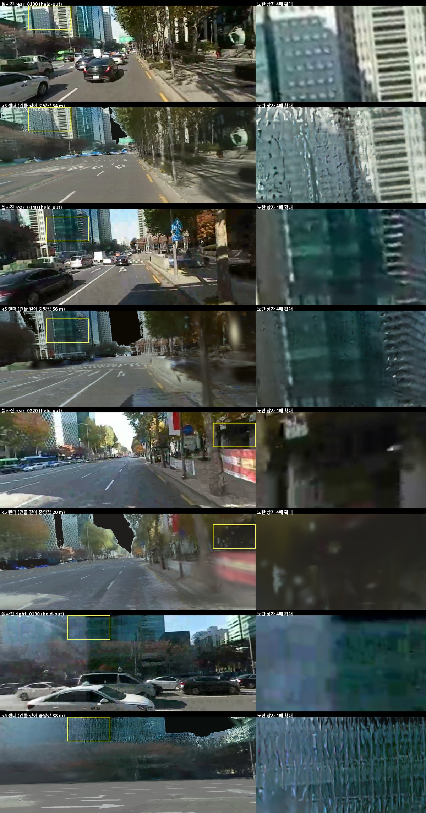
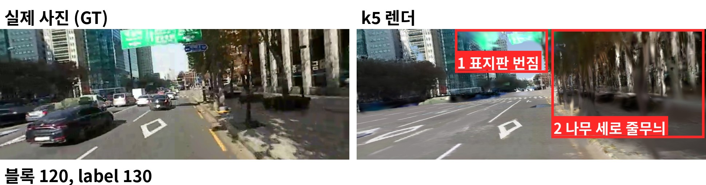

# Tesla FSD v15 Insight: Problem Breakdown and Transferable Ideas

> 우리 씬 재구성이 지금 막힌 문제를 하나씩 나눠 정의하고, Tesla가 공개한 세 기술에서 어느 문제에 무엇을 가져올 수 있는지 대응시킨 기록임

## 용어

| 용어 | 설명 |
|---|---|
| Reality View | FSD v15(2026-11-21 배포 시작)의 차 안 화면. 차 위쪽 가상 카메라에서 본 주변을 실시간 생성 영상으로 보여 줌 |
| Generative Gaussian Splatting | Tesla가 ICCV 2025에서 공개한 빠른 3D 재구성 방식. 아래에서 GGS로 줄여 씀 |
| Neural World Simulator | Tesla의 학습과 평가용 영상 생성 신경망. 현재 상태와 조작을 넣으면 다음 상태를 만듦 |
| world model | 조작에 따라 세상이 어떻게 바뀔지 예측하는 모델의 통칭 |
| feed-forward | 씬마다 수만 번 최적화하지 않고 신경망을 한 번 통과시켜 결과를 얻는 방식 |
| mean-flow | 한 번 또는 몇 번의 계산으로 이미지를 만드는 생성 모델 계열. diffusion의 여러 단계를 줄인 것 |
| vision encoder | 카메라 영상을 특징 벡터로 바꾸는 신경망. Tesla는 주행 모델과 Reality View가 같은 것을 씀 |
| closed loop | 모델의 조작이 다음 입력 화면을 바꾸는 평가 방식. 실제 주행과 같은 조건 |
| open loop | 기록된 영상에 대한 예측만 채점하는 방식. 모델의 조작이 화면에 반영되지 않음 |
| baseline | 같은 물체를 본 두 카메라 위치 사이의 간격. 넓을수록 형상을 정확히 잡음 |
| COLMAP | 사진들에서 카메라 위치와 초기 점을 구하는 도구. 일반 3DGS의 준비 단계 |
| novel view | 학습 사진이 없는 시점. 옆 차로, 차 뒤 추종 시점 등 |
| pseudo view | 생성 모델로 고쳐서 학습 사진처럼 쓰는 가상 시점 이미지 |
| Difix | 렌더의 흐림과 구멍을 한 번에 고치는 diffusion 모델. 우리는 학습 중 pseudo view를 만드는 데만 씀 |
| Difix3D+ | 최종 렌더에 프레임마다 Difix를 다시 거는 후처리. 우리는 쓰지 않음 |
| k4, k5 | ADI seq60 경로의 현재 구성. 바닥 2DGS와 나머지 3DGS. k5는 네이버 거리뷰 건물 사진을 더함 |
| NCC | 두 이미지의 무늬 위치가 얼마나 일치하는지 재는 값. 1이면 일치, 0이면 무관 |
| AI4 | Tesla 차량의 현재 연산 장치 |

## 요약

**결과**

- Tesla 공개 기술은 세 갈래임. Reality View(차 안 실시간 생성 영상), GGS(빠른 3D 재구성), Neural World Simulator(학습과 평가용 영상 생성)
- 우리 문제를 8개로 나눴고, 4개는 Tesla 기술과 직접 대응되고 4개는 간접적인 착안만 있음
- Tesla가 밝힌 일반 3DGS의 한계가 우리 11/23 진단과 같음. 주행은 거의 직선 이동이라 baseline이 좁고, 그래서 novel view가 깨진다는 것
- 우리 구조(형상은 명시적 3D, 생성 모델은 보조)는 Tesla의 평가용 구성과 방향이 같음

**미해결**

- 세 기술 모두 논문과 코드가 없음. 가져오려면 공개된 대체 모델로 시험해야 하고, 아직 하나도 시험하지 않았음
- Tesla 품질의 근원인 차량 수백만 대 규모의 학습 데이터는 가져올 수 없음
- **판단 필요** 5절의 적용 후보 5개 가운데 어느 것부터 시험할지

## 1. 예상과 달랐던 점

| 예상 | 공개 자료 기준 |
|---|---|
| LiDAR 데이터로 씬을 먼저 만듦 | 근거 없음. 양산차에 LiDAR가 없고, 입력은 카메라 특징만 언급됨 |
| 바닥은 prior 정보, 건물은 V-World 같은 명시적 정보로 깖 | 근거 없음. Reality View에는 명시적 3D 표현 자체가 언급되지 않음 |
| 3D 렌더 위에 Difix 같은 모델로 빈 곳을 채움 | 일부만 맞음. 몇 단계짜리 생성 모델을 쓰는 점은 같으나, 3D 렌더를 고치는 것이 아니라 영상을 통째로 생성함 |

**Reality View는 3D 재구성이 아니라 영상 생성임. 3D 재구성에 해당하는 것은 GGS임**

- 예상했던 구조(명시적 형상 위에 생성 모델을 얹는 것)는 Tesla보다 우리 방식과 NVIDIA 계열 방식에 가까움
- 한 포럼 글이 "Reality View가 220 ms마다 3DGS를 만든다"고 썼으나 GGS와 섞은 것으로 보임. 다른 출처로 확인되지 않음

## 2. Tesla 공개 기술 세 가지

| 기술 | 하는 일 | 돌아가는 곳 | 3D 표현 | 공개 수준 |
|---|---|---|---|---|
| Reality View | 주변을 위에서 본 영상으로 실시간 생성 | 차 안 | 없음 | 릴리스 노트, Musk와 Elluswamy의 X 글 |
| GGS | 주행 영상에서 3D Gaussian 씬을 바로 만듦 | 서버(추정), 주행 모델의 보조 출력으로도 언급됨 | 3D Gaussian | ICCV 2025 발표, Elluswamy X 글 |
| Neural World Simulator | 조작에 반응하는 여러 카메라 영상을 생성 | 서버 | 없음(영상) | ICCV 2025, CVPR 2026 발표 |

**세 기술은 역할이 다름. 운전자에게 보여 주는 것, 3D로 확인하는 것, 모델을 학습하고 평가하는 것**

- 셋 다 논문, 코드, 가중치가 없음
- 아래 수치는 출처 수준을 같이 적었음. "언론 풀이"는 Musk 글을 기자가 풀어 쓴 것이라 검증되지 않은 값임

### 2.1 Reality View

| 항목 | 내용 | 출처 수준 |
|---|---|---|
| 방식 | 실시간 AI 영상 생성. 게임 엔진 없음 | Musk X 글 |
| 모델 | 학습용 world model의 훨씬 작은 판본. conditional mean-flow model | Musk X 글 |
| 크기 | 약 10억 파라미터. 주행 모델(약 30억)과 별개로 돎 | 언론 풀이 |
| 조건 1 | 주행 모델과 같은 vision encoder의 최근 특징 시퀀스 | 언론 풀이 |
| 조건 2 | 직전에 생성한 프레임에 noise를 더한 것. 이것을 denoise해 현재 프레임을 만듦 | 언론 풀이 |
| 출력 | 8프레임 묶음, 36 fps, 차 안 화면 해상도 | 언론 풀이 |
| 연산 | AI4 가속기 하나의 절반 | Musk X 글 |
| 지연 | 실제보다 1초 가까이 늦음. 최신 encoder 특징을 중간 층에 끼워 넣어 35% 줄일 계획 | 리뷰어 관찰, Musk X 글 |

**직전 출력을 다시 쓰는 것과 특징으로 조건을 주는 것이 실시간의 핵심으로 보임**

- 직전 프레임에서 출발하므로 매번 처음부터 생성하지 않고, 프레임 사이 일관성도 같이 얻음
- 사진 화소가 아니라 encoder 특징을 조건으로 받음. 이미지를 다시 encode하는 비용이 없음
- 화면 해상도로만 출력함. 우리 실측에서도 Difix 시간은 해상도에 크게 좌우됐음

### 2.2 Generative Gaussian Splatting

**어떤 내용인가**

| 항목 | 내용 | 출처 수준 |
|---|---|---|
| 문제 인식 | 일반 3DGS는 baseline이 넓은 사진이 있어야 잘 됨. 차는 거의 직선으로 움직여서 재구성이 나쁘고 novel view에서 특히 깨짐 | Elluswamy X 글 |
| 방식 | 신경망이 영상을 받아 3D Gaussian을 바로 출력함(feed-forward) | Elluswamy X 글 |
| 속도 | 약 220 ms. 일반 3DGS는 수십 분 | Elluswamy X 글 |
| 준비 단계 | 초기값이 필요 없음. COLMAP도 쓰지 않음 | Elluswamy X 글, 발표 2차 요약 |
| 움직이는 물체 | 모델링할 수 있다고 함 | Elluswamy X 글 |
| 주행 모델과의 관계 | 주행 모델과 함께 학습할 수 있음. CVPR 2026 슬라이드에는 주행 모델의 보조 출력 목록에 3D Gaussian이 있음 | Elluswamy X 글, 발표 2차 요약 |
| 용도 | 차가 장애물을 안전하게 피하는지 3D로 확인하는 디버깅 | 발표 2차 요약 |

**Tesla가 든 문제 인식이 우리 진단과 같음. 우리 나무의 시선 각도 중앙값이 8.7도인 것이 바로 좁은 baseline임**

- 핵심 생각은 "이 씬의 사진만으로 최적화하지 말고, 수많은 씬에서 미리 배운 모델이 형상을 추정하게 한다"임
- 씬 하나의 정보가 모자라도, 다른 씬에서 배운 "도로, 가로수, 건물은 보통 이렇게 생겼다"는 지식이 빈 곳을 메움
- 화질 수치와 해상도는 공개되지 않았음. 용도가 디버깅이라 최종 화면 품질은 아닐 수 있음

**우리가 쓸 수 있는 방식** (모두 아직 안 함)

| 쓰는 방식 | 대상 문제 | 설명 |
|---|---|---|
| 초기값으로 쓰기 | P1, P3 | 지금 나무와 건물은 성긴 LiDAR 점에서 시작함. feed-forward 모델이 낸 Gaussian이나 깊이로 시작하면 좁은 baseline에서도 형상이 덜 틀릴 수 있음 |
| 깊이 감독으로 쓰기 | P1 | 지금 깊이 손실은 LiDAR가 닿은 화소에만 걸림. 모델이 추정한 촘촘한 깊이를 나무와 건물 화소에 추가로 걸 수 있음 |
| 카메라 위치 점검 | P3 | 360 카메라 보정값이 없어 시점끼리 기하가 안 맞음. 보정 없이 카메라 위치를 같이 추정하는 모델로 지금 위치를 검증하거나 고칠 수 있음 |
| 차 자리 채우기 | P5 | 움직이는 물체를 따로 다루는 모델이면, 차가 가렸던 바닥과 배경을 분리해 얻을 수 있음 |

- Tesla 모델은 공개되지 않았음. 공개 대체 후보는 VGGT(카메라 위치와 깊이를 한 번에 추정), STORM과 DrivingForward(주행 영상용 feed-forward Gaussian)임
- 대체 후보는 nuScenes, Waymo 같은 다른 카메라 배치로 학습됐음. 360 영상을 4방향으로 자른 우리 사진에서 동작하는지는 확인하지 않았음
- 통째로 바꾸는 것이 아니라 초기값과 감독으로 쓰는 것이 안전함. 최종 품질은 지금처럼 씬별 최적화가 맡음

### 2.3 Neural World Simulator

**어떤 내용인가**

| 항목 | 내용 | 출처 수준 |
|---|---|---|
| 입출력 | 현재 상태와 조작(조향, 가속, 제동)을 넣으면 다음 상태를 만듦. 상태는 카메라 영상, 내비게이션, 차량 운동, 소리 | CVPR 2026 발표 2차 요약 |
| 영상 규모 | 카메라 8대, 각 500만 화소 영상을 동시에 생성. 6분 이상 일관되게 이어짐 | ICCV 2025 발표 2차 요약 |
| 일관성 | 차량 휠, 신호등이 카메라 사이에서 서로 맞음 | ICCV 2025 발표 2차 요약 |
| 학습 데이터 | 실제 차량에서 모은 상태와 조작 쌍. 운전 실력이 나쁜 기록도 쓸모 있음 | ICCV 2025 발표 2차 요약 |
| 속도 | 연산을 줄이면 실시간으로 돌 수 있다고 함. 수치 없음 | CVPR 2026 발표 2차 요약 |
| 용도 1 | closed loop 평가. 주행 모델과 맞물려 돌림 | Elluswamy X 글 |
| 용도 2 | 과거 실패 기록을 새 모델로 다시 돌려 보기 | Elluswamy X 글 |
| 용도 3 | 끼어드는 차 같은 위험 상황을 인위적으로 넣기 | Elluswamy X 글 |
| 용도 4 | 대규모 강화학습 | Elluswamy X 글 |
| 정확도 | "작년부터 화소 수준으로 거의 완벽한 world model"이라고 표현 | Musk X 글. 검증된 수치 없음 |

**"open loop 점수가 좋아도 실제 주행이 좋다는 보장이 없다"는 것이 이 simulator를 만든 이유임**

- 형상이나 물리 엔진이 없음. 화면이 조작에 맞게 바뀌는 것까지 전부 신경망이 학습으로 흉내 냄
- 우리 구성은 같은 역할을 명시적으로 나눠 맡고 있음. 조작에 따른 차의 움직임은 Genesis 물리, 화면은 Gaussian 렌더
- 그래서 가져올 것은 모델 자체보다 **쓰는 방식**(평가 절차)과 **영상 단위 생성**이라는 생각임

**우리가 쓸 수 있는 방식** (모두 아직 안 함)

| 쓰는 방식 | 대상 문제 | 설명 |
|---|---|---|
| closed loop 평가 절차 | P8 | 지금 점수는 실제 카메라 자리의 PSNR뿐임. 우리 씬에서 Alpamayo를 closed loop로 돌려, 실제 기록과 같은 판단을 하는지를 씬 품질 지표로 삼을 수 있음 |
| 실패 기록 다시 돌리기 | P8 | 실제 주행 기록의 한 지점에서 출발해 모델이 다르게 움직이도록 둠. 경로를 벗어난 시점의 렌더가 필요하므로 novel view 품질이 직접 시험됨 |
| 위험 상황 넣기 | P8 | 우리 씬은 형상이 있어서 차량을 물리 객체로 추가할 수 있음. 영상 생성 방식보다 우리가 유리한 부분임 |
| 영상 단위 pseudo view | P1, P5 | 지금 Difix는 한 장씩 고쳐서 장마다 결과가 조금씩 다름. 여러 프레임을 한꺼번에 생성하는 모델로 바꾸면 프레임 사이 일관성이 생기고, 나무 줄무늬 같은 충돌이 줄 수 있음 |

- 공개 대체 후보는 NVIDIA Cosmos 계열임. 렌더나 깊이 영상을 조건으로 받아 사실적인 영상을 만드는 판본이 있음
- 이 방식(우리 3D 렌더를 조건으로 주고 생성 모델이 채움)이 1절의 처음 예상과 가장 가까운 구조임
- RTX 4090 한 대에서 도는지, 우리 해상도에서 얼마나 걸리는지는 확인하지 않았음

## 3. 우리 문제 breakdown

* 각 장면 위가 실제 사진, 아래가 k5 렌더(평가용 시점). 길 건너편 건물이 세로 줄무늬로 깨짐

* 녹색 도로 표지판이 청록색 얼룩으로 번지고, 오른쪽 가로수가 세로 줄무늬로 늘어남

| 번호 | 문제 | 현상 | 측정 | 원인 |
|---|---|---|---|---|
| P1 | baseline 부족 | 경로를 벗어난 시점, 길 건너편 건물, 나무 세부가 흐리거나 잡무늬가 생김 | 나무 시선 각도 중앙값 8.7도. 나무 렌더 세부는 사진의 0.55배, NCC 0.26 | 한 번 지나간 주행이라 같은 곳을 본 각도가 좁음 |
| P2 | 사진 해상도 한계 | 먼 건물의 창틀, 간판이 사진에서부터 뭉개져 있음 | 사진을 절반으로 줄였다 되돌려도 PSNR 41에서 44 dB. 실제 정보는 명목 해상도의 절반 수준 | 360 카메라 한 대의 영상을 4방향으로 잘라 씀 |
| P3 | 시점 간 기하 불일치 | 건물에 세부는 있으나 위치가 틀린 잡무늬 | 건물 NCC 0.03에서 0.08 | 360 카메라 보정값이 없음. 성긴 LiDAR에서 시작한 형상 |
| P4 | 외부 사진과의 충돌 | 네이버 사진을 더하면 건물은 좋아지고 ADI 시점 점수는 내려감 | ADI 평가 PSNR이 8블록 모두 0.17에서 0.77 dB 하락 | 촬영 날짜, 계절, 카메라가 달라 화소 단위로 안 맞음 |
| P5 | 차가 있던 자리 | 푸른색, 보라색 번짐이 남음 | 수치 없음. 평가 시점 렌더에서 눈으로 확인 | 차가 가린 바닥과 배경을 본 사진이 없음 |
| P6 | 블록 경계 | 블록 모델이 바뀌는 프레임에서 노면 색과 건물 무늬가 바뀜 | 296 m 부근이 가장 큼. 주행 영상에서 확인 | 블록 8개를 따로 학습하고 합치지 않음 |
| P7 | 프레임별 보정이 실시간 불가 | Difix3D+를 쓰면 화질은 오르나 시뮬레이터 속도를 못 맞춤 | RTX 4090, 가로 1440 세로 544, 1 step에서 프레임당 612 ms. 가로 768 세로 288에서는 148 ms | 생성 모델을 프레임마다 처음부터 돌림. 시간 대부분이 decoder |
| P8 | 평가 기준 부재 | 구성끼리 같은 조건으로 잰 점수가 없음. novel view는 정답 사진이 없음 | k0 점수 14.28 dB는 k4, k5 표와 조건이 달라 비교 불가 | 실제 카메라 자리의 PSNR만 재고 있음 |

**P1, P2, P3은 뿌리가 같음. 한 번의 주행과 한 대의 360 카메라로는 정보가 모자람**

- P1에서 P3은 학습 방식을 고쳐도 한계가 있음. 11/23에 LiDAR 초기값과 사진 번짐을 원인에서 기각했음
- P5, P6은 정보 부족이 아니라 처리 방식의 문제임. 고칠 방법이 우리 쪽에 이미 있음(k0의 블록 합치기 등)
- P7, P8은 씬 자체가 아니라 씬을 쓰는 단계의 문제임

## 4. 문제별 착안점

| 문제 | Tesla 기술 | 착안점 | 우리 쪽 적용 형태 | 대응 |
|---|---|---|---|---|
| P1 baseline 부족 | GGS | 모자란 정보는 다른 씬에서 미리 배운 모델이 메움 | feed-forward 모델의 형상을 초기값과 깊이 감독으로 씀 | 직접 |
| P1 baseline 부족 | World Simulator | 한 장이 아니라 영상 단위로 생성해 일관성을 얻음 | pseudo view를 영상 생성 모델로 묶음 생성 | 직접 |
| P3 기하 불일치 | GGS | 초기값과 COLMAP 없이 카메라와 형상을 같이 추정 | 보정 없는 카메라 위치를 모델로 검증하거나 고침 | 직접 |
| P7 실시간 보정 | Reality View | 직전 출력에 noise를 더해 다시 denoise. 화면 해상도 출력. 몇 단계 생성 | Difix의 참고 사진을 직전에 고친 프레임으로 바꾸고 낮은 해상도로 돌림 | 직접 |
| P8 평가 기준 | World Simulator | open loop 점수 대신 closed loop 결과로 평가 | 우리 씬에서 Alpamayo를 closed loop로 돌린 결과를 씬 품질 지표로 씀 | 직접 |
| P2 해상도 한계 | Reality View | 사진에 없는 세부는 생성 모델이 채우고, 출력은 화면 해상도면 충분함 | 렌더 후처리에서 세부를 채움. P7이 풀려야 가능 | 간접 |
| P4 외부 사진 충돌 | Reality View | 화소가 아니라 encoder 특징 공간에서 조건을 줌 | 네이버 사진은 화소 대신 특징(지각 손실)으로만 비교함 | 간접 |
| P5 차 자리 번짐 | GGS, World Simulator | 움직이는 물체는 재구성 대상에서 떼어 따로 다룸 | 차가 가린 화소를 생성 모델로 채운 pseudo view를 만듦 | 간접 |
| P6 블록 경계 | Reality View | 연속성을 직전 프레임 조건으로 유지 | P7 방식 후처리를 쓰면 경계의 급한 변화가 완화될 수 있음. 근본 해결은 블록 합치기 | 간접 |

**직접 대응은 P1, P3, P7, P8임. 이 넷이 우리가 지금 가장 크게 막힌 곳과 겹침**

- P7 착안은 기존 Difix 가중치로 바로 시험할 수 있음. 직전 프레임을 참고 사진으로 주는 것은 입력만 바꾸면 됨
- P1과 P3 착안은 같은 계열 모델 하나로 함께 시험할 수 있음
- 간접 대응 넷은 Tesla가 실제로 그렇게 한다는 근거는 없고, 공개된 설계에서 우리가 유추한 것임

### 가져올 수 없는 것

| 항목 | 이유 |
|---|---|
| 모델과 코드 | 세 기술 모두 비공개. 수치도 대부분 X 글과 2차 요약임 |
| 학습 데이터 규모 | 차량 약 130만 대의 주행 기록에서 온 prior임. 공개 모델은 이보다 훨씬 작은 데이터로 학습됨 |
| 여러 번 지나간 관측 | Tesla는 같은 길을 수많은 차가 지나감. 우리는 한 번의 주행뿐이라 P1 자체를 데이터로 풀 수 없음 |
| 전용 연산 장치 | Reality View는 AI4에 맞춰 줄인 모델임. 같은 구조를 RTX 4090에 옮겨도 같은 속도라는 보장이 없음 |

- Reality View도 1초 가까운 지연이 있음. 운전자 화면에는 괜찮지만 closed loop 시뮬레이터의 입력으로는 큰 값임
- 생성 영상은 실제와 세부가 다를 수 있다는 사용자 지적이 있음. 형상이 없는 방식의 공통 약점이고, 우리가 명시적 3D를 유지하는 이유임

## 5. 적용 후보

| 후보 | 대상 문제 | 필요한 것 | 비용 | 근거 수준 |
|---|---|---|---|---|
| A. 낮은 해상도 Difix에 직전 프레임을 참고 사진으로 주는 실시간 후처리 | P7, P6, P2 | 기존 Difix 가중치. 추론만 | 작음 | Reality View 구조는 언론 풀이. 148 ms는 우리 실측 |
| B. feed-forward 재구성 모델의 깊이와 카메라 위치를 초기값과 감독으로 사용 | P1, P3 | 공개 모델(VGGT 등) 추론, 블록 하나 재학습 | 중간 | 문제 인식은 Elluswamy X 글. 대체 모델 효과는 미확인 |
| C. Alpamayo closed loop 평가 절차 | P8 | 기존 Genesis 씬과 Alpamayo | 중간 | Elluswamy X 글 |
| D. 영상 생성 모델로 pseudo view 묶음 생성 | P1, P5 | 공개 영상 생성 모델. 메모리와 시간 확인 필요 | 큼 | 유추. 우리 장비에서 도는지 미확인 |
| E. 네이버 사진을 특징 손실로만 비교 | P4 | 손실 항 교체, 블록 하나 재학습 | 작음 | 유추 |

**비용이 작고 바로 시험할 수 있는 것은 A와 E, 막힌 곳을 가장 직접 겨냥하는 것은 B임**

- **판단 필요** 어느 후보부터 시험할지
- A는 기본 범위(Difix3D까지)를 넘는 프레임별 후처리임. 실시간이 되는지 확인하는 시험으로만 의미가 있음
- C는 화질을 올리는 것이 아니라 "얼마나 좋아야 충분한가"를 정하는 일임. 다른 후보의 효과를 재는 자로도 쓰임

## Reference

| 번호 | 자료 | 쓴 곳 |
|---|---|---|
| 1 | Ashok Elluswamy, "Tesla's approach to Autonomy", X, 2025-10-24. https://x.com/aelluswamy/status/1981644831790379245 | GGS, World Simulator |
| 2 | ICCV 2025 발표 2차 요약. https://threadreaderapp.com/thread/1982161471644545387 | GGS, World Simulator |
| 3 | Ashok Elluswamy, CVPR 2026 기조연설 영상. https://www.youtube.com/watch?v=2V0ddkF1Svo | World Simulator |
| 4 | CVPR 2026 발표 전문 해설(중국어). https://mp.ofweek.com/ai/a356714133687 | World Simulator, 주행 모델 입출력 |
| 5 | Teslarati, FSD v15 릴리스 노트, 2026-11-21. https://www.teslarati.com/tesla-full-self-driving-v15-rollout-begins-full-release-notes-improvements/ | Reality View |
| 6 | Teslarati, Reality View 지연과 Musk 설명, 2026-11-23. https://www.teslarati.com/tesla-fsd-v15s-reality-drive-one-complaint-musk-solution/ | Reality View 구조 |
| 7 | Not a Tesla Killer, Reality View 구조 해설. https://notateslakiller.com/en/tesla-reality-view-fsd-v15-live-generated-screen-half-chip/ | Reality View 구조 |
| 8 | The Next Web, FSD v15 Reality View. https://thenextweb.com/news/tesla-fsd-v15-reality-view-25x-safety | Reality View 연산, 지연 |
| 9 | EVwire, FSD v15 릴리스 노트와 Elluswamy 인용. https://evwire.com/p/tesla-fsd-v15-rollout-reality-view-release-notes | Reality View |
| 10 | 공개 대체 후보: VGGT (CVPR 2025), STORM (ICLR 2025), DrivingForward (AAAI 2025), NVIDIA Cosmos (2025), MeanFlow (2025) | 2절, 5절 |
| 11 | 우리 11/21 progress summary, 11/14 Difix3D+ 인사이트, 11/24 Tesla FSD reference 문서 | 3절의 측정값 |

## next step
