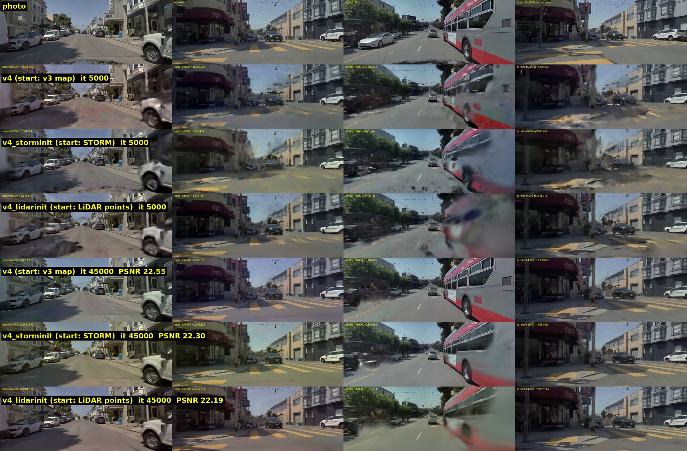
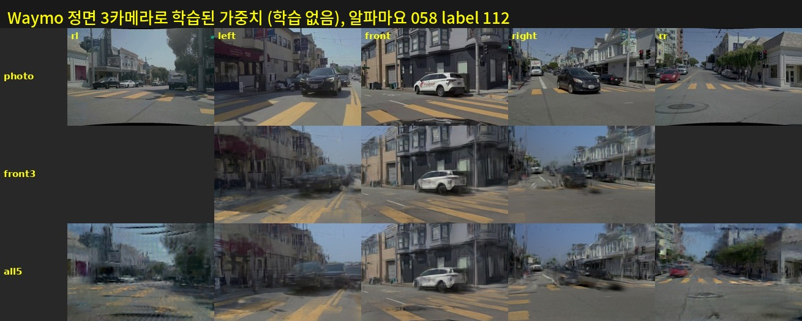
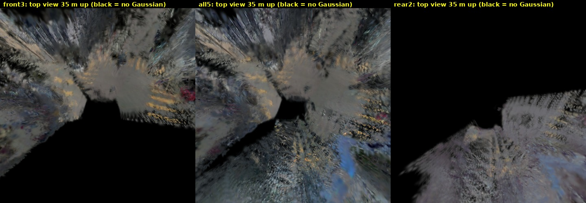

# 알파마요 058 feed-forward 장면 생성 시험과 STORM fine-tune 시작

> 11/27 진행. 테슬라 FSD 발표에서 말한 feed-forward 장면 생성을 공개 모델(STORM, VGGT, DGGT)로 알파마요 058에 시험하고, STORM을 우리 카메라 배치에 맞추는 fine-tune을 시작함

## 요약

| 항목 | 내용 |
|---|---|
| 시작점 비교 | v4 학습 방식 그대로 시작점만 바꿈. STORM 출력에서 시작 PSNR 22.30, LiDAR 점에서 시작 22.19, v3 맵에서 시작(v4) 22.55. STORM 시작은 버스 같은 큰 물체 형태를 더 일찍 잡고, 전체 시간은 v4의 약 3분의 1 |
| STORM 무학습 | 2초 구간 하나를 160 ms에 만듦. PSNR 17.8로 장면별 학습보다 크게 낮고, 2초마다 끊기고, 깊이가 LiDAR보다 1.4배 멂 |
| encoder 비교 | VGGT와 DGGT는 정면 1대만으로 포즈 오차 9 cm 안팎, 깊이 오차 0.10 안팎. 실제 거리 단위는 없음 |
| Waymo 가중치 사방 시험 | **측면과 후방도 깊이 모양은 잡지만 정면보다 1.6배에서 1.8배 나쁘고, 거리는 모든 방향에서 1.6배에서 2.1배 멀게 나옴.** 후방 렌더는 번짐 |
| fine-tune | 알파마요 55조각(학습 50, 검증 5)을 받아 변환하는 중. 사방 5대 카메라 fine-tune을 대기열에 넣음 |
| **판단 필요** | fine-tune 다음 단계 순서. nuScenes fine-tune과 데이터 섞어 학습 (11/27 사용자 지정 순서) |

## 용어

| 용어 | 설명 |
|---|---|
| feed-forward | 씬마다 최적화하지 않고, 미리 학습된 신경망을 한 번 통과시켜 Gaussian을 얻는 방식 |
| STORM | NVIDIA 등의 feed-forward 모델 (ICLR 2025). 사진 12장(카메라 3대, 시점 4개)으로 2초 구간의 Gaussian과 속도를 냄 |
| Waymo 가중치 | STORM 1저자가 Waymo 앞쪽 카메라 3대로 다시 학습해 공개한 비공식 가중치 |
| v4 | 알파마요 058 장면별 학습. v3 맵에서 시작해 45000회 |
| v4_storminit, v4_lidarinit | v4와 같은 학습인데 시작점만 STORM 출력 Gaussian 또는 색을 입힌 LiDAR 점으로 바꾼 것 |
| 앞 3대 입력, 사방 5대 입력 | STORM에 좌, 정면, 우만 넣은 경우와, 좌후, 좌, 정면, 우, 우후를 모두 넣은 경우 |
| 깊이 모양 오차 | 예측 깊이를 LiDAR와 중앙값 축척으로 맞춘 뒤 잰 AbsRel. 거리 단위와 상관없이 형태만 봄 |
| 거리 축척 | LiDAR 깊이를 예측 깊이로 나눈 중앙값. 1이 정답이고 작을수록 멀게 예측한 것 |

## 1. 시작점 비교

| 방법 | 시작점 | 학습 시간 | 최종 Gaussian 수 | PSNR | SSIM |
|---|---|---|---|---|---|
| v4 | 이미 학습된 v3 맵 (v3 학습 약 2.3 h) | 1.76 h | 6.17 M | **22.55** | **0.821** |
| v4_storminit | STORM 출력 Gaussian 2.93 M개 | 1.25 h | 2.55 M | 22.30 | 0.800 |
| v4_lidarinit | 색을 입힌 LiDAR 점 3.34 M개 | 1.30 h | 3.01 M | 22.19 | 0.804 |

* 맨 위 실제 사진, 아래로 세 방법의 5000회와 45000회 렌더
* 세 번째 열의 버스가 STORM 시작에서만 5000회부터 형태를 유지함

- PSNR은 정면 199장 기준이고 학습에 쓴 사진이라, 처음 보는 시점 품질은 아님
- 비교 영상: `v4_vs_storminit_vs_lidarinit_front.mp4`, `v4_vs_storminit_vs_lidarinit_left3m.mp4`, `v4_vs_storminit_vs_lidarinit_drive.mp4`

## 2. STORM 무학습과 encoder 비교

| 항목 | STORM | VGGT | DGGT |
|---|---|---|---|
| 입력 | 카메라 3대와 포즈 | 정면 1대, 포즈 없음 | 정면 1대, 포즈 없음 |
| 시간 | 160 ms | 107 ms | 167 ms |
| 포즈 오차 | 포즈를 입력으로 받음 | 9.0 cm | 8.6 cm |
| 깊이 오차 (AbsRel) | 0.260 | 0.106 | 0.097 |
| 입력에 없던 프레임 PSNR | 17.7 | 해당 없음 | 17.0 |

- STORM은 2초 구간마다 따로 만들어 주행 영상이 2초마다 끊김 (`storm_drive.mp4`)
- 요청에 따라 STORM 렌더에 Difix3D+를 한 번 적용함. 눈으로는 크게 선명해지지만 PSNR은 17.72에서 17.42로 떨어짐. Difix가 실제와 다른 세부를 그려 넣기 때문임 (`storm_drive_difix3d+.mp4`)

## 3. Waymo 가중치로 사방 무학습 시험

* 위 실제 사진, 가운데 앞 3대 입력, 아래 사방 5대 입력. 입력에 없던 시각(label 112)
* 열은 왼쪽부터 좌후, 좌, 정면, 우, 우후

| 입력 | 카메라 | 깊이 모양 오차 | 거리 축척 | PSNR |
|---|---|---|---|---|
| 앞 3대 | 정면 | **0.26** | 0.62 | 18.6 |
| 앞 3대 | 좌 | 0.42 | 0.63 | **18.8** |
| 앞 3대 | 우 | 0.48 | 0.60 | 17.7 |
| 사방 5대 | 정면 | **0.26** | 0.58 | 18.2 |
| 사방 5대 | 좌 | 0.41 | 0.58 | 18.0 |
| 사방 5대 | 우 | 0.46 | 0.50 | 17.2 |
| 사방 5대 | 좌후 | 0.42 | 0.55 | 16.8 |
| 사방 5대 | 우후 | 0.46 | 0.56 | 16.4 |

**측면과 후방의 깊이 형태는 잡히지만 거리 단위가 2배 가까이 틀어짐**

- 알파마요 5조각(058과 검증 4개), 조각마다 2초 구간 10개 평균
- 사방 5대를 넣으면 앞 3대만 넣을 때보다 앞쪽 PSNR이 0.4에서 0.8 떨어지고 축척도 더 틀어짐. 학습에 없던 후방 토큰이 attention으로 섞여 앞쪽 추정을 오염시키는 것으로 해석함
- 뒤 2대만 넣으면 사방 5대에 섞어 넣을 때보다 후방 PSNR이 0.6에서 0.9 낮음. 후방은 측면과 같이 넣는 편이 나음

* 위에서 내려다본 Gaussian. 검은 곳이 Gaussian이 없는 곳
* 앞 3대 입력은 뒤쪽이 비고, 사방 5대 입력은 뒤쪽이 채워지지만 방사형으로 번짐

## 4. 알파마요 fine-tune 진행 상태

| 항목 | 내용 |
|---|---|
| 데이터 | PhysicalAI-AV에서 미국, 낮 9시에서 16시, 카메라 5대와 LiDAR가 있는 조각 중 학습 50, 검증 5개를 무작위로 고름. 조각당 받기 약 70초(440 MB), 변환 약 80초. 변환 결과는 조각당 약 150 MB에서 190 MB |
| 검증 | 058 변환 결과의 카메라 포즈와 차 궤적이 기존 058 처리와 정확히 일치함 |
| 학습 설정 | Waymo 가중치에서 시작, 사방 5대, 2만 회, 실효 배치 8 (한 번에 1조각, 8번 모아 갱신), 학습률 5e-5. 손실은 원래 학습과 같고 하늘 마스크 손실만 뺌 |
| 평가 | 검증 조각과 058에서 입력에 없던 시각의 PSNR, 정면 깊이를 실제 거리 기준으로 LiDAR와 비교. 0회째 평가가 학습 전 기준선임 |
| 상태 | 학습 조각 25개가 모이면 자동 시작. 4090에서 약 15시간에서 18시간 예상 |

- 학습 계획 전체는 `[DIGLAB][26-11-27]_STORM_학습계획.md`에 있음

## next step
